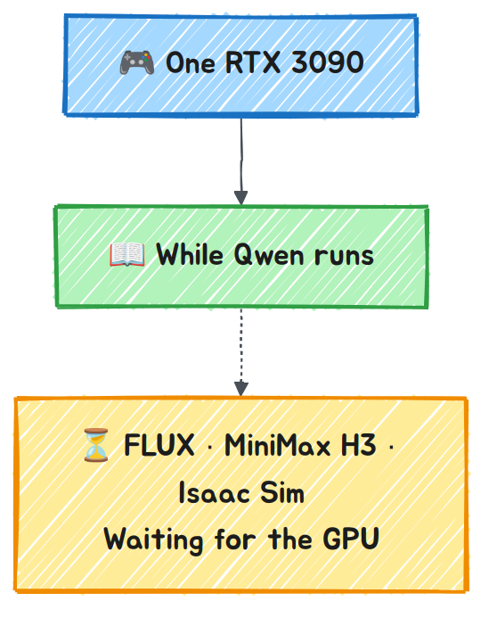
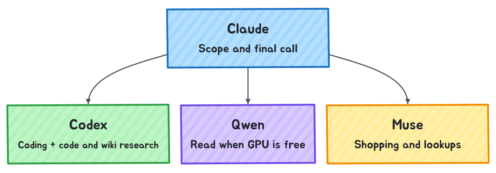
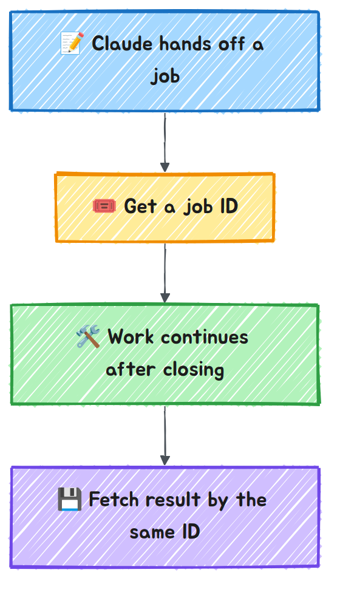
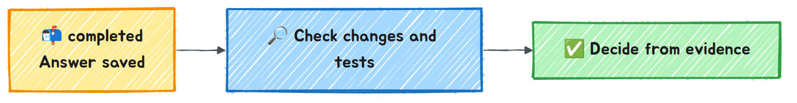

# Max 5x Was Too Expensive. I Only Needed Twice as Much: The Night I Put Codex to Work in Claude Code

<video autoplay muted loop playsinline controls preload="metadata" poster="/assets/demos/bridge-opening-poster.jpg" src="/assets/demos/bridge-opening.mp4" style="width:100%" aria-label="A short animation: worker robots lay the last planks, then a handcart with a work order rolls across the finished bridge"></video>

I kept running short on my personal Claude Code Pro plan. Max 5x was more than I wanted to spend. I just wanted twice as much room.

## The short version

- A Python bridge lets Claude Code hand a job to Codex. I can close the window and use the same job ID to check the result later.
- I ask for an eight-line report with failures first. When I see `completed`, I still check the changes and test evidence I need.
- Codex read files, fixed a README and even did a review. When Qwen's turn came, Isaac Sim already had the GPU, so the bridge politely stepped aside.


In the [previous post](local-llm-reading.md), I handed a long book to Qwen on my PC. I only have one RTX 3090. While Qwen occupied its memory, I couldn’t run FLUX, MiniMax H3, or Isaac Sim. Saving Claude usage had left the work I wanted to do waiting for a turn on the GPU.



Running short on tokens, I decided to try Codex, which I'd never used before. In my own work, Codex felt a little less capable than Claude Code, but its allowance felt much roomier. I kept my usual Claude Code window. Claude set the scope and made the final call, and Codex dug through files, implemented changes, tested them, and did the first review. Qwen could read long documents when the card was free. For shopping research, I sent Muse. Put simply, Claude is the general contractor and Codex is the subcontractor. The sub is cheaper, but inspection stays with the general contractor.



## The first two jobs stopped at startup

I hooked up the bridge one evening and sent it a job. I thought it would take a minute. I was still at it that night.

The first two jobs stopped before Codex even started working. It was a problem with where Codex was running, and once I moved it, it finally got to work.

When I drop off clothes for alterations, I get a ticket and leave. I wanted Claude to be able to do the same. That meant the program doing the work had to stay alive after the counter closed.



When Qwen's turn came, the Isaac Sim robot simulator already had the GPU. The bridge quietly skipped Qwen and left the simulator alone.

I meant to save Claude some log reading. I also found that I liked being able to close the window and come back with just a number. A claim ticket came in handy when I sent Muse shopping, too.

Later I made it possible to send a quick follow-up to the same Codex conversation. It felt like taking the same ticket back to the tailor to ask for one more alteration. On my PC, I asked Codex to “read `note.txt` and reply only with the secret word.” It said `pineapple`. Once the job finished, I asked, “Without reading the file again, reverse the word you reported.” It said `elppaenip`. The Codex session stayed the same, and the new job recorded the earlier job ID in `continued_from`.

## If you’d like to try it

### 1. Connect the bridge

The counter is `coop.py`. Claude Code uses MCP to discover and call the bridge’s tools. Claude Code starts the script and exchanges messages with it one line at a time. The script reads from standard input and writes to standard output, which is why this setup is called **stdio**. There's no public address to set up. Standard output carries only MCP messages. Logs go to standard error. [MCP stdio specification](https://modelcontextprotocol.io/specification/2025-11-25/basic/transports)

| Tool Claude calls | What comes back |
| --- | --- |
| `delegate_task` | Give it a project path and a task. It returns a job ID. |
| `job_result` | Look up the status or retrieve the report by ID. |
| `cooperation_status` | See recent jobs and whether Qwen is ready. |

The bridge saves each request in `runs/<id>/` and starts a separate program to do the work, called a worker. The worker saves its status and final answer there, so I can reopen Claude Code and look up the same ID. A lock keeps two bridge jobs from working on the same Git working tree together, even if the requests name different subfolders. I still have to coordinate edits in an editor I open myself.

On Linux, I used Python 3, Git, Claude Code, and a signed-in Codex CLI. I kept the bridge in a private, writable directory outside the projects I hand off. To register the bridge, replace `/path/to/coop.py` with its actual path. The connection shows up under `/mcp` in Claude Code. The public directory contains the core bridge and its tests. I kept the GPU recipe runner out of it. [Public code](https://github.com/butt2rflow/butt2rflow.github.io/tree/main/code/claude-codex-bridge) · [Claude Code MCP docs](https://code.claude.com/docs/en/mcp)

```bash
claude mcp add --transport stdio --scope user ai-cooperation -- /usr/bin/python3 /path/to/coop.py serve
```

### 2. Start with a small job

Start by asking `delegate_task` to read the project README. Save the job ID, reopen Claude Code, and give the same ID to `job_result`.

Once the earlier job has finished and `job_result` shows `resumable: true`, call `delegate_task` from the same project directory with the earlier job ID in `continue_job` and just the new request in `task`. From the CLI, use `python3 coop.py start --cwd /path/to/project --continue-job JOB_ID --task 'Your follow-up'`. The bridge uses `codex exec resume` to pick up the conversation and gives the follow-up a new job ID. Running jobs, Qwen jobs, and jobs from another directory can't be continued.

I only set `write=true` when I've authorized edits. For a broken install command, I'd give Codex the absolute project path and say, “Edit only the README and preserve existing changes. Run the corrected command from the project and tell me what happened.” The file list is part of the task instructions. The sandbox grants write access at the workspace level. A failed job may leave edits behind, so I check the records and the actual changes before retrying.

These days Claude also picks the Codex model and how hard it should think (`model`, `effort`) when it hands off a job. Below, another Claude Code window passes Codex the job of building a video-prompt skill, and decides Astra at medium effort is enough. A general contractor picking the right sub for each job.


For a long document, I send a path to the file. Qwen reads the source inside the project on my PC. Claude gets the summary and goes back to the source for the evidence it needs.

The bridge sends the request to Ollama, the program that runs the local model, only when the configured model is already fully in GPU memory and no competing compute process is using the card.

For a reading job, `target=auto` can pick Codex before launch if Qwen isn't ready. An explicit `target=qwen` is rejected when those checks fail. GPU use can change right after a check, so before starting a large job on the same card I use `python3 coop.py qwen-disable` to block new requests and wait for any active reading jobs to finish.

### 3. Check the result and tests

At first I thought a detailed report would be reassuring. But if Claude reads the files and logs again, I've bought myself very little. I ask for eight lines and at most 800 characters, with failures up top, the files changed, and the checks actually run. For more, I can use `detail=true` with `job_result` or open `result.md` on disk. `completed` means Codex exited successfully and saved an answer. To tell whether the corrected command works, I look at the test evidence.



**What I've done**

- The three tools showed up in Claude Code.
- I closed the window, came back, and pulled what Codex had read with the same job number.
- Codex fixed a README, and I ran the fixed command separately. Reviews ran read-only.

**What I haven't done yet**

- Have Qwen actually read something through this bridge. Every time I tried, Isaac Sim had the GPU.

### Where to look when it gets stuck

| Symptom | What to check |
| --- | --- |
| An edit fails | Check the job record and any edits it left before retrying. |
| Qwen was skipped | Check `cooperation_status` and see what’s using the GPU. |

**Related** [Let local AI do the reading](local-llm-reading.md) · [Don’t Spend Claude Tokens on Shopping: Send Muse and Use Its Free Allowance](muse-mcp-shopping.md)
