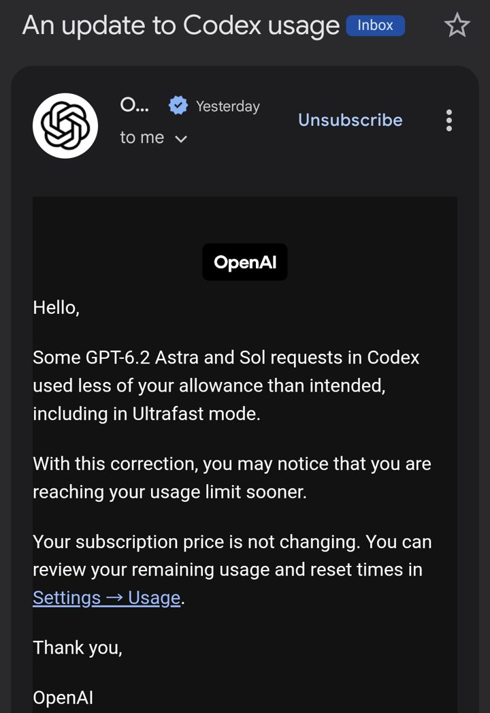

# Claude Directs, Codex Does the Work: A Bridge to Save Claude Usage

<video autoplay muted loop playsinline controls preload="metadata" poster="/assets/demos/bridge-opening-poster-en.jpg" src="/assets/demos/bridge-opening-en.mp4" style="width:100%" aria-label="A short animation: the Codex crew lays the last planks, a handcart with a work order rolls across to them, and a ticket returns to Claude, the boss; Qwen sits on a stack of books"></video>

Using Claude Code on the Claude Pro plan for personal projects, I kept hitting the limit. Twice the allowance felt like plenty. Max 5x was more than I needed or wanted to spend. I was considering a second Pro subscription when I got curious about Codex. I’d never tried it.


In the [Reading a 1,069-page book with local AI](local-llm-reading.md), I saved some of my Claude allowance by having Qwen read a long book on my PC. Could Claude and Codex split the work like that when I was coding? I had a reason to try it. My single RTX 3090 already had a queue. While Qwen occupied its memory, FLUX, MiniMax H3, and Isaac Sim all had to wait.


On my projects, Codex felt a little less capable than Claude Code, but its allowance felt much more generous. I set things up so Claude scopes each job from my usual Claude Code window and Codex reads the files, implements the changes, runs the tests, and does the first review. Claude is the general contractor and Codex is the subcontractor. The sub costs less, and Claude still does the final inspection.

OpenAI had been undercounting some requests to Astra and Sol, Codex’s top and default models. Once it fixed the count, the same work hit the limit much sooner. I used up the allowance again within 30 minutes of one reset. Now Sol gets the work by default. I save Astra for security reviews and hard design calls, and I bundle fixes into a single job. I’m weighing that second Claude Pro subscription again.



Then a web search made me rethink what I was handing off. I wanted a robot-arm vendor’s manual and a robot-hand wiki. Claude searched the web itself and sent subagents to read the pages. One run ate about 100,000 tokens. When I saw the count, I asked Claude, “Why aren’t you using Codex?”

Now I send product, seller, kit-content, and manual lookups to Muse with one instruction: “Find it. Don’t buy it.” For code, repos, or tracing a wiki page back to the relevant code, I send Codex a read-only job. Claude does a single quick web search when I only need one fact. Qwen reads long documents when the GPU is free.


## The short version

- A Python bridge lets Claude Code hand a job to Codex. I can close the window and use the same job ID to check the result later.
- Sol is my Codex default, with Astra reserved for security reviews and hard design calls. Muse looks up products, and read-only Codex jobs handle code research.
- I ask for an eight-line report with failures first. When I see `completed`, I still check the changes and test evidence I need.
- Codex read files, fixed a README and even did a review. On Windows 11 I could also delegate to Codex and use Muse tools. I kept Qwen on the Ubuntu side.

## The first two jobs stopped at startup

I hooked up the bridge one evening and sent it a job. I thought it would take a minute. I was still at it that night.

The first two jobs stopped before Codex even started working. It was a problem with where Codex was running, and once I moved it, it finally got to work.

When I drop off clothes for alterations, I get a ticket and leave. I wanted Claude to be able to do the same. That meant the program doing the work had to stay alive after the counter closed.


When Qwen's turn came, the Isaac Sim robot simulator already had the GPU. The bridge quietly skipped Qwen and left the simulator alone. On Windows 11, Qwen is unavailable through the bridge even if the card is free. Its driver model (WDDM) doesn't report GPU memory use per process, so the bridge declines to call Qwen. The protected MCP for launching GPU jobs is Linux-only by design and refuses requests on Windows.

I originally just wanted Claude to spend less time reading logs. What I came to appreciate was being able to close the window and find the result later with a single number. The ticket came in handy when I sent Muse shopping, too. On Ubuntu I keep the Muse token out of Codex and call Muse directly from Claude Code. On Windows I set things up so both Claude and a delegated Codex job could use Muse. The bridge launches Codex with `-a never`, so it can’t pause for approval. I approved just the Muse tools I needed in `config.toml` ahead of time.

Later I made it possible to send a quick follow-up to the same Codex conversation. It felt like taking the same ticket back to the tailor to ask for one more alteration. On my PC, I asked Codex to “read `note.txt` and reply only with the secret word.” It said `pineapple`. Once the job finished, I asked, “Without reading the file again, reverse the word you reported.” It said `elppaenip`. The Codex session stayed the same, and the new job recorded the earlier job ID in `continued_from`.

## If you’d like to try it

### 1. Connect the bridge

The counter is `coop.py`. Claude Code uses MCP to discover and call the bridge’s tools. Claude Code starts the script and exchanges messages with it one line at a time. The script reads from standard input and writes to standard output, which is why this setup is called **stdio**. There's no public address to set up. Standard output carries only MCP messages. Logs go to standard error. [MCP stdio specification](https://modelcontextprotocol.io/specification/2025-11-25/basic/transports)

| Tool Claude calls | What comes back |
| --- | --- |
| `delegate_task` | Give it a project path and a task. It returns a job ID. |
| `job_result` | Look up the status or retrieve the report by ID. |
| `cooperation_status` | See recent jobs and whether Qwen is ready. |

The bridge saves each request in `runs/<id>/` and starts a separate program to do the work, called a worker. The worker saves its status and final answer there, so I can reopen Claude Code and look up the same ID. A lock keeps two bridge jobs from working on the same Git working tree together, even if the requests name different subfolders. I still have to coordinate edits in an editor I open myself.

On Linux, I used Python 3, Git, Claude Code, and a signed-in Codex CLI. I kept the bridge in a private, writable directory outside the projects I hand off. To register the bridge, replace `/path/to/coop.py` with its actual path. The connection shows up under `/mcp` in Claude Code. The public directory contains the core bridge and its tests. That public version is for Linux. The Windows bridge I tried and the GPU recipe runner are still outside the public code. [Public code](https://github.com/butt2rflow/butt2rflow.github.io/tree/main/code/claude-codex-bridge) · [Claude Code MCP docs](https://code.claude.com/docs/en/mcp)

```bash
claude mcp add --transport stdio --scope user ai-cooperation -- /usr/bin/python3 /path/to/coop.py serve
```

### 2. Start with a small job

Start by asking `delegate_task` to read the project README. Save the job ID, reopen Claude Code, and give the same ID to `job_result`.

Once the earlier job has finished and `job_result` shows `resumable: true`, call `delegate_task` from the same project directory with the earlier job ID in `continue_job` and just the new request in `task`. From the CLI, use `python3 coop.py start --cwd /path/to/project --continue-job JOB_ID --task 'Your follow-up'`. The bridge uses `codex exec resume` to pick up the conversation and gives the follow-up a new job ID. Running jobs, Qwen jobs, and jobs from another directory can't be continued.

I only set `write=true` when I've authorized edits. For a broken install command, I'd give Codex the absolute project path and say, “Edit only the README and preserve existing changes. Run the corrected command from the project and tell me what happened.” The file list is part of the task instructions. The sandbox grants write access at the workspace level. A failed job may leave edits behind, so I check the records and the actual changes before retrying.

In the public version, `start` accepts `--write` to allow edits, `--target` to choose where the job goes, and `--timeout` to set a limit in seconds. Pass `--file` once per input file, and use `--model` and `--effort` to pick the Codex model and reasoning effort.

Claude also picks the Codex model and reasoning effort (`model`, `effort`) for each job. I took the screenshot below before making Sol the default. I asked for a video-prompt skill in another Claude Code window, and Claude chose Astra at medium effort.


For a long document, I send a path to the file. Qwen reads the source inside the project on my PC. Claude gets the summary and goes back to the source for the evidence it needs.

On Ubuntu, the bridge sends the request to Ollama, the program that runs the local model, only when the configured model is already fully in GPU memory and no competing compute process is using the card.

For a reading job, `target=auto` can pick Codex before launch if Qwen isn't ready. An explicit `target=qwen` is rejected when those checks fail. GPU use can change right after a check, so before starting a large job on the same card I use `python3 coop.py qwen-disable` to block new requests and wait for any active reading jobs to finish.

### 3. Check the result and tests

At first I thought a detailed report would be reassuring. But if Claude reads the files and logs again, I've bought myself very little. I ask for eight lines and at most 800 characters, with failures up top, the files changed, and the checks actually run. For more, I can use `detail=true` with `job_result` or open `result.md` on disk. `completed` means Codex exited successfully and saved an answer. To tell whether the corrected command works, I look at the test evidence.


**What I've done**

- The three tools showed up in Claude Code.
- I closed the window, came back, and pulled what Codex had read with the same job number.
- Codex fixed a README, and I ran the fixed command separately. Reviews ran read-only.
- On Windows 11, I also delegated a read and a follow-up edit. I saw `auto` send the job to Codex when Qwen was unavailable.

On Ubuntu, Isaac Sim was using the GPU, so I still haven't had Qwen read through this bridge.

### Where to look when it gets stuck

| Symptom | What to check |
| --- | --- |
| An edit fails | Check the job record and any edits it left before retrying. |
| Qwen was skipped | Check `cooperation_status` and see what’s using the GPU. |

**Related** [Reading a 1,069-page book with local AI](local-llm-reading.md) · [Don’t Spend Claude Tokens on Shopping: Send Muse and Use Its Free Allowance](muse-mcp-shopping.md) · [Why I Used LTX for the Robot Arm and H3 for the Classroom](ltx-vs-h3.md)
