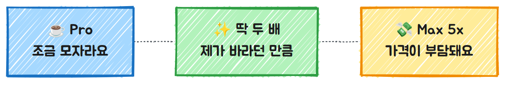
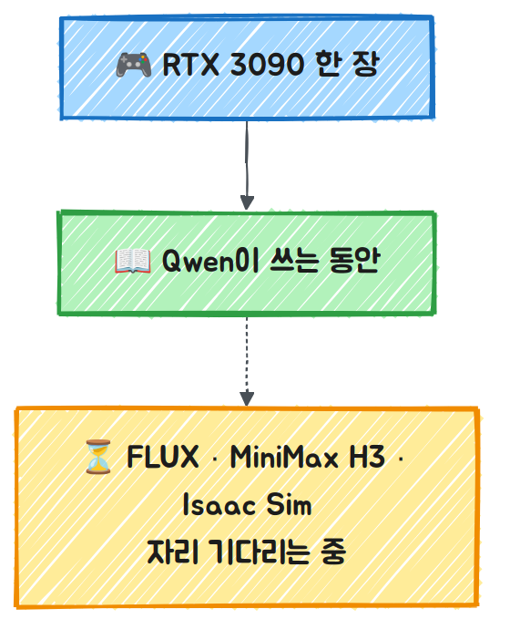
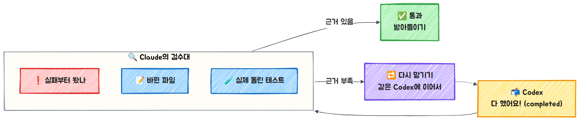

# Claude는 감독, Codex는 일꾼: 사용량 아끼려고 만든 작업 브리지

<video autoplay muted loop playsinline controls preload="metadata" poster="/assets/demos/bridge-opening-poster.jpg" src="/assets/demos/bridge-opening.mp4" style="width:100%" aria-label="Claude 감독 로봇이 지시서를 실은 손수레를 두고 기다리는 동안 Codex 일꾼 로봇들이 다리 판을 놓고, 완성된 다리로 손수레가 건너가고 번호표가 돌아오는 짧은 애니메이션. 책 위에는 Qwen 로봇이 앉아 있다"></video>

Claude Code Pro로 개인 프로젝트를 하다 보면 사용량이 모자랐어요. Max 5x로 올리자니 제게는 요금이 너무 크게 뛰었고요. 제가 바란 건 딱 두 배였어요.

## 30초 요약

- Claude Code에 Python 브리지를 붙여 Codex에 일을 맡겼어요. 화면을 닫아도 작업은 계속되고, 다시 열어 같은 번호로 결과를 읽어요.
- Claude에는 실패부터 적은 8줄짜리 보고를 보내요. `completed`가 떠도 실제 변경과 테스트 근거를 보고 판단해요.
- Codex는 파일을 읽고, README를 고치고, 리뷰까지 해냈어요. Windows 11에서도 Codex에 일을 맡기고 Muse 도구를 쓸 수 있었어요. Qwen은 Ubuntu 쪽에 남겨 뒀어요.



[지난 글](local-llm-reading.md)에서는 긴 책을 제 PC의 Qwen에 맡겼어요. 그런데 제 RTX 3090은 한 장뿐이에요. Qwen이 그래픽카드 메모리를 차지하는 동안엔 FLUX, MiniMax H3, Isaac Sim을 돌릴 수 없었어요. Claude 사용량을 아끼려다 정작 하고 싶은 일이 그래픽카드 앞에 줄을 섰죠.



토큰이 모자라 고민하다가, 그동안 써 본 적 없는 Codex에 도전해 보기로 했어요. 제 작업에선 Claude Code보다 Codex가 조금 아쉽게 느껴졌지만, 사용량에는 훨씬 여유가 있는 느낌이었어요. 익숙한 Claude Code 화면에서 Claude는 맡길 범위를 정하고 마지막 판단을 해요. Codex는 파일 조사부터 구현, 테스트, 1차 리뷰까지 맡아요. Qwen은 카드가 빌 때 긴 글을 읽고, 쇼핑 조사는 Muse에게 보내요. 말하자면 Claude가 원청, Codex가 하청이에요. 단가는 싸지만, 검수는 끝까지 원청 몫이에요.


## 첫 두 건은 Codex가 시작도 못 했어요

어느 저녁, Claude Code에 브리지를 붙여 첫 일을 맡겨 봤어요. 잠깐이면 될 줄 알았는데 밤까지 붙들고 있었어요.

첫 두 건은 Codex가 일을 시작하기도 전에 멈췄어요. 실행 환경 문제였고, 자리를 옮겨 다시 돌리니 그제야 일을 시작했어요.

수선집에 옷을 맡기고 번호표를 받으면 그 자리에서 기다릴 필요가 없잖아요. 저도 Claude가 일을 맡기고 번호만 받아 오게 하고 싶었어요. 그러려면 접수 창구를 닫아도 뒤에서 일하는 프로그램이 살아 있어야 했어요.


Qwen 차례가 왔을 땐 로봇 시뮬레이터인 Isaac Sim이 이미 GPU를 쓰고 있었어요. 브리지는 Qwen을 부르지 않고 조용히 비켜 갔어요. 시뮬레이터를 끄지도 않았고요. Windows 11에선 카드가 비어 있어도 Qwen에 일을 맡길 수 없어요. WDDM 드라이버가 프로그램별 GPU 메모리 사용량을 보여 주지 않아 브리지가 Qwen을 부르지 않아요. GPU 작업을 실행하는 보호 MCP도 Linux 전용이라 Windows에선 요청을 거부해요.

처음 기대한 건 Claude가 읽는 로그가 줄어드는 거였어요. 막상 써 보니 중간에 화면을 닫고 나중에 번호 하나로 이어 볼 수 있다는 점도 마음에 들었어요. Muse에 쇼핑을 맡겼을 때도 접수 번호 덕을 봤어요. Windows에선 Claude와 위임받은 Codex가 둘 다 Muse 도구를 쓸 수 있었어요. 다만 브리지는 Codex를 `-a never`로 실행해 중간에 허락을 물을 수 없어요. 그래서 제가 쓸 Muse 도구만 `config.toml`에서 미리 승인했어요. Ubuntu의 Codex에는 Muse 토큰을 두지 않고 Claude Code에서 Muse를 직접 불러요.

나중엔 같은 번호표를 들고 수선집에 가서 한 군데만 더 고쳐 달라고 하듯, Codex에게도 짧게 후속 요청을 보낼 수 있게 했어요. 제 PC에서 먼저 “`note.txt`를 읽고 비밀 단어만 답해 줘”라고 했더니 `pineapple`이 왔어요. 일이 끝난 뒤 “파일을 다시 읽지 말고 방금 답한 단어를 거꾸로 써 줘”라고 하니 `elppaenip`이라고 답했어요. Codex 세션은 같았고, 새 작업 기록의 `continued_from`에는 앞 작업 번호가 남았어요.

## 직접 해 보고 싶다면

### 1. 브리지 연결하기

그 창구가 `coop.py`예요. Claude Code에서는 MCP라는 약속을 통해 이 브리지의 도구를 불러요. Claude Code가 이 스크립트를 실행하고 요청과 응답을 한 줄씩 주고받아요. 프로그램의 표준 입력과 표준 출력으로 메시지를 주고받는 방식이라 **stdio**라고 불러요. 외부에 접속 주소를 열 필요는 없어요. 출력에는 MCP 메시지만 쓰고, 진단 기록은 표준 오류로 보내요. [MCP stdio 사양](https://modelcontextprotocol.io/specification/2025-11-25/basic/transports)

| Claude가 부르는 도구 | 돌아오는 것 |
| --- | --- |
| `delegate_task` | 프로젝트 경로와 할 일을 넘기면 작업 번호를 받아요. |
| `job_result` | 번호로 진행 상태를 읽고, 끝났으면 보고를 받아요. |
| `cooperation_status` | 최근 작업과 Qwen을 쓸 수 있는지 봐요. |

접수할 때 요청을 `runs/<id>/`에 저장하고, Claude Code와 별개로 실행되는 작업 프로그램(워커)을 띄워요. 상태와 마지막 답변도 거기에 남겨서 새 세션에서 같은 번호로 조회할 수 있어요. 두 워커가 같은 Git 작업 트리를 동시에 건드리지 않도록, 하위 폴더에서 요청해도 같은 잠금을 써요. 제가 따로 열어 둔 편집기까지 막아 주지는 않아서 그건 제가 조율해요.

리눅스에서 Python 3, Git, Claude Code와 로그인된 Codex CLI를 준비했어요. 브리지는 맡길 프로젝트 밖의 비공개 폴더에 두고, 아래 명령에서 `/path/to/coop.py`를 브리지의 실제 경로로 바꿔 Claude Code에 등록해요. `/mcp`에서 연결을 볼 수 있어요. 공개 저장소에는 브리지 핵심 코드와 테스트를 올렸어요. 이 공개판은 Linux용이에요. Windows에서 시험한 브리지와 GPU 작업용 레시피 실행기는 공개판에 들어 있지 않아요. [공개 코드](https://github.com/butt2rflow/butt2rflow.github.io/tree/main/code/claude-codex-bridge) · [Claude Code MCP 문서](https://code.claude.com/docs/en/mcp)

```bash
claude mcp add --transport stdio --scope user ai-cooperation -- /usr/bin/python3 /path/to/coop.py serve
```

### 2. 작은 일부터 맡기기

먼저 `delegate_task`로 프로젝트 안의 README를 읽어 달라고 해 보세요. 받은 번호를 적어 두고 Claude Code를 다시 열어 `job_result`에 같은 번호를 넣어 봐요.

앞선 작업이 끝나고 `job_result`에 `resumable: true`가 보이면, 같은 프로젝트 경로에서 `delegate_task`의 `continue_job`에 앞 작업 번호를 넣고 새로 부탁할 내용만 적어요. CLI에서는 `python3 coop.py start --cwd /path/to/project --continue-job JOB_ID --task "후속 요청"`으로 같은 일을 할 수 있어요. 브리지는 `codex exec resume`으로 앞 대화를 이어 가고 후속 요청에는 새 작업 번호를 줘요. 진행 중인 일이나 Qwen 작업, 다른 폴더에서 맡긴 일은 이어 갈 수 없어요.

수정을 맡길 때만 `write=true`를 줘요. 예를 들어 README의 설치 명령을 고치려면 프로젝트의 절대 경로와 함께 “README만 고치고 기존 변경은 보존해 줘. 고친 명령을 프로젝트에서 실행해 보고 결과를 적어 줘”라고 써요. 파일 범위는 작업 지시이고, 쓰기 권한은 작업 공간 단위로 제한돼요. 실패한 작업에 수정이 남을 수 있어서 다시 맡기기 전에 기록과 실제 변경부터 확인해요.

공개판의 `start` 명령에서도 수정 허용은 `--write`, 맡길 모델 경로는 `--target`, 제한 시간(초)은 `--timeout`으로 정해요. 읽을 파일은 `--file`을 파일마다 붙여 넘기고, Codex의 모델과 생각 강도는 `--model`과 `--effort`로 골라요.

요즘은 Claude가 일을 넘길 때 Codex의 모델과 생각 강도까지 골라요(`model`, `effort`). 아래는 옆 Claude Code 창이 영상 프롬프트 스킬을 만드는 일을 Codex에 넘긴 화면이에요. 이 일엔 Astra 모델에 보통 강도(medium)면 된다고 본 거죠. 일감마다 맞는 하청을 고르는 원청인 셈이에요.


긴 글은 파일 위치만 넘겨요. 로컬 Qwen이 프로젝트 안에서 원문을 읽고, Claude는 요약을 받은 뒤 판단에 필요한 대목만 원문에서 확인해요.

브리지는 Ubuntu에선 그래픽카드(GPU)에 지정한 모델이 전부 올라와 있고 다른 계산 작업이 없을 때만 Ollama에 요청을 보내요. Ollama는 제 PC에서 모델을 실행하는 프로그램이에요.

읽기 작업에 `target=auto`를 주면 시작 전에 Qwen을 쓸 수 없을 때 Codex로 보낼 수 있어요. `target=qwen`을 명시하면 조건을 못 맞췄을 때 거부해요. GPU 상태는 확인 직후에도 바뀔 수 있어서, 같은 GPU로 큰 작업을 시작하기 전에는 `python3 coop.py qwen-disable`로 새 요청을 막고 진행 중인 읽기가 끝나기를 기다려요.

### 3. 결과와 테스트 확인하기

처음엔 자세히 보고받으면 마음이 놓일 줄 알았어요. 그런데 Claude에게 파일도 읽히고 로그도 읽히면 일을 넘긴 보람이 없잖아요. 그래서 보고는 8줄, 800자 이내로 부탁해요. 실패가 있으면 맨 위에 두고, 바꾼 파일과 실제로 실행한 검사를 적게 해요. 길면 `job_result`에 `detail=true`를 주거나 디스크의 `result.md`를 열어요. `completed`는 Codex가 정상 종료해서 답을 저장했다는 뜻이에요. 고친 명령이 정말 동작하는지는 테스트 기록을 봐야 알아요.



**해 본 일**

- Claude Code에 도구 셋이 떴어요.
- 창을 닫았다 다시 열어도 같은 번호로 Codex가 읽은 내용을 꺼냈어요.
- Codex가 README를 고쳤고, 고친 명령은 따로 돌려 봤어요. 리뷰는 읽기 전용으로 맡겼어요.

- Windows 11에서도 읽기와 쓰기 후속 요청을 맡겼어요. Qwen을 쓸 수 없을 때 `auto`가 Codex로 넘기는 것도 확인했어요.

Ubuntu에선 Isaac Sim이 GPU를 쓰고 있어서 이 브리지로 Qwen에게 실제로 읽혀 보진 못했어요.

### 막히면 여기부터

| 증상 | 살펴볼 곳 |
| --- | --- |
| 쓰기 작업 실패 | 재시도 전에 작업 기록과 남은 변경을 살펴봐요. |
| Qwen을 건너뜀 | `cooperation_status`와 GPU 점유 상태를 확인해요. |

**관련 글** [로컬 AI에게 읽기 맡기기](local-llm-reading.md) · [Claude 토큰으로 쇼핑하지 마세요: 공짜 토큰 많은 Muse에게 심부름 보내기](muse-mcp-shopping.md)
