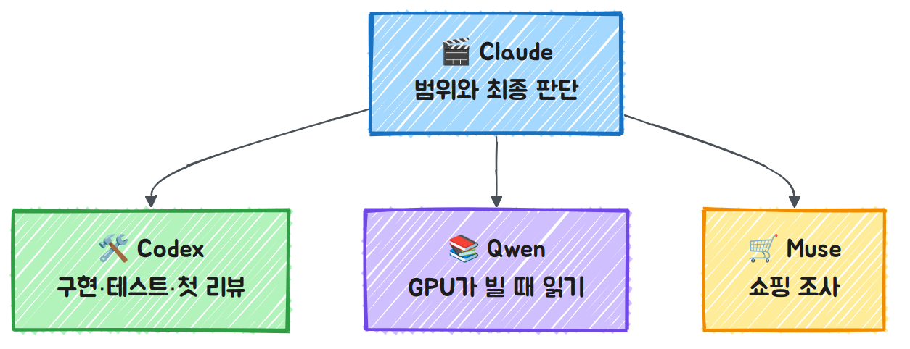
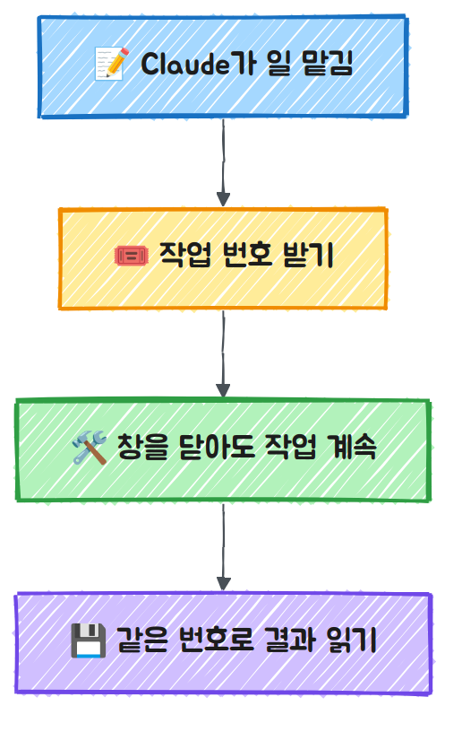
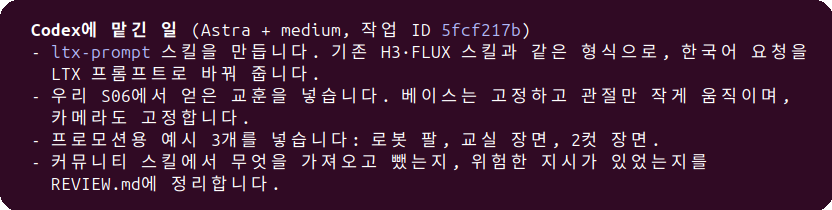

# Claude는 감독, Codex는 일꾼: 사용량 아끼려고 만든 작업 브리지

<video autoplay muted loop playsinline controls preload="metadata" poster="/assets/demos/bridge-opening-poster.jpg" src="/assets/demos/bridge-opening.mp4" style="width:100%" aria-label="Claude 감독 로봇이 지시서를 실은 손수레를 두고 기다리는 동안 Codex 일꾼 로봇들이 다리 판을 놓고, 완성된 다리로 손수레가 건너가고 번호표가 돌아오는 짧은 애니메이션. 책 위에는 Qwen 로봇이 앉아 있다"></video>

Claude Pro 플랜으로 Claude Code를 쓰며 개인 프로젝트를 하다 보니 자꾸 사용 한도에 걸렸어요. 쓸 수 있는 토큰이 지금의 딱 두 배면 충분할 것 같았어요. Max 5x까지 올리자니 요금이 부담스러웠고요. Pro를 하나 더 구독할까 생각하던 중에 아직 한 번도 안 써 본 Codex가 궁금해졌어요.


[1,069쪽 책을 로컬 AI에 맡기기](local-llm-reading.md)에서는 긴 책을 읽는 일을 제 PC의 Qwen에 맡겨 Claude 사용량을 아꼈어요. 코딩할 때도 Claude와 Codex가 그렇게 일을 나누면 어떨까 싶었어요. Qwen에 더 맡기기엔 RTX 3090이 한 장뿐이었어요. Qwen이 GPU 메모리를 쓰는 동안엔 FLUX도, MiniMax H3도, Isaac Sim도 차례를 기다려야 했거든요.


직접 써 보니 제 작업에서는 Codex가 Claude Code보다 조금 아쉬웠지만, 사용량은 훨씬 넉넉하게 느껴졌어요. 그래서 익숙한 Claude Code 창에서 Claude가 일의 범위를 정하면 Codex가 파일을 살펴보고 구현과 테스트, 1차 리뷰까지 맡도록 했어요. 비유하자면 Claude가 원청, Codex가 하청인 셈이에요. 단가는 내려가도 마지막 검수는 원청 몫이죠. 긴 글은 GPU가 빌 때 Qwen에 맡기고, 쇼핑 조사는 Muse에 보내요.



## 30초 요약

- Claude Code에 Python 브리지를 붙여 Codex에 일을 맡겼어요. 화면을 닫아도 작업은 계속되고, 다시 열어 같은 번호로 결과를 읽어요.
- Codex는 실패한 일이 있으면 맨 위에 적어 8줄 이내로 보고해요. Claude는 `completed`가 떠도 실제 변경 내용과 테스트 결과를 살펴봐요.
- Codex는 파일을 읽고, README를 고치고, 리뷰까지 해냈어요. Windows 11에서도 Codex에 일을 맡기고 Muse 도구를 쓸 수 있었어요. Qwen은 Ubuntu 쪽에 남겨 뒀어요.

## 첫 두 건은 Codex가 시작도 못 했어요

어느 저녁, Claude Code에 브리지를 붙여 첫 일을 맡겨 봤어요. 잠깐이면 될 줄 알았는데 밤까지 붙들고 있었어요.

첫 두 건은 실행 환경 문제로 Codex가 시작하기도 전에 멈췄어요. 실행할 곳을 옮기고 나서야 첫 작업이 돌아갔어요.

수선집에 옷을 맡기고 번호표를 받으면 그 자리에서 기다릴 필요가 없잖아요. 저도 Claude가 일을 맡기고 번호만 받아 오게 하고 싶었어요. 그러려면 접수 창구를 닫아도 뒤에서 일하는 프로그램이 살아 있어야 했어요.



막상 Qwen에 읽기를 맡기려니 로봇 시뮬레이터인 Isaac Sim이 이미 GPU를 쓰고 있었어요. 브리지는 시뮬레이터를 그대로 두고 Qwen 차례를 건너뛰었어요. Windows 11에서는 GPU가 비어 있어도 마찬가지예요. Windows의 그래픽 드라이버 방식(WDDM)으로는 프로그램마다 GPU 메모리를 얼마나 쓰는지 알 수 없어서 브리지가 Qwen을 호출하지 않거든요. GPU 작업을 안전하게 실행하는 MCP도 Linux 전용이라 Windows에서 보낸 요청은 거부해요.

처음엔 Claude가 읽을 로그만 줄어도 좋겠다 싶었어요. 써 보니 창을 닫았다가 번호 하나로 결과를 찾는 게 꽤 편하더라고요. Muse에 쇼핑을 맡길 때도 이 번호표가 요긴했어요. Ubuntu에서는 Codex에 Muse 토큰을 두지 않고 Claude Code에서 직접 Muse를 불러요. Windows에서는 Claude뿐 아니라 브리지로 일을 받은 Codex도 Muse를 쓸 수 있게 했어요. 브리지가 `-a never`로 Codex를 실행하면 중간에 승인을 요청할 수 없으니, 필요한 Muse 도구만 `config.toml`에서 미리 승인해 뒀어요.

나중엔 같은 번호표를 들고 수선집에 가서 한 군데만 더 고쳐 달라고 하듯, Codex에게도 짧게 후속 요청을 보낼 수 있게 했어요. 제 PC에서 먼저 “`note.txt`를 읽고 비밀 단어만 답해 줘”라고 했더니 `pineapple`이 왔어요. 일이 끝난 뒤 “파일을 다시 읽지 말고 방금 답한 단어를 거꾸로 써 줘”라고 하니 `elppaenip`이라고 답했어요. Codex 세션은 같았고, 새 작업 기록의 `continued_from`에는 앞 작업 번호가 남았어요.

## 직접 해 보고 싶다면

### 1. 브리지 연결하기

접수 창구 역할을 하는 스크립트가 `coop.py`예요. Claude Code는 MCP라는 규약에 따라 브리지의 도구를 불러요. Claude Code가 스크립트를 직접 실행해 표준 입력으로 요청을 한 줄씩 보내고 표준 출력으로 답을 받아요. 이 방식을 **stdio**라고 해요. 외부에 접속 주소를 열 필요도 없어요. 표준 출력에는 MCP 메시지만 쓰고 진단 기록은 표준 오류로 보내요. [MCP stdio 사양](https://modelcontextprotocol.io/specification/2025-11-25/basic/transports)

| Claude가 부르는 도구 | 돌아오는 것 |
| --- | --- |
| `delegate_task` | 프로젝트 경로와 할 일을 넘기면 작업 번호를 받아요. |
| `job_result` | 번호로 진행 상태를 읽고, 끝났으면 보고를 받아요. |
| `cooperation_status` | 최근 작업을 살펴보고 Qwen을 쓸 수 있는지도 확인해요. |

브리지는 요청이 들어오면 `runs/<id>/`에 저장하고, Claude Code와 별개로 일할 프로그램(워커)을 띄워요. 워커가 상태와 마지막 답변을 같은 폴더에 남기니 새 세션에서도 작업 번호로 결과를 찾을 수 있어요. 요청을 서로 다른 하위 폴더에서 보내도 Git 작업 트리가 같으면 같은 잠금을 걸어요. 덕분에 두 워커가 동시에 손댈 일은 없지만, 제가 따로 연 편집기에서 고칠 때는 작업이 겹치지 않게 직접 챙겨요.

Linux에서 Python 3와 Git, Claude Code를 준비하고 Codex CLI에 로그인했어요. 일을 맡길 프로젝트 밖에 비공개 폴더를 만들고 거기에 브리지를 뒀어요. 아래 명령에서 `/path/to/coop.py`를 실제 경로로 바꿔 실행한 뒤 Claude Code의 `/mcp`에서 연결을 확인해요. 공개 저장소에는 Linux용 브리지의 핵심 코드와 테스트를 올렸어요. Windows에서 시험한 브리지와 GPU 작업용 레시피 실행기는 공개판에 포함되지 않아요. [공개 코드](https://github.com/butt2rflow/butt2rflow.github.io/tree/main/code/claude-codex-bridge) · [Claude Code MCP 문서](https://code.claude.com/docs/en/mcp)

```bash
claude mcp add --transport stdio --scope user ai-cooperation -- /usr/bin/python3 /path/to/coop.py serve
```

### 2. 작은 일부터 맡기기

먼저 `delegate_task`로 프로젝트 안의 README를 읽어 달라고 해 보세요. 받은 번호를 적어 두고 Claude Code를 다시 열어 `job_result`에 같은 번호를 넣어 봐요.

앞선 작업이 끝나고 `job_result`에 `resumable: true`가 보이면, 같은 프로젝트 경로에서 `delegate_task`의 `continue_job`에 앞 작업 번호를 넣고 새로 부탁할 내용만 적어요. CLI에서는 `python3 coop.py start --cwd /path/to/project --continue-job JOB_ID --task "후속 요청"`으로 같은 일을 할 수 있어요. 브리지는 `codex exec resume`으로 앞 대화를 이어 가고 후속 요청에는 새 작업 번호를 줘요. 진행 중인 일이나 Qwen 작업, 다른 폴더에서 맡긴 일은 이어 갈 수 없어요.

수정을 맡길 때만 `write=true`를 줘요. 예를 들어 README의 설치 명령을 고치려면 프로젝트의 절대 경로와 함께 “README만 고치고 기존 변경은 보존해 줘. 고친 명령을 프로젝트에서 실행해 보고 결과를 적어 줘”라고 써요. 어느 파일을 고칠지는 이렇게 말로 지정해요. 실제 쓰기 권한은 작업 공간 단위로 정해져요. 실패한 작업에 수정이 남을 수 있어서 다시 맡기기 전에 기록과 실제 변경부터 확인해요.

공개판에서 `start` 명령을 쓸 때는 `--write`로 수정을 허용하고, `--target`으로 일을 맡길 대상을 골라요. 제한 시간은 `--timeout`에 초 단위로 적어요. 읽을 파일마다 `--file`을 붙이고, Codex의 모델과 추론 강도는 각각 `--model`과 `--effort`로 정해요.

Claude가 일을 넘길 때도 작업에 맞춰 Codex의 모델과 추론 강도를 골라요(`model`, `effort`). 아래는 옆에 열어 둔 Claude Code 창에서 영상 프롬프트 스킬을 만들어 달라고 했을 때예요. Claude는 그 일에 Astra 모델과 중간 강도(medium)면 충분하다고 보고 Codex에 맡겼어요.



긴 글은 파일 위치만 넘겨요. 로컬 Qwen이 프로젝트 안에서 원문을 읽고, Claude는 요약을 받은 뒤 판단에 필요한 대목만 원문에서 확인해요.

Ubuntu에서 로컬 모델을 실행할 때는 Ollama를 써요. 브리지는 지정한 모델이 GPU 메모리에 전부 올라와 있고 다른 계산 작업이 GPU를 쓰지 않을 때만 Ollama에 요청을 보내요.

읽기를 맡길 때 `target=auto`로 두면 시작 전에 Qwen을 쓸 수 없을 경우 Codex가 대신 맡을 수 있어요. `target=qwen`으로 지정하면 같은 조건에서 요청을 거부해요. 확인 직후에도 GPU를 쓰는 프로그램은 달라질 수 있어요. 그래서 같은 GPU로 큰 작업을 돌리기 전에는 `python3 coop.py qwen-disable`로 새 요청부터 막고, 이미 시작한 읽기가 끝날 때까지 기다려요.

### 3. 결과와 테스트 확인하기

처음엔 보고가 자세해야 안심이 될 줄 알았어요. 그런데 Claude가 파일과 로그를 다시 다 읽으면 일을 넘긴 보람이 없잖아요. 그래서 8줄, 800자 이내로 줄이고, 실패한 일이 있으면 제일 먼저 쓰라고 해요. 어떤 파일을 바꿨고 어떤 검사를 실제로 돌렸는지도 적게 하고요. 더 궁금하면 `job_result`에 `detail=true`를 주거나 디스크에 저장된 `result.md`를 열어 봐요. `completed`는 Codex가 정상 종료했고 답변이 저장됐다는 뜻이에요. 고친 명령이 제대로 동작했는지는 테스트 기록에서 확인해요.


**해 본 일**

- Claude Code에 도구 셋이 떴어요.
- 창을 닫았다 다시 열어도 같은 번호로 Codex가 읽은 내용을 꺼냈어요.
- Codex가 README를 고쳤고, 고친 명령은 따로 돌려 봤어요. 리뷰는 읽기 전용으로 맡겼어요.
- Windows 11에서는 파일을 읽힌 뒤 같은 Codex에 수정을 맡겼어요. Qwen을 쓸 수 없을 때 `auto`가 일을 Codex로 넘기는 것도 확인했어요.

Ubuntu에서는 Isaac Sim이 GPU를 쓰고 있어서, 이 브리지를 통해 Qwen에 글을 읽히는 데까지는 못 갔어요.

### 막히면 여기부터

| 증상 | 살펴볼 곳 |
| --- | --- |
| 쓰기 작업 실패 | 재시도 전에 작업 기록과 남은 변경을 살펴봐요. |
| Qwen을 건너뜀 | `cooperation_status`와 GPU 점유 상태를 확인해요. |

**관련 글** [1,069쪽 책을 로컬 AI에 맡기기](local-llm-reading.md) · [Claude 토큰으로 쇼핑하지 마세요: 공짜 토큰 많은 Muse에게 심부름 보내기](muse-mcp-shopping.md) · [로봇 팔은 LTX로, 교실은 H3로 만든 이유](ltx-vs-h3.md)
