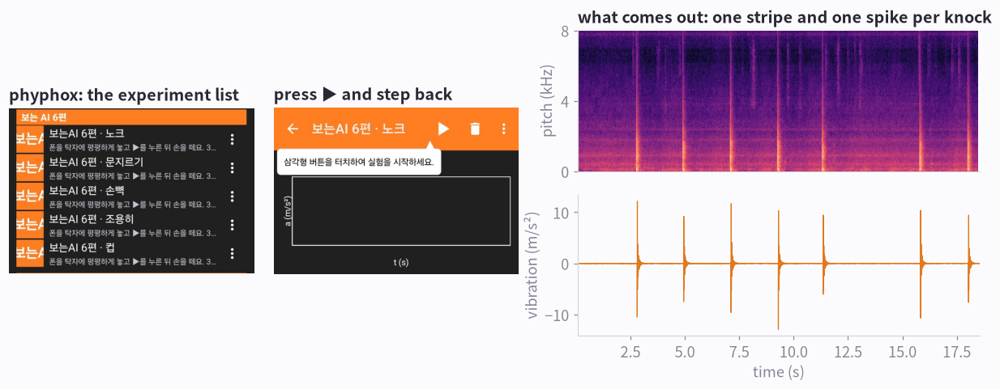
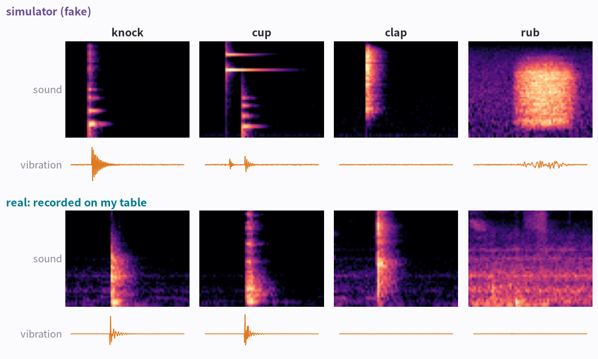
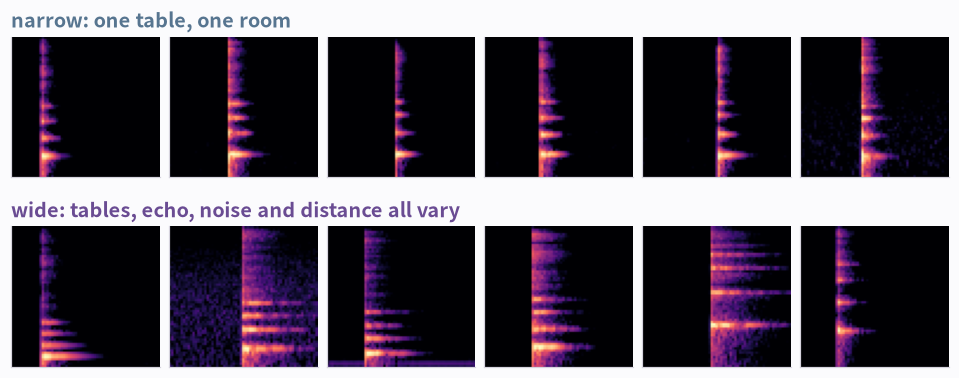
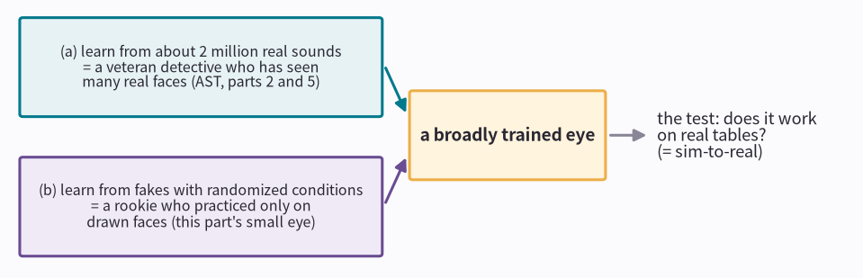
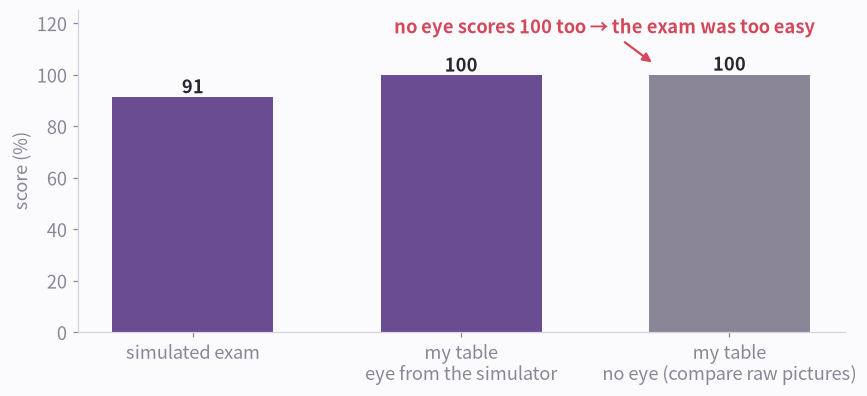
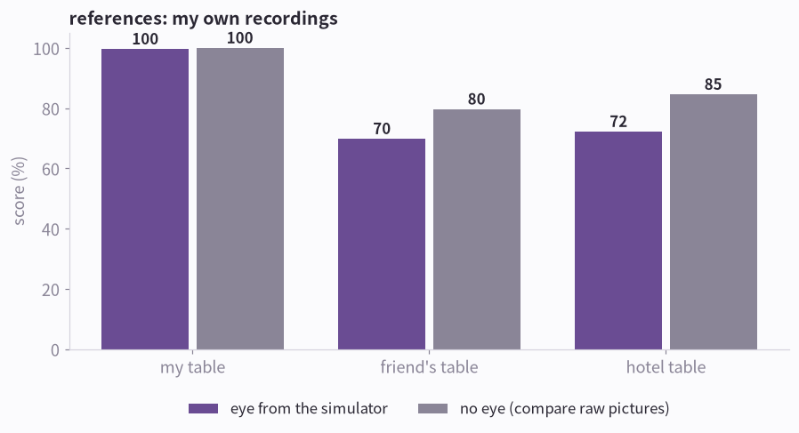
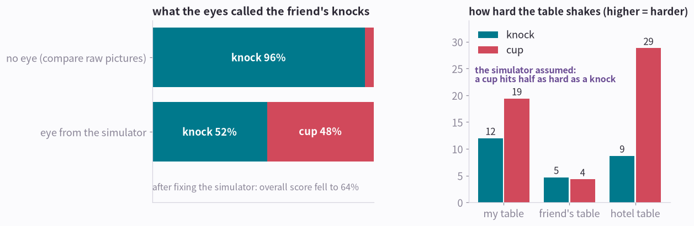
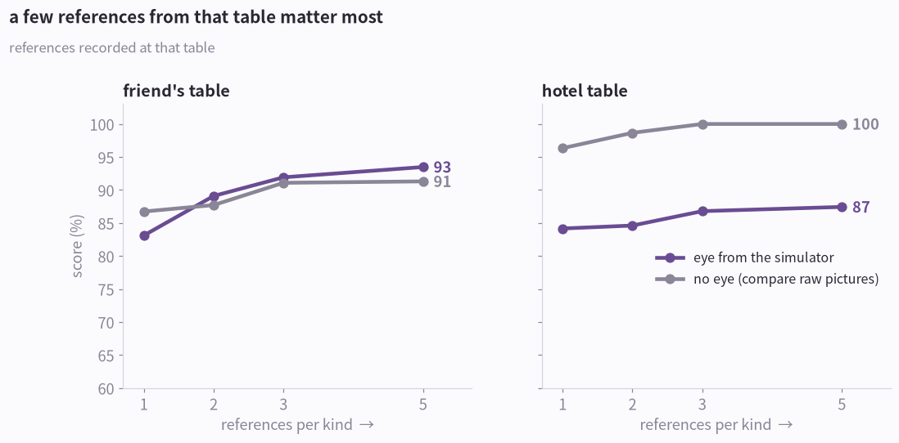
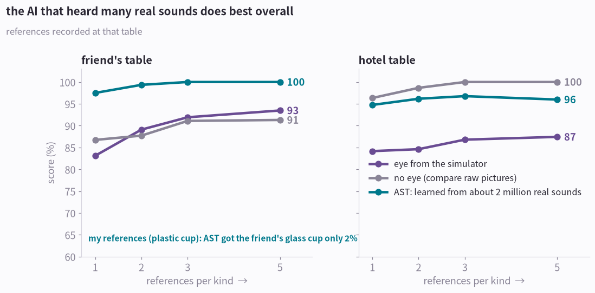
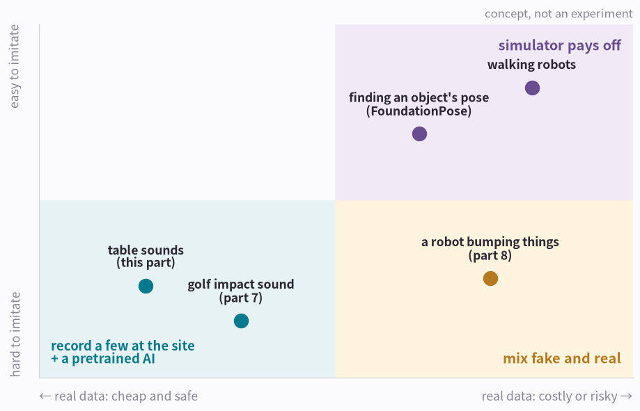

# AI in Pictures Part 6: An Eye Taught in Simulation

> **AI in Pictures · Part 6.** A picture-first series on sound and motion AI. [Start from part 0](aip-robot-senses.md)

Part 5 named simulation as the next step toward a broadly trained eye. I tried it. A small eye taught only on fake sounds and vibrations did worse on other tables than simply overlaying two pictures and checking how alike they are (no eye at all). What worked best overall was an AI that had heard lots of real sounds, given a few references recorded on the spot. The pictures show how I found out.

*10 pictures · no formulas · real experiments · try it with one phone · about 10 minutes*

---

## Picture 1 · A phone becomes a lab

phyphox is a free app from RWTH Aachen University in Germany. It turns the sensors already in your phone, like the microphone and the accelerometer, into lab instruments. You can also design your own experiment screens, so for this part I made five experiments that record sound and vibration together.

**How to read the picture**

- Left: the five experiments added to phyphox (the app screens are in Korean): knock, cup down, clap, rub and quiet.
- Middle: put the phone on the table, press ▶ and let go. Then tap the table.
- Right: what a real recording looks like. Top: the sound picture (the spectrogram from [part 1](aip-seeing-sound.md)). Bottom: the table's vibration (the accelerometer from [part 3](aip-seeing-motion.md)). Every knock makes a stripe and a spike at the same moment.

!!! abstract "In one line"
    One phone measures sound and vibration together. All the real data in this part was collected this way.

*But recording lots of examples is tedious. Could we fake them instead?*

## Picture 2 · Why not learn from fake sounds?

I wrote a small program (a simulator) that imitates a table's sounds and vibrations. A knock goes ‘tock’ and the table rings; a cup goes ‘clink’ and then its base touches down once more; a clap is sound only; a rub is a long ‘shhh’. It can make thousands of fake sounds in seconds.

**How to read the picture**

- Top two rows: fakes from the simulator. Bottom two rows: real recordings from my phone on my table.
- All the vibration rows use the same scale (set by the knock). A clap doesn't shake the table, so its vibration is almost flat, in the fakes and in the real recording.
- They look alike, but not the same. Real sound has room echo and noise, and a real rub barely shakes the table.

!!! abstract "In one line"
    Fakes are unlimited, but each one is a little off from the real thing.

*Instead of one kind of fake, I deliberately varied them.*

## Picture 3 · Fakes with randomized conditions

Every fake gets a random table material, room echo, background noise, distance from the phone and strength. The idea: an AI that has seen enough variety might treat a real table it has never met as just one more variation. This is the next step [part 5](aip-learning-from-reference.md) ended on.

**How to read the picture**

- Top: a narrow range. The six knocks look nearly the same.
- Bottom: a wide range. The same knock, with different echo, noise and pitch each time.
- With 6,000 of these fakes I trained a small AI that looks at sound and vibration together (the same kind I trained from scratch in [part 2](aip-teaching-sound.md)). Training it takes about 5 seconds on a graphics card. Cups were deliberately left out of training.

!!! abstract "In one line"
    Learn from fakes with widely randomized conditions, and real sounds may land inside that range.

## Picture 4 · Two ways to a broadly trained eye

Part 5 said an ‘eye’ (an AI that only describes features) works better the more variety it has learned from. There are two main ways to get such an eye. In [part 5](aip-learning-from-reference.md)'s detective terms:

**How to read the picture**

- (a) Let it hear huge numbers of real sounds: a veteran detective who has seen countless real faces. That's AST, the AI borrowed in parts 2 and 5. It learned from about 2 million YouTube sound clips.
- (b) Teach it with fakes whose conditions are randomized: a rookie who practiced only on drawn faces. That's this part's small eye.
- Using (b) on real data is called sim-to-real (learn in simulation, use it for real). It's common in robotics, and there are many cases where it has worked (picture 10).

!!! abstract "In one line"
    This part's question: does an eye taught only on fakes work on a real table?

*First, I tested it on my own table.*

## Picture 5 · The first exam looked perfect

I ran two tests: one on fake sounds from the simulator, one on real sounds recorded on my table. For the real exam I gave a few of my recordings of each kind as references (the [part 5](aip-learning-from-reference.md) method) and labeled each new sound with the kind of its closest reference. I also set a baseline: no eye at all, just laying two sound-and-vibration pictures on top of each other and measuring how alike they are.

**How to read the picture**

- Fake exam: 91%. My table: almost 100%.
- But look at the gray bar. With no eye, comparing raw pictures also scores 100%.
- The references and the exam came from the same room, day and person, so the exam was too easy, like reusing the practice questions on the test. It can't tell us whether the eye helped.

!!! abstract "In one line"
    Without the baseline, I would have taken 100% as a success.

*So I tried other tables.*

## Picture 6 · What about other tables?

A friend recorded at home on a wooden table with a glass cup, and I recorded on a coated hotel table with a stainless steel tumbler. The references were still my own recordings from my table.

**How to read the picture**

- Friend's table: the eye from the simulator 70%, no eye 80%.
- Hotel table: the eye 72%, no eye 85%.
- Both times the eye scored lower. The eye trained on fakes actually got in the way.

!!! abstract "In one line"
    The small eye trained only on fakes didn't carry over to other tables.

## Picture 7 · Where did it go wrong?

The most visible mistake was on the friend's knocks: the eye called about half of them cups (rubs were almost all wrong, too).

**How to read the picture**

- Left: with no eye, 96% of the friend's knocks are called knocks. The eye from the simulator gets only 52% right and calls 48% cups.
- Right: I measured how hard the table shakes. On my table the cup (19) is stronger than the knock (12). On the friend's table they're about the same (knock 5, cup 4). In the hotel the tumbler (29) is about three times as strong as the knock (9).
- The simulator assumed a cup lands about half as hard as a knock. On real tables it was about the same or harder.
- So I changed the simulator to let knock and cup strengths overlap, and retrained. The change made things worse: the friend's-table score fell from 70% to 64%. Strength alone doesn't explain it, and I don't know the real cause yet.

!!! abstract "In one line"
    The simulator was built on my guesses, and only real recordings showed which guesses were wrong.

*What if it gets references recorded on that table?*

## Picture 8 · References from that table

This time the references came from the table being tested. Each table was recorded twice, so one recording served as references and the other as the exam; then I swapped them. I also varied the number of references from one to five per kind.

**How to read the picture**

- Friend's table: the eye scores 83% with 1 reference and 93% with 5. No eye: 87% and 91%.
- Hotel table: the eye 84–87%, no eye 96–100%.
- On-site references lift the eye a lot. Still, at every number of references it only matches or trails comparing raw pictures. A gap of a few points means nothing here; look only at big differences.
- The eye that never learned cups still recognized them from cup references: 97% on the friend's table and 100% in the hotel. But the no-eye comparison also got every cup right, so this alone doesn't show the eye is better.

!!! abstract "In one line"
    The biggest effect came from recording a few examples on the spot. Adding the eye trained on fakes didn't improve on that.

*What about way (a), an AI that heard lots of real sounds?*

## Picture 9 · What about an AI that heard lots of real sounds?

I gave AST, the AI from parts 2 and 5, the same exam. AST never learned from my recordings; it only got the same references.

**How to read the picture**

- The teal line is AST. On the friend's table it scores 98% with one reference and 100% with five, ahead of the other two.
- On the hotel table it scores 96%, slightly below comparing raw pictures (100%), but above the eye trained on fakes.
- When the references were my own recordings (a plastic cup), even AST recognized the friend's glass cup only 2% of the time. A different cup sounds different, so on-site references are still needed.

!!! abstract "In one line"
    Overall, AST worked best as the eye, as long as the references came from the table being tested.

## Picture 10 · So are simulators useless?

No. This result covers one case: table sounds. Simulators do well at other jobs. The picture below is a concept drawing of my own view, not an experimental result.

**How to read the picture**

- Top right (simulator pays off): easy to imitate, and real data is costly or risky to collect. Many walking robots today walk on real ground with gaits learned only in simulation. FoundationPose finds an object's position and orientation from its 3D model (or a few photos), and it learned from huge numbers of computer-made (synthetic) images.
- Bottom right (mix fake and real): hard to imitate, yet real data is costly. If collecting data means crashing a robot dozens of times or breaking things, learn broadly from fakes and mix in a few real examples (part 8).
- Bottom left: this part and the golf impact sound (part 7). Sound changes with every table, cup and room, so it's hard to imitate, and a few knocks take seconds to record. Here a pretrained AI plus a few on-site recordings works better.

!!! abstract "In one line"
    A simulator is the tool for things that are easy to imitate and costly or risky to collect for real.

## The whole thing in five lines

1. With a phone and phyphox you can record sound and vibration together.
2. A small eye trained on fakes with randomized conditions did well on the fake exam, but on real tables it did worse than comparing raw pictures.
3. Looking at its mistakes showed the simulator's assumptions didn't match reality. Without a baseline and a test somewhere else, I'd never have known.
4. An AI that heard lots of real sounds (AST), given a few on-site references, did best overall.
5. Simulators pay off for things that are easy to imitate and costly or risky to collect. The table sounds tested here were the opposite.

## Next

Part 7 is about my golf swing. A sensor glove on my right hand records sound and motion together, with references recorded separately for each player, club and swing type. In part 8 the same eye goes on a robot gripper.

## Try it yourself: choosing references

For FoundationPose, the 3D model is the reference. For sound and motion, a few recordings made on the spot play that role.

1. Record where it will actually be used: the same table, the same objects, the same phone position.
2. One to five per kind is enough. With a pretrained AI, even one works well.
3. Include ‘nothing happening’ as a reference. Once it knows what the background sounds like, it can tell the other sounds apart.
4. Vary the strength and position a little: mix soft knocks with hard ones.
5. Re-record when the table or cup changes. The glass-cup miss (picture 9) is a case in point.

Recording kit (phyphox experiment files and guide, in Korean): [https://butt2rflow.github.io/assets/aip/kit/](https://butt2rflow.github.io/assets/aip/kit/)

Limits: the exams are small (23–57 one-second clips per place, two people, one phone model, the Galaxy S25, and five kinds of sound). More tables, people and phones, and mixing a few real examples into the fakes (the plan sketched in [part 5](aip-learning-from-reference.md)), haven't been tested yet.

----

**Series** · [← Part 5, Learning from a Reference](aip-learning-from-reference.md) · [Back to part 0, How Robots Feel](aip-robot-senses.md)

*Related: [Why Robots Learn in a 'Fake World' First](robot-simulation.md) · [Field Notes, Part 2: Isaac ROS, Foundation Models](jetson-isaac-foundation-models.md)*

### Sources and notices

Recording: phyphox (RWTH Aachen University), Galaxy S25. The app screens are my own screenshots. The real recordings were made in a private home and a hotel room, so to protect privacy they appear only as pictures, never as sound. Pretrained AI: AST (Gong, Chung, Glass, 2021; MIT/ast-finetuned-audioset-10-10-0.4593, BSD-3-Clause); AudioSet © Google, CC BY 4.0. FoundationPose: Wen et al. (NVIDIA), CVPR 2024. Experiments ran on one RTX 3090. Training one eye took about 5 seconds on the GPU and about 2.5 minutes on the CPU (16 threads); one exam (27 eyes) took about 3 minutes on the GPU and would take over an hour on the CPU. Picture 10 is a concept drawing. phyphox is a trademark of RWTH Aachen University, YouTube of Google LLC, Galaxy of Samsung Electronics Co., Ltd., and NVIDIA and GeForce RTX of NVIDIA Corporation, used here only to refer to them.

### Terms

- *the program that makes fakes*: simulator
- *fakes with randomized conditions*: domain randomization
- *learning in simulation, using it for real*: sim-to-real
- *a broadly trained eye*: foundation model (general-purpose representation)
- *small AI*: CNN (convolutional neural network)
- *AI that heard lots of real sounds*: AST (Audio Spectrogram Transformer, pretrained on AudioSet)
- *recognizing from a few references*: few-shot (one-shot with a single reference)
- *comparing raw pictures, no eye*: baseline: nearest prototype on raw features
- *score (share of clips labeled correctly)*: accuracy. Rankings are the same with macro-F1, which balances precision and recall for each kind (AST not included)
- *what was mistaken for what*: confusion matrix
- *leave one kind out of training, recognize it from references*: leave-one-out (LOO), held-out class
- *one recording as references, the other as the exam, then swap*: 2-fold cross-validation
- *the table's vibration*: acceleration (accelerometer)
- *finding an object's position and orientation from a 3D model or photos*: 6D pose estimation (FoundationPose: model-based and model-free)
