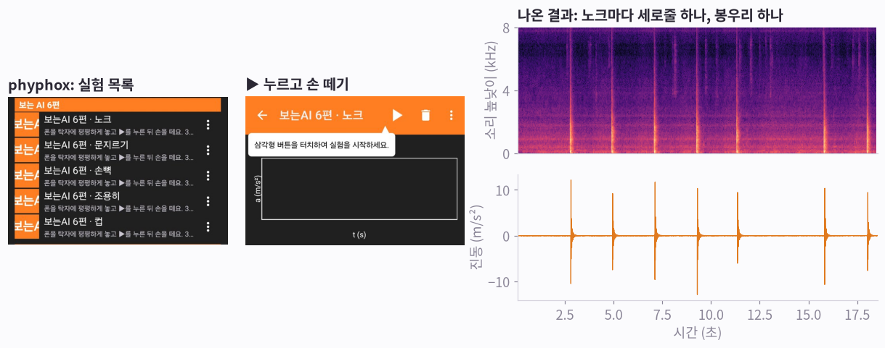
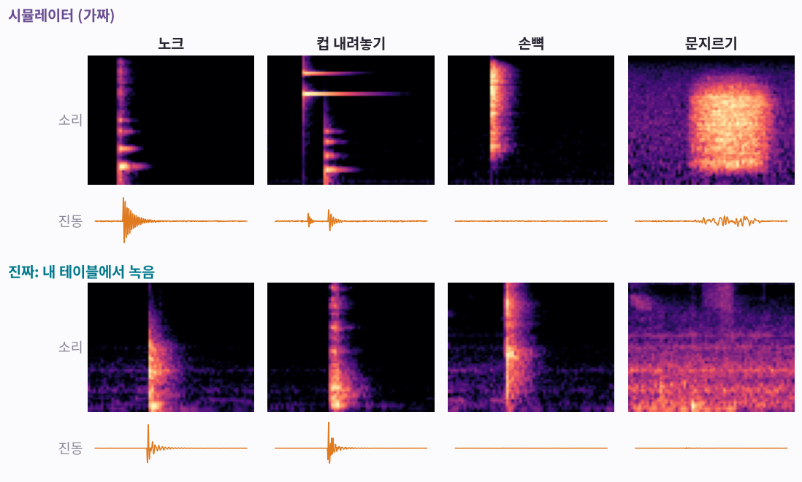
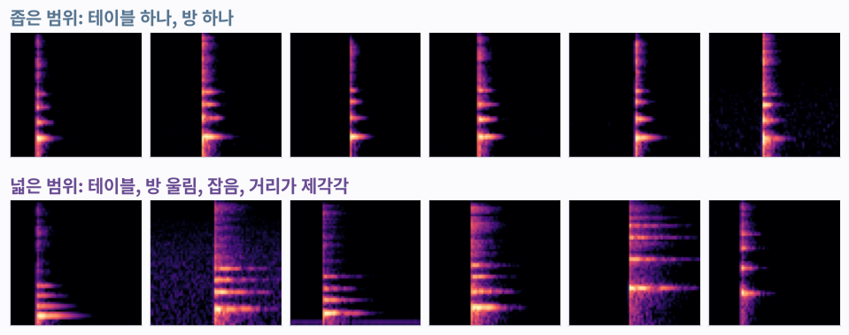
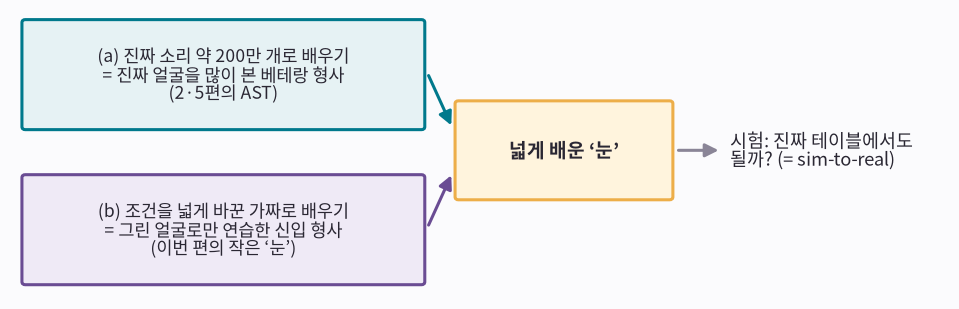
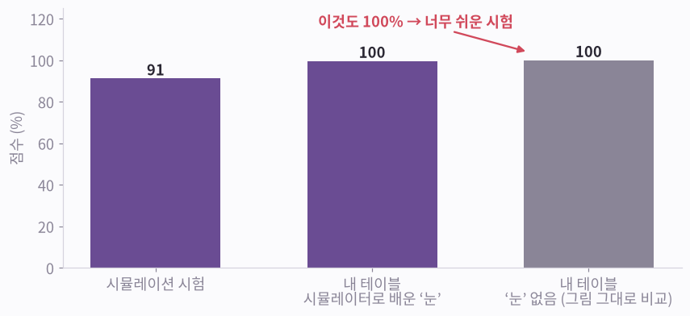
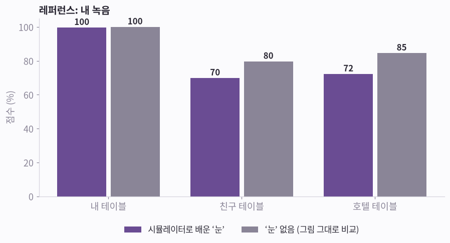
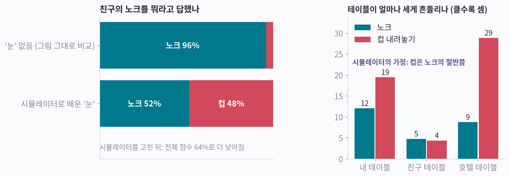
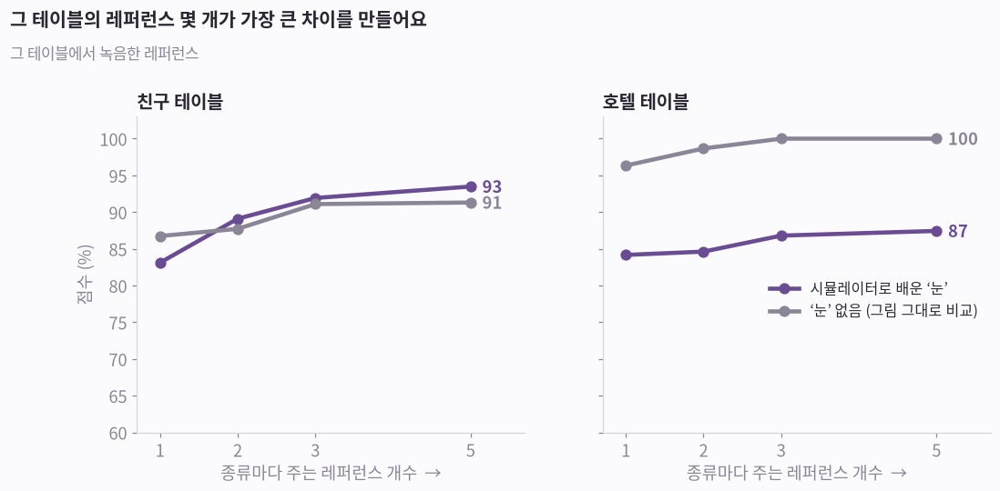
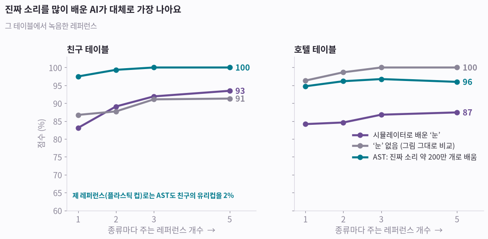
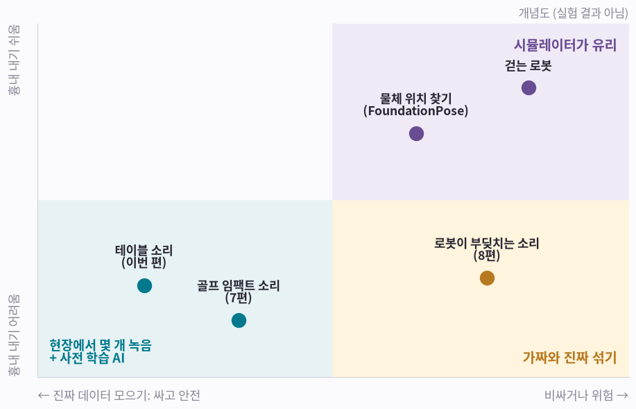

# 보는 AI 6편: 시뮬레이션으로 배운 ‘눈’

> **보는 AI · 6편.** 그림으로 보는 소리·움직임 AI 시리즈예요. [0편부터 읽기](aip-robot-senses.md)

[5편](aip-learning-from-reference.md) 끝에서 넓게 배운 ‘눈’을 만드는 다음 단계로 시뮬레이션을 꼽았어요. 직접 해 봤어요. 가짜 소리와 진동으로만 배운 작은 ‘눈’은 다른 테이블에서, ‘눈’ 없이 그대로 비교하는 것보다도 못했어요. 대체로 가장 좋았던 건 진짜 소리를 많이 배운 AI에 그 자리에서 녹음한 레퍼런스 몇 개를 주는 방법이었어요. 어떻게 알게 됐는지 그림으로 따라가 볼게요.

*그림 10장 · 수식 없음 · 진짜 실험 결과 · 폰 하나로 직접 해 보기 · 10분 정도*

---

## 그림 1 · 폰 하나가 실험실이 돼요

phyphox는 독일 아헨공대가 만든 무료 앱이에요. 마이크나 가속도 센서처럼 폰에 든 센서를 그대로 실험 도구로 쓸 수 있게 해 줘요. 실험 화면을 직접 만들 수도 있어서, 이번 편을 위해 소리와 진동을 함께 녹음하는 실험 다섯 개를 만들었어요.

**그림 보는 법**

- 왼쪽: phyphox에 추가한 실험 다섯 개예요. 노크, 컵 내려놓기, 손뼉, 문지르기, 조용히.
- 가운데: 폰을 테이블에 놓고 ▶를 누른 뒤 손을 떼요. 그다음 테이블을 ‘톡’ 쳐요.
- 오른쪽: 실제로 녹음된 모습이에요. 위는 소리 그림([1편](aip-seeing-sound.md)의 스펙트로그램), 아래는 테이블의 진동([3편](aip-seeing-motion.md)의 가속도)이에요. 노크할 때마다 세로줄과 봉우리가 같은 순간에 생겨요.

!!! abstract "한 줄 정리"
    폰 한 대로 소리와 진동을 함께 잴 수 있어요. 이번 편의 진짜 데이터는 전부 이렇게 모았어요.

*그런데 녹음을 많이 모으기는 번거로워요. 가짜로 만들 수는 없을까요?*

## 그림 2 · 가짜 소리로 배우면 안 될까요?

컴퓨터로 테이블의 소리와 진동을 흉내 내는 작은 프로그램(시뮬레이터)을 만들었어요. 노크는 ‘딱’ 하고 테이블이 울리고, 컵은 ‘쨍’ 울린 뒤 바닥이 한 번 더 ‘톡’ 닿고, 손뼉은 소리만 나고, 문지르기는 길게 ‘스윽’ 하는 식이에요. 이런 가짜 소리는 몇 초면 수천 개를 만들 수 있어요.

**그림 보는 법**

- 위 두 줄은 시뮬레이터가 만든 가짜, 아래 두 줄은 제 테이블에서 폰으로 녹음한 진짜예요.
- 진동 줄은 모두 같은 눈금이에요(노크 크기 기준). 손뼉은 테이블을 흔들지 않아서 진동이 거의 평평해요. 가짜도 진짜도 그래요.
- 닮았지만 똑같지는 않아요. 진짜 소리에는 방 울림과 잡음이 있고, 진짜 문지르기는 진동이 아주 약해요.

!!! abstract "한 줄 정리"
    가짜는 얼마든지 만들 수 있지만, 진짜와 조금씩 달라요.

*그래서 가짜를 한 가지로만 만들지 않고, 조건을 일부러 마구 바꿔서 만들어요.*

## 그림 3 · 조건을 마구 바꿔 가짜 만들기

테이블 재질, 방 울림, 잡음, 폰과의 거리, 세기를 가짜 하나마다 무작위로 바꿔요. 여러 가지를 배운 AI라면 처음 보는 진짜 테이블도 그중 하나로 여기지 않을까 하는 생각이에요. [5편](aip-learning-from-reference.md) 끝에서 ‘다음 단계’라고 했던 방법이에요.

**그림 보는 법**

- 위: 범위가 좁아요. 노크 6개가 거의 똑같아요.
- 아래: 범위가 넓어요. 같은 노크인데 울림, 잡음, 음높이가 제각각이에요.
- 이렇게 만든 가짜 6,000개로 소리와 진동을 함께 보는 작은 AI([2편](aip-teaching-sound.md)에서 직접 가르친 것과 같은 종류)를 가르쳤어요. 3090 그래픽카드로 하나에 5초쯤 걸려요. 컵 소리는 일부러 빼고 가르쳤어요.

!!! abstract "한 줄 정리"
    조건을 넓게 바꾼 가짜로 배우면, 진짜도 그 범위 안에 들어오길 기대할 수 있어요.

*이건 AI 분야에서 잘 알려진 두 가지 길 중 하나예요.*

## 그림 4 · 넓게 배운 ‘눈’을 얻는 두 가지 길

[5편](aip-learning-from-reference.md)에서 ‘눈’(특징만 적어 주는 AI)은 여러 가지를 두루 배웠을수록 좋다고 했어요. 그런 ‘눈’을 얻는 길은 크게 두 가지예요. [5편](aip-learning-from-reference.md)의 형사로 비유하면 이래요.

**그림 보는 법**

- (a) 진짜 소리를 아주 많이 들려주기. 진짜 얼굴을 수없이 본 베테랑 형사예요. [2편](aip-teaching-sound.md)과 [5편](aip-learning-from-reference.md)에서 빌려 쓴 AST가 그래요. 유튜브 영상 소리 약 200만 개로 배웠어요.
- (b) 조건을 넓게 바꾼 가짜로 가르치기. 그린 얼굴로만 연습한 신입 형사예요. 이번 편의 작은 ‘눈’이에요.
- (b)가 진짜에서도 통하는지 보는 시험을 sim-to-real(시뮬레이션에서 배워 진짜에 쓰기)이라고 불러요. 로봇 분야에서 많이 쓰고, 실제로 통한 예도 많아요(그림 10).

!!! abstract "한 줄 정리"
    이번 편의 질문: 가짜로만 배운 ‘눈’이 진짜 테이블에서도 통할까요?

*먼저 제 테이블에서 시험했어요.*

## 그림 5 · 첫 시험은 완벽해 보였어요

시뮬레이터가 만든 가짜 소리와 제 테이블에서 녹음한 진짜 소리, 두 가지로 시험했어요. 진짜 시험에서는 종류마다 제 녹음 몇 개를 레퍼런스로 주고([5편](aip-learning-from-reference.md)의 방법), 가장 닮은 레퍼런스의 이름을 답하게 했어요. 비교할 기준도 하나 두었어요. ‘눈’ 없이, 소리·진동 그림 두 장을 그대로 겹쳐 보고 얼마나 닮았는지만 재는 방법이에요.

**그림 보는 법**

- 가짜 시험: 91%. 제 테이블: 거의 100%.
- 그런데 회색 막대를 보세요. ‘눈’ 없이 그림을 그대로 비교해도 100%예요.
- 같은 방, 같은 날, 같은 사람의 녹음이라 너무 쉬운 시험이었어요. 연습문제를 그대로 시험에 낸 셈이에요. 이걸로는 ‘눈’이 도움이 됐는지 알 수 없어요.

!!! abstract "한 줄 정리"
    비교 기준이 없었다면 100%를 성공으로 착각했을 거예요.

*그래서 다른 테이블에서 시험해 봤어요.*

## 그림 6 · 다른 테이블에서는요?

친구가 자기 집 나무 테이블과 유리컵으로, 저는 호텔의 코팅된 테이블과 스테인리스 텀블러로 녹음했어요. 레퍼런스는 여전히 제 테이블의 녹음이에요.

**그림 보는 법**

- 친구 테이블: 시뮬레이터로 배운 ‘눈’ 70%, ‘눈’ 없음 80%.
- 호텔 테이블: ‘눈’ 72%, ‘눈’ 없음 85%.
- 두 곳 모두 ‘눈’ 쪽이 더 낮았어요. 가짜로 배운 ‘눈’이 오히려 방해가 됐어요.

!!! abstract "한 줄 정리"
    가짜로만 배운 작은 ‘눈’은 다른 테이블에서 통하지 않았어요.

*어디서 틀렸는지 들여다봤어요.*

## 그림 7 · 어디서 틀렸을까요?

가장 눈에 띄는 혼동은 친구의 노크를 ‘컵 내려놓기’로 착각한 거였어요(문지르기는 거의 다 틀렸고요).

**그림 보는 법**

- 왼쪽: ‘눈’ 없이 비교하면 친구의 노크를 96% 맞혀요. 시뮬레이터로 배운 ‘눈’은 노크로 맞힌 게 52%뿐이고, 48%는 컵으로 착각했어요.
- 오른쪽: 테이블이 얼마나 세게 흔들리는지 재 봤어요. 제 테이블에선 컵(19)이 노크(12)보다 셌어요. 친구 테이블에선 둘이 비슷했고(노크 5, 컵 4), 호텔에선 텀블러(29)가 노크(9)의 3배였어요.
- 시뮬레이터는 컵이 노크의 절반쯤으로 약하게 닿는다고 가정했어요. 진짜 테이블에서는 비슷하거나 더 셌어요.
- 그래서 시뮬레이터를 고쳐 노크와 컵의 세기가 겹치게 만들고 다시 가르쳤어요. 친구 테이블 점수는 70%에서 64%로 오히려 떨어졌어요. 세기만으로는 설명되지 않았고, 진짜 원인은 아직 몰라요.

!!! abstract "한 줄 정리"
    시뮬레이터는 만든 사람이 가정한 만큼만 맞아요. 뭐가 틀렸는지는 진짜와 견줘 봐야 알 수 있어요.

*그 테이블에서 녹음한 레퍼런스를 주면 어떨까요?*

## 그림 8 · 그 테이블의 레퍼런스를 주면?

이번엔 그 테이블에서 녹음한 소리를 레퍼런스로 줬어요. 녹음을 두 번 했으니 한 번은 레퍼런스로, 다른 한 번은 시험으로 쓰고, 역할을 바꿔 한 번 더 했어요. 레퍼런스도 1개에서 5개까지 늘려 봤어요.

**그림 보는 법**

- 친구 테이블: ‘눈’은 레퍼런스 1개일 때 83%, 5개일 때 93%. ‘눈’ 없음은 각각 87%, 91%.
- 호텔 테이블: ‘눈’은 84~87%, ‘눈’ 없음은 96~100%.
- 현장 레퍼런스를 주자 ‘눈’의 점수가 크게 올랐어요. 그래도 ‘눈’ 없이 그대로 비교한 쪽과 비슷하거나 그보다 낮아요. 레퍼런스가 1개뿐일 때도 그래요. 몇 %p 차이는 의미가 없으니 큰 차이만 보세요.
- 컵을 한 번도 안 배운 ‘눈’도 컵 레퍼런스를 주자 컵 소리를 친구 테이블에서 97%, 호텔에서 100% 맞혔어요. 다만 ‘눈’ 없이 비교해도 컵은 모두 맞혀서, 이 결과만으로 ‘눈’이 낫다고 할 수는 없어요.

!!! abstract "한 줄 정리"
    가장 효과가 컸던 건 그 자리에서 몇 개 녹음하는 거였어요. 가짜로 배운 ‘눈’을 더해도 나아지지 않았어요.

*그럼 (a)처럼 진짜 소리를 많이 배운 AI는 어떨까요?*

## 그림 9 · 진짜 소리를 많이 배운 AI라면?

[2편](aip-teaching-sound.md)과 [5편](aip-learning-from-reference.md)의 AST에게도 같은 시험을 보게 했어요. AST는 제 녹음을 한 번도 배운 적이 없어요. 똑같이 레퍼런스만 줬어요.

**그림 보는 법**

- 청록 선이 AST예요. 친구 테이블에서는 레퍼런스 1개만으로 98%, 5개면 100%예요. 다른 둘을 모두 앞섰어요.
- 호텔 테이블에서는 96%로, 그대로 비교한 쪽(100%)보다 조금 낮아요. 그래도 가짜로 배운 ‘눈’보다는 높아요.
- 레퍼런스로 제 테이블 녹음(플라스틱 컵)을 줬을 때는 AST도 친구의 유리컵을 2%밖에 못 알아봤어요. 컵이 다르면 소리가 달라요. 그래서 현장 레퍼런스는 여전히 필요해요.

!!! abstract "한 줄 정리"
    ‘눈’은 진짜 소리를 많이 배운 AI가, 무엇을 찾을지는 현장 레퍼런스가 맡을 때 대체로 가장 좋았어요.

## 그림 10 · 그럼 시뮬레이터는 쓸모없나요?

아니에요. 이번 결과는 테이블 소리라는 한 가지 경우예요. 시뮬레이터가 제 몫을 하는 곳은 따로 있어요. 아래 그림은 실험 결과가 아니라 제 생각을 정리한 개념도예요.

**그림 보는 법**

- 오른쪽 위(시뮬레이터가 유리): 흉내 내기 쉽고, 진짜 데이터를 모으는 데 돈이 많이 들거나 위험한 경우예요. 요즘 많은 걷는 로봇은 시뮬레이션에서만 배운 걸음으로 진짜 땅을 걸어요. FoundationPose는 물체의 3D 모델(또는 사진 몇 장)을 보고 위치와 방향을 찾는데, 대량의 가짜(합성) 이미지로 배웠어요.
- 오른쪽 아래(가짜와 진짜 섞기): 흉내 내기 어려운데 진짜 데이터도 비싼 경우예요. 로봇을 일부러 수십 번 부딪치게 하거나 물건을 깨뜨려야 한다면, 가짜로 넓게 배우고 진짜 몇 개를 섞어요(8편).
- 왼쪽 아래: 이번 편과 골프 임팩트 소리(7편)예요. 소리는 테이블, 컵, 방마다 달라서 흉내 내기 어렵고, 노크 몇 번은 몇 초면 녹음할 수 있어요. 이럴 땐 사전 학습 AI에 현장 녹음 몇 개를 주는 쪽이 나아요.

!!! abstract "한 줄 정리"
    시뮬레이터는 대상을 흉내 내기 쉽고, 진짜 데이터를 모으기 비싸거나 위험할 때 쓰는 도구예요.

## 다섯 줄 정리

1. 폰과 phyphox만 있으면 소리와 진동을 함께 녹음할 수 있어요.
2. 조건을 넓게 바꾼 가짜로 배운 작은 ‘눈’은 가짜 시험에선 잘했지만, 진짜 테이블에선 그대로 비교하는 것보다 못했어요.
3. 틀린 곳을 보니 시뮬레이터의 가정이 진짜와 달랐어요. 비교 기준과 다른 장소에서 한 시험이 없었다면 몰랐을 거예요.
4. 진짜 소리를 많이 배운 AI(AST)에 현장 레퍼런스 몇 개를 주는 쪽이 대체로 가장 좋았어요.
5. 시뮬레이터는 흉내 내기 쉽고 진짜 데이터가 비싸거나 위험할 때 쓸모가 커요. 이번에 시험한 테이블 소리는 그 반대였어요.

## 다음 편

7편은 제 골프 스윙이에요. 오른손 센서 장갑으로 소리와 움직임을 함께 재고, 레퍼런스는 사람, 클럽, 스윙 종류마다 따로 녹음해요. 8편에서는 같은 ‘눈’을 로봇 그리퍼에 달아요.

## 직접 해 보려면: 레퍼런스 정하는 법

FoundationPose에게 3D 모델이 본보기라면, 소리와 움직임에서는 그 자리에서 녹음한 몇 개가 본보기예요.

1. 실제로 쓸 그 자리에서 녹음해요. 같은 테이블, 같은 물건, 같은 폰 위치.
2. 종류마다 1~5개면 돼요. 사전 학습 AI를 쓰면 1개로도 잘 돼요.
3. ‘아무 일도 없음’도 레퍼런스로 넣어요. 배경 소리를 알아야 다른 소리와 구분할 수 있어요.
4. 세기나 위치를 조금씩 바꿔서 녹음해요. 약한 노크와 센 노크를 섞는 식이에요.
5. 테이블이나 컵이 바뀌면 다시 녹음해요. 유리컵 실수(그림 9)가 그 예예요.

녹음 키트(phyphox 실험 파일과 안내): [https://butt2rflow.github.io/assets/aip/kit/](https://butt2rflow.github.io/assets/aip/kit/)

한계: 시험이 작아요. 장소마다 1초짜리 소리 23~57개, 사람 2명, 폰은 Galaxy S25 한 기종, 소리 종류 다섯 가지예요. 더 많은 테이블·사람·폰, 그리고 [5편](aip-learning-from-reference.md)에서 말한 ‘가짜에 진짜 몇 개를 섞어 배우는’ 방법은 아직 시험하지 않았어요.

----

**시리즈** · [← 5편, 레퍼런스만 주면 알아보는 AI](aip-learning-from-reference.md) · [처음부터: 0편, 로봇은 무엇으로 세상을 느낄까](aip-robot-senses.md)

### 출처와 표기

녹음: phyphox (RWTH Aachen University), Galaxy S25. 앱 화면은 제 폰에서 직접 찍었어요. 진짜 녹음은 개인 집과 호텔 방에서 한 것이라, 사생활을 지키려고 소리는 싣지 않고 그림만 보여 줘요. 사전 학습 AI: AST (Gong, Chung, Glass, 2021; MIT/ast-finetuned-audioset-10-10-0.4593, BSD-3-Clause), AudioSet © Google, CC BY 4.0. FoundationPose: Wen 외 (NVIDIA), CVPR 2024. 실험은 RTX 3090 한 대에서 했어요. ‘눈’ 하나를 가르치는 데 GPU로 약 5초, CPU(16스레드)로는 약 2분 반이 걸렸어요. 시험 한 번(‘눈’ 27개)이면 GPU로 약 3분, CPU로는 1시간이 넘어요. 그림 10은 개념도예요. phyphox는 RWTH Aachen University의, YouTube는 Google LLC의, Galaxy는 Samsung Electronics Co., Ltd.의, NVIDIA·GeForce RTX는 NVIDIA Corporation의 상표이며, 지칭 목적으로만 사용했습니다.

### 용어 설명

- *가짜를 만드는 프로그램*: 시뮬레이터
- *조건을 마구 바꿔 가짜 만들기*: 도메인 랜덤화(domain randomization)
- *시뮬레이션에서 배워 진짜에 쓰기*: sim-to-real
- *넓게 배운 ‘눈’*: 파운데이션 모델 (일반화된 표현)
- *작은 AI*: CNN (합성곱 신경망, Convolutional Neural Network)
- *진짜 소리를 많이 배운 AI*: AST (Audio Spectrogram Transformer, AudioSet으로 사전 학습)
- *레퍼런스 몇 개로 알아보기*: 퓨샷(few-shot), 1개면 원샷(one-shot)
- *‘눈’ 없이 그대로 비교*: 기준선(baseline): 원본 특징의 최근접 프로토타입
- *점수 (전체 중 맞힌 비율)*: 정확도(accuracy). 정밀도와 재현율을 함께 보는 macro-F1로 계산해도 순위 같음(AST 제외)
- *무엇을 무엇으로 착각했나*: 혼동 행렬(confusion matrix)
- *한 종류를 빼고 가르친 뒤 레퍼런스로만 알아보기*: 리브-원-아웃(leave-one-out, LOO), 처음 보는 클래스(held-out class)
- *녹음 하나는 레퍼런스, 하나는 시험, 바꿔서 한 번 더*: 2겹 교차 검증(2-fold cross-validation)
- *테이블의 진동*: 가속도(가속도계)
- *물체의 3D 모델이나 사진을 보고 위치·방향 찾기*: 6D 자세 추정 (FoundationPose: 모델 기반과 모델 없는 방식)
