# AI in Pictures Part 5: Learning from a Reference

> **AI in Pictures · Part 5.** A picture-first series on sound and motion AI. [Start from part 0](aip-robot-senses.md)

Parts 2 and 4 trained AIs on thousands of examples. This time there's no training: just a few references or one sentence. Every number below was measured (only the last picture is a concept drawing).

*9 pictures · no formulas · real experiments · listen to exam sounds · about 10 minutes*

---

## Picture 1 · Instead of teaching, just show a reference

Until now, a new kind meant collecting labeled examples and training all over again. This part works differently: use an AI that already learned a lot as an ‘eye’, and tell it what to look for with a few references or a sentence.

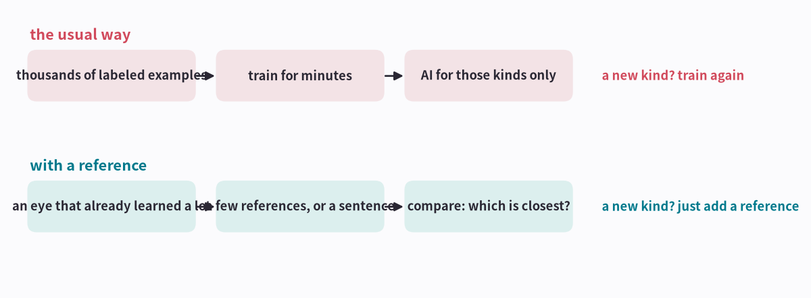

**How to read the picture**

- Top: the usual way. Adding one more kind means starting over.
- Bottom: the reference way. No training at all; just check which reference a new sound is closest to.

!!! abstract "In one line"
    With an eye that has learned a lot, a new kind only needs a reference.

*First, what it means to use an AI as an eye.*

## Picture 2 · What using it as an ‘eye’ means

The AI borrowed in [part 2](aip-teaching-sound.md) has two parts: a seeing part that looks at a sound picture and writes its features down as 768 numbers, and a choosing part that reads those numbers and picks one of 50 kinds. Using it as an eye means removing the choosing part and keeping only the seeing part.

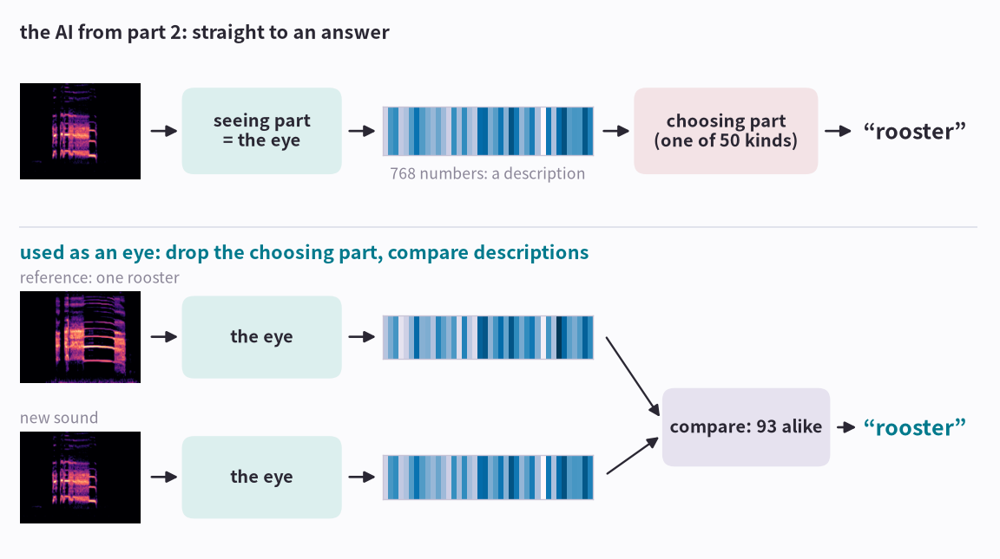

**How to read the picture**

- Top: the AI from [part 2](aip-teaching-sound.md). The seeing part writes the description and the choosing part answers “rooster”. The choosing part only knows the 50 kinds it learned.
- The striped bar is the description: the first 40 of the 768 numbers, shown as shades.
- Bottom: no choosing part. The reference and the new sound both go through the eye, and their descriptions are compared. They are 93 alike out of 100, so the answer is “rooster”.
- Think of a skilled detective: they can describe any face by its features, so one photo is enough to find someone by comparison.

!!! abstract "In one line"
    The eye doesn't pick an answer; it only describes. The answer comes from comparing with the references' descriptions.

*Spread these descriptions on a map and you can see how the eye sees sounds.*

## Picture 3 · The eye puts similar sounds together

Take the eye's description (768 numbers) of each sound. Squeeze those 768 numbers down to 2, the way a flat world map flattens the globe, and plot them: similar sounds land close together.

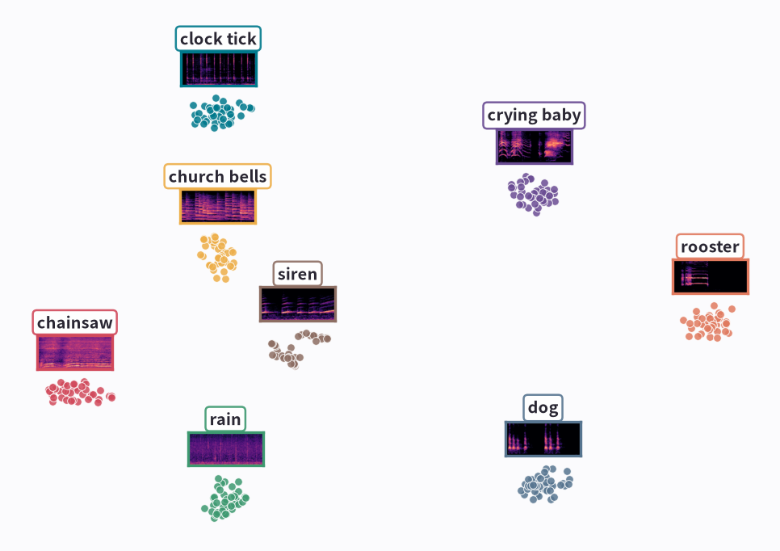

**How to read the picture**

- Each dot is one ESC-50 sound: eight familiar kinds, 320 sounds.
- The map was made without ESC-50's name tags. Color and names were added afterwards, and still each kind forms its own cluster. (This eye did already learn kinds like dog and siren from another dataset, AudioSet.)
- The small picture on each cluster is that kind's sound picture (the spectrogram from [part 1](aip-seeing-sound.md)). Pictures like these are what the eye takes in.
- So for a new sound, you only need to see which cluster it lands near.

!!! abstract "In one line"
    The eye turns a sound into a point on a map, and similar sounds land close together.

*We measured how many references it takes.*

## Picture 4 · How many references does it take

We gave a few reference sounds per kind and named each of the 400 exam sounds after the kind whose references it was closest to. No training. With several references, their descriptions are averaged into one representative for the kind, like a police sketch drawn from several witnesses.

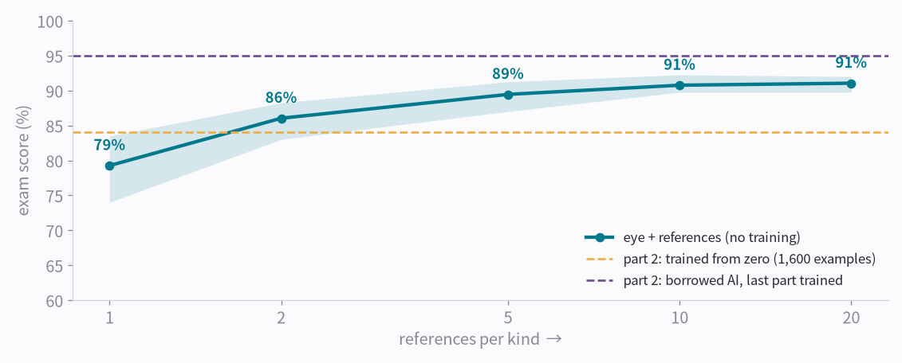

**How to read the picture**

- 1 reference: 79%. 2: 86%. 5: about 89%. 20: 91%. More witnesses make a sharper sketch, and more references make a sharper representative, so the score rises.
- With just 2 references it beat the AI trained from zero on 1,600 sounds in [part 2](aip-teaching-sound.md) (84%, yellow line).
- We redid the test 20 times with different references, picked at random. The pale band runs from the lowest score to the highest: 74-84% with one reference. Which reference you pick matters too.

!!! abstract "In one line"
    A good eye plus a few references does as well as an AI trained from zero.

*There is even a way with no reference sound at all.*

## Picture 5 · A single sentence is enough

CLAP learned sounds together with sentences describing them, so a sentence like “This is a sound of siren.” can serve as the reference.

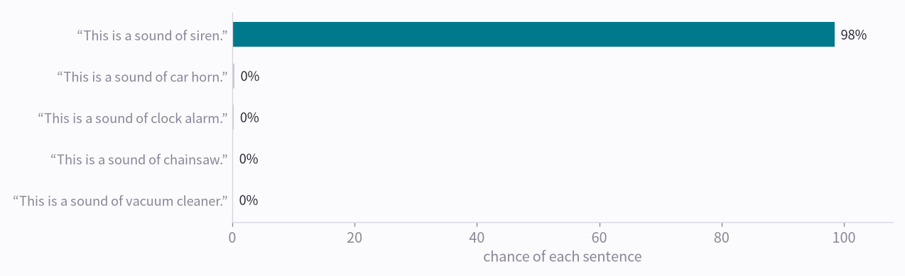

**How to read the picture**

- One exam sound (a siren) against 50 sentences: “siren” wins with 98%.
- Over all 400 exam sounds, sentences alone got 92% right.
- This number is a little optimistic: CLAP's training data includes Freesound, where ESC-50's sounds come from, so it may have heard similar ones.

!!! abstract "In one line"
    With an eye that learned sound and text together, a description becomes the reference.

*Listen to some real exam sounds.*

## Picture 6 · Hear the closest reference

**Sure, and right** · Right answer: **rooster**

<b>Exam sound</b> <audio controls preload="none" src="/assets/aip/aip-learning-from-reference-9dfe2062db.wav"></audio>

<b>Chosen reference</b> <audio controls preload="none" src="/assets/aip/aip-learning-from-reference-ac8c23a157.wav"></audio>

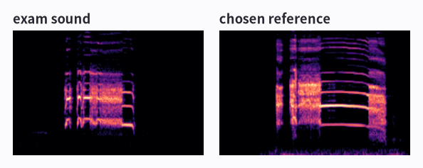

Closest references: rooster 93, hen 58, cow 19

**Right** · Right answer: **clock tick**

<b>Exam sound</b> <audio controls preload="none" src="/assets/aip/aip-learning-from-reference-846cf9c4fc.wav"></audio>

<b>Chosen reference</b> <audio controls preload="none" src="/assets/aip/aip-learning-from-reference-82d4271eae.wav"></audio>

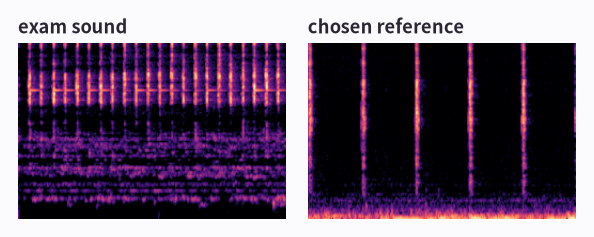

Closest references: clock tick 66, clock alarm 46, mouse click 26

**Wrong** · Right answer: **footsteps**

<b>Exam sound</b> <audio controls preload="none" src="/assets/aip/aip-learning-from-reference-91f0fcca21.wav"></audio>

<b>Chosen reference</b> <audio controls preload="none" src="/assets/aip/aip-learning-from-reference-57253cfc61.wav"></audio>

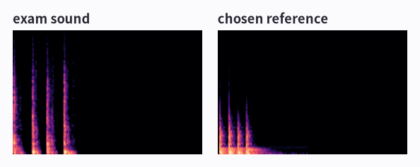

Closest references: door wood knock 80, footsteps 59, fireworks 16

**How to read the picture**

- One reference per kind only. Each card lets you hear the exam sound and the reference the AI found closest.
- The numbers show similarity: closer to 100 means more alike.
- The wrong card: footsteps judged closer to a door knock. In the sound pictures both are a few short upright stripes, so the mix-up is understandable.

!!! abstract "In one line"
    Comparing with references lets you hear and see why the AI answered as it did.

*Now to motion.*

## Picture 7 · Motion doesn't work without an eye

The same test on the phone data from [part 4](aip-teaching-motion.md). Motion still has few widely used eyes like CLAP or AST, so we compared vibration pictures directly.

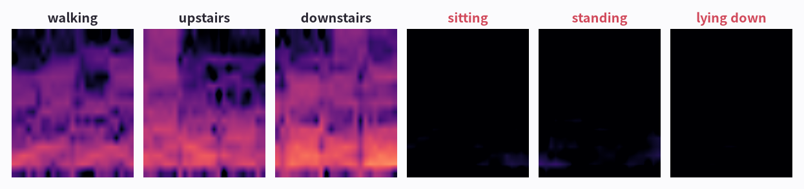

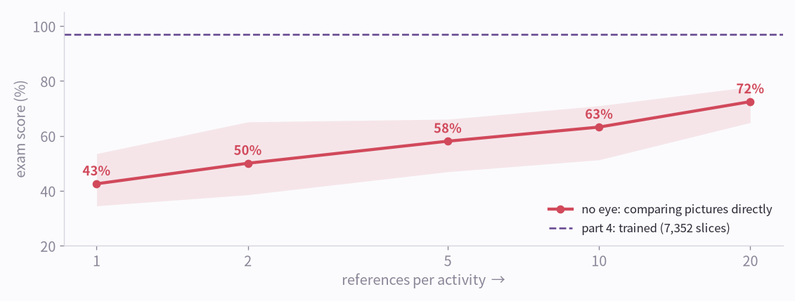

**How to read the picture**

- Top: the vibration pictures from [part 4](aip-teaching-motion.md). Sitting, standing and lying down barely move, so all three are nearly black. Comparing pictures directly can hardly tell them apart. Sitting and standing were the pair that even the trained AI mixed up in picture 6 of [part 4](aip-teaching-motion.md).
- Bottom: 1 reference: 43%. 5: 58%. 20: 72%.
- Far below the 97% of the AI trained in [part 4](aip-teaching-motion.md).

!!! abstract "In one line"
    The reference way needs a good eye; comparing raw pictures isn't enough.

*So we built a motion eye.*

## Picture 8 · A narrow eye struggles with new activities

For example, we taught an eye the five activities other than lying down, then registered lying down from just 5 references. We repeated this leaving out each activity in turn.

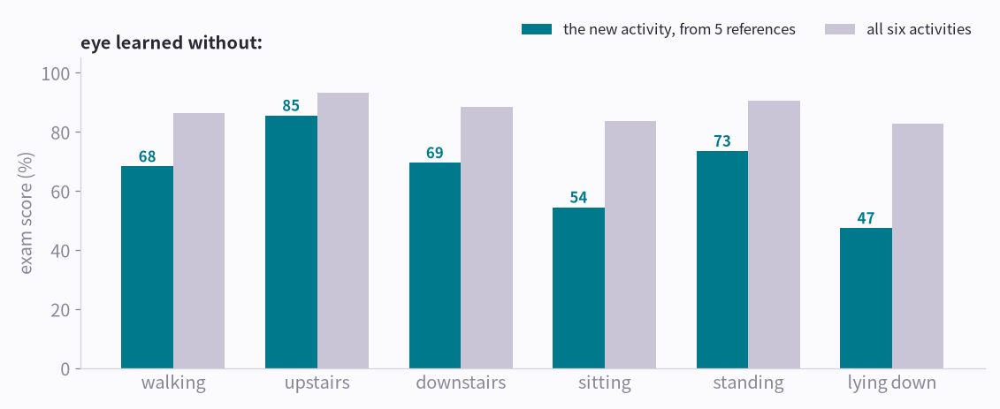

**How to read the picture**

- Gray: all six together score 83-93%, far better than without an eye (58%).
- Teal: the newly registered activity alone scores 47-85%, 66% on average.
- Upstairs (85%) resembles the walking the eye learned (see the vibration pictures in picture 7), which likely makes it easy. Lying down (47%) and sitting (54%) seem to need features the eye never learned.

!!! abstract "In one line"
    An eye recognizes things like what it learned. To recognize something truly new, it has to learn far more broadly.

*How to learn broadly, and how to see sound and motion together.*

## Picture 9 · One eye for sound and motion together

Simulation is one way to build a broad eye: generate lots of virtual swings while randomizing the swing, sensor placement, body, the range's echo and the distance to the next bay (domain randomization), then mix in some real swings. And learn sound and motion together, not separately.

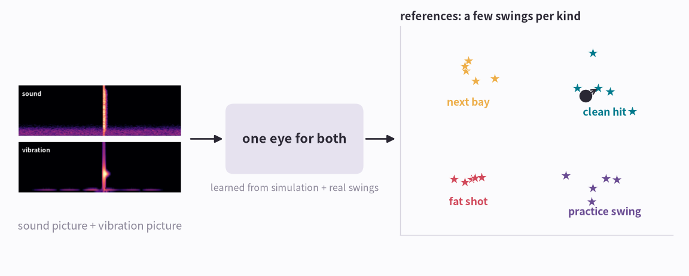

**How to read the picture**

- Sound and vibration pictures from the same moment are pulled close on the map, the way CLAP paired sound with text; Meta's ImageBind bound video, sound, text and IMU into one space like this.
- At the same time a next-bay tock (sound only) or a practice swing (motion only) is pushed far from your clean hit.
- A new kind is registered from a few swings. The right side is a concept drawing, not an experiment.

!!! abstract "In one line"
    An eye that learned sound and motion together, broadly, can recognize a new move from a few references.

*Five lines to finish.*

## The whole thing in five lines

1. Use an AI that learned a lot as an eye, and you don't retrain for each new kind.
2. Give a few references (or one sentence) and name things after the closest reference.
3. Sound already has good eyes, so a few references are enough.
4. Motion still lacks a broadly trained eye; learning broadly from simulation is the next step.
5. An eye that learned sound and motion together can tell the real thing from look-alikes in only one of them.

----

**Series** · [← Part 4, Teaching Motion](aip-teaching-motion.md) · [Part 6, An Eye Taught in Simulation →](aip-eye-from-simulation.md)

### Sources and notices

Sound: ESC-50 (K. J. Piczak, CC BY-NC); eye: AST (Gong, Chung, Glass; MIT/ast-finetuned-audioset-10-10-0.4593, BSD-3-Clause); text model: LAION CLAP (laion/clap-htsat-unfused, Apache-2.0). Motion: UCI HAR (Anguita et al. 2013, CC BY 4.0). Experiments ran on one RTX 3090. Picture 9 is a concept drawing. Meta and ImageBind are trademarks of Meta Platforms, Inc., and NVIDIA and GeForce RTX of NVIDIA Corporation, used here only to refer to them.

### Terms

- *the eye's numbers*: embedding
- *recognizing from a few references*: few-shot (one-shot with one)
- *recognizing from a sentence*: zero-shot
- *average of the references*: prototype
- *similarity*: cosine similarity
- *flat map*: t-SNE
- *AI that learned sound with text*: CLAP (contrastive language-audio pretraining)
- *one eye for sound and motion*: multimodal joint embedding
- *simulating with random changes*: domain randomization
- *a broadly trained eye*: foundation model (general-purpose representation)
- *learning in simulation, using it for real*: sim-to-real
