# 보는 AI 5편: 레퍼런스만 주면 알아보는 AI

> **보는 AI · 5편.** 그림으로 보는 소리·움직임 AI 시리즈예요. [0편부터 읽기](aip-robot-senses.md)

[2편](aip-teaching-sound.md)과 [4편](aip-teaching-motion.md)에서는 AI를 예제 수천 개로 학습시켰어요. 이번엔 학습 없이, 레퍼런스 몇 개나 글 한 줄만 주고 알아보게 해요. 아래 숫자는 모두 직접 잰 결과예요(마지막 그림만 개념도예요).

*그림 9장 · 수식 없음 · 진짜 실험 결과 · 시험 소리 듣기 · 10분 정도*

---

## 그림 1 · 가르치는 대신, 레퍼런스만 보여 주기

지금까지는 새 종류가 생기면 이름표 붙은 예제를 다시 모으고 다시 학습해야 했어요. 이번 편은 다른 방법이에요. 이미 많이 배운 AI를 ‘눈’으로만 쓰고, 알아볼 대상은 레퍼런스(비교할 본보기) 몇 개나 글 한 줄로 알려 줘요.

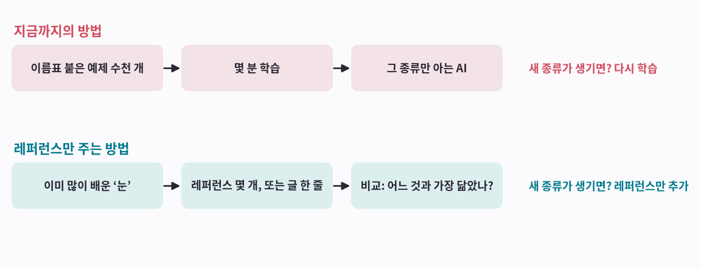

**그림 보는 법**

- 위: 지금까지의 방법이에요. 종류를 하나 더하려면 처음부터 다시 해요.
- 아래: 레퍼런스만 주는 방법이에요. 학습은 한 번도 안 하고, 새 소리가 어느 레퍼런스와 가장 닮았는지만 비교해요.

!!! abstract "한 줄 정리"
    많이 배운 ‘눈’이 있으면, 새 종류는 레퍼런스만 보여 줘도 돼요.

*먼저 ‘눈’으로 쓴다는 게 무슨 뜻인지부터 볼게요.*

## 그림 2 · ‘눈’으로 쓴다는 건

[2편](aip-teaching-sound.md)에서 빌린 AI는 두 부분으로 되어 있어요. 소리 그림을 보고 특징을 숫자 768개로 적는 ‘보는 부분’과, 그 메모를 보고 50종류 중 하나를 고르는 ‘고르는 부분’이에요. ‘눈’으로 쓴다는 건 고르는 부분을 떼어 내고 보는 부분만 쓰는 거예요.

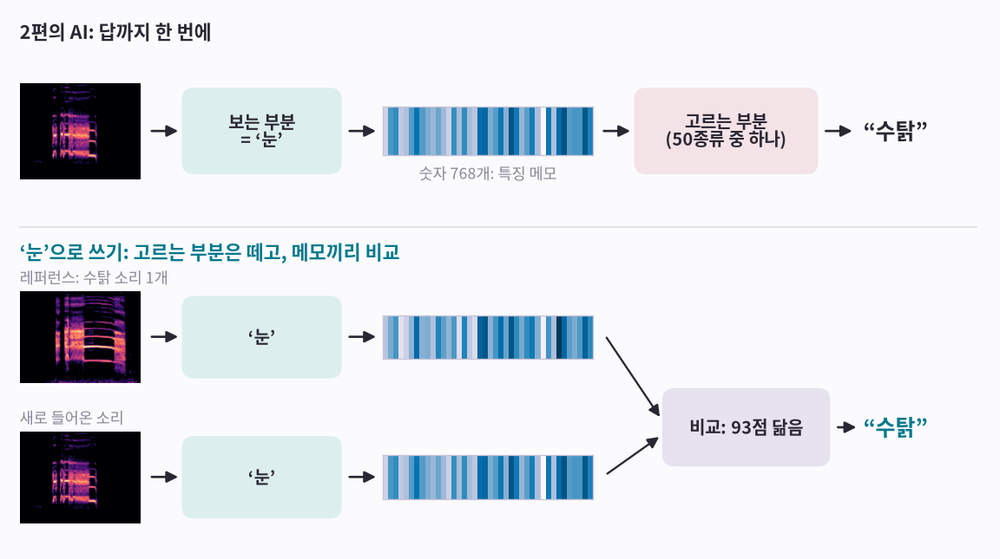

**그림 보는 법**

- 위: [2편](aip-teaching-sound.md)의 AI예요. 보는 부분이 메모를 적고, 고르는 부분이 “수탉”이라고 답해요. 고르는 부분은 배운 50종류밖에 몰라요.
- 줄무늬가 메모예요. 숫자 768개 중 처음 40개만 색으로 칠했어요.
- 아래: 고르는 부분 없이, 레퍼런스 소리와 새 소리를 둘 다 ‘눈’에 보여 주고 메모끼리 비교해요. 두 메모가 93점만큼 닮아서 “수탉”이라고 답해요.
- 몽타주와 비슷해요. 숙련된 형사는 처음 보는 얼굴도 특징으로 묘사할 수 있어서, 사진 한 장만 있으면 비교해서 사람을 찾아요.

!!! abstract "한 줄 정리"
    ‘눈’은 답을 고르지 않고 특징을 적기만 해요. 답은 레퍼런스의 메모와 비교해서 정해요.

*이 메모들을 지도에 펼치면 ‘눈’이 소리를 어떻게 보는지 보여요.*

## 그림 3 · ‘눈’은 닮은 소리끼리 모아 놓아요

소리마다 ‘눈’의 메모(숫자 768개)를 받아서, 지구본을 평면 지도로 펴듯 2개로 줄여 지도에 찍어 보면 닮은 소리끼리 가까이 모여요.

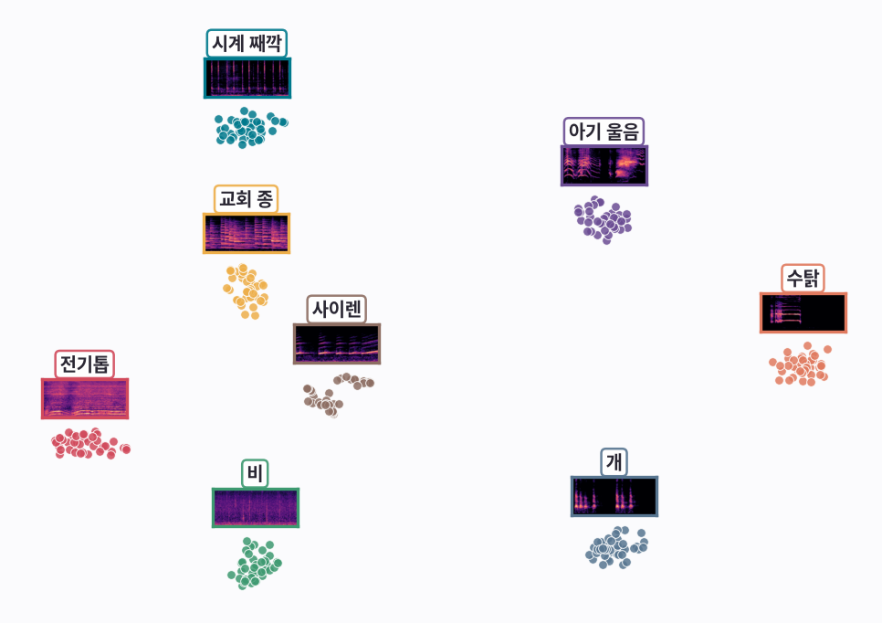

**그림 보는 법**

- 점 하나가 ESC-50 소리 하나예요. 익숙한 8종류, 소리 320개를 찍었어요.
- 지도를 만들 때 ESC-50의 이름표는 쓰지 않았어요. 색과 이름은 나중에 칠했는데도, 같은 종류끼리 덩어리가 져요. 다만 이 ‘눈’은 다른 자료(AudioSet)로 개, 사이렌 같은 종류를 이미 배운 상태예요.
- 덩어리마다 붙은 작은 그림은 그 종류의 소리 그림([1편](aip-seeing-sound.md)의 스펙트로그램)이에요. ‘눈’이 받는 것도 이런 소리 그림이에요.
- 그러니 새 소리가 들어오면, 지도에서 어느 덩어리 근처에 떨어지는지만 보면 돼요.

!!! abstract "한 줄 정리"
    ‘눈’이 하는 일은 소리를 지도 위 한 점으로 바꾸는 거예요. 닮은 소리는 가까이 떨어져요.

*레퍼런스가 몇 개 있어야 하는지는 직접 재 봤어요.*

## 그림 4 · 레퍼런스 몇 개면 될까요

종류마다 레퍼런스 소리를 몇 개씩만 주고, 시험 소리 400개가 어느 종류의 레퍼런스와 가장 닮았는지로 맞혀 봤어요. 학습은 0번이에요. 레퍼런스가 여러 개면 메모들의 평균을 그 종류의 대표로 써요. 몽타주로 치면, 목격자 여러 명의 말을 합쳐 그린 얼굴 하나예요.

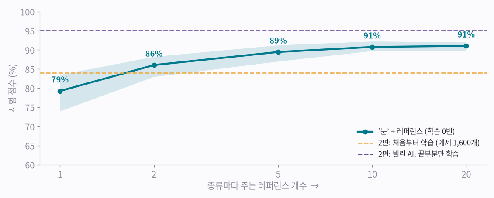

**그림 보는 법**

- 레퍼런스 1개면 79%, 2개면 86%, 5개면 약 89%, 20개면 91%예요. 목격자가 많을수록 몽타주가 또렷해지듯, 레퍼런스가 늘수록 대표가 또렷해져서 점수가 올라요.
- 레퍼런스 2개만으로 [2편](aip-teaching-sound.md)에서 1,600개로 처음부터 가르친 AI(84%, 노란 점선)를 넘었어요.
- 레퍼런스를 무작위로 바꿔 가며 20번 다시 시험했어요. 옅은 띠는 그중 가장 낮은 점수부터 가장 높은 점수까지예요. 레퍼런스 1개일 땐 74~84%로 차이가 커요. 어떤 레퍼런스를 고르느냐도 중요해요.

!!! abstract "한 줄 정리"
    좋은 ‘눈’에 레퍼런스 몇 개만 더하면, 처음부터 학습시킨 AI만큼 알아봐요.

*레퍼런스 소리가 아예 없어도 되는 방법도 있어요.*

## 그림 5 · 글 한 줄만으로도 알아봐요

CLAP은 소리와 그 소리를 설명하는 글을 짝지어 배운 AI예요. 그래서 레퍼런스 소리 대신 “이건 사이렌 소리예요” 같은 글을 레퍼런스로 쓸 수 있어요(실험에서는 “This is a sound of siren.”처럼 영어 문장을 썼어요).

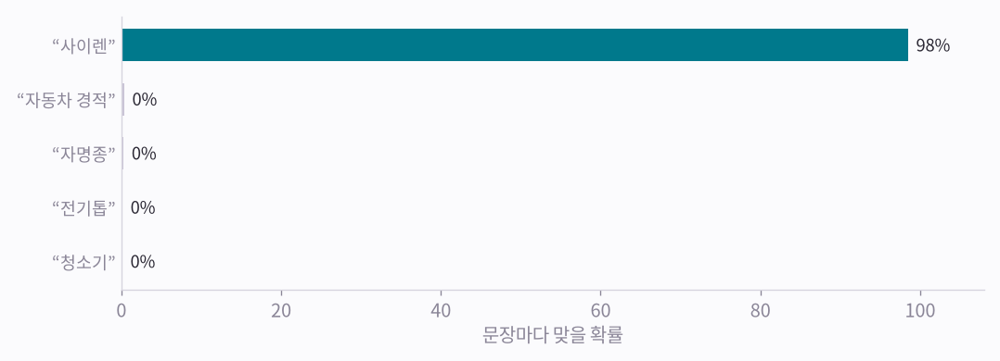

**그림 보는 법**

- 시험 소리 하나(사이렌)를 들려주고, 50종류의 설명 글 중 어느 것과 맞는지 물었어요. “사이렌” 문장이 98%로 압도적이에요.
- 시험 소리 400개 전체로는 레퍼런스 소리 없이 글만으로 92%를 맞혔어요.
- 다만 이 숫자는 조금 낙관적이에요. CLAP이 배운 자료에 ESC-50의 출처(Freesound) 소리가 섞여 있어서, 비슷한 소리를 이미 들어 봤을 수 있어요.

!!! abstract "한 줄 정리"
    소리와 글을 함께 배운 ‘눈’에게는 글 설명이 곧 레퍼런스예요.

*실제 시험 소리로 직접 들어 볼게요.*

## 그림 6 · 가장 닮은 레퍼런스, 직접 들어 보기

**확신하고 맞힘** · 정답: **수탉**

<b>시험 소리</b> <audio controls preload="none" src="/assets/aip/aip-learning-from-reference-9dfe2062db.wav"></audio>

<b>고른 레퍼런스</b> <audio controls preload="none" src="/assets/aip/aip-learning-from-reference-ac8c23a157.wav"></audio>

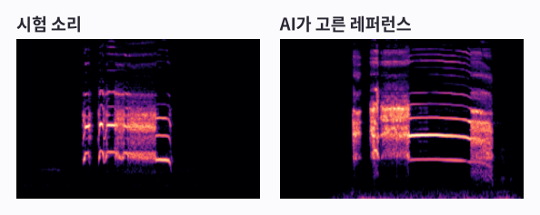

가장 닮은 레퍼런스 1~3위: 수탉 93, 암탉 58, 소 19

**맞힘** · 정답: **시계 째깍**

<b>시험 소리</b> <audio controls preload="none" src="/assets/aip/aip-learning-from-reference-846cf9c4fc.wav"></audio>

<b>고른 레퍼런스</b> <audio controls preload="none" src="/assets/aip/aip-learning-from-reference-82d4271eae.wav"></audio>

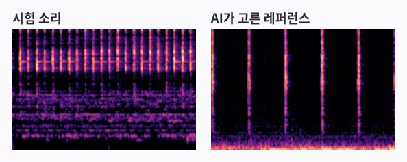

가장 닮은 레퍼런스 1~3위: 시계 째깍 66, 자명종 46, 마우스 클릭 26

**틀림** · 정답: **발소리**

<b>시험 소리</b> <audio controls preload="none" src="/assets/aip/aip-learning-from-reference-91f0fcca21.wav"></audio>

<b>고른 레퍼런스</b> <audio controls preload="none" src="/assets/aip/aip-learning-from-reference-57253cfc61.wav"></audio>

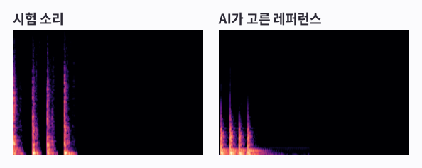

가장 닮은 레퍼런스 1~3위: 문 노크 80, 발소리 59, 불꽃놀이 16

**그림 보는 법**

- 종류마다 레퍼런스 소리를 딱 1개만 주고 맞힌 결과예요. 카드마다 시험 소리와, AI가 가장 닮았다고 고른 레퍼런스 소리를 들어 볼 수 있어요.
- 숫자는 닮은 정도예요. 100에 가까울수록 많이 닮았어요.
- 틀린 카드: 발소리를 문 노크와 더 닮았다고 봤어요. 소리 그림을 보면 둘 다 짧은 세로줄이 몇 개 늘어선 모양이라, 헷갈릴 만해요.

!!! abstract "한 줄 정리"
    레퍼런스와 비교하는 방식은, AI가 왜 그렇게 답했는지 귀와 눈으로 확인할 수 있다는 게 장점이에요.

*이제 움직임으로 넘어가요.*

## 그림 7 · 움직임은 ‘눈’이 없으면 잘 안 돼요

[4편](aip-teaching-motion.md)의 폰 동작 데이터로 같은 실험을 했어요. 다만 IMU에는 소리의 CLAP이나 AST처럼 널리 쓰이는 ‘눈’이 아직 드물어서, 진동 그림끼리 바로 비교했어요.

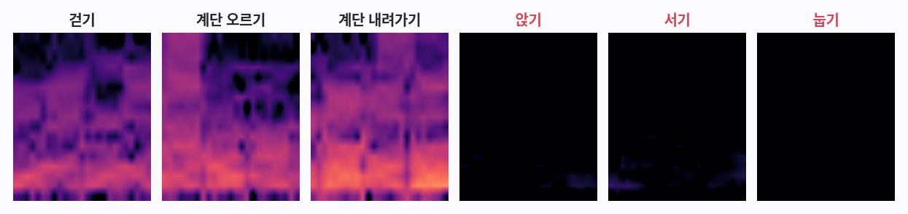

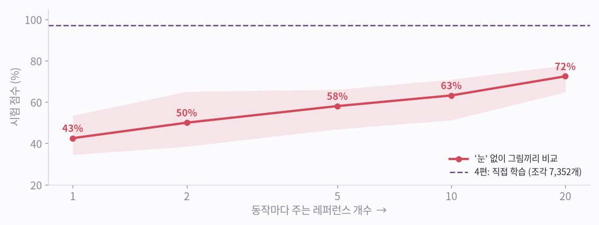

**그림 보는 법**

- 위: [4편](aip-teaching-motion.md)의 진동 그림이에요. 앉기, 서기, 눕기는 몸이 거의 안 움직여서 셋 다 거의 까매요. 그림끼리 바로 비교해서는 이 셋을 가르기 어려워요. 앉기와 서기는 [4편](aip-teaching-motion.md) 그림 6에서 직접 학습한 AI도 헷갈린 짝이에요.
- 아래: 레퍼런스 1개면 43%, 5개면 58%, 20개면 72%예요.
- [4편](aip-teaching-motion.md)에서 직접 학습한 AI(97%)와는 차이가 커요.

!!! abstract "한 줄 정리"
    레퍼런스 방식의 성패는 ‘눈’에 달려 있어요. 그림끼리 바로 비교해서는 부족해요.

*그래서 움직임의 ‘눈’을 직접 만들어 봤어요.*

## 그림 8 · 좁게 배운 ‘눈’은 처음 보는 동작에 약해요

예를 들어 눕기를 뺀 다섯 동작으로만 ‘눈’을 가르친 뒤, 눕기는 레퍼런스 5개만 보여 주고 새로 등록했어요. 빼는 동작을 하나씩 바꿔 가며 모두 여섯 번 해 봤어요.

**그림 보는 법**

- 회색: 여섯 동작 전체 점수는 83~93%예요. ‘눈’이 없을 때(58%)보다 훨씬 좋아요.
- 청록: 새로 등록한 동작만 보면 47~85%, 평균 66%예요.
- 계단 오르기(85%)는 그림 7의 진동 그림에서 보듯 ‘눈’이 배운 걷기와 비슷해서 잘 알아보는 것으로 보여요. 눕기(47%)와 앉기(54%)는 ‘눈’이 배운 적 없는 특징이 필요해서 어려운 것 같아요.

!!! abstract "한 줄 정리"
    좁게 배운 ‘눈’은 배운 것과 비슷한 것만 잘 알아봐요. 처음 보는 것까지 알아보려면 훨씬 넓게 배워야 해요.

*넓게 배우는 방법, 그리고 소리와 움직임을 함께 보는 방법을 볼게요.*

## 그림 9 · 소리와 움직임을 함께 보는 ‘눈’

넓게 배운 ‘눈’을 만드는 한 가지 방법이 시뮬레이션이에요. 스윙, 센서 위치, 체형, 연습장 울림, 옆 타석까지의 거리를 무작위로 바꿔 가며 가상 데이터를 잔뜩 만들고(도메인 랜덤화), 실제 스윙 몇 개를 섞어 배워요. 이때 소리와 움직임을 따로가 아니라 함께 배우게 해요.

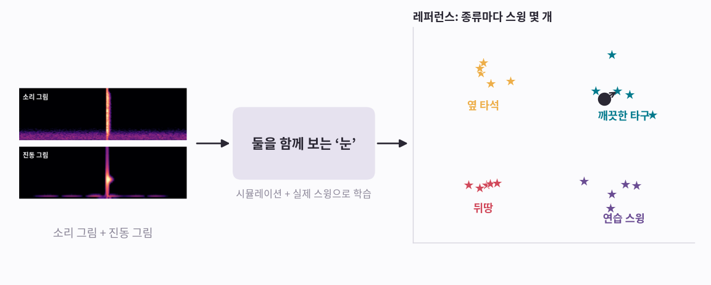

**그림 보는 법**

- 같은 순간의 소리 그림과 진동 그림이 지도에서 가까이 놓이도록 배워요. CLAP이 소리와 글을 짝지어 배운 것과 같은 방식이고, Meta의 ImageBind가 영상, 소리, 글, IMU를 이렇게 한 공간에 묶은 연구예요.
- 이때 소리만 닮은 옆 타석이나 움직임만 닮은 연습 스윙은 내 타구와 멀리 떨어지도록 함께 배워요.
- 새 종류는 스윙 몇 개를 레퍼런스로 등록하면 돼요. 오른쪽은 그 모습을 그린 개념도예요(실험한 결과는 아니에요).

!!! abstract "한 줄 정리"
    소리와 움직임을 함께, 그리고 넓게 배운 ‘눈’이라면 레퍼런스 몇 개로 새 동작까지 알아볼 수 있어요.

*아래에 다섯 줄로 정리했어요.*

## 다섯 줄 정리

1. 많이 배운 AI를 ‘눈’으로 쓰면, 새 종류마다 다시 학습하지 않아도 돼요.
2. 레퍼런스 몇 개(또는 설명 글 한 줄)만 주고, 가장 닮은 레퍼런스의 이름을 붙여요.
3. 소리는 이미 좋은 ‘눈’이 있어서 레퍼런스 몇 개면 충분해요.
4. 움직임은 아직 넓게 배운 ‘눈’이 부족해요. 시뮬레이션으로 넓게 배우게 하는 게 다음 단계예요.
5. 소리와 움직임을 함께 배운 ‘눈’이면, 소리만 닮거나 움직임만 닮은 것과 진짜를 구별해요.

----

**시리즈** · [← 4편, 움직임을 알아보는 AI](aip-teaching-motion.md) · [6편, 시뮬레이션으로 배운 ‘눈’ →](aip-eye-from-simulation.md)

### 출처와 표기

소리: ESC-50 (K. J. Piczak, CC BY-NC), ‘눈’: AST (Gong, Chung, Glass), 글 모델: LAION CLAP(laion/clap-htsat-unfused). 움직임: UCI HAR (Anguita 외 2013, CC BY 4.0). 실험은 RTX 3090 한 대에서 했어요. 그림 9는 개념도예요. Meta·ImageBind는 Meta Platforms, Inc.의, NVIDIA·GeForce RTX는 NVIDIA Corporation의 상표이며, 지칭 목적으로만 사용했습니다.

### 용어 설명

- *‘눈’이 바꾼 숫자 묶음*: 임베딩(embedding)
- *레퍼런스 몇 개로 알아보기*: 퓨샷(few-shot), 1개면 원샷(one-shot)
- *레퍼런스 없이 글로 알아보기*: 제로샷(zero-shot)
- *레퍼런스들의 평균*: 프로토타입(prototype)
- *닮은 정도*: 코사인 유사도
- *평면 지도*: t-SNE
- *소리와 글을 함께 배운 AI*: CLAP (대조 학습한 언어-오디오 모델)
- *소리와 움직임을 함께 보는 ‘눈’*: 멀티모달 공동 임베딩
- *무작위로 바꿔 가며 시뮬레이션*: 도메인 랜덤화
- *넓게 배운 ‘눈’*: 파운데이션 모델 (일반화된 표현)
- *시뮬레이션에서 배워 진짜에 쓰기*: sim-to-real
