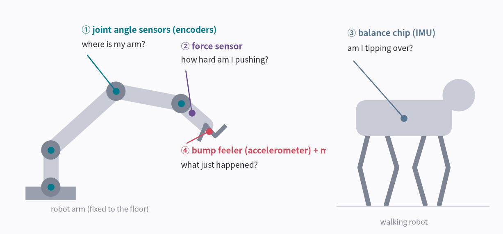
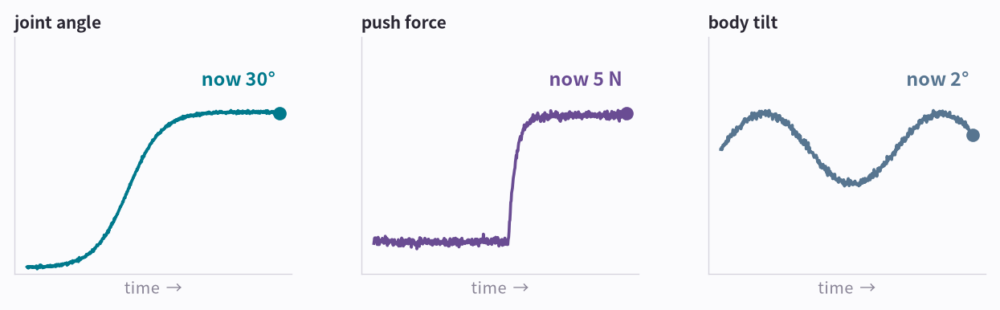
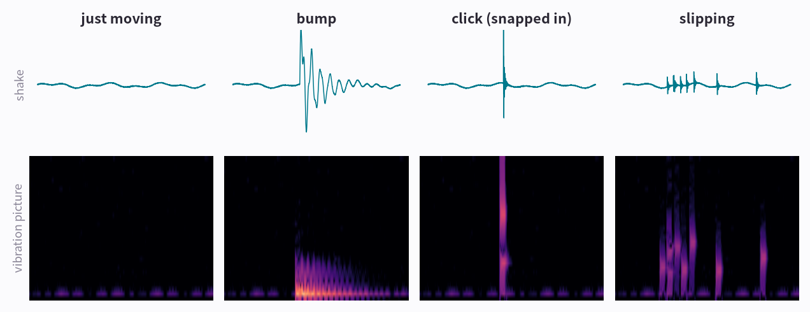
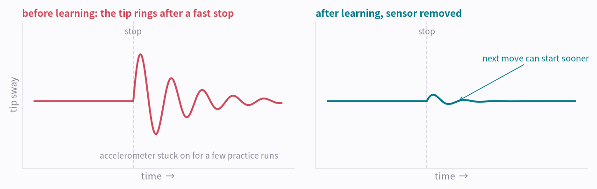

# AI in Pictures Part 0: How Robots Feel

> **AI in Pictures · Part 0.** The first post of a picture-first series on sound and motion AI. It starts from a robot's senses; parts 1-6 turn sound and motion into pictures for an AI.

Robots feel the world through several senses. Most of them answer with a single number, but one doesn't. Handling that one takes an AI that looks at pictures, and that is what AI in Pictures is about.

*4 pictures · no formulas · about 5 minutes*

---

<video controls playsinline preload="metadata" src="/assets/aip/aip-robot-senses-video-325af68209.mp4" style="width:100%"></video>

*AI-generated video. Underneath is the picture of its sound (a spectrogram). When the robot sets the block down, a bright upright stripe appears in the sound picture. A robot has to tell what just happened from shaking and sound like this.*

## Picture 1 · Robots have senses too

With your eyes closed you still know where your arm is, how heavy a thing feels and whether you're leaning. Robots get similar senses from sensors. Here are a factory robot arm and a walking robot.

**How to read the picture**

- ① Joint angle sensors (encoders): each joint measures how far its motor has turned. Knowing every joint angle, the robot can work out where its hand is. It's the sense that tells you where your arm is with your eyes closed.
- ② Force sensor: measures how hard the wrist pushes and twists. It's the weight you feel in your hand. Universal Robots' e-Series has one built into the wrist; FANUC offers one as an option. Even without one, a motor using more electricity than usual tells the robot it has probably been blocked or bumped.
- ③ Balance chip (IMU): a fingernail-sized chip that feels shaking and turning together. Your phone has one, and [part 3, Seeing Motion](aip-seeing-motion.md), looks at it closely. A robot arm bolted to the floor gets by with joint angles, but a walking robot must know whether its whole body is tipping, or it falls over. It's your inner-ear balance.
- ④ Bump feeler (accelerometer) and microphone: they feel the shaking and hear the sound at the hand. They are what this series is about.

!!! abstract "In one line"
    A robot feels position, force, tilt and shaking with different sensors.

*The first three give simple answers.*

## Picture 2 · Three senses answer with one number

**How to read the picture**

- The joint angle sensor says “30° now”, the force sensor “5 N now”, the balance chip “tilted 2° now”. N (newton) is the unit of force: 5 N is about the weight you feel holding a 500 g object.
- One number is the answer, so the robot only checks whether it crosses a set limit. For example, it can stop when the push goes over 50 N (the weight of about 5 kg).

!!! abstract "In one line"
    Position, force and tilt can be read straight from one current value.

*“What just happened?” is different: one number can't answer it.*

## Picture 3 · “What just happened?” needs the shape of the shaking

Here is the shaking a bump feeler at the hand would feel in four situations (signals made for illustration). Top: the shaking as a wiggle. Bottom: the same shaking drawn as a vibration picture, the way [part 1, Seeing Sound](aip-seeing-sound.md), draws sound.

**How to read the picture**

- Just moving: slow and gentle. Only a faint glow along the bottom.
- Bump: a big, dull blob that lingers low in the picture (slow shaking).
- Click (snapped in): one very short upright stripe, the same shape as the golf “tock” in [part 3](aip-seeing-motion.md).
- Slipping: small stripes that come irregularly, again and again, as it sticks and slips.
- By size alone, a bump and a click can look alike, since both jump high. The shape tells them apart.

!!! abstract "In one line"
    What happened isn't in one number but in the shape of the shaking. That's why an AI that reads pictures is needed.

*Real factory robots already measure shaking and learn from it.*

## Picture 4 · Factory robots learn from shaking too

FANUC robots have a feature called Learning Vibration Control. A bump feeler is attached to the hand and the same motion is run a few times, so the robot learns how much its hand sways after a fast stop. Then the sensor comes off, and the robot moves in a way that keeps the sway down.

**How to read the picture**

- Left: before learning. After a fast stop the hand keeps swaying for a while (a concept drawing).
- Right: after learning. The sway is small, so the next move can start sooner. FANUC says cycle times drop by 10-15%.
- Universal Robots also has a bump feeler in the wrist, but it measures only a few times a second and includes gravity, so it is reportedly used mainly to check how the robot is mounted. To study shaking closely, people add a separate sensor.
- Factories also attach vibration sensors to catch parts such as the gears inside a motor shaking differently before they fail.

!!! abstract "In one line"
    Robots already measure shaking and learn from it. To tell what happened from shaking, they need an AI that reads vibration pictures.

*How does that AI read pictures? It starts with sound.*

## The whole thing in three lines

1. A robot feels position with joint angle sensors, force with a force sensor or the motor's electricity use, and tilt with a balance chip.
2. Those answer with one number, but “what just happened?” lives in the shape of shaking and sound.
3. Reading that shape takes an AI that turns shaking and sound into pictures. Part 1 shows how.

----

**Series** · [Part 1, Seeing Sound →](aip-seeing-sound.md)

*Related: [Choosing a Physical AI Approach](choosing-physical-ai.md) · [Hands-on Notes, Part 0: Learning Without a Real Industrial Robot](learn-without-industrial-robot.md)*

### Sources and notices

Robot facts: FANUC Learning Vibration Control (LVC) flyer, Universal Robots e-Series datasheets and RTDE guide. Picture 1 is a drawing; the signals in pictures 3 and 4 were made for illustration. FANUC is a trademark of FANUC Corporation and Universal Robots of Universal Robots A/S, used here only to refer to them.

### Terms

- *joint angle sensor*: rotary encoder (absolute encoder)
- *working out the hand's position from joint angles*: forward kinematics
- *force sensor*: 6-axis force/torque sensor
- *guessing a bump from the motor's electricity use*: collision detection from motor current (disturbance torque)
- *balance chip*: IMU (inertial measurement unit), attitude estimation
- *bump feeler*: accelerometer
- *FANUC's learning feature*: Learning Vibration Control (LVC)
- *catching a failure early from shaking*: predictive maintenance, vibration monitoring
