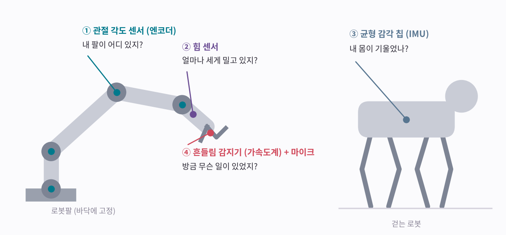
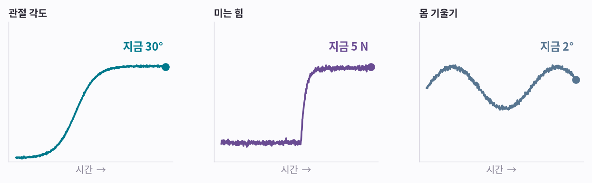
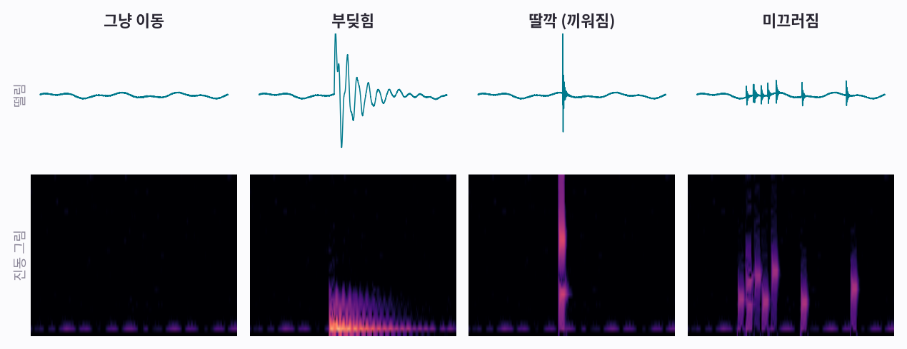
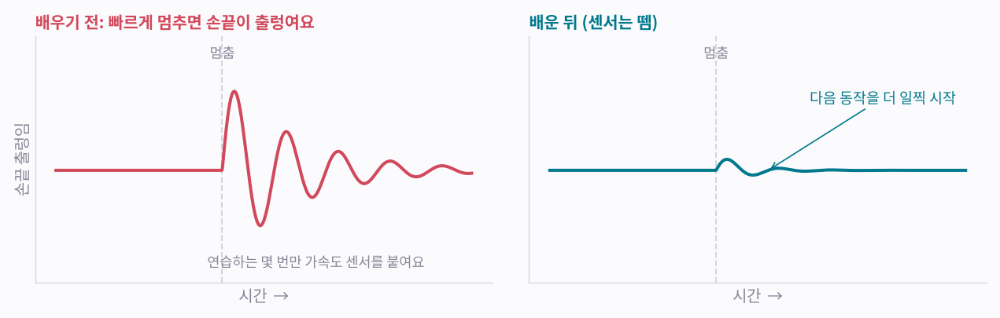

# 보는 AI 0편: 로봇은 무엇으로 느낄까

> **보는 AI · 0편.** 그림으로 보는 소리·움직임 AI 시리즈의 첫 글이에요. 로봇의 감각에서 시작해 1~5편에서 소리와 움직임을 그림으로 바꿔 AI에게 보여 줘요.

로봇은 여러 감각으로 세상을 느껴요. 대부분은 숫자 하나로 답이 나오지만, 하나는 그렇지 않아요. 그 감각을 다루려면 그림을 보는 AI가 필요하고, 이 시리즈 「보는 AI」가 다루는 게 바로 그거예요.

*그림 4장 · 수식 없음 · 5분 정도*

---

<video controls playsinline preload="metadata" src="/assets/aip/aip-robot-senses-video-22fa368d70.mp4" style="width:100%"></video>

*AI로 만든 영상이에요. 아래는 이 영상 소리의 그림(스펙트로그램)이에요. 로봇이 블록을 내려놓는 순간 소리 그림에 밝은 세로줄이 생겨요. 로봇은 이런 떨림과 소리로 ‘방금 무슨 일이 있었는지’ 알아야 해요.*

## 그림 1 · 로봇도 감각이 있어요

사람은 눈을 감아도 내 팔이 어디 있는지, 물건이 얼마나 무거운지, 몸이 기울었는지 알아요. 로봇도 비슷한 감각을 센서로 가져요. 공장의 로봇팔과 걷는 로봇을 예로 볼게요.

**그림 보는 법**

- ① 관절 각도 센서(엔코더): 관절마다 모터가 몇 도 돌았는지 재요. 관절 각도를 모두 알면 손끝 위치는 계산으로 나와요. 눈 감고도 내 팔 위치를 아는 감각이에요.
- ② 힘 센서: 손목에서 미는 힘과 비트는 힘을 재요. 손에 느껴지는 무게와 같아요. Universal Robots의 e-시리즈는 손목에 기본으로 들어 있고, 화낙은 옵션으로 달아요. 힘 센서가 없어도, 모터가 평소보다 전기를 많이 쓰면 ‘어딘가에 막혔다, 부딪혔다’고 짐작할 수 있어요.
- ③ 균형 감각 칩(IMU): 흔들림과 회전을 함께 느끼는 손톱만 한 칩이에요. 여러분 폰에도 들어 있고, [3편 「움직임을 보다」](aip-seeing-motion.md)에서 자세히 봐요. 바닥에 고정된 로봇팔은 관절 각도만으로 충분하지만, 걷는 로봇은 몸 전체가 기울었는지 알아야 넘어지지 않아요. 귓속 균형 감각과 같아요.
- ④ 흔들림 감지기(가속도계)와 마이크: 손끝의 떨림과 소리를 느껴요. 이 시리즈의 주인공이에요.

!!! abstract "한 줄 정리"
    로봇은 위치, 힘, 기울기, 떨림을 각각 다른 센서로 느껴요.

*앞의 세 감각은 답이 간단해요.*

## 그림 2 · 세 감각은 숫자 하나로 답해요

**그림 보는 법**

- 관절 각도 센서는 “지금 30°”, 힘 센서는 “지금 5 N”, 균형 감각 칩은 “지금 2° 기울었어요”처럼 답해요. N(뉴턴)은 힘의 단위로, 5 N은 500 g쯤 되는 물건을 들 때 손에 느껴지는 무게예요.
- 숫자 하나가 곧 답이라서, 정해 둔 값을 넘는지만 보면 돼요. 예를 들어 미는 힘이 50 N(5 kg쯤 되는 물건의 무게)을 넘으면 멈추게 할 수 있어요.

!!! abstract "한 줄 정리"
    위치, 힘, 기울기는 지금 값 하나만 읽으면 알 수 있어요.

*그런데 ‘방금 무슨 일이 있었지?’는 숫자 하나로 답이 안 나와요.*

## 그림 3 · ‘방금 무슨 일이?’는 떨림의 모양을 봐야 해요

손끝의 흔들림 감지기가 잰 떨림을 네 가지 상황으로 그려 봤어요(설명을 위해 만든 신호예요). 위는 떨림 물결, 아래는 같은 떨림을 [1편 「소리를 보다」](aip-seeing-sound.md)와 같은 방법으로 그린 진동 그림이에요.

**그림 보는 법**

- 그냥 이동: 느리고 잔잔해요. 그림 바닥에만 희미하게 남아요.
- 부딪힘: 크고 둔한 덩어리가 그림 아래쪽(느린 떨림)에 한동안 남아요.
- 딸깍 끼워짐: 아주 짧은 세로줄 하나예요. [3편](aip-seeing-motion.md)의 골프공 ‘딱’과 같은 모양이에요.
- 미끄러짐: 작은 세로줄이 불규칙하게 여러 번 생겨요. 붙었다 미끄러졌다를 되풀이하거든요.
- 흔들림의 크기만 보면 부딪힘과 딸깍을 헷갈릴 수 있어요. 둘 다 크게 튀니까요. 모양을 봐야 구별돼요.

!!! abstract "한 줄 정리"
    ‘무슨 일이 있었나’는 숫자 하나가 아니라 떨림의 모양에 담겨 있어요. 그래서 그림을 읽는 AI가 필요해요.

*실제 공장 로봇도 이미 떨림을 재고 배워요.*

## 그림 4 · 공장 로봇도 떨림을 배워요

화낙(FANUC) 로봇에는 ‘학습 진동 제어’라는 기능이 있어요. 손끝에 흔들림 감지기를 붙이고 같은 동작을 몇 번 반복해서, 빠르게 멈출 때 손끝이 얼마나 출렁이는지 배워요. 그다음 센서를 떼면, 배운 대로 출렁임을 줄이며 움직여요.

**그림 보는 법**

- 왼쪽: 배우기 전이에요. 빠르게 멈추면 손끝이 한동안 출렁여요(개념 그림이에요).
- 오른쪽: 배운 뒤예요. 출렁임이 줄어서 다음 동작을 더 일찍 시작할 수 있어요. 화낙은 작업 시간이 10~15% 줄어든다고 소개해요.
- Universal Robots도 손목에 흔들림 감지기가 있지만 1초에 재는 횟수가 적고 중력이 섞여 있어서, 주로 설치 방향을 확인하는 데 쓰이는 것으로 알려져 있어요. 떨림을 자세히 보려면 센서를 따로 붙여요.
- 공장에서는 모터 속 기어 같은 부품이 고장 나기 전에 떨림이 달라지는 걸 잡으려고 진동 센서를 붙이기도 해요.

!!! abstract "한 줄 정리"
    로봇도 떨림을 재고 배워요. 떨림으로 ‘무슨 일이 있었나’까지 알아보려면, 떨림 그림을 읽는 AI가 필요해요.

*그 AI가 그림을 어떻게 읽는지, 소리부터 시작해요.*

## 세 줄 정리

1. 로봇은 관절 각도 센서로 위치를, 힘 센서와 모터의 전기 사용량으로 힘을, 균형 감각 칩으로 기울기를 느껴요.
2. 이 셋은 숫자 하나로 답하지만, ‘방금 무슨 일이 있었지?’는 떨림과 소리의 모양에 담겨 있어요.
3. 그 모양을 읽으려면 떨림과 소리를 그림으로 바꿔 보는 AI가 필요해요. [1편](aip-seeing-sound.md)부터 그 방법을 봐요.

----

**시리즈** · [1편, 소리를 보다 →](aip-seeing-sound.md)

*관련: [Physical AI를 고르는 법](choosing-physical-ai.md) · [실습 노트 0부, 실물 로봇 없이 배우기](learn-without-industrial-robot.md)*

### 출처와 표기

로봇 정보: 화낙 학습 진동 제어(LVC) 소개 자료, Universal Robots e-시리즈 데이터시트와 RTDE 안내서. 그림 1은 설명용 그림이고, 그림 3과 4의 신호는 설명을 위해 만든 거예요. FANUC은 FANUC Corporation의, Universal Robots는 Universal Robots A/S의 상표이며, 지칭 목적으로만 사용했습니다.

### 용어 설명

- *관절 각도 센서*: 로터리 엔코더 (절대형 엔코더)
- *관절 각도로 손끝 위치 계산*: 정기구학(forward kinematics)
- *힘 센서*: 6축 힘/토크 센서
- *모터의 전기 사용량으로 부딪힘 짐작*: 모터 전류(외란 토크) 기반 충돌 감지
- *균형 감각 칩*: IMU(관성 측정 장치), 자세 추정
- *흔들림 감지기*: 가속도계(accelerometer)
- *화낙 학습 진동 제어*: Learning Vibration Control (LVC)
- *고장 전에 떨림으로 알아채기*: 예지 보전(predictive maintenance), 진동 모니터링
