# AI in Pictures Part 3: Seeing Motion

> **AI in Pictures · Part 3.** A picture-first series on sound and motion AI. [Start from part 0](aip-robot-senses.md)

In [part 1](aip-seeing-sound.md) we turned sound into pictures to look at. Movement becomes pictures the same way. The sensor glove on this page (an example design) can find the exact moment your club hits the ball, and record the swing around it. Besides listening for the “tock”, it feels the jolt in your fingers, so the golfer in the next bay can't fool it. Everything is shown in pictures, with no formulas.

*8 pictures · no formulas · a small game at the end · about 10 minutes*

---

<video controls playsinline preload="metadata" src="/assets/aip/aip-seeing-motion-video-0433a93496.mp4" style="width:100%"></video>

*AI-generated video. Underneath, the picture of its sound (a spectrogram, as in [part 1](aip-seeing-sound.md)): the “tock” appears at the same moment the glove passes the bottom of its path.*

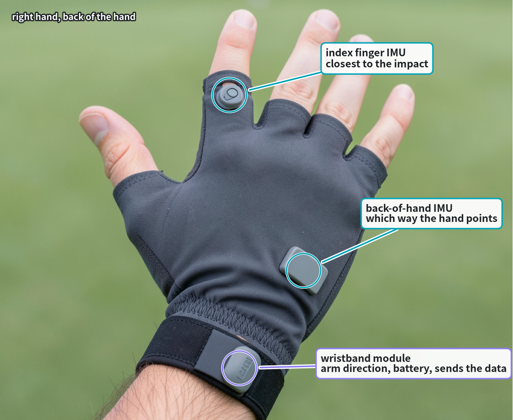

*Where the sensors sit on the right-hand glove. AI-generated photo.*

## Picture 1 · A sensor glove and a band on the right arm

The golfer keeps their usual glove on the left hand. A thin extra sensor glove goes on the right hand (the lower hand on the grip), and a small band on the right forearm. The glove carries one feeler chip on the back of the hand, one on a finger, and a tiny microphone; the band carries one more chip, a radio that sends everything to your phone, and the battery.

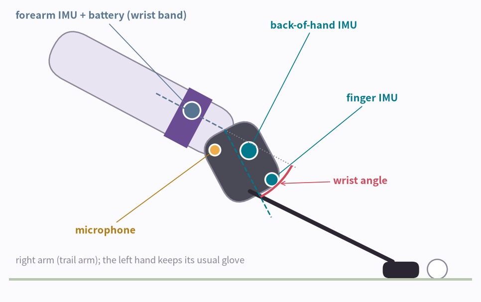

**How to read the picture**

- Back-of-hand chip (teal): which way the right hand points.
- Finger chip (teal): the closest to the impact, and it notices when the fingers loosen or re-grip.
- Forearm chip (blue, in the band): which way the right forearm points.
- Red arc: the wrist angle. Picture 5 shows how it is measured.

!!! abstract "In one line"
    The glove and the band sit on the same right arm, so the glove can measure straight away how far the right wrist bends.

*What does each feeler chip actually feel? Two different things.*

## Picture 2 · Two kinds of feeling

The bump feeler is like a coffee cup in a car: it spills when the car brakes hard. It feels pushes and sudden stops. The turn feeler is like sitting in a spinning office chair: it feels the hand and wrist turning. Both feelers sit together in one chip smaller than a fingernail. That chip is called an IMU, and the glove and band carry three of them.

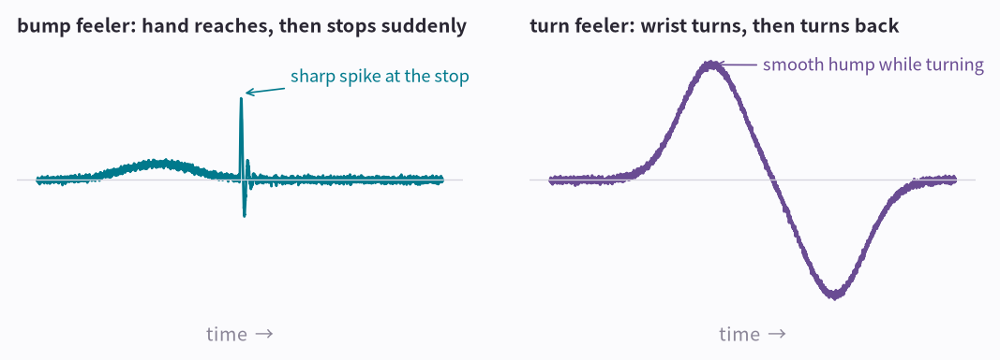

**How to read the picture**

- Left: the hand reaches out, then stops suddenly. The bump feeler draws a sharp spike at the stop.
- Right: the wrist turns, then turns back. The turn feeler draws a smooth hump one way, then the other way.

!!! abstract "In one line"
    One feels bumps and stops, the other feels turning. Together they make an IMU.

*Before golf, a look at the IMU you already carry every day.*

## Picture 3 · Your phone has one too

Almost every smartphone has an IMU inside. Many things you do every day rely on it.

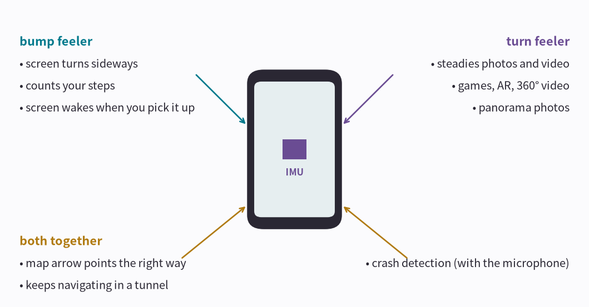

**How to read the picture**

- Left (bump feeler): turning the screen sideways, counting steps, waking the screen when you pick the phone up.
- Right (turn feeler): steadying shaky photos and video, games and AR that follow how you turn the phone, panorama photos.
- Bottom (both, plus the compass sensor): the map arrow pointing the right way, and guessing where you are in a tunnel when GPS drops out. Some phones even detect a car crash by checking a huge jolt and a loud bang at the same moment, the same idea as the glove.

!!! abstract "In one line"
    The chips in the glove and band are the same kind as the one in your phone.

*Back to golf. A swing gives both feelers a very particular shape.*

## Picture 4 · A golf swing has a shape

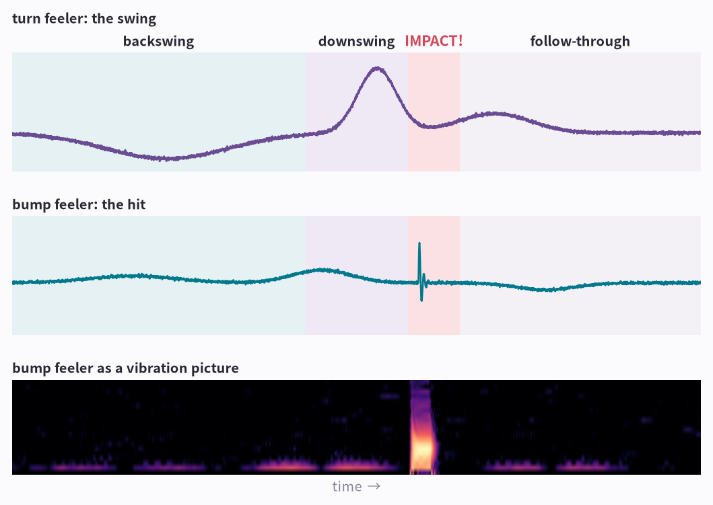

**How to read the picture**

- Backswing: the turn feeler (top) dips slowly one way as you take the club back.
- Downswing: the turn feeler shoots up fast the other way. The fastest turning comes just before the ball.
- IMPACT: the bump feeler (middle) draws a tiny, sharp spike when the club meets the ball. This is what the glove is waiting for.
- Follow-through: both settle down.
- Bottom: the middle line drawn as a vibration picture, the same way as the sound pictures in [part 1, Seeing Sound](aip-seeing-sound.md). The swing itself stays a faint glow along the floor (very slow shaking); the hit becomes one bright upright stripe. Picture 7 lines this stripe up with the sound picture.

!!! abstract "In one line"
    The turn feeler draws the swing. The bump feeler marks the exact moment of impact.

*The feelers can tell you more than the moment of impact.*

## Picture 5 · It also draws how your wrist bends

The wrist angle is the difference between where the back-of-hand chip points and where the forearm chip points (the red arc in picture 1); that's why glove and band sit on the same arm. The two feelers in each chip correct each other's mistakes, so the angle can be drawn through the whole swing.

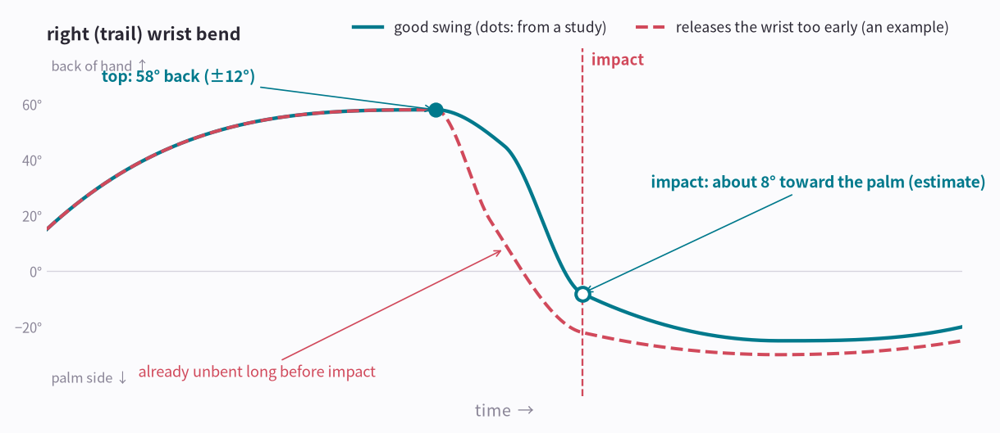

**How to read the picture**

- The right wrist bends back toward the back of the hand in the backswing, then whips toward the palm in the downswing.
- The teal dots come from a study of skilled golfers: 58° bent back at the top (filled dot). In the downswing the study saw it swing 66° back the other way, which is 8° past straight, so near impact it is bent about 8° toward the palm (hollow dot, our estimate).
- It's very fast: at its quickest, the wrist moves so fast that at that speed it would spin all the way around more than four times in one second.
- The red dashed swing is an example of a common fault: the wrist unbends too early, long before the club reaches the ball.

!!! abstract "In one line"
    With two feelers together, the glove draws the wrist's angle through the whole swing, not only the moment of impact.

*Impact lasts only a moment. How does the glove not miss it?*

## Picture 6 · Impact is quick, so the feeler has to look often

The feeler doesn't watch all the time. It takes a quick look, then another, many times a second, like the frames of a video. The golf study above recorded its swings with motion capture 400 times a second for exactly this reason. The sounds in [part 1](aip-seeing-sound.md) were measured 16,000 times a second; a bump feeler usually looks a few hundred to a few thousand times a second.

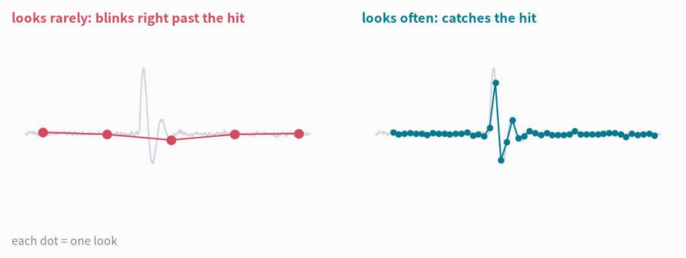

**How to read the picture**

- Left: the looks are far apart. The dots jump right over the impact, and the glove never sees it.
- Right: the looks are close together. Several dots land on the impact, so it shows up clearly.

!!! abstract "In one line"
    Look often enough, or you blink right past the impact.

*The feelers catch the jolt. The microphone catches the sound.*

## Picture 7 · A real hit: you hear it and feel it at the same moment

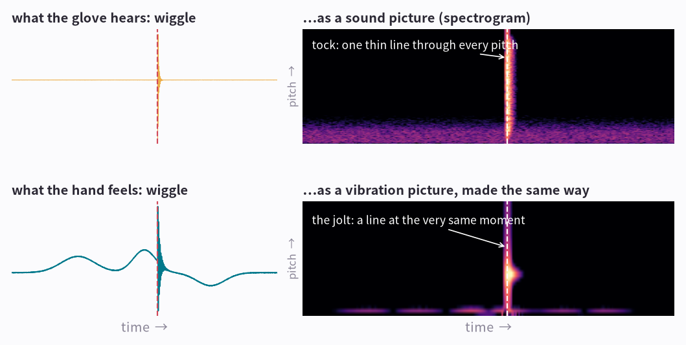

**How to read the picture**

- Top left: the “tock” the microphone heard, drawn as a wiggle. Top right: the same sound drawn the way [part 1](aip-seeing-sound.md) taught (cut into short slices, FFT each one): the tock becomes one thin line through every pitch.
- Bottom: the bump feeler's vibration turns into a picture in exactly the same way. The jolt of impact becomes a line too.
- Dashed line: the two lines sit at exactly the same moment.

!!! abstract "In one line"
    When the sound picture and the vibration picture both show a line at the same moment, your club hit the ball.

The vibration picture is called a spectrogram too. To say what was measured, people call it a vibration spectrogram or an accelerometer spectrogram.

*Listening alone isn't enough, because a driving range is full of “tocks”.*

## Picture 8 · Why it needs both

| What happened | Hear | Feel | Counted as a clean hit? |
|---|---|---|---|
| You hit the ball cleanly | tock | sharp jolt | ✓ yes |
| The golfer in the next bay hits | tock | — | ✗ not yours |
| You hit the ground first (a fat shot) | thud | big, dull bump | ✗ fat shot |
| A practice swing, no ball | — | swing only | ✗ no hit |
| A thin or off-center hit (top of the ball, or the club's toe or heel) | weak | weak | ✗ often missed |

**How to read the picture**

- Next bay: a line in the sound picture, but nothing in the vibration picture. Not your shot.
- Fat shot: not a thin line but a dull blob low in both pictures (low pitch, lasting longer). It's recorded as hitting the ground, not the ball.
- Practice swing: the turn feeler sees a full swing, but there's no impact at all.
- Off-center: the lines in both pictures are very faint, so the glove can miss it.
- A phone's crash detection works the same way: a jolt alone could be a dropped phone, so it also listens for the bang.

!!! abstract "In one line"
    The microphone says “a ball was hit”. The feelers say “it was your swing”.

*Your turn: can you pick out the real hits?*

## Your hit or not?

Top = the sound picture, bottom = the vibration picture, just like the sound-picture game in [part 1](aip-seeing-sound.md). Look for the lines, pick an answer for each card, then check.

**Card 1**

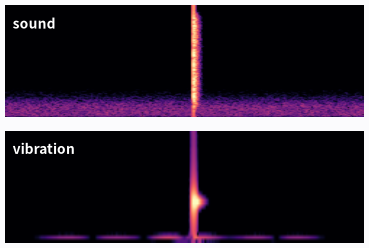

??? success "Show the answer"
    Your hit: a thin line in both pictures at the same moment.

**Card 2**

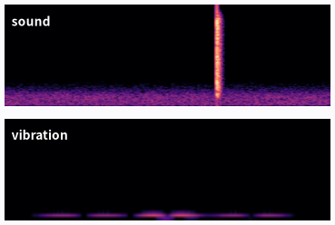

??? success "Show the answer"
    Not yours: a line in the sound picture only. The next bay.

**Card 3**

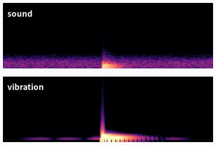

??? success "Show the answer"
    Not a clean hit: dull low blobs instead of thin lines. A fat shot that hit the ground.

**Card 4**

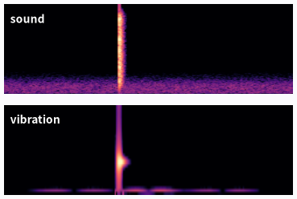

??? success "Show the answer"
    Your hit: a thin line in both pictures at the same moment.

**Card 5**

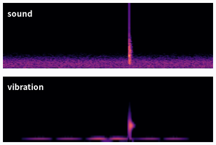

??? success "Show the answer"
    Not counted: both lines are very faint. An off-center hit is easy to miss.

This is what an AI practices. Put the sound picture and the vibration picture together as one image, label thousands of them “clean hit” or “not”, and show them to the same kind of AI (a CNN) that learned sounds in [part 2, Teaching Sound](aip-teaching-sound.md). The next part actually trains a motion AI. Recognising from a few references with no training is in [part 5, Learning from a Reference](aip-learning-from-reference.md).

----

**Series** · [← Part 2, Teaching Sound](aip-teaching-sound.md) · [Part 4, Teaching Motion →](aip-teaching-motion.md)

### Sources and notices

Part 3 of AI in Pictures. Apart from the right-wrist values taken from a study, pictures are drawn for explanation and are not recordings from a real device; the sensor layout is one example. Wrist data: Sweeney, Mills, Mankad, Elliott & Alderson (2012), “Wrist kinematics during the golf drive from a bilaterally anatomical perspective”, 30th ISBS Conference, Melbourne (skilled golfers, handicap 2.7, 400 Hz motion capture).

### Terms

- *bump feeler + turn feeler in one chip*: IMU (inertial measurement unit)
- *bump feeler*: accelerometer
- *turn feeler*: gyroscope
- *one look*: a sample
- *how often it looks*: sample rate (samples per second)
- *hear + feel at the same moment; two feelers drawing the wrist angle*: sensor fusion; time alignment; orientation tracking
- *wrist angle from the hand chip and the forearm chip*: joint angle from the relative orientation of two IMUs
- *vibration picture*: spectrogram of the accelerometer signal (STFT); a vibration or accelerometer spectrogram
- *a picture that shows strength as color*: heatmap
- *similar pictures used for machine vibration*: FFT spectrum, waterfall plot, Campbell diagram
- *examples labeled by a person*: labeled training data
