# 보는 AI 3편: 움직임을 보다

> **보는 AI · 3편.** 그림으로 보는 소리·움직임 AI 시리즈예요. [0편부터 읽기](aip-robot-senses.md)

[1편](aip-seeing-sound.md)에서 소리를 그림으로 바꿔 ‘봤죠’. 움직임도 똑같이 그림이 돼요. 이 페이지의 센서 장갑(설명용 예시)은 클럽이 공에 맞는 정확한 순간을 찾아서, 그 앞뒤 스윙을 기록해요. ‘딱’ 소리만 듣는 게 아니라 손가락에 전해지는 충격도 함께 느껴서, 옆 타석 소리에 속지 않아요. 수식 없이 그림으로 봐요.

*그림 8장 · 수식 없음 · 마지막에 작은 게임 · 10분 정도*

---

<video controls playsinline preload="metadata" src="/assets/aip/aip-seeing-motion-video-91b3008d09.mp4" style="width:100%"></video>

*AI로 만든 영상이에요. 아래는 이 영상 소리의 그림([1편](aip-seeing-sound.md)의 스펙트로그램)이에요. 장갑이 궤적의 가장 아래를 지나는 순간, 소리 그림에 ‘딱’이 나타나요.*

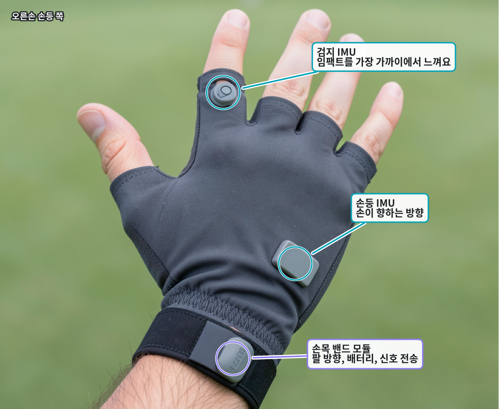

*오른손 센서 장갑의 센서 위치예요. AI로 만든 사진이에요.*

## 그림 1 · 오른손 센서 장갑과 오른팔 밴드

왼손에는 평소 끼던 골프 장갑을 그대로 껴요. 오른손(그립 아래쪽 손)에 얇은 센서 장갑을 하나 더 끼고, 오른 팔뚝에 작은 밴드를 차요. 장갑에는 손등에 감지기 칩 하나, 손가락에 하나, 그리고 아주 작은 마이크가 있어요. 밴드에는 칩이 하나 더 있고, 신호를 전화기로 보내는 무선 칩과 배터리가 들어 있어요.

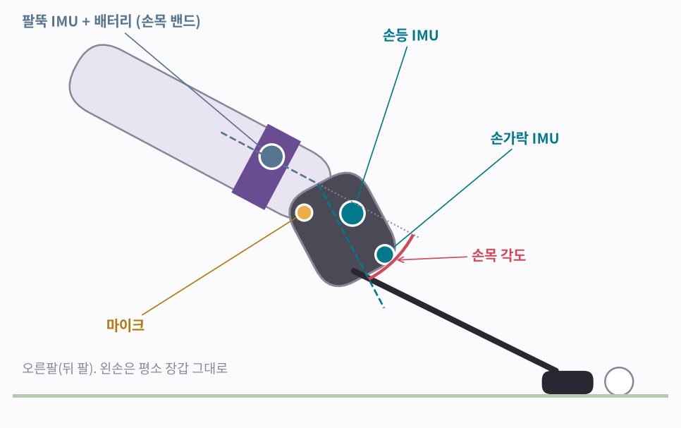

**그림 보는 법**

- 손등 칩(청록): 오른손이 어느 쪽을 향하는지 알아요.
- 손가락 칩(청록): 임팩트 충격을 가장 가까이에서 느끼고, 손가락이 그립에서 풀리거나 고쳐 잡는 것도 알아채요.
- 팔뚝 칩(파랑, 밴드 안): 오른 팔뚝이 어느 쪽을 향하는지 알아요.
- 빨간 호: 손목 각도예요. 어떻게 재는지는 그림 5에서 봐요.

!!! abstract "한 줄 정리"
    장갑과 밴드가 같은 오른팔에 있어서, 오른 손목이 얼마나 꺾이는지 바로 잴 수 있어요.

*감지기 칩 하나하나는 정확히 뭘 느낄까요? 두 가지를 느껴요.*

## 그림 2 · 느끼는 방법은 두 가지예요

흔들림 감지기는 차 안의 커피잔 같아요. 차가 급정거하면 커피가 쏟아지죠. 밀고 갑자기 멈추는 걸 느껴요. 돌림 감지기는 회전의자에 앉아 빙글 도는 느낌 같아요. 손과 손목이 도는 걸 느껴요. 두 감지기는 손톱보다 작은 칩 하나에 같이 들어 있어요. 이 칩을 IMU(관성 측정 장치)라고 하고, 장갑과 밴드에 세 개가 있어요.

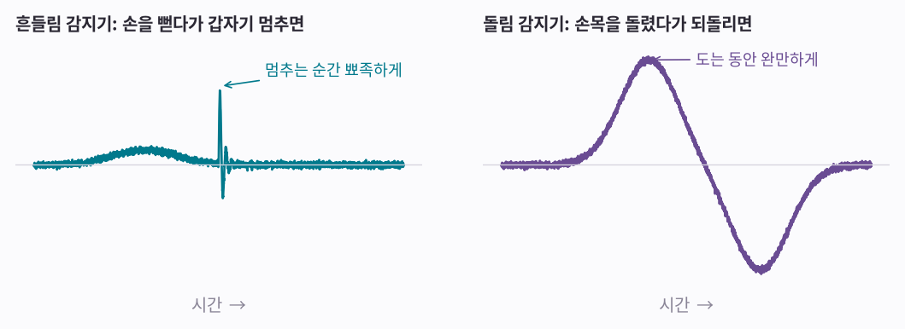

**그림 보는 법**

- 왼쪽: 손을 뻗다가 갑자기 멈춰요. 흔들림 감지기가 멈추는 순간 뾰족한 선을 그려요.
- 오른쪽: 손목을 돌렸다가 되돌려요. 돌림 감지기가 한쪽으로 완만하게 올라갔다가 반대쪽으로 내려가요.

!!! abstract "한 줄 정리"
    하나는 흔들림과 멈춤을, 다른 하나는 도는 걸 느껴요. 둘을 합친 게 IMU예요.

*골프 이야기 전에, 여러분이 매일 들고 다니는 IMU부터 볼게요.*

## 그림 3 · 여러분 전화기에도 있어요

거의 모든 스마트폰 안에 IMU가 들어 있어요. 매일 쓰는 기능 중에 IMU 덕분인 게 많아요.

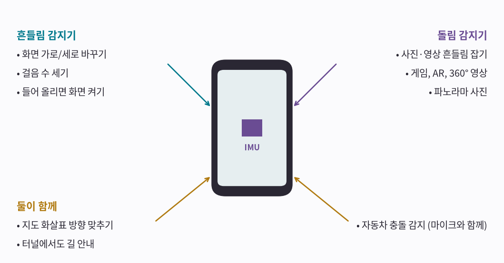

**그림 보는 법**

- 왼쪽(흔들림 감지기): 화면 가로/세로 바꾸기, 걸음 수 세기, 폰을 들어 올리면 화면 켜기.
- 오른쪽(돌림 감지기): 사진·영상 흔들림 잡기, 폰을 돌리는 대로 따라 도는 게임과 AR, 파노라마 사진.
- 아래(둘이 함께, 나침반 센서도 더해서): 지도 화살표가 내가 보는 방향을 가리키기, 터널에서 GPS가 끊겨도 위치 짐작하기. 어떤 폰은 아주 큰 충격과 큰 소리가 같은 순간에 나면 자동차 충돌로 알아채요. 장갑과 같은 원리예요.

!!! abstract "한 줄 정리"
    장갑과 밴드 속 칩은 여러분 전화기 속 칩과 같은 종류예요.

*다시 골프로 돌아가 볼게요. 스윙을 하면 두 감지기에 아주 특별한 모양이 생겨요.*

## 그림 4 · 골프 스윙에는 모양이 있어요

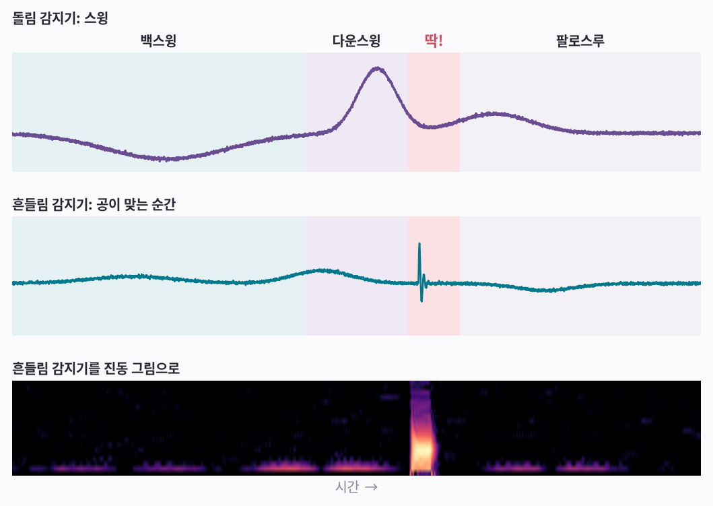

**그림 보는 법**

- 백스윙: 클럽을 뒤로 들어 올리는 동안 돌림 감지기(위)가 한쪽으로 천천히 내려가요.
- 다운스윙: 돌림 감지기가 반대쪽으로 빠르게 치솟아요. 가장 빠르게 도는 순간은 공에 닿기 바로 전이에요.
- 딱!(임팩트): 클럽이 공에 맞는 순간 흔들림 감지기(가운데)에 작고 뾰족한 선이 튀어요. 장갑이 기다리는 게 바로 이거예요.
- 팔로스루: 둘 다 잦아들어요.
- 맨 아래: 가운데 선을 [1편 「소리를 보다」](aip-seeing-sound.md)의 소리 그림과 같은 방법으로 그린 진동 그림이에요. 스윙 동작은 바닥(아주 느린 흔들림)에만 희미하게 남고, ‘딱!’은 밝은 세로줄 하나가 돼요. 그림 7에서 이 세로줄을 소리 그림과 맞춰 봐요.

!!! abstract "한 줄 정리"
    돌림 감지기는 스윙을 그리고, 흔들림 감지기는 공이 맞은 정확한 순간을 찍어요.

*감지기가 알려 주는 건 임팩트 순간만이 아니에요.*

## 그림 5 · 손목이 얼마나 꺾이는지도 그려요

손목 각도는 손등 칩이 향하는 방향과 팔뚝 칩이 향하는 방향의 차이예요(그림 1의 빨간 호). 그래서 장갑과 밴드를 같은 팔에 껴요. 칩 속 두 감지기가 서로 틀린 걸 바로잡아 줘서, 스윙 내내 각도를 그릴 수 있어요.

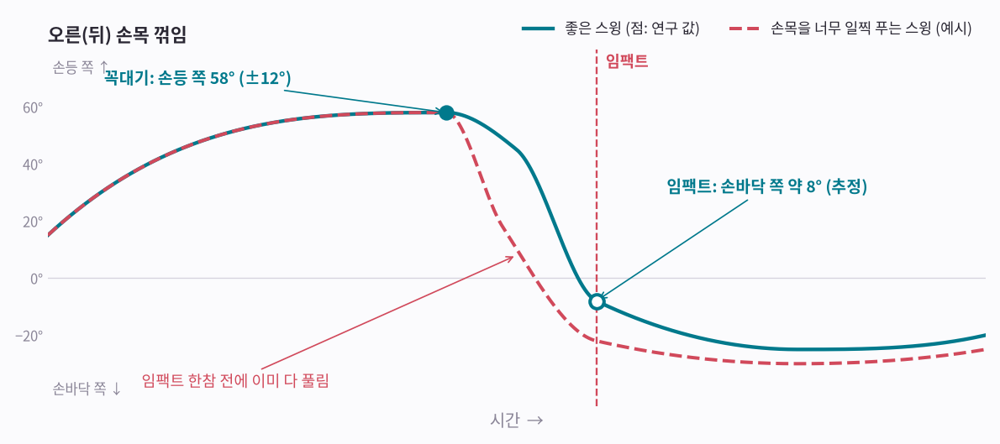

**그림 보는 법**

- 오른 손목은 백스윙 때 손등 쪽으로 젖혀졌다가, 다운스윙 때 손바닥 쪽으로 확 꺾여요.
- 청록 점은 숙련 골퍼를 잰 연구에서 왔어요. 꼭대기에서 손등 쪽으로 58° 젖혀져요(속이 찬 점). 다운스윙 때는 반대쪽으로 66° 돌아온다고 쟀어요. 곧게 편 상태를 8° 지나치는 셈이라, 임팩트 즈음엔 손바닥 쪽으로 약 8° 꺾여 있다고 어림했어요(속이 빈 점).
- 아주 빨라요. 가장 빠를 때는, 그 빠르기로 계속 돈다면 1초에 네 바퀴가 넘을 정도예요.
- 빨간 점선은 흔한 실수의 예시예요. 클럽이 공에 닿기 한참 전에 손목이 미리 다 풀려 버려요.

!!! abstract "한 줄 정리"
    두 감지기를 합치면 임팩트 순간만이 아니라, 스윙 내내 손목의 각도를 그릴 수 있어요.

*임팩트는 눈 깜짝할 사이에 지나가요. 장갑이 이걸 놓치지 않는 방법을 볼게요.*

## 그림 6 · 임팩트는 아주 빨라서 자주 봐야 해요

감지기는 계속 지켜보는 게 아니라, 1초에 여러 번 ‘슬쩍 보기’를 해요. 동영상이 사진을 빠르게 이어 붙인 것과 같아요. 앞에서 본 골프 연구도 바로 이 이유로 스윙을 1초에 400번 찍었어요. [1편](aip-seeing-sound.md)의 소리는 1초에 16,000번씩 잰 거였고, 흔들림 감지기는 보통 1초에 수백~수천 번 봐요.

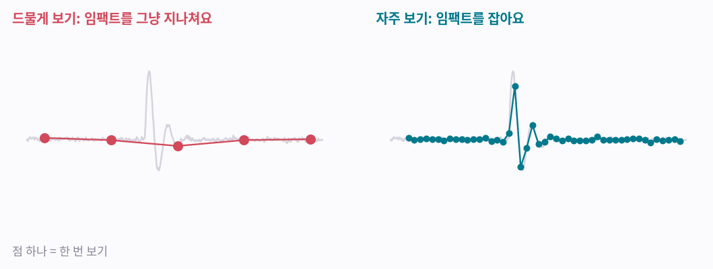

**그림 보는 법**

- 왼쪽: 보는 간격이 넓어요. 점들이 임팩트를 그냥 뛰어넘어서, 장갑은 임팩트를 못 봐요.
- 오른쪽: 보는 간격이 좁아요. 점 여러 개가 임팩트 위에 찍혀서 또렷하게 보여요.

!!! abstract "한 줄 정리"
    충분히 자주 봐야 임팩트를 놓치지 않아요.

*임팩트를 느끼는 건 절반이에요. 나머지 절반은 마이크가 알려 줘요.*

## 그림 7 · 진짜 내 타구는 듣는 순간과 느끼는 순간이 같아요

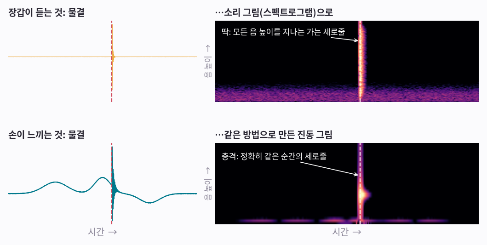

**그림 보는 법**

- 위 왼쪽: 마이크가 들은 ‘딱’을 물결로 그렸어요. 위 오른쪽은 같은 소리를 [1편 「소리를 보다」](aip-seeing-sound.md)에서 배운 방법(짧게 잘라 조각마다 FFT)으로 그린 소리 그림이에요. ‘딱’은 모든 음 높이를 지나는 가는 세로줄이 돼요.
- 아래: 흔들림 감지기의 진동도 똑같은 방법으로 그림이 돼요. 임팩트 충격도 세로줄로 나타나요.
- 점선: 두 그림의 세로줄이 정확히 같은 순간에 있어요.

!!! abstract "한 줄 정리"
    소리 그림과 진동 그림에 같은 순간 세로줄이 있으면, 내 클럽이 공을 친 거예요.

진동 그림도 이름은 똑같이 스펙트로그램이에요. 무엇을 쟀는지 밝힐 때는 ‘진동 스펙트로그램’ 또는 ‘가속도 스펙트로그램’이라고 불러요.

*그냥 듣기만 하면 안 될까요? 연습장엔 ‘딱’ 소리가 사방에서 나요.*

## 그림 8 · 그래서 둘 다 필요해요

| 무슨 일이 있었나 | 들림 | 느낌 | 깨끗한 타구? |
|---|---|---|---|
| 내가 공을 깨끗하게 침 | 딱 | 날카로운 충격 | ✓ 맞아요 |
| 옆 타석 사람이 침 | 딱 | — | ✗ 내 것 아님 |
| 뒤땅 (땅을 먼저 침) | 퍽 | 크고 뭉툭한 흔들림 | ✗ 뒤땅 |
| 연습 스윙 (공 없이) | — | 휘두르기만 | ✗ 타구 없음 |
| 빗맞음 (공 윗부분이나 클럽 끝에 맞음) | 약함 | 약함 | ✗ 자주 놓침 |

**그림 보는 법**

- 옆 타석: 소리 그림엔 세로줄이 있지만 진동 그림엔 아무것도 없어요. 내 타구가 아니에요.
- 뒤땅: 가는 세로줄이 아니라 두 그림 아래쪽(낮은 음)에 뭉툭하고 긴 덩어리가 생겨요. 공이 아니라 땅을 친 걸로 기록해요.
- 연습 스윙: 돌림 감지기는 스윙 전체를 보지만, 임팩트는 아예 없어요.
- 빗맞음: 두 그림의 세로줄이 아주 희미해서 장갑이 놓칠 수 있어요.
- 전화기의 충돌 감지도 같아요. 충격만으로는 폰을 떨어뜨린 건지 모르니, 큰 소리도 같이 들어 봐요.

!!! abstract "한 줄 정리"
    마이크는 ‘공이 맞았다’고 말하고, 감지기는 ‘그게 네 스윙이다’라고 말해요.

*이제 직접 해 봐요. 진짜 내 타구를 골라낼 수 있나요?*

## 내 타구일까요?

위 = 소리 그림, 아래 = 진동 그림이에요. [1편](aip-seeing-sound.md)의 소리 그림 게임처럼 세로줄을 찾아서, 카드마다 답을 고른 뒤 확인해 보세요.

**1번**

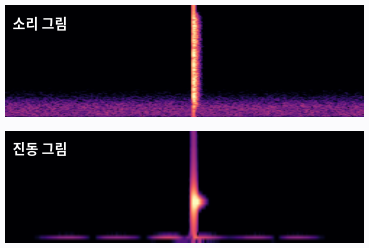

??? success "정답 보기"
    내 타구: 두 그림 모두 같은 순간에 가는 세로줄이 있어요.

**2번**

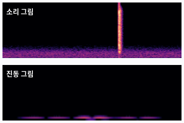

??? success "정답 보기"
    아님: 소리 그림에만 세로줄이 있어요. 옆 타석이에요.

**3번**

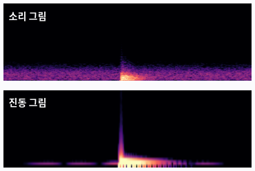

??? success "정답 보기"
    아님: 가는 세로줄 대신 아래쪽에 뭉툭한 덩어리. 땅을 먼저 친 뒤땅이에요.

**4번**

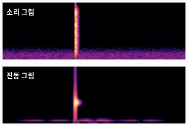

??? success "정답 보기"
    내 타구: 두 그림 모두 같은 순간에 가는 세로줄이 있어요.

**5번**

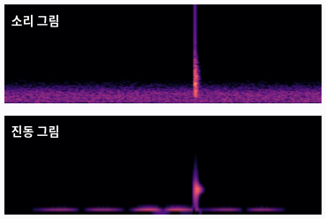

??? success "정답 보기"
    인정 안 됨: 두 그림의 세로줄이 아주 희미해요. 빗맞으면 놓치기 쉬워요.

AI가 연습하는 게 바로 이거예요. 소리 그림과 진동 그림을 한 장으로 붙이고, ‘깨끗한 타구’ 또는 ‘아님’ 이름표를 달아 수천 장을 보여 주면 돼요. 쓰는 AI는 [2편 「소리를 알아듣는 AI」](aip-teaching-sound.md)에서 소리를 배운 것과 같은 종류(CNN)예요. 움직임 AI를 실제로 가르쳐 보는 건 바로 다음 편이고, 학습 없이 레퍼런스 몇 개로 알아보는 방법은 [5편 「레퍼런스만 주면 알아보는 AI」](aip-learning-from-reference.md)에서 봐요.

----

**시리즈** · [← 2편, 소리를 알아듣는 AI](aip-teaching-sound.md) · [4편, 움직임을 알아보는 AI →](aip-teaching-motion.md)

### 출처와 표기

「보는 AI」 3편이에요. 연구에서 가져온 오른 손목 꺾임 값을 빼면, 그림은 설명을 위해 그린 것이고 실제 기기 기록이 아니에요. 센서 위치는 하나의 예시예요. 손목 자료: Sweeney, Mills, Mankad, Elliott, Alderson (2012), “Wrist kinematics during the golf drive from a bilaterally anatomical perspective”, 제30회 ISBS 학회, 멜버른 (숙련 골퍼, 핸디캡 평균 2.7, 1초에 400번 모션 캡처).

### 용어 설명

- *흔들림 감지기 + 돌림 감지기를 담은 칩*: IMU (관성 측정 장치, inertial measurement unit)
- *흔들림 감지기*: 가속도계(accelerometer)
- *돌림 감지기*: 자이로스코프(gyroscope)
- *한 번 보기*: 샘플(sample)
- *얼마나 자주 보나*: 샘플링 레이트(초당 샘플 수)
- *같은 순간에 들림 + 느낌, 두 감지기로 손목 각도 그리기*: 센서 융합, 시간 맞추기, 자세(방향) 추정
- *손등 칩과 팔뚝 칩으로 손목 각도 재기*: 두 IMU의 상대 자세로 관절 각도 추정
- *진동 그림*: 가속도 신호의 스펙트로그램(STFT), 진동 스펙트로그램 또는 가속도 스펙트로그램
- *색으로 세기를 보여 주는 그림*: 히트맵(heatmap)
- *기계 진동을 볼 때 쓰는 비슷한 그림*: FFT 스펙트럼, 워터폴 플롯, 캠벨 선도
- *사람이 이름표 붙인 예제*: 레이블된 학습 데이터
