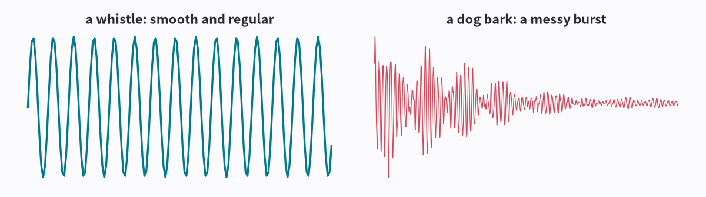
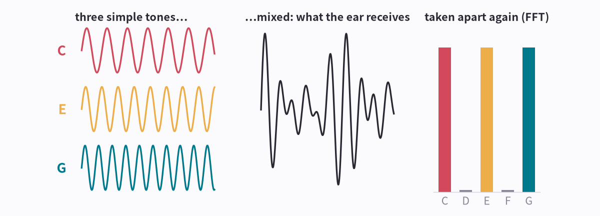
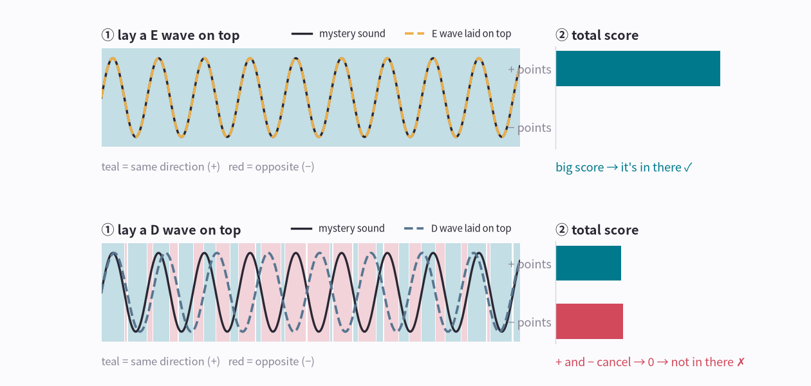
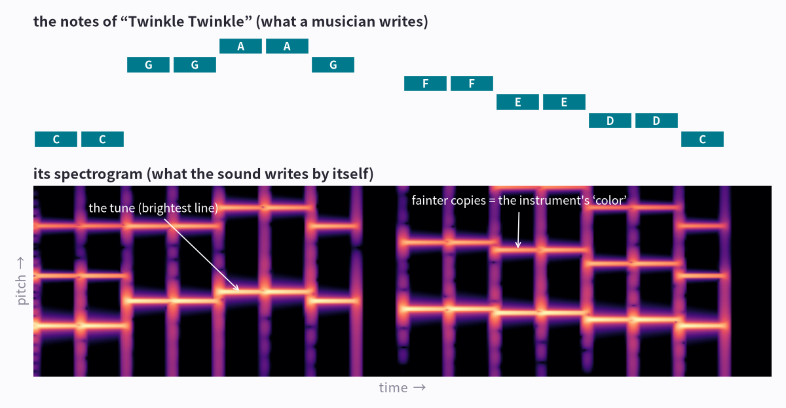
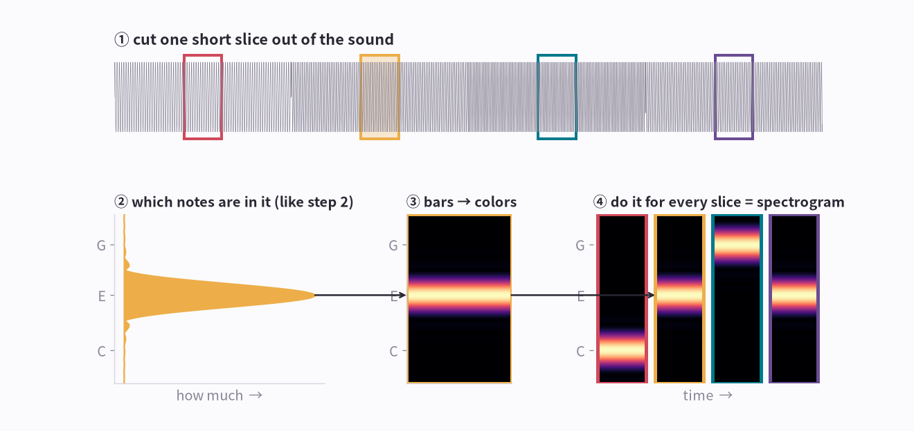
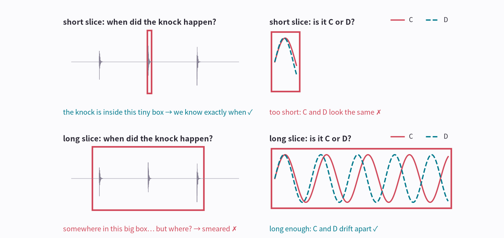
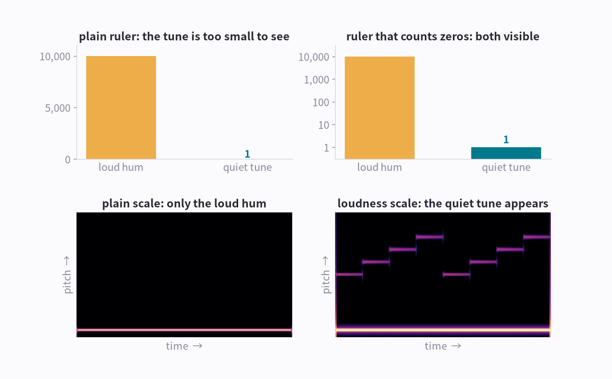
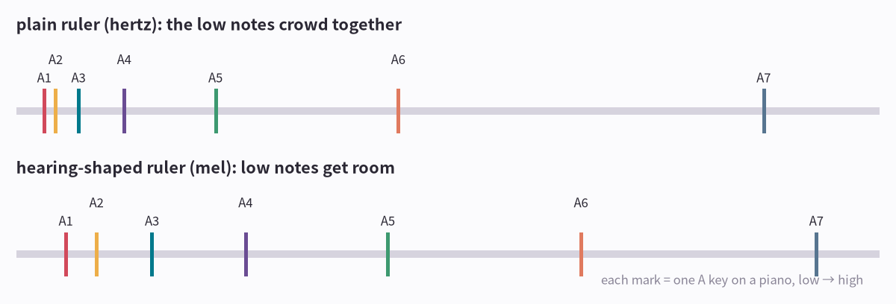
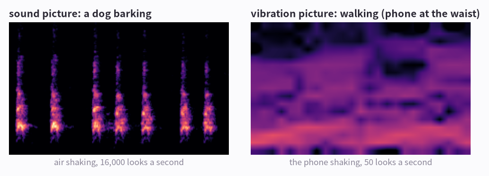

# AI in Pictures Part 1: Seeing Sound

> **AI in Pictures · Part 1.** A picture-first series on sound and motion AI. [Start from part 0](aip-robot-senses.md)

This series is about AI that understands sounds and movements, so why is it called AI in Pictures? A hint: an AI doesn't hear sounds with ears. Follow what a computer turns a sound into, and by the end of this part you'll have the answer. Press play as you go.

*8 pictures · no formulas · a guessing game at the end · about 10 minutes*

---

## Picture 1 · A sound is air shaking back and forth

A microphone measures that shaking and records it as a wiggly line. The line is called a waveform.

<b>Whistle</b> <audio controls preload="none" src="/assets/aip/aip-seeing-sound-d83ba8a82b.wav"></audio>

<b>Dog bark</b> <audio controls preload="none" src="/assets/aip/aip-seeing-sound-afbc37053e.wav"></audio>

**How to read the picture**

- Left, a whistle: the same shape repeats at the same spacing.
- Right, a dog bark: one big shake that fades, and no two wiggles look alike.

!!! abstract "In one line"
    Regular shaking sounds like a note. Irregular shaking sounds like noise.

*Most sounds you hear are several of these mixed together, so let's see what happens when they mix.*

## Picture 2 · Most sounds are several notes mixed together

<b>C</b> <audio controls preload="none" src="/assets/aip/aip-seeing-sound-512236c33f.wav"></audio>

<b>E</b> <audio controls preload="none" src="/assets/aip/aip-seeing-sound-70dd74f96a.wav"></audio>

<b>G</b> <audio controls preload="none" src="/assets/aip/aip-seeing-sound-f16588e5a7.wav"></audio>

<b>All three</b> <audio controls preload="none" src="/assets/aip/aip-seeing-sound-54a755933a.wav"></audio>

**How to read the picture**

- Left: C, E and G. Each one alone is a clean wave.
- Middle: press all three at once and your ear gets only this one messy wave.
- Right: the notes the computer found again in that messy wave. C, E and G are high; D and F, which we never played, are zero.

!!! abstract "In one line"
    From a mixed sound you can get back which notes are inside, and how much of each. That calculation is the Fourier transform; the FFT is the fast way to do it.

*How did it find C, E and G in that messy middle wave? The next picture shows the trick.*

## Picture 3 · The FFT gives every note an overlap score

To check whether a note is inside a sound, lay that note's wave on top of the sound. Wherever the two move the same way (both up, or both down) it scores a plus point. Wherever they move opposite ways it scores a minus point.

<b>E</b> <audio controls preload="none" src="/assets/aip/aip-seeing-sound-70dd74f96a.wav"></audio>

<b>D</b> <audio controls preload="none" src="/assets/aip/aip-seeing-sound-436cca5f86.wav"></audio>

**How to read the picture**

- Top: the sound has an E in it. The E wave moves with it the whole time, so it's all teal (+). Big score.
- Bottom: the D wave runs at a slightly different speed. It starts in step (teal), drifts out of step (red), then back. Half plus, half minus: the score is 0.
- It works the same when many notes are mixed, like the chord in picture 2. Only the notes that are inside keep a score; the rest come out 0.

!!! abstract "In one line"
    Each note's overlap score is the height of its bar in picture 2. The FFT is a fast way to work out every note's score at once.

*But in a song the notes keep changing, so now we draw a sound that changes over time.*

## Picture 4 · A spectrogram is sheet music the sound writes itself

<b>Twinkle Twinkle</b> <audio controls preload="none" src="/assets/aip/aip-seeing-sound-17c4d06bc1.wav"></audio>

**How to read the picture**

- Top: the notes of Twinkle Twinkle. Time runs to the right; higher notes sit higher.
- Bottom: the computer's picture of the same song. The brightest line makes the same staircase as the notes.
- The fainter lines above it are the instrument's ring. You can ignore them for now.

!!! abstract "In one line"
    A spectrogram: across = time, up = pitch, brightness = loudness.

*The computer draws it one column at a time.*

## Picture 5 · Each short slice becomes one column of the picture

<b>C · E · G · E</b> <audio controls preload="none" src="/assets/aip/aip-seeing-sound-8955374f0c.wav"></audio>

**How to read the picture**

- ① Top: cut a short slice out of C · E · G · E, as wide as a colored box (about 0.06 s).
- ② Score the yellow slice with the overlap trick from picture 3: only E comes out high.
- ③ Turn height into brightness, the higher the brighter. Now it fits in one thin column.
- ④ Do the same for every slice and line the columns up. You get a staircase: the spectrogram.

!!! abstract "In one line"
    A spectrogram is one FFT per short slice, lined up side by side. Engineers call this the STFT.

*That leaves a question: how short should a slice be?*

## Picture 6 · Choosing the slice length means giving something up

<b>Knocks</b> <audio controls preload="none" src="/assets/aip/aip-seeing-sound-0855bad7d2.wav"></audio>

<b>C</b> <audio controls preload="none" src="/assets/aip/aip-seeing-sound-512236c33f.wav"></audio>

<b>D</b> <audio controls preload="none" src="/assets/aip/aip-seeing-sound-436cca5f86.wav"></audio>

**How to read the picture**

- Top left: a short box fits tightly around the knock, so you know exactly when it happened.
- Top right: but inside that short box the C and D waves almost overlap. You can't tell which note it is.
- Bottom: in a long box C and D drift apart and are easy to tell apart. But the knock could be anywhere in the big box.

!!! abstract "In one line"
    Short slices get 'when' right; long slices get 'which note' right. Most sound work uses about 0.03 s, in between.

*The picture is drawn, but quiet sounds are still hard to see. That can be fixed too.*

## Picture 7 · To see quiet sounds, count the zeros

<b>Hum + quiet tune</b> <audio controls preload="none" src="/assets/aip/aip-seeing-sound-6590d2c6c8.wav"></audio>

**How to read the picture**

- Top left: the hum's strength is 10,000 and the tune is 1. On a plain ruler the tune's bar is flat on the floor.
- Top right: move up one step each time a zero is added (1 → 10 → 100 → 1,000) and the tune shows up too.
- Bottom: the same trick on the sound picture. Left shows only the hum; right shows the tune's staircase.

!!! abstract "In one line"
    On this scale every extra zero adds 10. It's called the decibel (dB) scale. Your ear judges loudness in a roughly similar way.

*Last, make the up-and-down (pitch) ruler match your ear too.*

## Picture 8 · Make the pitch ruler match your ear

Pitch numbers (hertz: how many times a second something shakes) grow faster and faster as notes go up. So on a plain ruler the low notes get squeezed into a tiny space.

**How to read the picture**

- Top: seven A keys of a piano on a plain ruler. The four low ones crowd at the left edge.
- Bottom: on a hearing-shaped ruler (mel) the low notes get room too.

!!! abstract "In one line"
    The picture an AI looks at takes three moves: one FFT per slice, loudness counted in zeros (dB), and a hearing-shaped ruler (mel). It's called a log-mel spectrogram.

*Now it's your turn to read some of these pictures.*

## Can you read sound pictures?

These are six real recordings. Guess each one from its picture first, then press Listen to check yourself.

Clues: a siren is one line sliding up and down. A clock is evenly spaced thin stripes. Rain is fuzz everywhere.

**Card 1**

<b>Listen</b> <audio controls preload="none" src="/assets/aip/aip-seeing-sound-e26047663f.wav"></audio>

??? success "Show the answer"
    Siren

**Card 2**

<b>Listen</b> <audio controls preload="none" src="/assets/aip/aip-seeing-sound-85fba2c244.wav"></audio>

??? success "Show the answer"
    Clock ticking

**Card 3**

<b>Listen</b> <audio controls preload="none" src="/assets/aip/aip-seeing-sound-1777b6ea43.wav"></audio>

??? success "Show the answer"
    Dog

**Card 4**

<b>Listen</b> <audio controls preload="none" src="/assets/aip/aip-seeing-sound-ab02fa65c1.wav"></audio>

??? success "Show the answer"
    Rain

**Card 5**

<b>Listen</b> <audio controls preload="none" src="/assets/aip/aip-seeing-sound-5d71daf352.wav"></audio>

??? success "Show the answer"
    Door knock

**Card 6**

<b>Listen</b> <audio controls preload="none" src="/assets/aip/aip-seeing-sound-407dfb4c39.wav"></audio>

??? success "Show the answer"
    Crying baby

## Training a sound AI is that game, thousands of times

dog siren rain … thousands more → AI model learns which shapes go with which name → a new sound: “dog” for example, 94% sure

You looked at pictures and matched shapes to names. An AI does the same with thousands of labeled pictures until it can name one it has never seen. Because the input is a picture, the same kind of AI that recognizes photos works on sound.

Anything that shakes can be drawn this way, not only air. On the right, a phone's motion sensor recorded someone walking, and it went through the same recipe: cut into short slices, FFT each one, lay them side by side. These vibration pictures are used for a golf sensor glove in [part 3, Seeing Motion](aip-seeing-motion.md), and to teach an AI in [part 4, Teaching Motion](aip-teaching-motion.md). That's why this series is called AI in Pictures: an AI turns sounds, and movements too, into pictures and looks at them.

----

**Series** · [← Part 0, How Robots Feel](aip-robot-senses.md) · [Part 2, Teaching Sound →](aip-teaching-sound.md)

### Sources and notices

Real recordings from the ESC-50 dataset (K. J. Piczak, CC BY-NC). Other sounds and pictures were generated for this page.

### Terms

- *wiggle*: waveform (samples, sample rate)
- *taking the mix apart; an overlap score per note*: Fourier transform (FFT): correlating with each frequency
- *sound picture*: spectrogram
- *one column per short slice*: STFT (short-time Fourier transform): window, hop
- *slice length*: window length; the time–frequency trade-off
- *counting the zeros*: decibels (dB), a log scale
- *hearing-shaped ruler*: mel scale
- *the finished picture an AI eats*: log-mel spectrogram
