# 보는 AI 1편: 소리를 보다

> **보는 AI · 1편.** 그림으로 보는 소리·움직임 AI 시리즈예요. [0편부터 읽기](aip-robot-senses.md)

소리를 알아듣는 AI, 움직임을 알아보는 AI를 다루는데, 시리즈 이름은 왜 「보는 AI」일까요? 힌트: AI는 소리를 귀로 듣지 않아요. 이 편에서 컴퓨터가 소리를 무엇으로 바꾸는지 따라가 보면 답이 나와요. 재생 버튼을 눌러 가며 보세요.

*그림 8장 · 수식 없음 · 마지막에 맞히기 게임 · 10분 정도*

---

## 그림 1 · 소리는 공기의 떨림이에요

마이크는 공기가 앞뒤로 흔들리는 걸 재서 구불구불한 선으로 기록해요. 이 선을 ‘파형’이라고 불러요.

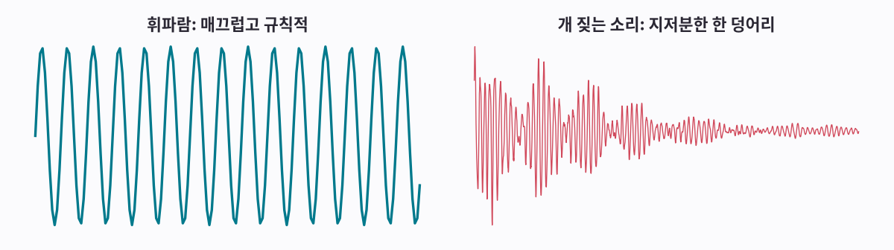

<b>휘파람</b> <audio controls preload="none" src="/assets/aip/aip-seeing-sound-d83ba8a82b.wav"></audio>

<b>개 짖는 소리</b> <audio controls preload="none" src="/assets/aip/aip-seeing-sound-afbc37053e.wav"></audio>

**그림 보는 법**

- 왼쪽 휘파람: 같은 모양의 물결이 똑같은 간격으로 반복돼요.
- 오른쪽 개 짖는 소리: 처음에 크게 흔들리고 점점 작아져요. 물결 모양도 제각각이에요.

!!! abstract "한 줄 정리"
    규칙적인 떨림은 ‘음’으로, 불규칙한 떨림은 ‘소음’으로 들려요.

*그런데 우리가 듣는 소리는 대부분 여러 떨림이 섞여 있어요. 섞이면 어떻게 되는지 볼게요.*

## 그림 2 · 대부분의 소리는 여러 음이 섞인 거예요

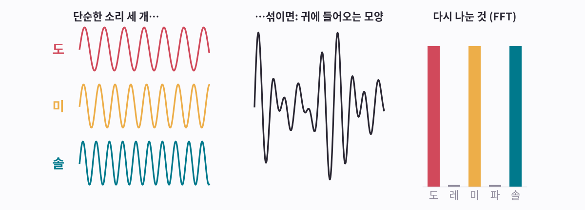

<b>도</b> <audio controls preload="none" src="/assets/aip/aip-seeing-sound-512236c33f.wav"></audio>

<b>미</b> <audio controls preload="none" src="/assets/aip/aip-seeing-sound-70dd74f96a.wav"></audio>

<b>솔</b> <audio controls preload="none" src="/assets/aip/aip-seeing-sound-f16588e5a7.wav"></audio>

<b>세 개 같이</b> <audio controls preload="none" src="/assets/aip/aip-seeing-sound-54a755933a.wav"></audio>

**그림 보는 법**

- 왼쪽: 도, 미, 솔. 하나씩은 깨끗한 물결이에요.
- 가운데: 셋을 동시에 누르면 귀에는 이 지저분한 물결 하나만 들어와요.
- 오른쪽: 컴퓨터가 그 지저분한 물결에서 다시 찾아낸 음이에요. 도·미·솔은 높고, 누르지 않은 레·파는 0이에요.

!!! abstract "한 줄 정리"
    섞인 소리에서 ‘어떤 음이 얼마나’ 들었는지 되찾을 수 있어요. 이 계산이 푸리에 변환이고, 빠르게 해내는 방법을 FFT라고 해요.

*가운데 물결만 보고 어떻게 도·미·솔을 찾았을까요? 다음 그림에 그 방법이 있어요.*

## 그림 3 · FFT는 음마다 ‘겹쳐 보기 점수’를 매겨요

어떤 음이 소리 안에 들어 있는지 알고 싶으면, 그 음의 물결을 소리 위에 겹쳐 봐요. 두 물결이 같은 방향(둘 다 위, 또는 둘 다 아래)으로 움직이는 순간은 +점수, 반대 방향으로 움직이는 순간은 −점수예요.

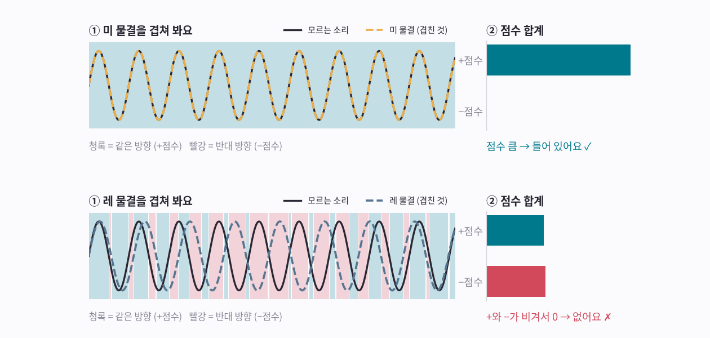

<b>미</b> <audio controls preload="none" src="/assets/aip/aip-seeing-sound-70dd74f96a.wav"></audio>

<b>레</b> <audio controls preload="none" src="/assets/aip/aip-seeing-sound-436cca5f86.wav"></audio>

**그림 보는 법**

- 위: 소리 안에 미가 있어요. 미 물결이 소리와 내내 같은 방향으로 움직여서 온통 청록(+)이에요. 점수가 커요.
- 아래: 레 물결은 미보다 살짝 느려요. 처음엔 같은 방향(청록)이다가 점점 엇갈려 반대 방향(빨강)이 되고, 다시 맞춰져요. +와 −가 반반이라 점수는 0이에요.
- 그림 2의 화음처럼 여러 음이 섞여 있어도 똑같아요. 들어 있는 음만 점수가 남고, 나머지는 0이 돼요.

!!! abstract "한 줄 정리"
    음마다 매긴 겹쳐 보기 점수가 바로 그림 2 막대의 높이예요. 모든 음의 점수를 한꺼번에 아주 빨리 계산하는 방법이 FFT예요.

*그런데 노래처럼 음이 계속 바뀌면 어떻게 할까요? 이번엔 시간에 따라 바뀌는 소리를 그림으로 그려요.*

## 그림 4 · 스펙트로그램은 소리가 스스로 쓴 악보예요

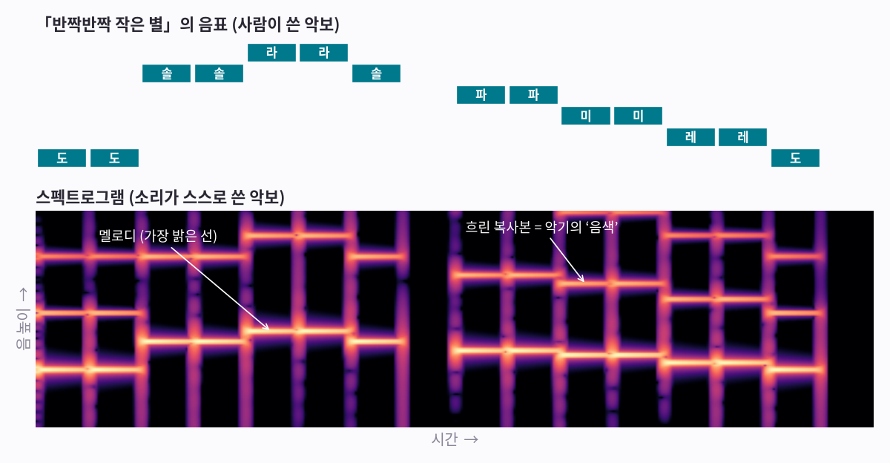

<b>반짝반짝 작은 별</b> <audio controls preload="none" src="/assets/aip/aip-seeing-sound-17c4d06bc1.wav"></audio>

**그림 보는 법**

- 위: 「반짝반짝 작은 별」 음표예요. 오른쪽으로 갈수록 시간이 흐르고, 위로 갈수록 높은 음이에요.
- 아래: 같은 노래를 컴퓨터가 그린 그림이에요. 가장 밝은 선이 위 음표와 똑같은 계단 모양이에요.
- 그 위의 흐린 선들은 악기 특유의 울림이에요. 지금은 신경 안 써도 돼요.

!!! abstract "한 줄 정리"
    스펙트로그램은 가로가 시간, 세로가 음 높이, 밝기가 소리 크기인 그림이에요.

*컴퓨터는 이 그림을 어떻게 그릴까요? 한 줄씩 그리는 과정을 볼게요.*

## 그림 5 · 짧은 조각 하나가 그림의 세로 한 줄이 돼요

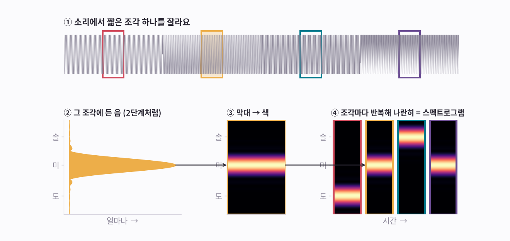

<b>도 · 미 · 솔 · 미</b> <audio controls preload="none" src="/assets/aip/aip-seeing-sound-8955374f0c.wav"></audio>

**그림 보는 법**

- ① 위: 도·미·솔·미 소리를 색 상자만큼 짧게 잘라요(약 0.06초).
- ② 노란 상자 조각에 그림 3의 겹쳐 보기 점수를 매기면 ‘미’만 높게 나와요.
- ③ 높이를 밝기로 바꿔요. 높을수록 밝게. 그러면 가느다란 세로 한 줄이 돼요.
- ④ 다른 조각도 똑같이 해서 옆으로 붙이면 계단 모양 그림, 즉 스펙트로그램이 돼요.

!!! abstract "한 줄 정리"
    짧은 조각마다 FFT를 하고 그 결과를 옆으로 이어 붙이면 스펙트로그램이 돼요. 이 과정을 STFT라고 불러요.

*그럼 조각은 얼마나 짧게 잘라야 할까요?*

## 그림 6 · 조각 길이를 정할 땐 하나를 포기해야 해요

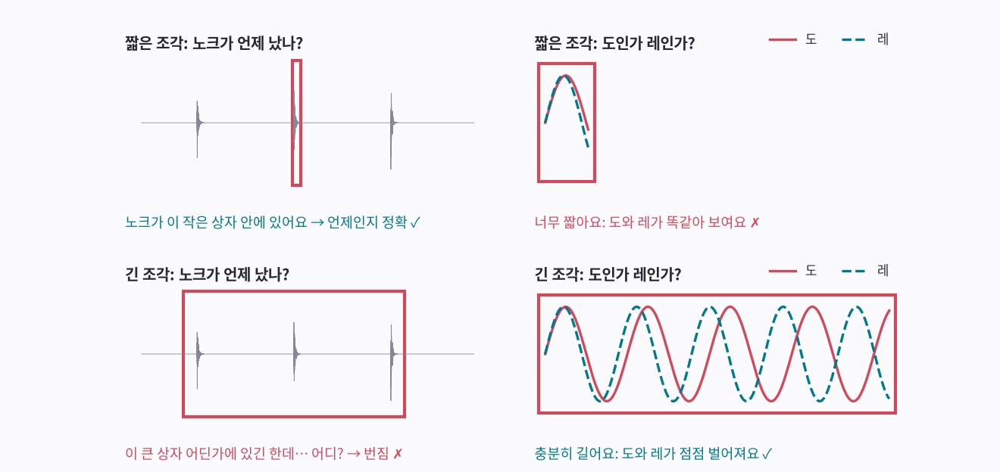

<b>노크</b> <audio controls preload="none" src="/assets/aip/aip-seeing-sound-0855bad7d2.wav"></audio>

<b>도</b> <audio controls preload="none" src="/assets/aip/aip-seeing-sound-512236c33f.wav"></audio>

<b>레</b> <audio controls preload="none" src="/assets/aip/aip-seeing-sound-436cca5f86.wav"></audio>

**그림 보는 법**

- 왼쪽 위: 짧은 상자가 노크를 딱 감싸요. 노크가 ‘언제’ 났는지 정확히 알아요.
- 오른쪽 위: 하지만 짧은 상자 안에서는 도와 레 물결이 거의 겹쳐요. 어느 음인지 구별이 안 돼요.
- 아래: 긴 상자 안에서는 도와 레가 점점 벌어져서 구별돼요. 대신 노크가 큰 상자 어디쯤에서 났는지는 몰라요.

!!! abstract "한 줄 정리"
    짧게 자르면 ‘언제’가 정확하고, 길게 자르면 ‘무슨 음’이 정확해요. 보통은 그 중간인 0.03초쯤으로 잘라요.

*그림은 다 그렸는데, 작은 소리가 잘 안 보이는 문제가 남았어요. 이것도 해결할 방법이 있어요.*

## 그림 7 · 작은 소리도 보이게 0의 개수로 재요

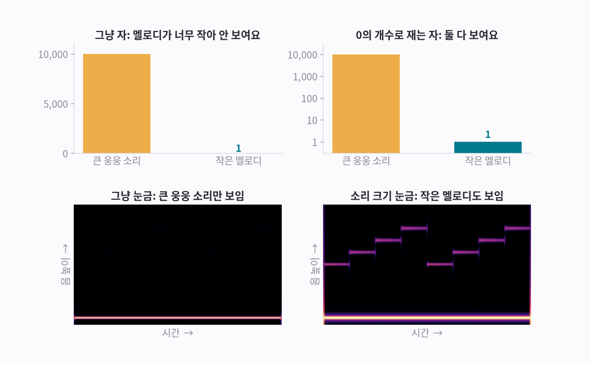

<b>웅웅 소리 + 작은 멜로디</b> <audio controls preload="none" src="/assets/aip/aip-seeing-sound-6590d2c6c8.wav"></audio>

**그림 보는 법**

- 왼쪽 위: 웅웅 소리의 세기는 10,000, 멜로디는 1이에요. 보통 자로 재면 멜로디 막대가 바닥에 붙어 안 보여요.
- 오른쪽 위: 1 → 10 → 100 → 1,000처럼 0이 하나 늘 때마다 한 칸씩 올리면 멜로디도 보여요.
- 아래: 같은 방법을 소리 그림에 썼어요. 왼쪽엔 웅웅 소리 한 줄뿐이지만, 오른쪽엔 멜로디 계단이 보여요.

!!! abstract "한 줄 정리"
    0이 하나 늘 때마다 10씩 올라가는 눈금을 ‘데시벨(dB)’이라고 해요. 사람 귀도 소리 크기를 대략 이런 식으로 느껴요.

*마지막으로, 세로(음 높이) 눈금도 귀에 맞게 바꿔요.*

## 그림 8 · 음 높이 눈금도 귀에 맞춰요

음 높이를 나타내는 숫자(헤르츠: 1초에 몇 번 떨리는지)는 높은 음으로 갈수록 훨씬 빨리 커져요. 그래서 보통 자에서는 낮은 음들이 좁은 곳에 몰려요.

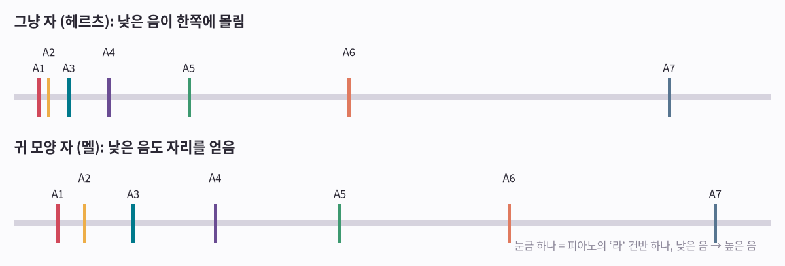

**그림 보는 법**

- 위: 피아노 ‘라’ 건반 7개를 보통 자에 찍으면 낮은 음 4개가 왼쪽 끝에 몰려요.
- 아래: 귀 모양 자(멜)에서는 낮은 음들도 넉넉하게 떨어져요.

!!! abstract "한 줄 정리"
    조각마다 FFT를 하고, 0의 개수로 재고(dB), 귀 모양 자(멜)로 다시 그린 그림을 AI가 봐요. 이름은 ‘로그 멜 스펙트로그램’이에요.

*이제 이런 그림을 직접 읽어 볼 차례예요.*

## 소리 그림, 읽을 수 있나요?

진짜로 녹음한 소리 여섯 개예요. 먼저 그림만 보고 맞혀 본 다음, 듣기를 눌러 확인해 보세요.

힌트: 사이렌은 선 하나가 위아래로 미끄러져요. 시계는 가는 줄이 일정한 간격으로 있어요. 비는 온통 자글자글해요.

**1번**

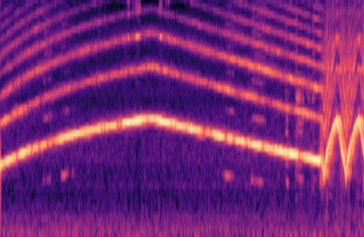

<b>듣기</b> <audio controls preload="none" src="/assets/aip/aip-seeing-sound-e26047663f.wav"></audio>

??? success "정답 보기"
    사이렌

**2번**

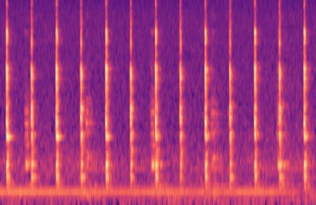

<b>듣기</b> <audio controls preload="none" src="/assets/aip/aip-seeing-sound-85fba2c244.wav"></audio>

??? success "정답 보기"
    시계 째깍

**3번**

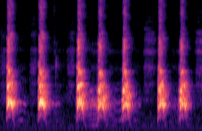

<b>듣기</b> <audio controls preload="none" src="/assets/aip/aip-seeing-sound-1777b6ea43.wav"></audio>

??? success "정답 보기"
    개

**4번**

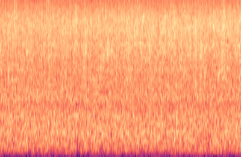

<b>듣기</b> <audio controls preload="none" src="/assets/aip/aip-seeing-sound-ab02fa65c1.wav"></audio>

??? success "정답 보기"
    비

**5번**

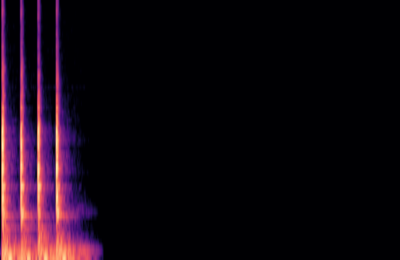

<b>듣기</b> <audio controls preload="none" src="/assets/aip/aip-seeing-sound-5d71daf352.wav"></audio>

??? success "정답 보기"
    문 노크

**6번**

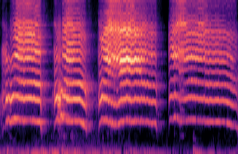

<b>듣기</b> <audio controls preload="none" src="/assets/aip/aip-seeing-sound-407dfb4c39.wav"></audio>

??? success "정답 보기"
    아기 울음

## 소리 AI 학습은 이 게임을 수천 번 하는 거예요

개 사이렌 비 … 그리고 수천 장 더 → AI 모델 어떤 모양이 어떤 이름인지 배워요 → 새 소리: “개” 예: 94% 확신

방금 그림을 보고 모양과 이름을 짝지었죠. AI도 똑같이, 이름표가 붙은 그림 수천 장을 보면서 처음 보는 그림의 이름도 맞힐 때까지 배워요. 입력이 그림이라서, 사진을 알아보는 AI와 같은 종류의 AI가 소리에도 통해요.

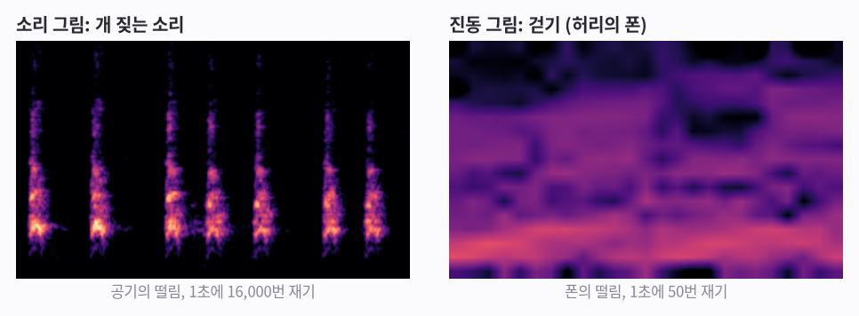

공기가 아니어도, 떨리는 것이면 같은 방법으로 그림을 그릴 수 있어요. 오른쪽은 폰 속 움직임 센서가 잰 걷기를 똑같은 순서(짧게 자르고, 조각마다 FFT, 옆으로 이어 붙이기)로 그린 거예요. [3편 「움직임을 보다」](aip-seeing-motion.md)에서는 이 진동 그림을 골프 센서 장갑에 쓰고, [4편 「움직임을 알아보는 AI」](aip-teaching-motion.md)에서는 이 그림으로 AI를 가르쳐요. 그래서 이 시리즈 이름이 「보는 AI」예요. AI는 소리도, 움직임도 그림으로 바꿔서 ‘봐요’.

----

**시리즈** · [← 0편, 로봇은 무엇으로 세상을 느낄까](aip-robot-senses.md) · [2편, 소리를 알아듣는 AI →](aip-teaching-sound.md)

### 출처와 표기

실제 녹음은 ESC-50 데이터셋(K. J. Piczak, CC BY-NC)에서 가져왔어요. 나머지 소리와 그림은 이 페이지를 위해 만들었어요.

### 용어 설명

- *떨림*: 파형(waveform), 샘플, 샘플링 레이트
- *섞인 소리 나누기, 음마다 겹쳐 보기 점수*: 푸리에 변환(FFT): 주파수마다 상관(correlation) 계산
- *소리 그림*: 스펙트로그램(spectrogram)
- *조각마다 세로 한 줄*: STFT(단시간 푸리에 변환): 창(window), 홉(hop)
- *조각 길이*: 창 길이, 시간–주파수 트레이드오프
- *0의 개수로 재기*: 데시벨(dB), 로그 눈금
- *귀 모양 자*: 멜 스케일(mel scale)
- *AI가 먹는 완성된 그림*: 로그 멜 스펙트로그램(log-mel spectrogram)
