# AI in Pictures Part 7: Can One Person Build a Product End to End?

> **AI in Pictures · Part 7.** A picture-first series on sound and motion AI. [Start from part 0](aip-robot-senses.md)

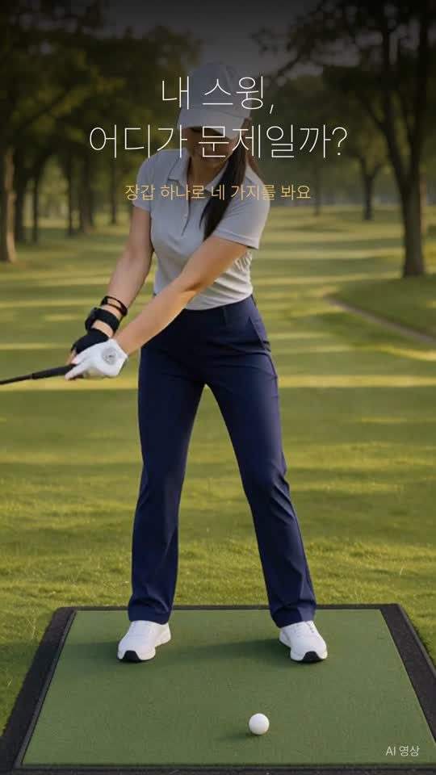{ width="320" }

*The first scene of the ad. It's an AI-generated video.*

Part 6 ended with a promise: my golf swing was next. The plan was a glove with sensors that would capture sound and motion together. But somewhere along the way a different question took over. Could I build this like a real product, all by myself? Name it, put it out in the world, even make an ad. No team, just AI tools.

## The wrist the camera missed

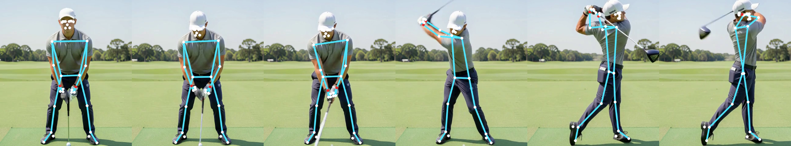

*The golfer in this picture is AI-generated.*

It started with a phone camera. I filmed a swing and let a pose AI find the joints. It tracked my shoulders and hips all the way. The hands were the problem. They move fastest on the downswing, and that's exactly when they blur and the AI loses the wrists. In golf, the wrists are the part I most want to see.

So I decided to put a sensor on the hand itself.

## One on the hand, one on the forearm

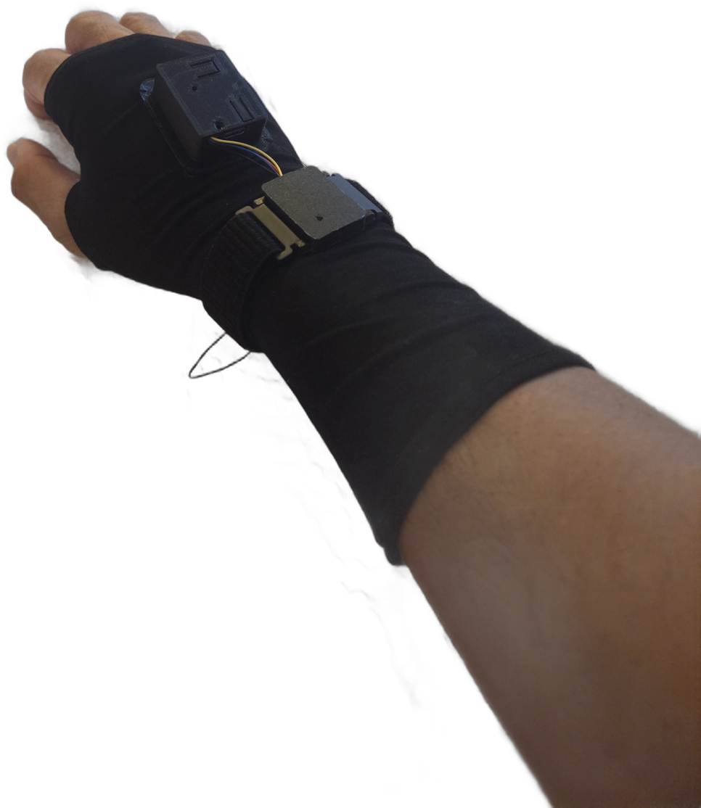{ width="360" }

On the back of the hand sits a board about the size of a thumbnail. It's tiny, yet it has a motion sensor, a microphone and Bluetooth. A second motion sensor rides on the forearm. The difference between the two tells you how far the wrist cocks and releases. I printed the cases on my home 3D printer, again and again.

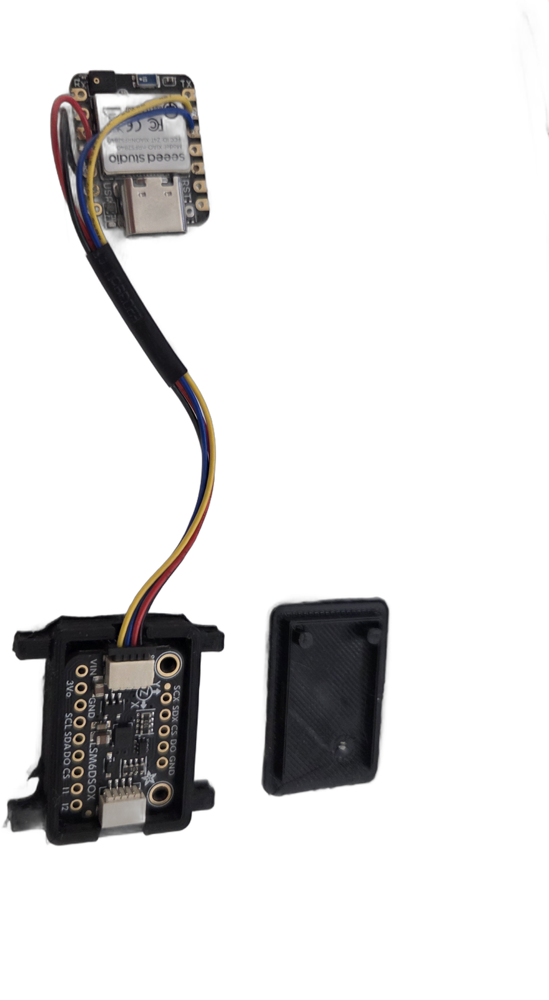{ width="300" }

## When a swing becomes a picture

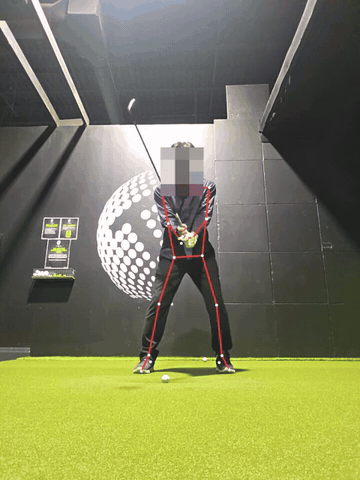{ width="420" }

*A swing I hit at an indoor range, recorded straight from the phone screen. My face is blurred.*

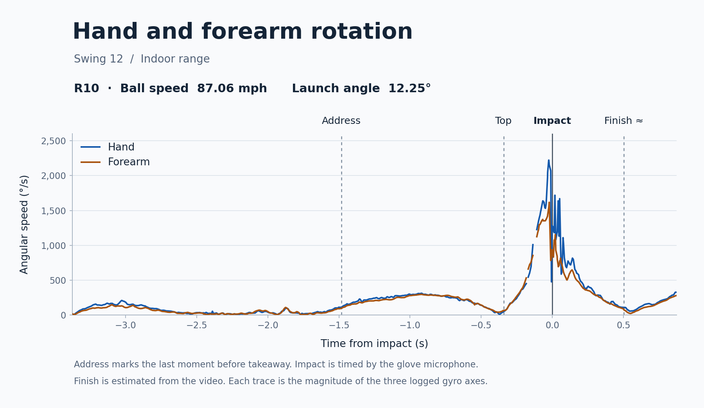

The first day at the range with the glove on, I stared at the graph on my phone for a long time. A slow climb, a brief pause, a fast drop, and a spike the moment the club hits the ball. The motion pictures from [Part 3](aip-seeing-motion.md), drawn by my own swing. This one took a little over a second going back and about a third of that coming down. The ball left at around 87 mph.

## Hearing a fat shot

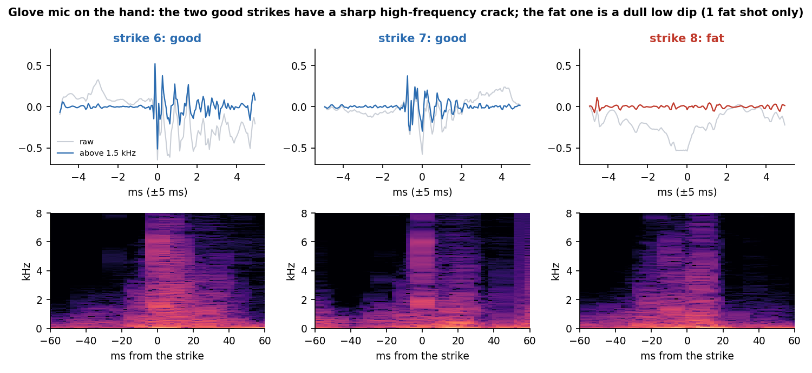

With a mic in the glove, the sound comes along too. A clean strike cracks with a sharp, high note. A fat shot lands with a dull thud. You can hear the difference, and you can see it in the sound pictures from [Part 1](aip-seeing-sound.md). But once I collected a lot of phone recordings, they overlapped more than I expected. Sound alone isn't enough to call a fat shot yet.

## Where did the ball go?

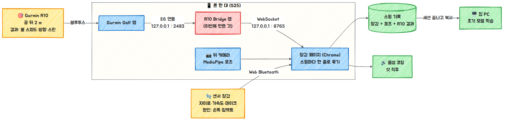

Measuring the swing alone is only half the story. So I added a launch monitor, the Garmin R10. When you hit, the R10 sends the ball speed and angles, and the phone pairs them with the swing just before. The first time at the range it missed a few. After a fix, I replayed that day’s recording and it paired all nine. Now each row reads: this is how I swung, and this is how it flew. The R10 is really an answer key. Tag every swing with its answer, and one day an AI can learn from them and tell you without the R10.

## Without taking out the phone

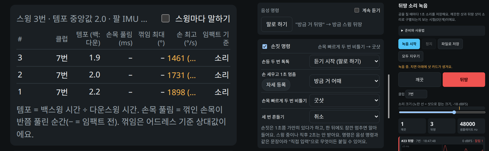

At the range there's no time to look at a screen, and pulling out a phone with a glove on is a hassle. So the glove does it all.

You change clubs the way you switch weapons in a game. Tap the back of your hand four times and club selection starts. Turn your wrist like a dial and it steps through 7-iron, 8-iron, 9-iron. A small turn steps slowly, a big turn flicks through fast. Tap four times again on the club you want, and you're done. Honestly, the four taps still miss more often than I'd like, so I'm working on that.

Voice works too. Double-tap the glove and say “seven iron, half” to switch clubs, or “last one was fat” to tag the shot. If you like, it reads back the tempo and shoulder turn after each swing. Along the way it learned English as well as Korean.

The screen kept changing as I used it at the range. It started out packed with numbers. Now it shows just the swing you hit, big, and keeps it there until the next one, so a glance after the shot is enough.

## Naming it

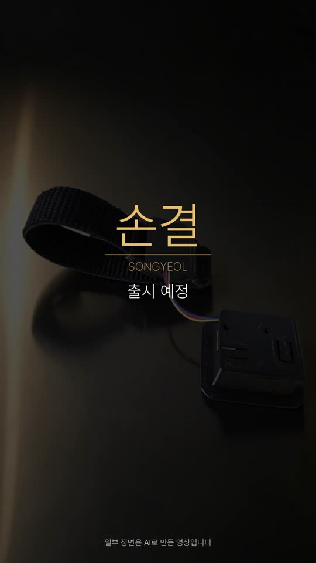{ width="320" }

*The last scene of the ad, still showing the old spelling.*

A product needs a name. I picked **손결 (Songyul)**. *Son* means hand, and *gyul* means grain or texture: the feel of a hand. It fits a glove that reads how your hand moves. English was the hard part. The official romanization looked hard for English speakers to read, so I went with **Songyul**. Choosing one name took longer than I expected.

## Getting ready to share it

It felt like a waste to keep it to myself, so I'm getting it ready for GitHub, where anyone can take it and build one. Getting ready turned out to be most of the work: filtering out what shouldn't go up, like location data hiding in photos and personal details tucked into notes. The known issues are going in too, not hidden.

## And then the ad

<video controls playsinline preload="metadata" width="320" src="../../../assets/aip/songyul/ad-v16.mp4"></video>

*The 30-second ad. Some scenes are AI-generated.*

Last came the ad. I gave a video AI a photo of me wearing the glove, and it came back with close-ups of the glove and a golfer swinging. Pose, wrist, feel, sound: the four things the glove reads, in 30 seconds. The golfer is an AI-made person. While I kept remaking it, the English spelling changed, so the ad still carries the old one. The captions are Korean.

## So, did one person make it all the way?

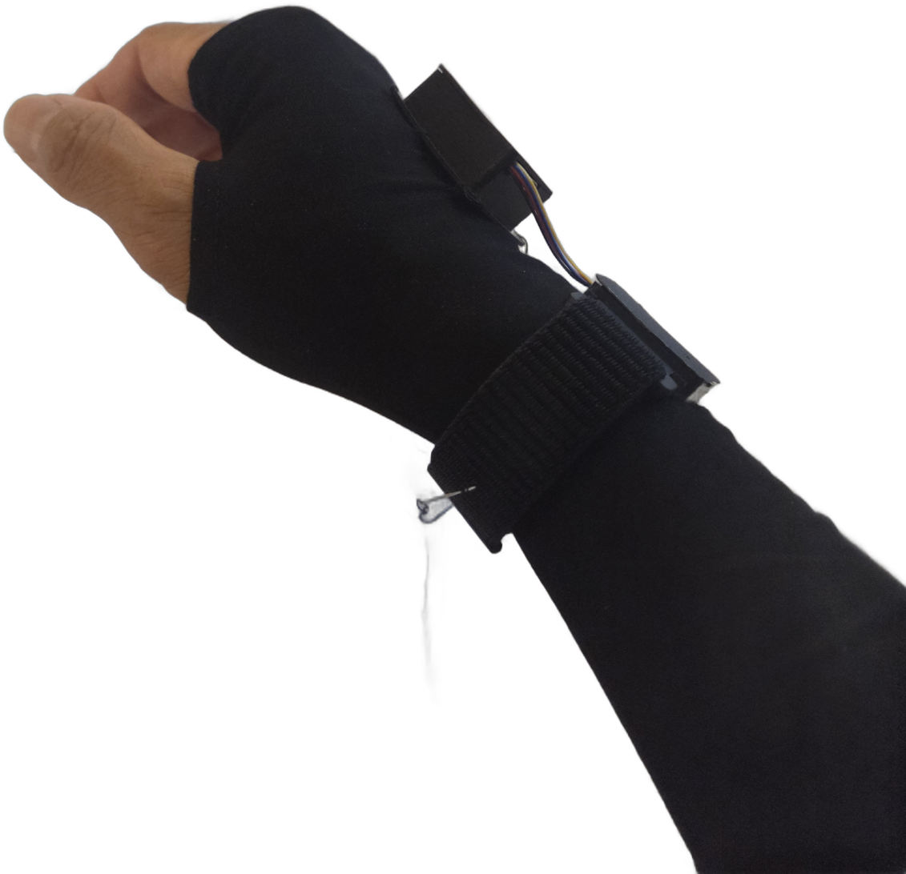{ width="320" }

About halfway, I'd say. When I soldered the first wire onto the glove, I never pictured it with a name and an ad of its own. It turns out one person can get surprisingly far. Not truly alone, of course. I talked the hard calls through with Claude, handed code and tests to Codex, and let a local AI do the long reading. That part has its own post: [the work bridge](ai-workbench-routing.md).

Still, every time I hit balls with Songyul on, something nags at me. I'm the only person who has ever worn it. I don't know yet whether it reads anyone's hand but mine.

Building it, I could do alone. Whether it becomes a product depends on other people using it. The next step is putting Songyul on someone else's hand. And when winter is over, I want to build a coach that says a word after every shot.

## Next

In Part 8, the same ‘eye’ goes onto a robot gripper.

**Series** · [← Part 6, An Eye Taught in Simulation](aip-eye-from-simulation.md) · [Back to part 0, How Robots Feel](aip-robot-senses.md)
