# 보는 AI 7편: 혼자서 제품 하나를 끝까지 만들 수 있을까

> **보는 AI · 7편.** 그림으로 보는 소리·움직임 AI 시리즈예요. [0편부터 읽기](aip-robot-senses.md)

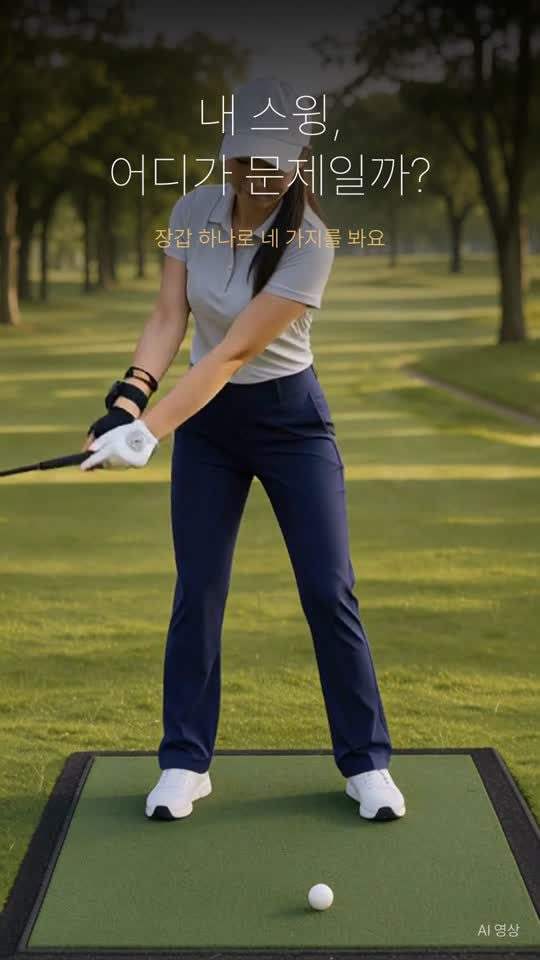{ width="320" }

*광고 영상의 첫 장면이에요. AI로 만든 영상이에요.*

6편 끝에서 다음은 제 골프 스윙이라고 했어요. 장갑에 센서를 붙여서 소리와 움직임을 같이 재 보려던 거였죠. 그런데 만들다 보니 엉뚱한 궁금증이 생겼어요. 이걸 혼자서 진짜 제품처럼 끝까지 만들어 볼 수 있을까? 이름도 짓고, 세상에 공개도 하고, 광고까지요. 옆에 팀은 없고, AI 도구들만 있었어요.

## 카메라가 놓친 손목

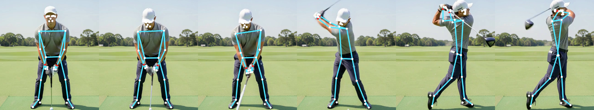

*그림 속 골퍼는 AI로 만든 사람이에요.*

시작은 폰 카메라였어요. 스윙을 찍고 자세 AI에게 관절을 찾게 하니, 어깨랑 엉덩이는 끝까지 잘 따라가더라고요. 문제는 손이었어요. 다운스윙에서 손이 제일 빠른데, 바로 그 순간 화면에서 흐려지고 AI도 손목을 놓쳐 버렸어요. 골프에서 제일 궁금한 게 그 손목인데요.

그래서 손에 직접 센서를 붙이기로 했어요.

## 손등에 하나, 팔뚝에 하나

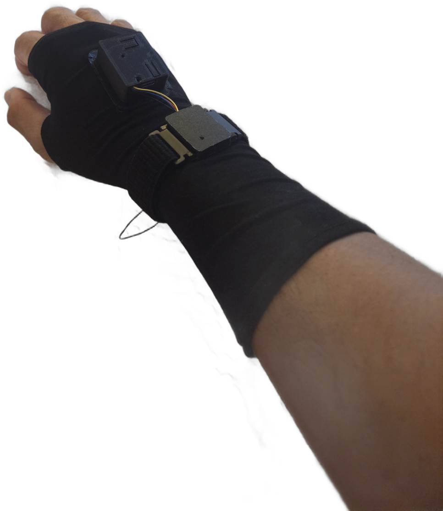{ width="360" }

손등에는 엄지손톱만 한 보드를 올렸어요. 작은데 움직임 센서, 마이크, 블루투스까지 다 들어 있어요. 팔뚝에도 센서를 하나 더 달았어요. 두 센서의 움직임 차이를 보면 손목이 얼마나 꺾이고 풀리는지 알 수 있거든요. 케이스는 집에 있는 3D 프린터로 몇 번이고 다시 뽑았어요.

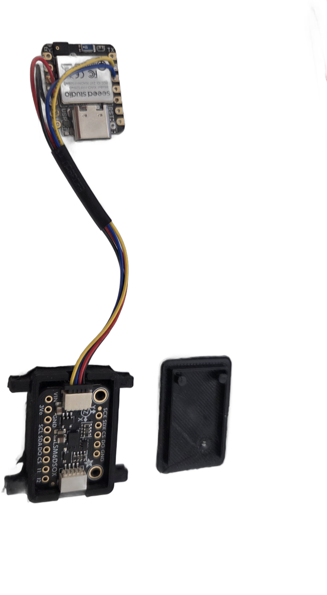{ width="300" }

## 스윙이 그림이 되는 순간

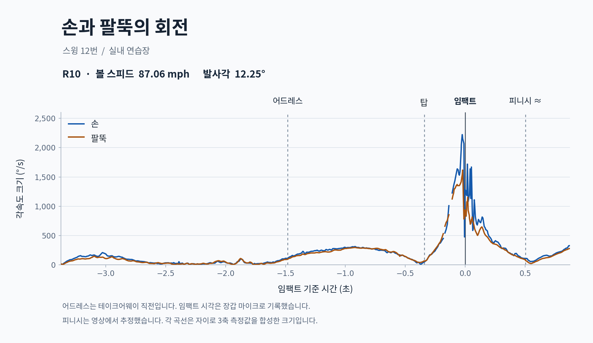

처음 연습장에서 장갑을 끼고 친 날, 폰에 뜬 그래프를 한참 들여다봤어요. 천천히 올라갔다가 잠깐 멈추고, 확 내려와서 공을 치는 순간 그래프가 튀어요. [3편](aip-seeing-motion.md)에서 본 움직임 그림이 제 스윙으로 그려진 거예요. 이 스윙은 백스윙에 1초 남짓, 다운스윙은 그 3분의 1쯤 걸렸어요. 공은 시속 87마일쯤으로 날아갔고요.

## 소리로 듣는 뒤땅

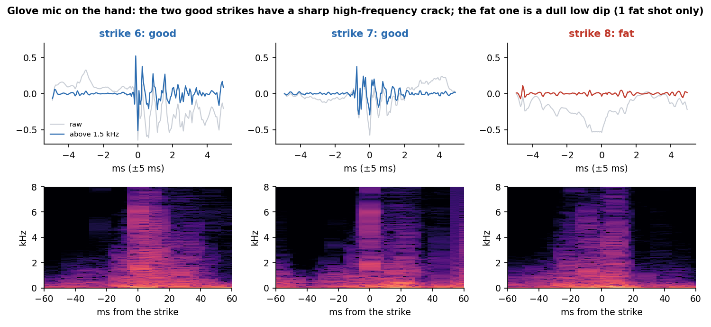

장갑에 마이크가 있으니 소리도 같이 들어와요. 잘 맞은 공은 '딱' 하고 높은 소리가 날카롭게 터지는데, 뒤땅은 '퍽' 하고 둔하게 가라앉아요. 귀로 들어도 다르고, [1편](aip-seeing-sound.md)의 소리 그림으로 봐도 달라요. 그런데 폰으로 녹음한 걸 많이 모아 보니 생각보다 겹치는 게 많았어요. 소리만으로 뒤땅을 가려내기엔 아직 부족해요.

## 공은 어디로 갔을까

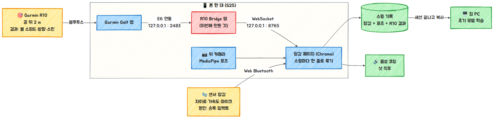

스윙만 재면 반쪽이에요. 그래서 공이 어떻게 날아갔는지 재는 장비(Garmin R10)를 붙였어요. 공을 치면 R10이 공 속도와 각도를 보내 주고, 폰이 그걸 바로 앞 스윙과 짝지어요. 연습장에서 처음 해 봤을 땐 몇 번 놓쳤어요. 고친 뒤 그날 기록으로 다시 돌려 보니 아홉 번 다 맞게 짝지었어요. 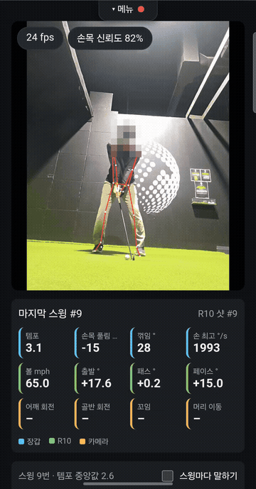{ width="300" }

*실제 폰 화면을 녹화했어요. 치고 나면 스윙 숫자와 R10 결과가 바로 카메라 위에 떠요. 얼굴은 가렸어요.*

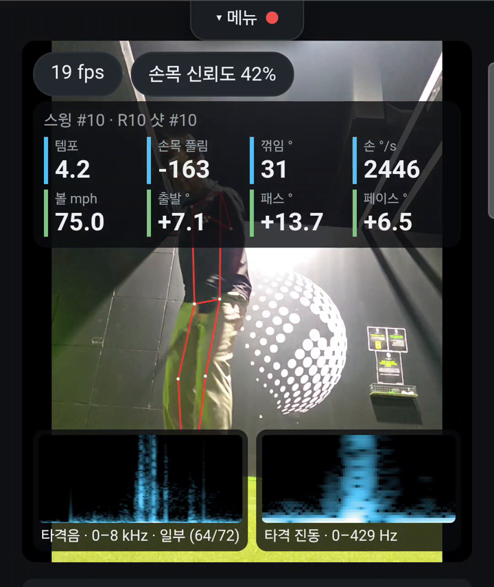{ width="360" }

멈춰서 보면 이래요. 위 카드의 파란 줄은 장갑이 잰 값이에요. 템포, 손목이 풀린 시점, 손목 꺾임, 손이 가장 빨리 돈 속도요. 초록 줄은 R10이 잰 값이에요. 공 속도와 방향, 클럽이 지나간 길과 페이스 각도요. 아래 두 그림은 장갑 마이크로 들은 타격음과 장갑이 느낀 타격 진동이에요. 공 한 번 치고 고개만 돌리면 이게 다 보여요.

이제 '이렇게 휘둘렀더니 이렇게 날아갔다'가 한 줄씩 쌓여요. 사실 R10은 정답지예요. 스윙마다 답을 붙여 두면, 언젠가 AI가 그걸 배워서 R10 없이도 공이 어떻게 날아갔는지 말해 줄 수 있을 테니까요.

## 폰을 꺼내지 않고

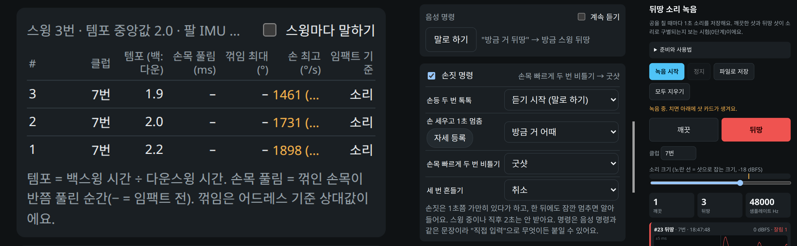

연습장에서는 폰 화면을 볼 틈이 없어요. 장갑을 낀 손으로 폰을 꺼내 클럽을 바꾸는 것도 번거롭고요. 그래서 장갑으로 다 하게 만들었어요.

클럽은 게임에서 무기 바꾸듯 골라요. 손등을 네 번 톡톡 치면 클럽 고르기가 시작되고, 손목을 다이얼처럼 돌리면 7번, 8번, 9번 하고 넘어가요. 조금 돌리면 천천히, 많이 돌리면 휙휙 넘어가요. 마음에 드는 클럽에서 다시 네 번 톡톡 치면 끝이에요. 솔직히 네 번 톡톡은 아직 잘 안 먹힐 때가 많아서, 지금 손보는 중이에요.

말로도 돼요. 장갑을 톡톡 두 번 치고 "7번 하프"라고 하면 클럽이 바뀌고, "방금 거 뒤땅"이라고 하면 그 샷에 표시가 붙어요. 원하면 스윙이 끝날 때마다 템포와 어깨 회전을 읽어 주고요. 하다 보니 영어로도 되게 만들었어요.

화면도 연습장에서 쓰면서 계속 바뀌었어요. 처음엔 숫자가 빼곡했는데, 지금은 방금 친 스윙의 결과만 크게 보여 줘요. 다음 스윙을 할 때까지 그대로 남아 있어서, 치고 나서 고개만 돌려 보면 돼요.

## 이름 짓기

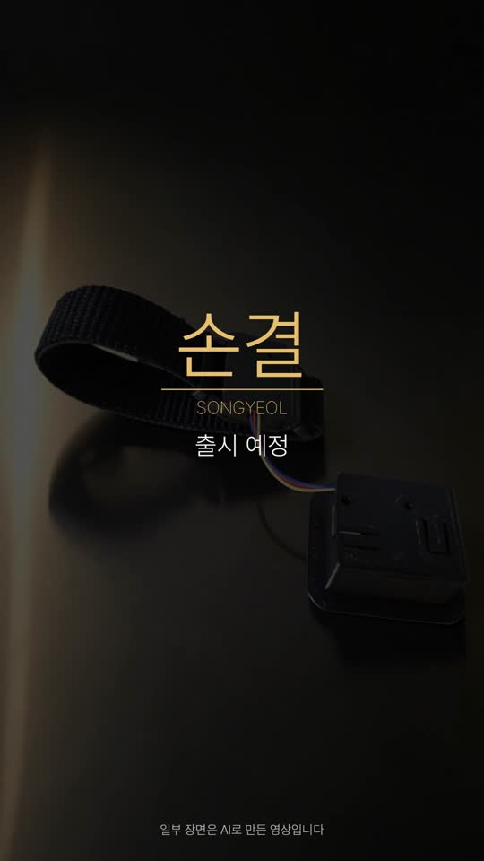{ width="320" }

*광고 마지막 장면이에요. 여기엔 아직 옛 영어 표기가 남아 있어요.*

제품에는 이름이 있어야죠. 손이 가진 결이라는 뜻으로 **손결**이라고 지었어요. 손의 움직임을 읽는 장갑이니까요. 영어가 문제였어요. 공식 로마자로 쓰면 영어권 사람이 읽기 어려워 보여서 **Songyul**로 정했어요. 이름 하나 정하는 데 생각보다 오래 걸렸어요.

## 세상에 내놓기

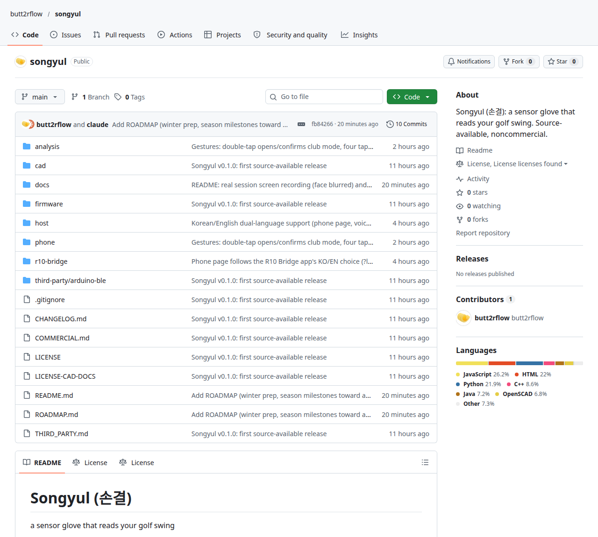

혼자만 쓰기는 아까워서 GitHub에 올렸어요. 누구나 가져다 만들어 볼 수 있어요. 그런데 올리는 것보다 올리면 안 되는 걸 걸러 내는 데 시간이 더 들었어요. 사진에 남은 위치 정보, 메모에 섞인 개인 정보 같은 것들이요. 아직 고칠 곳도 숨기지 않고 적어 뒀어요.

[github.com/butt2rflow/songyul](https://github.com/butt2rflow/songyul)

## 그리고 광고

<video controls playsinline preload="metadata" width="320" src="../../assets/aip/songyul/ad-v16.mp4"></video>

*30초 광고예요. 일부 장면은 AI로 만든 영상이에요.*

마지막은 광고였어요. 제가 장갑을 낀 사진을 영상 AI에 넣었더니, 장갑을 비추는 장면과 골퍼가 스윙하는 장면이 나왔어요. 자세, 손목, 손맛, 소리. 장갑이 보는 네 가지를 30초에 담았어요. 화면 속 골퍼는 AI가 만든 사람이에요. 여러 번 고쳐 만드는 사이 영어 표기가 바뀌어서, 광고에는 옛 표기가 그대로 남아 있어요.

## 그래서, 혼자서 끝까지 됐을까요?

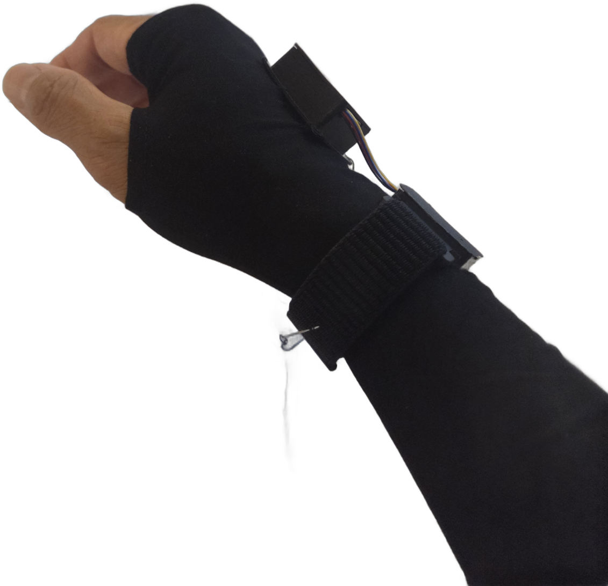{ width="320" }

반은 됐다고 생각해요. 처음 장갑에 선을 납땜할 때만 해도 이름을 짓고 광고까지 만들 줄은 몰랐어요. 막상 해 보니 혼자서도 꽤 멀리 갈 수 있더라고요. 물론 정말 혼자는 아니었어요. 어려운 판단은 Claude와 상의했고, 코드와 시험은 Codex에 맡겼고, 긴 자료는 로컬 AI가 읽었어요. 그 이야기는 [작업 브리지 글](ai-workbench-routing.md)에 따로 적었어요.

그런데 연습장에서 손결을 끼고 칠 때마다 마음에 걸리는 게 있어요. 이 장갑을 써 본 사람이 아직 저 하나라는 거예요. 제 손, 제 스윙에서만 잘 읽는 건지 아직 몰라요.

만드는 건 혼자 할 수 있었어요. 제품이 되는 건 다른 사람이 써 봐야 알 것 같아요. 다음 단계는 손결을 다른 손에 끼워 보는 거예요. 그리고 겨울이 지나면, 공을 칠 때마다 옆에서 한마디 해 주는 코치를 만들어 보려고 해요.

## 다음 편

8편에서는 같은 ‘눈’을 로봇 그리퍼에 달아요.

**시리즈** · [← 6편, 시뮬레이션으로 배운 ‘눈’](aip-eye-from-simulation.md) · [처음부터: 0편, 로봇은 무엇으로 세상을 느낄까](aip-robot-senses.md)
