# AI in Pictures Part 4: Teaching Motion

> **AI in Pictures · Part 4.** A picture-first series on sound and motion AI. [Start from part 0](aip-robot-senses.md)

In [part 3, Seeing Motion](aip-seeing-motion.md), the vibration of a swing became a picture. Now we teach an AI to recognize movements from such pictures, with real phone data from 30 people. Every number below comes from training we ran.

*8 pictures · no formulas · real training results · a game at the end · about 10 minutes*

---

## Picture 1 · Ingredients: 10,000 slices of six activities

We use UCI HAR, a public dataset: 30 people wore a phone on the waist while walking, climbing stairs, going down stairs, sitting, standing and lying down. The phone's IMU measured 50 times a second; the recordings are cut into 2.56-second slices, each with a name tag.

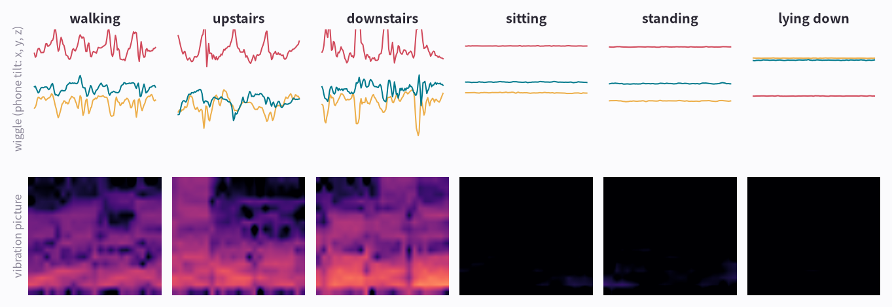

**How to read the picture**

- Top row: the phone's tilt as three wiggles (x, y, z).
- Bottom row: the size of the body's shaking as a vibration picture, the same recipe as [part 1](aip-seeing-sound.md).
- Walking and the two stair activities light up the vibration picture. Sitting, standing and lying down are almost dark: there is little shaking, so the tilt (top) is the only clue that tells them apart.

!!! abstract "In one line"
    A motion AI learns from slices of movement with name tags, just as the sound AI in [part 2](aip-teaching-sound.md) learned from sounds.

*We won't study with all of it. This time, how we split it matters even more.*

## Picture 2 · Split by person: study with 21, examine 9 new people

Everyone walks a little differently. If the same person shows up in both the study set and the exam, the AI can recognize that person's habits instead of the activity. So the exam uses people the AI has never seen.

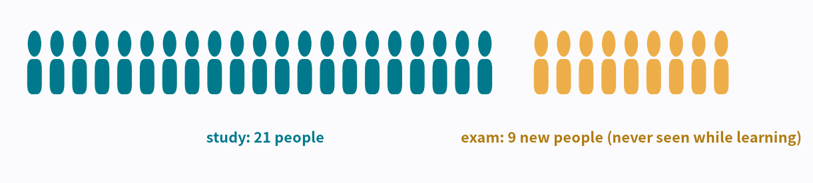

**How to read the picture**

- Teal: 21 people, 7,352 slices for studying.
- Yellow: 9 other people, 2,947 slices, used only for the exam.

!!! abstract "In one line"
    A fair exam for a motion AI uses people it has never met.

*Now each slice becomes pictures.*

## Picture 3 · One slice becomes nine vibration pictures

The phone's IMU gives six signals: shaking in three directions and turning in three directions. The shaking is then split into two parts: the body's own movement, and gravity, which shows how the phone is tilted. That makes nine signals, and each becomes its own vibration picture.

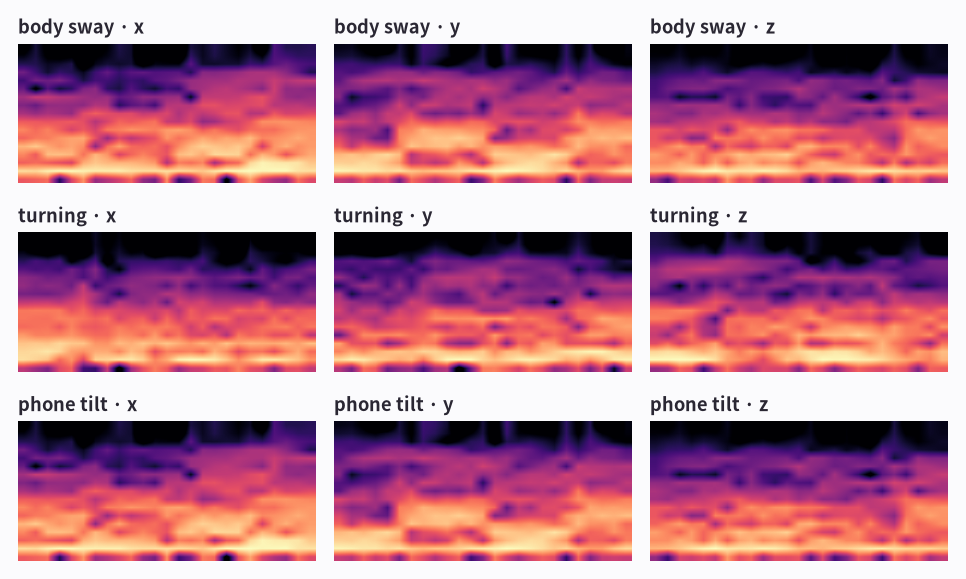

**How to read the picture**

- Here is one walking slice. Every row repeats with each step, so the pictures show regular bright bands.
- The nine pictures are stacked like the color layers of a photo, and the AI looks at all of them at once.

!!! abstract "In one line"
    A motion AI looks at nine vibration pictures at once, where a sound AI looked at one sound picture.

*What does a brand-new AI make of them?*

## Picture 4 · A brand-new AI knows nothing

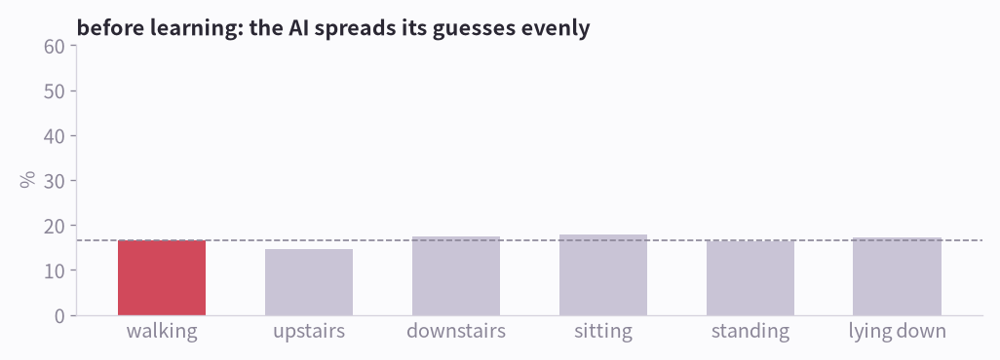

**How to read the picture**

- The six bars are the AI's answer for one walking slice. All are near the dashed line, 1 in 6.
- On the 2,947 exam slices it got 17% right. Guessing one of six gets 17%.

!!! abstract "In one line"
    Before learning, the AI is guessing, exactly as in [part 2](aip-teaching-sound.md).

*Then it learns the same way: guess, get marked, fix a little.*

## Picture 5 · It learns in seconds

Learning works exactly as in [part 2, Teaching Sound](aip-teaching-sound.md). The slices are small, so 40 rounds of study took about 9 seconds on the RTX 3090.

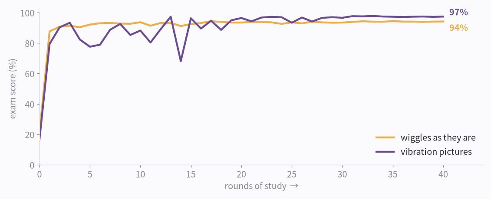

**How to read the picture**

- Yellow: an AI that studied the wiggles as they are. It ended at 94% on the 9 new people.
- Purple: an AI that studied the vibration pictures. It wobbled at first, then ended at 97%.

!!! abstract "In one line"
    In this experiment, turning movement into pictures helped, as it did for sound.

*Which activities does it still mix up?*

## Picture 6 · The mix-up: sitting and standing

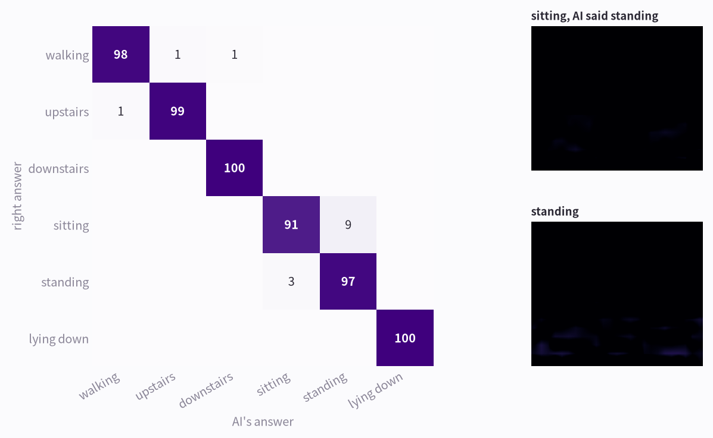

**How to read the picture**

- Each row across is the right answer, each column down is the AI's answer, and the numbers are percentages. Dark squares on the diagonal are correct answers. For example, the “sitting” row shows what the AI said when the real answer was sitting: 91 right, 9 called standing.
- Walking, stairs and lying down are almost always right.
- The big miss is sitting taken for standing. Both are still, so the vibration pictures are nearly dark for both, and the phone on the waist is tilted almost the same way.
- Right: the vibration pictures of a sitting slice the AI called standing, and of a typical standing slice. Both are nearly black, so the picture alone can hardly tell them apart. They come back in picture 7 of [part 5, Learning from a Reference](aip-learning-from-reference.md).

!!! abstract "In one line"
    When two movements make the same vibration picture, even a good AI confuses them. The sensor's place matters.

*One more experiment: what if the split had been unfair?*

## Picture 7 · An unfair exam inflates the score

We trained the wiggle AI again, but mixed everyone before splitting, so the same people were in study and exam.

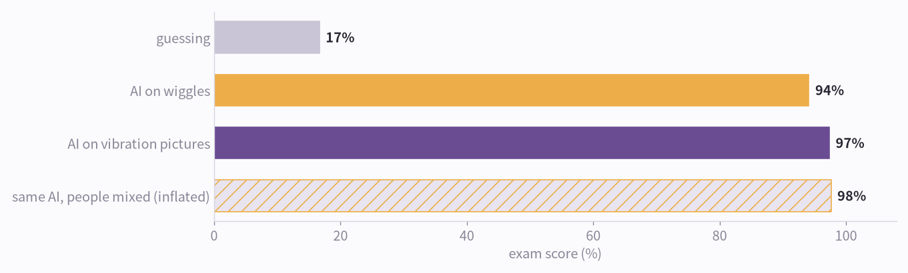

**How to read the picture**

- Guessing: 17%. Wiggle AI on new people: 94%. Vibration-picture AI on new people: 97%.
- The same wiggle AI with people mixed: 98%, 3.5 points higher than its honest score. The same people's slices, even neighboring slices that share half their time, were on both sides, so it had partly seen the exam.

!!! abstract "In one line"
    Always examine on new people, or the score looks better than the AI really is.

*Back to golf: what would the glove need?*

## Picture 8 · Back to the golf glove

The same recipe works for the sensor glove: put the sound picture and the vibration picture of each swing together, label it, and teach an AI.

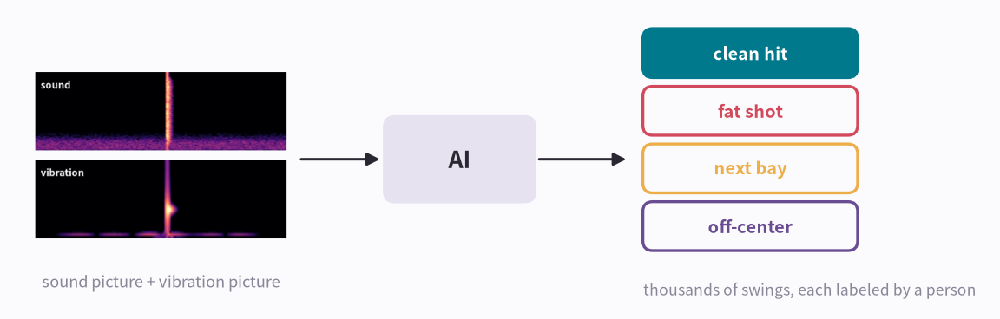

**How to read the picture**

- What it needs: thousands of swings from many golfers, each labeled by a person: clean hit, fat shot, next bay, off-center.
- The exam must use golfers the AI has never met, for the reason in the previous picture.
- Where the sensors sit matters: a sensor that barely moves can't tell apart two swings that feel the same there, just as the waist phone mixed up sitting and standing.
- One eye for sound and motion together, and recognizing new moves from references with no training, continue in [part 5, Learning from a Reference](aip-learning-from-reference.md).

!!! abstract "In one line"
    Sound AI and motion AI learn the same way. Only the pictures they are shown are different.

*Your turn: read some vibration pictures yourself.*

## Which activity is it?

Each card is an exam slice from a new person: tilt wiggles on top, vibration picture below. Pick the activity, then check.

**Card 1**

??? success "Show the answer"
    lying down

**Card 2**

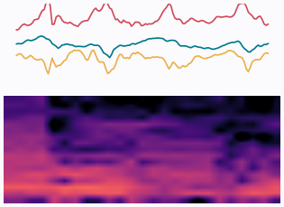

??? success "Show the answer"
    upstairs

**Card 3**

??? success "Show the answer"
    sitting

**Card 4**

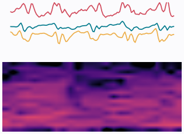

??? success "Show the answer"
    walking

**Card 5**

??? success "Show the answer"
    standing

**Card 6**

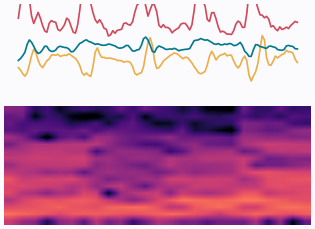

??? success "Show the answer"
    downstairs

## The whole thing in five lines

1. Collect slices of movement with name tags.
2. Turn each slice into vibration pictures, the same recipe as for sound.
3. Study with some people, examine on people the AI has never met.
4. Guess, mark, fix a little, many times; a small AI learns this in seconds.
5. Movements that feel the same where the sensor sits stay hard: place the sensor well.

----

**Series** · [← Part 3, Seeing Motion](aip-seeing-motion.md) · [Part 5, Learning from a Reference →](aip-learning-from-reference.md)

### Sources and notices

Data: UCI HAR, Anguita, Ghio, Oneto, Parra and Reyes-Ortiz (2013), “A Public Domain Dataset for Human Activity Recognition Using Smartphones”, ESANN; CC BY 4.0. Training ran on one RTX 3090. The golf picture is an illustration; no golf data was trained. NVIDIA and GeForce RTX are trademarks of NVIDIA Corporation, used here only to refer to them.

### Terms

- *activity recognition*: human activity recognition (HAR)
- *split by person*: subject-wise split; leave-subjects-out evaluation
- *unfair exam with the same people*: data leakage
- *nine vibration pictures*: multi-channel spectrogram input
- *wiggle AI / picture AI*: 1-D CNN on raw signals / 2-D CNN on spectrograms
- *table of mix-ups*: confusion matrix
