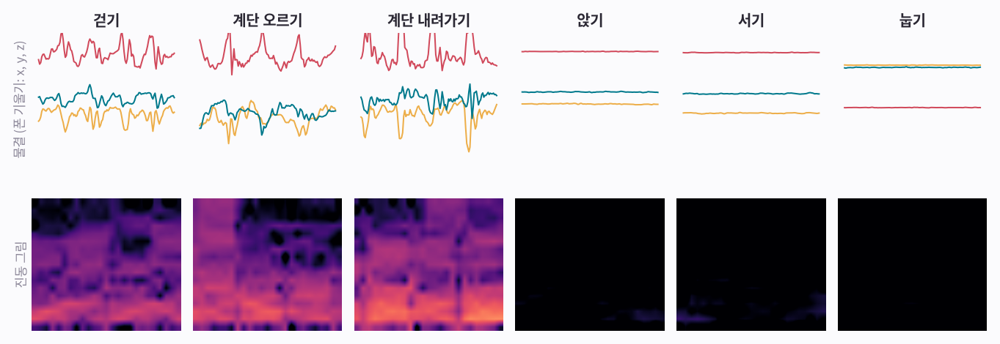
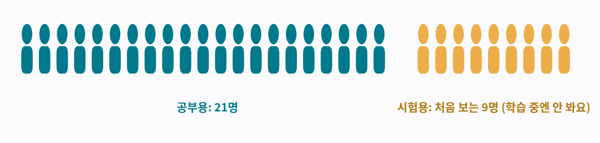
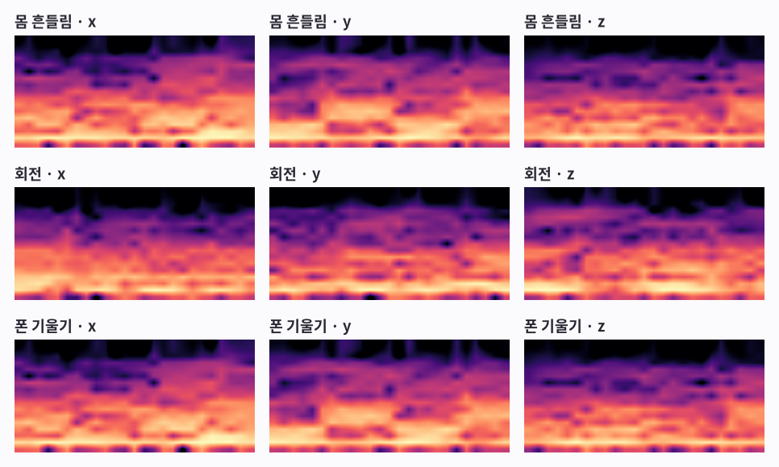
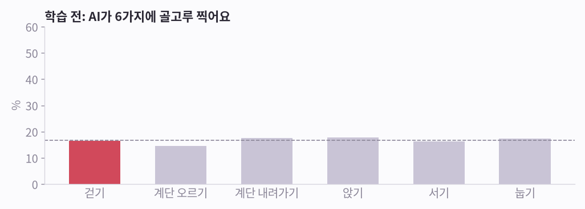
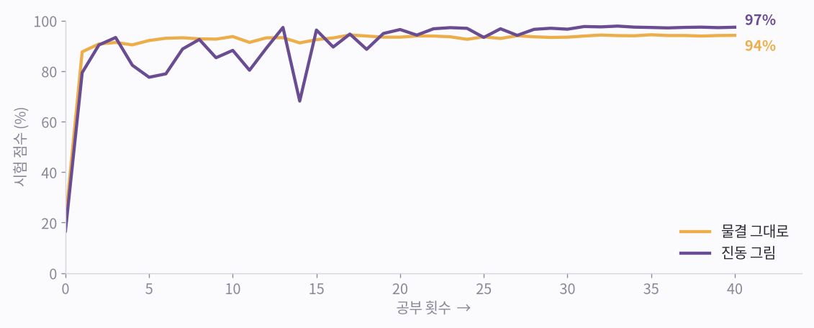
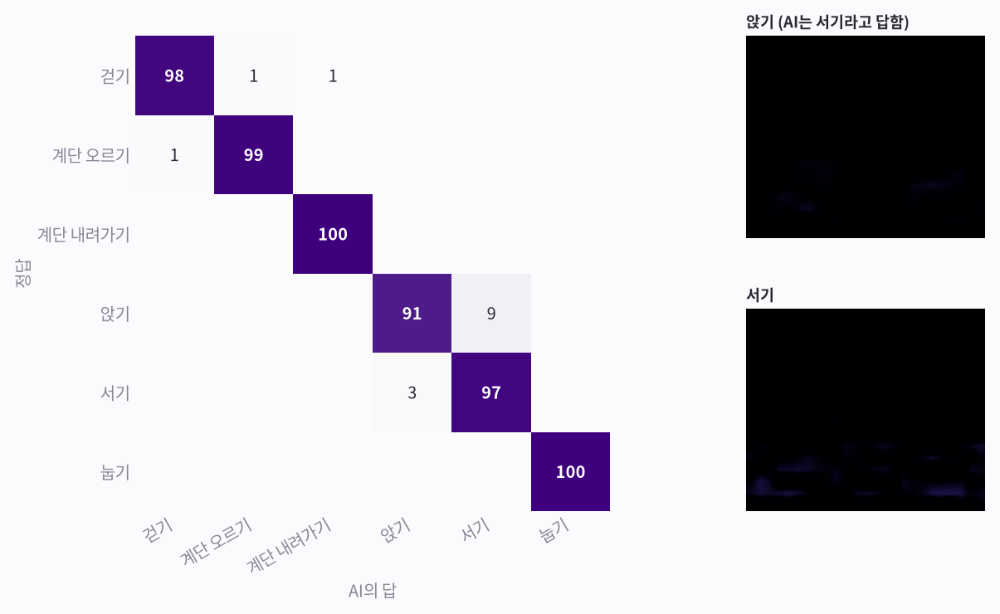
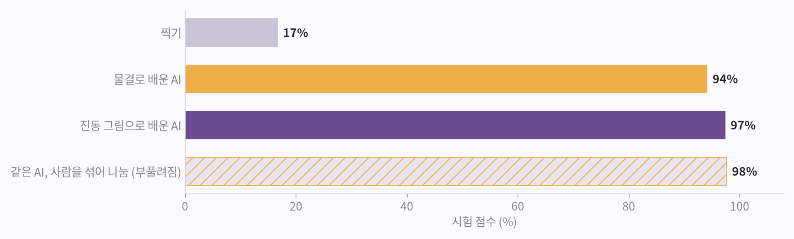
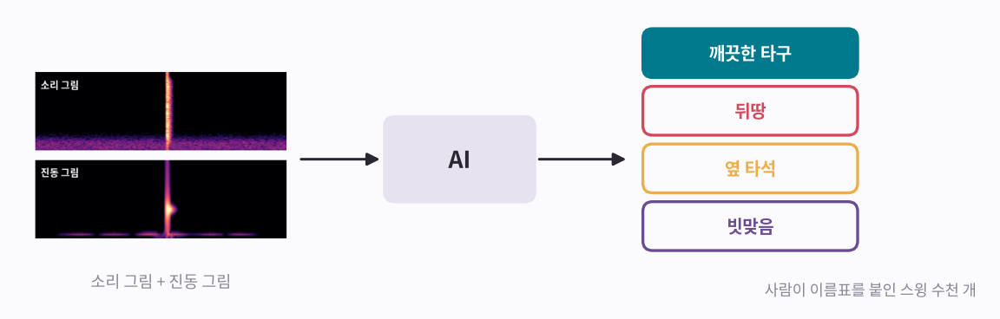

# 보는 AI 4편: 움직임을 알아보는 AI

> **보는 AI · 4편.** 그림으로 보는 소리·움직임 AI 시리즈예요. [0편부터 읽기](aip-robot-senses.md)

[3편 「움직임을 보다」](aip-seeing-motion.md)에서 스윙의 진동이 그림이 됐어요. 이번엔 그런 그림으로 AI가 동작을 알아보게 가르쳐요. 30명의 실제 폰 데이터를 썼고, 아래 숫자는 모두 직접 학습시킨 결과예요.

*그림 8장 · 수식 없음 · 진짜 학습 결과 · 마지막에 게임 · 10분 정도*

---

## 그림 1 · 재료: 여섯 가지 동작을 담은 조각 1만 개

UCI HAR라는 공개 자료를 써요. 30명이 허리에 폰을 차고 걷기, 계단 오르기, 계단 내려가기, 앉기, 서기, 눕기를 했어요. 폰 속 IMU가 1초에 50번씩 쟀고, 기록을 2.56초짜리 조각으로 잘라 조각마다 이름표를 붙였어요.

**그림 보는 법**

- 위 줄: 폰이 기울어진 정도를 물결 세 개(x, y, z)로 그렸어요.
- 아래 줄: 몸이 흔들린 크기를 진동 그림으로 그렸어요. [1편](aip-seeing-sound.md)과 같은 방법이에요.
- 걷기와 계단 두 가지는 진동 그림이 환하게 켜져요. 앉기, 서기, 눕기는 거의 까매요. 흔들림이 거의 없어서, 구별할 단서는 위쪽 기울기뿐이에요.

!!! abstract "한 줄 정리"
    움직임 AI도 이름표 붙은 조각으로 배워요. [2편](aip-teaching-sound.md)의 소리 조각과 같은 원리예요.

*이걸 전부 공부에 쓰면 될까요? 아니에요. 이번엔 나누는 방법이 더 중요해요.*

## 그림 2 · 사람 기준으로 나눠요: 21명으로 공부, 처음 보는 9명으로 시험

사람마다 걷는 습관이 조금씩 달라요. 같은 사람이 공부용과 시험용에 다 들어 있으면, AI가 동작이 아니라 그 사람의 습관을 알아볼 수 있어요. 그래서 시험은 AI가 한 번도 못 본 사람으로 봐요.

**그림 보는 법**

- 청록: 21명, 공부용 조각 7,352개
- 노랑: 다른 9명, 시험에만 쓰는 조각 2,947개

!!! abstract "한 줄 정리"
    움직임 AI는 처음 보는 사람으로 시험해야 공정해요.

*이제 조각마다 그림으로 바꿔요.*

## 그림 3 · 조각 하나가 진동 그림 9장이 돼요

폰 속 IMU는 신호 6개를 줘요. 세 방향의 흔들림과 세 방향의 회전이에요. 흔들림을 다시 몸이 움직인 부분과 중력(폰이 기운 방향) 부분으로 나누면 모두 9개가 돼요. 신호마다 진동 그림을 한 장씩 만들어요.

**그림 보는 법**

- 걷기 조각 하나예요. 걸음마다 같은 모양이 되풀이돼서, 그림마다 규칙적인 밝은 띠가 보여요.
- 9장을 사진의 색 층처럼 겹쳐서, AI가 한꺼번에 봐요.

!!! abstract "한 줄 정리"
    소리 AI가 소리 그림 1장을 봤다면, 움직임 AI는 진동 그림 9장을 한꺼번에 봐요.

*이제 막 만든 AI에게 이 그림을 보여 줄게요.*

## 그림 4 · 처음 AI는 아무것도 몰라요

**그림 보는 법**

- 막대 6개는 걷기 조각 하나를 보고 AI가 각 동작에 건 확률이에요. 모두 점선(6개 중 1개) 근처예요.
- 시험 조각 2,947개를 풀게 했더니 17%를 맞혔어요. 6개 중 하나를 찍으면 17%예요.

!!! abstract "한 줄 정리"
    학습 전 AI는 그냥 찍어요. [2편](aip-teaching-sound.md)에서 본 것과 같아요.

*그리고 똑같이 배워요. 맞혀 보고, 채점하고, 조금 고치기.*

## 그림 5 · 몇 초 만에 배워요

학습 방법은 [2편 「소리를 알아듣는 AI」](aip-teaching-sound.md)와 똑같아요. 조각이 작아서 40회 공부가 RTX 3090으로 9초쯤 걸렸어요.

**그림 보는 법**

- 노랑: 물결을 그대로 공부한 AI예요. 처음 보는 9명에게서 94%로 끝났어요.
- 보라: 진동 그림으로 공부한 AI예요. 처음엔 오르락내리락하다가 97%로 끝났어요.

!!! abstract "한 줄 정리"
    이번 실험에서는 소리처럼 움직임도 그림으로 바꿔 보여 준 쪽이 더 잘 배웠어요.

*그래도 헷갈리는 동작이 있을까요?*

## 그림 6 · 헷갈리는 짝: 앉기와 서기

**그림 보는 법**

- 가로줄은 정답, 세로줄은 AI의 답이고, 숫자는 %예요. 대각선의 진한 칸이 맞힌 거예요. 예를 들어 ‘앉기’ 줄은 정답이 앉기일 때 AI가 뭐라고 답했는지예요. 91은 맞혔고, 9는 서기라고 했어요.
- 걷기, 계단, 눕기는 거의 다 맞혀요.
- 가장 많이 틀린 건 앉기를 서기로 본 경우예요. 둘 다 가만히 있어서 진동 그림이 거의 까맣고, 허리의 폰도 거의 같은 각도로 기울어 있거든요.
- 오른쪽: AI가 서기라고 답한 앉기 조각과, 평범한 서기 조각의 진동 그림이에요. 둘 다 거의 까매서 그림만으로는 구별하기 어려워요. 이 둘은 [5편 「참고만 주면 알아보는 AI」](aip-learning-from-reference.md) 그림 7에서 다시 나와요.

!!! abstract "한 줄 정리"
    두 동작이 같은 진동 그림을 만들면 좋은 AI도 헷갈려요. 센서를 어디에 두느냐가 중요해요.

*실험 하나 더. 나누는 방법이 공정하지 않았다면?*

## 그림 7 · 불공정한 시험은 점수를 부풀려요

물결 AI를 다시 학습시키되, 이번엔 사람을 다 섞은 뒤 나눴어요. 같은 사람이 공부용과 시험용에 다 들어갔어요.

**그림 보는 법**

- 찍기 17%. 처음 보는 사람에게 물결 AI 94%, 진동 그림 AI 97%.
- 같은 물결 AI를 사람을 섞어 나눠 시험하면 98%예요. 정직한 점수보다 3.5점 높아요. 같은 사람의 조각, 그것도 시간이 절반씩 겹치는 이웃 조각까지 양쪽에 들어가서 문제를 미리 본 셈이 됐거든요.

!!! abstract "한 줄 정리"
    시험은 꼭 처음 보는 사람으로. 아니면 AI가 실제보다 잘해 보여요.

*마지막으로, 골프 센서 장갑에 이 방법을 쓰려면 무엇이 필요한지 볼게요.*

## 그림 8 · 다시 골프 장갑으로

센서 장갑에도 같은 방법을 써요. 스윙마다 소리 그림과 진동 그림을 한 장으로 붙이고, 이름표를 달아 AI를 가르쳐요.

**그림 보는 법**

- 필요한 것: 여러 골퍼의 스윙 수천 개, 그리고 사람이 하나하나 붙인 이름표(깨끗한 타구, 뒤땅, 옆 타석, 빗맞음)
- 시험은 AI가 처음 보는 골퍼로 봐야 해요. 바로 앞 그림의 이유예요.
- 센서 위치도 중요해요. 거의 안 움직이는 곳에 있는 센서는, 그곳에서 똑같이 느껴지는 두 스윙을 구별하지 못해요. 허리의 폰이 앉기와 서기를 헷갈린 것처럼요.
- 소리와 움직임을 함께 보는 ‘눈’, 그리고 학습 없이 참고만으로 새 동작을 알아보는 방법은 [5편 「참고만 주면 알아보는 AI」](aip-learning-from-reference.md)에서 이어져요.

!!! abstract "한 줄 정리"
    소리 AI와 움직임 AI는 같은 방법으로 배워요. 달라지는 건 보여 주는 그림이에요.

*이제 직접 진동 그림을 읽어 볼 차례예요.*

## 어떤 동작일까요?

카드는 모두 처음 보는 사람의 시험 조각이에요. 위는 기울기 물결, 아래는 진동 그림이에요. 동작을 고른 뒤 확인해 보세요.

**1번**

??? success "정답 보기"
    눕기

**2번**

??? success "정답 보기"
    계단 오르기

**3번**

??? success "정답 보기"
    앉기

**4번**

??? success "정답 보기"
    걷기

**5번**

??? success "정답 보기"
    서기

**6번**

??? success "정답 보기"
    계단 내려가기

## 다섯 줄 정리

1. 이름표 붙은 움직임 조각을 모아요.
2. 조각마다 진동 그림으로 바꿔요. 소리와 같은 방법이에요.
3. 일부 사람으로 공부하고, AI가 처음 보는 사람으로 시험해요.
4. 맞혀 보기, 채점, 조금 고치기를 많이 반복해요. 작은 AI는 몇 초면 배워요.
5. 센서 자리에서 똑같이 느껴지는 동작은 끝까지 어려워요. 센서를 잘 두세요.

----

**시리즈** · [← 3편, 움직임을 보다](aip-seeing-motion.md) · [5편, 참고만 주면 알아보는 AI →](aip-learning-from-reference.md)

### 출처와 표기

데이터: UCI HAR, Anguita, Ghio, Oneto, Parra, Reyes-Ortiz (2013), “A Public Domain Dataset for Human Activity Recognition Using Smartphones”, ESANN, CC BY 4.0. 학습은 RTX 3090 한 대에서 실행했어요. 골프 그림은 설명용이고, 골프 데이터로 학습하지는 않았어요. NVIDIA·GeForce RTX는 NVIDIA Corporation의 상표이며, 지칭 목적으로만 사용했습니다.

### 용어 설명

- *동작 알아보기*: 인간 활동 인식(HAR)
- *사람 기준으로 나누기*: 피험자 단위 분할(leave-subjects-out)
- *같은 사람이 섞인 불공정한 시험*: 데이터 누수(data leakage)
- *진동 그림 9장*: 다채널 스펙트로그램 입력
- *물결 AI / 그림 AI*: 원신호 1-D CNN / 스펙트로그램 2-D CNN
- *헷갈림 표*: 혼동 행렬(confusion matrix)
