# AI in Pictures Part 2: Teaching Sound

> **AI in Pictures · Part 2.** A picture-first series on sound and motion AI. [Start from part 0](aip-robot-senses.md)

In [part 1](aip-seeing-sound.md) you turned sounds into pictures. Now we teach an AI with 2,000 of those pictures. Every picture and number below comes from training we actually ran for this page.

*9 pictures · no formulas · real training results · about 15 minutes*

---

## Picture 1 · Ingredients: 2,000 sounds with name tags

To teach an AI you need lots of examples with the right answer attached. Here we use ESC-50, a public collection: 50 kinds of sound, such as dog, rain and siren, 40 recordings of each, 5 seconds apiece.

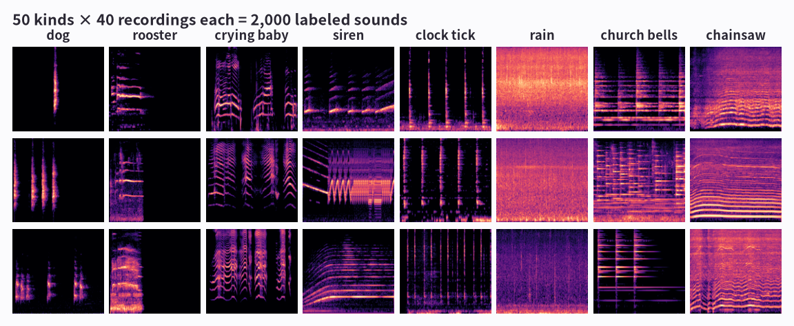

**How to read the picture**

- Each tile is one sound turned into a picture, the log-mel spectrogram from [part 1](aip-seeing-sound.md).
- Each column is three recordings of the same kind. Same kinds look alike: the clock is vertical stripes, church bells are stacked flat lines.
- But no two dog barks are the same. The AI has to see past those differences and find what makes a dog sound like a dog.

!!! abstract "In one line"
    An AI learns from a pile of examples with name tags (right answers). This is called a dataset.

*We shouldn't study with all 2,000, and the next picture shows why.*

## Picture 2 · Split it: a study set and an exam

If you see the exam questions while studying, your score is high but tells nobody what you actually know. Same for an AI. So we hide part of the data and use it only for the final exam.

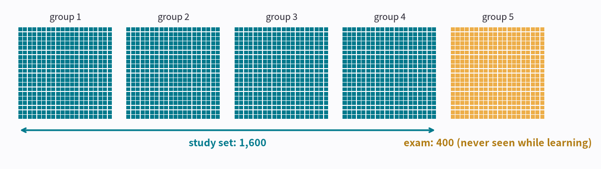

**How to read the picture**

- Each small square is one recording. The collection already comes in 5 groups of 400.
- The AI studies with the four teal groups (1,600 sounds).
- The yellow group 5 (400 sounds) is never shown during learning. It's only used as the exam, so every exam sound is new to the AI.

!!! abstract "In one line"
    Learn from the study set; measure real skill on the exam it has never seen.

*Now we build the AI. How much does it know at first?*

## Picture 3 · A brand-new AI knows nothing

Inside a brand-new AI are about 1.2 million numbers, all set at random. So play it a dog and it guesses across all 50 kinds evenly.

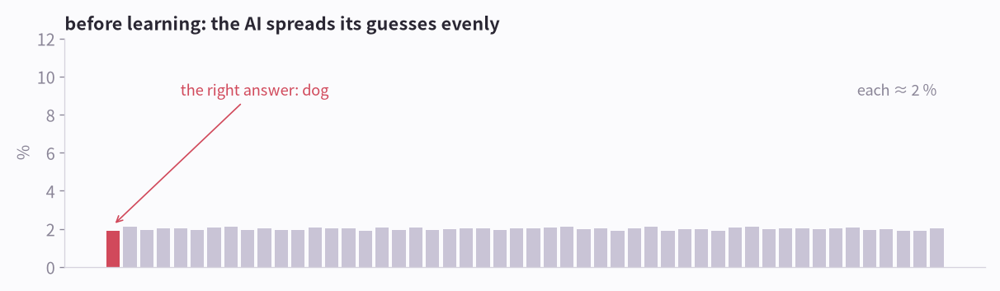

**How to read the picture**

- The 50 bars are the AI's answer for the 50 kinds. Taller = more sure.
- The red bar is the right answer (dog), but it's about as tall as the rest: all near 2%.
- On the 400 exam sounds it got 2% right. Guessing one of 50 gets 2%.

!!! abstract "In one line"
    Before learning, the AI is guessing. That's where we start.

*So how do we teach it?*

## Picture 4 · Learning = guess, get marked, fix a little

Like a teacher marking a workbook. Nobody tells the AI any rules. It guesses, and when it's wrong it gets adjusted, over and over.

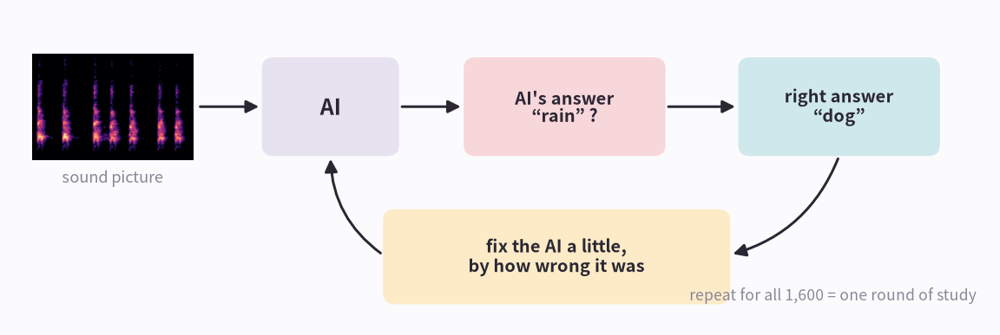

**How to read the picture**

- ① Show the AI a sound picture.
- ② The AI answers, say “rain?”
- ③ Compare with the right answer (“dog”) and nudge the AI's numbers by how wrong it was, so next time “dog” is a little more likely.
- ④ Going through all 1,600 once is one round of study. We did 200 rounds (320,000 guesses); on the RTX 3090 that took 5 minutes.

!!! abstract "In one line"
    Learning is “guess → mark → fix a little”, repeated over and over.

*What happens inside the AI after all that fixing?*

## Picture 5 · Magnifiers grow inside the AI on their own

The AI we used is a CNN. It sweeps dozens of small magnifiers over the picture, each looking for a pattern. Which pattern each magnifier looks for is something it decides by itself while learning.

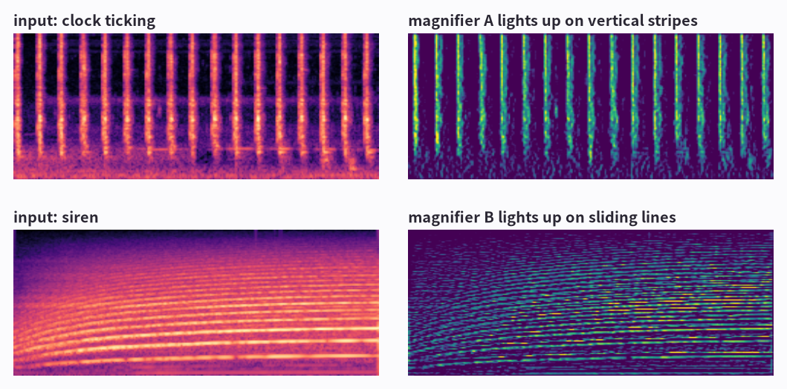

**How to read the picture**

- Top: given a clock ticking, magnifier A lights up most on the vertical tick stripes.
- Bottom: given a siren, magnifier B lights up along the line that slides up and down.
- Nobody told it to look for vertical stripes. It grew that way because it helped it get answers right.

!!! abstract "In one line"
    The AI builds its own pattern finders, then combines what they find to decide the answer.

*How do the scores change while it learns?*

## Picture 6 · The score rises… and memorizing creeps in

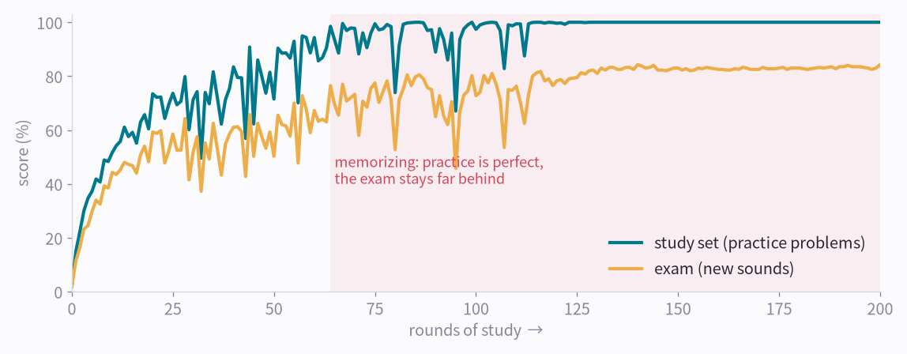

**How to read the picture**

- The teal line is the study-set score (practice problems). It quickly reaches nearly 100%.
- The yellow line is the exam score (new sounds). It climbs much more slowly and ends at 84%.
- In the red zone it gets every practice problem right, but the exam stays about 16 points behind. Part of what it learned is memorized answers, not the pattern.

!!! abstract "In one line"
    A big gap between the practice score and the exam score means memorizing. Engineers call it overfitting.

*There's a simple way to stop the memorizing.*

## Picture 7 · Changing the problems: we tried it

A common way to stop memorizing: each time the AI studies a sound, change it slightly. A dog is still a dog if it starts a bit later, if part of it is hidden, or if rain is mixed in.

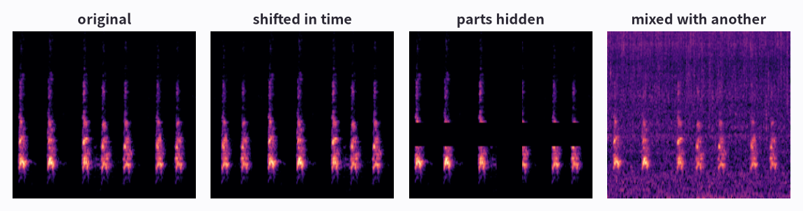

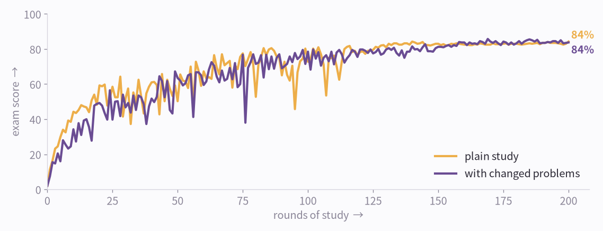

**How to read the picture**

- Top: the original dog picture and three changed versions: shifted in time, parts hidden (stripes blanked out), mixed with rain.
- Bottom: plain study (yellow) ended at 84%, studying with changed problems (purple) at 84%. Practically the same.
- The exam has only 400 sounds, so one sound is a quarter of a point. A gap this small is luck, not skill. Here the trick simply didn't help.

!!! abstract "In one line"
    Changing the problems (data augmentation) is a standard fix for memorizing, but it isn't magic. You only know if it helps by checking the exam.

*Before trying something else, let's see what this AI gets wrong.*

## Picture 8 · Exam results: easy sounds and confusing ones

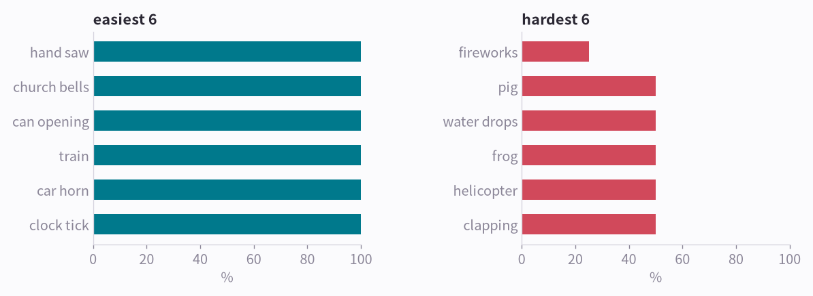

**How to read the picture**

- Left: the kinds it got right most often, such as hand saw, church bells, can opening.
- Right: the kinds it got right least often, such as fireworks, pig, water drops. Each kind has only 8 exam sounds, so 50% means 4 of 8.
- The mix-up it made most was answering “crackling fire” for “fireworks” (5 times). Listen to real exam sounds in the cards below.
- Each card puts the exam sound's picture next to a study sound of the kind the AI answered. On the wrong card both are full of thin upright stripes, so mixing up fireworks and a crackling fire is understandable. Motion has pairs like this too: in [part 4, Teaching Motion](aip-teaching-motion.md), it's sitting and standing.

**Hear the exam for yourself**

**Sure, and right** · Right answer: **dog**

<b>Listen</b> <audio controls preload="none" src="/assets/aip/aip-teaching-sound-3f2baf8d44.wav"></audio>

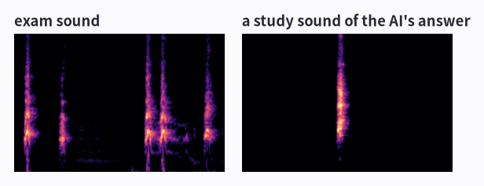

The AI's top 3: dog 100%, sneezing 0%, clapping 0%

**Unsure, but right** · Right answer: **airplane**

<b>Listen</b> <audio controls preload="none" src="/assets/aip/aip-teaching-sound-2f1a921149.wav"></audio>

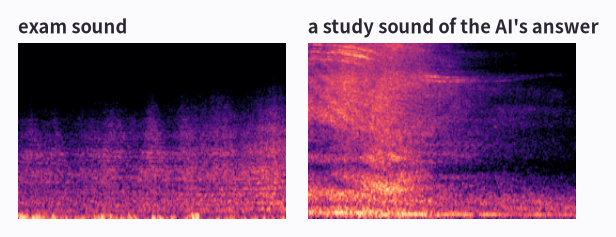

The AI's top 3: airplane 30%, thunderstorm 27%, wind 22%

**Wrong** · Right answer: **fireworks**

<b>Listen</b> <audio controls preload="none" src="/assets/aip/aip-teaching-sound-4142412477.wav"></audio>

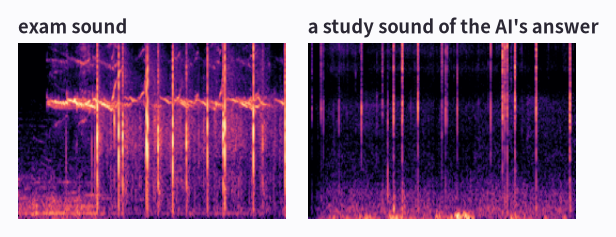

The AI's top 3: crackling fire 54%, footsteps 13%, fireworks 10%

!!! abstract "In one line"
    Looking at what an AI gets wrong, not just its score, tells you how to improve it.

*To do better it needs far more examples. But what if we only have 2,000?*

## Picture 9 · Borrow an AI that has already learned a lot

We borrowed a big AI that another research team trained in advance on about 2 million sounds and shared. We keep its “eye” as it is (86 million numbers) and only teach the last part, “pick one of 50”, with our 1,600 sounds. That took seconds.

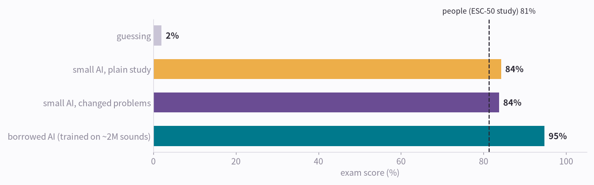

**How to read the picture**

- Guessing gets 2%. Our small AI, taught from zero, got 84% (84% with changed problems).
- The borrowed AI got 95% on the same exam.
- The dashed line is how well people did on ESC-50 when it was published: 81%. The borrowed AI goes well past it (though the conditions weren't exactly the same).
- With a borrowed eye you can even skip training and recognize from a few references; see [part 5, Learning from a Reference](aip-learning-from-reference.md).

!!! abstract "In one line"
    Borrowing an AI that already learned a lot and teaching only its last part works far better than starting from zero. This is called transfer learning.

*That's roughly how a sound AI learns. Here it is in five lines.*

## The whole thing in five lines

1. Collect lots of examples with name tags, and turn each sound into a picture.
2. Split them: study with most, keep some hidden for the exam.
3. Let the AI guess, mark it, fix it a little. Repeat many times.
4. If practice scores race ahead of the exam, it's memorizing. Try fixes, and keep only what raises the exam score.
5. With few examples, borrow an AI that already learned a lot and teach only its last part.

----

**Series** · [← Part 1, Seeing Sound](aip-seeing-sound.md) · [Part 3, Seeing Motion →](aip-seeing-motion.md)

### Sources and notices

Recordings: ESC-50 (K. J. Piczak, CC BY-NC). Human score 81.3% from Piczak (2015). Pretrained model: AST by Gong, Chung and Glass (MIT). Training ran on one RTX 3090. NVIDIA and GeForce RTX are trademarks of NVIDIA Corporation, used here only to refer to them.

### Terms

- *sounds with name tags*: labeled dataset
- *study set / exam*: training set / test set (here: ESC-50 fold 5)
- *one round of study*: epoch
- *how wrong it was*: loss (cross-entropy)
- *fix a little*: gradient descent (an optimizer such as AdamW)
- *magnifiers*: convolution filters in a CNN
- *memorizing*: overfitting
- *changing the problems*: data augmentation (time shift, SpecAugment, mixup)
- *borrowing an AI*: transfer learning from a pretrained model (AST on AudioSet)
