# 보는 AI 2편: 소리를 알아듣는 AI

> **보는 AI · 2편.** 그림으로 보는 소리·움직임 AI 시리즈예요. [0편부터 읽기](aip-robot-senses.md)

[1편 「소리를 보다」](aip-seeing-sound.md)에서 소리를 그림으로 바꿨어요. 이번엔 그 그림 2,000장으로 AI를 직접 가르쳐요. 아래 그림과 숫자는 모두 이 페이지를 만들면서 실제로 학습시킨 결과예요.

*그림 9장 · 수식 없음 · 진짜 학습 결과 · 15분 정도*

---

## 그림 1 · 재료: 이름표 붙은 소리 2,000개

AI를 가르치려면 정답이 붙은 예제가 많이 필요해요. 여기서는 ESC-50이라는 공개 자료를 써요. 개, 비, 사이렌처럼 50종류의 소리가 종류마다 40개씩, 하나에 5초예요.

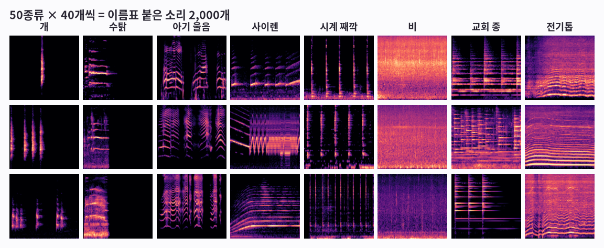

**그림 보는 법**

- 한 칸이 소리 하나를 그림([1편](aip-seeing-sound.md)의 로그 멜 스펙트로그램)으로 바꾼 거예요.
- 세로로 같은 종류가 3개씩 있어요. 같은 종류끼리 무늬가 비슷하죠? 시계는 세로줄, 교회 종은 가로줄이 여러 겹이에요.
- 하지만 같은 개 소리도 조금씩 달라요. AI는 이 차이를 넘어서 ‘개다운 무늬’를 찾아야 해요.

!!! abstract "한 줄 정리"
    AI는 이름표(정답)가 붙은 예제 묶음으로 배워요. 이 묶음을 ‘데이터셋’이라고 해요.

*이 2,000개를 전부 공부에 쓰면 될까요? 아니에요. 이유를 볼게요.*

## 그림 2 · 공부용과 시험용을 나눠요

시험 문제를 미리 보고 공부하면 점수는 높아도 진짜 실력은 알 수 없죠. AI도 같아요. 그래서 일부는 숨겨 두고 마지막 시험에만 써요.

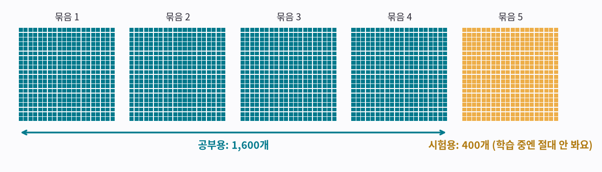

**그림 보는 법**

- 작은 네모 하나가 소리 하나예요. 자료는 처음부터 400개씩 5묶음으로 나뉘어 있어요.
- 청록색 4묶음(1,600개)으로 공부해요.
- 노란 5번 묶음(400개)은 학습하는 동안 한 번도 보여 주지 않아요. 시험에만 써서, AI에겐 모두 처음 듣는 소리예요.

!!! abstract "한 줄 정리"
    공부용으로 배우고, 한 번도 안 본 시험용으로 진짜 실력을 재요.

*이제 AI를 만들었어요. 처음엔 얼마나 알까요?*

## 그림 3 · 처음 AI는 아무것도 몰라요

막 만든 AI 안에는 숫자가 약 119만 개 있는데, 전부 아무렇게나 정해져 있어요. 그래서 개 소리를 들려줘도 50종류에 골고루 찍어요.

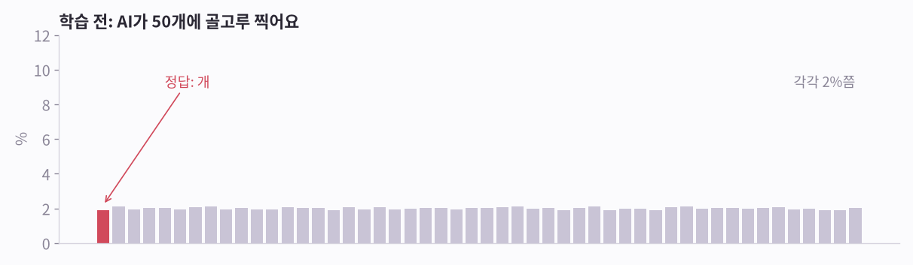

**그림 보는 법**

- 막대 50개는 50종류 각각에 AI가 건 확률이에요. 높을수록 ‘이거다’라고 믿는 거예요.
- 빨간 막대가 정답(개)인데, 다른 막대들과 높이가 비슷해요. 모두 2% 근처예요.
- 실제로 시험용 400개를 풀게 했더니 2%를 맞혔어요. 50개 중 하나를 찍으면 2%예요.

!!! abstract "한 줄 정리"
    학습 전 AI는 그냥 찍어요. 여기서 출발해요.

*이제 가르쳐 볼게요.*

## 그림 4 · 학습 = 맞혀 보고, 채점하고, 조금 고치기

선생님이 문제집을 채점해 주는 것과 같아요. 사람이 규칙을 알려 주지 않아요. 맞혀 보고, 틀리면 고치는 걸 아주 많이 반복할 뿐이에요.

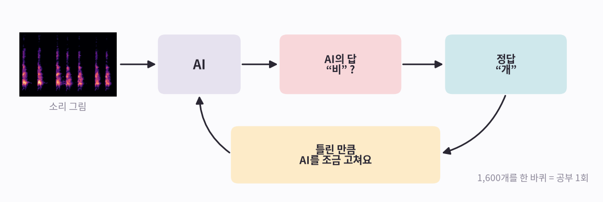

**그림 보는 법**

- ① 소리 그림을 AI에게 보여 줘요.
- ② AI가 답해요. 예: “비?”
- ③ 정답(“개”)과 비교해서, 틀린 만큼 AI 안의 숫자를 조금 고쳐요. 다음엔 ‘개’라고 답할 가능성이 조금 높아지게요.
- ④ 1,600개를 한 바퀴 돌면 공부 1회예요. 여기서는 200회(맞혀 보기 32만 번) 했고, RTX 3090 그래픽카드로 5분 걸렸어요.

!!! abstract "한 줄 정리"
    학습은 ‘맞혀 보기 → 채점 → 조금 고치기’를 수십만 번 되풀이하는 일이에요.

*이렇게 고치다 보면 AI 안에서 무슨 일이 생길까요?*

## 그림 5 · AI 안에 ‘돋보기’가 저절로 생겨요

이번에 쓴 AI는 CNN이라는 종류예요. 작은 돋보기 수십 개로 그림을 훑으면서 무늬를 찾아요. 각 돋보기가 어떤 무늬를 찾을지는 학습하면서 스스로 정해요.

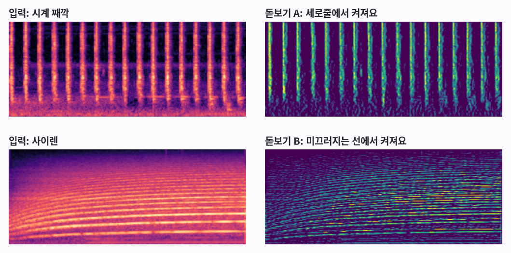

**그림 보는 법**

- 위: 시계 소리를 넣었더니 돋보기 A가 째깍거리는 세로줄에서 가장 밝게 켜졌어요.
- 아래: 사이렌을 넣었더니 돋보기 B가 위아래로 미끄러지는 선을 따라 켜졌어요.
- 아무도 ‘세로줄을 찾아라’라고 가르치지 않았어요. 맞히는 데 쓸모가 있어서 저절로 생긴 거예요.

!!! abstract "한 줄 정리"
    AI는 무늬를 찾는 돋보기를 스스로 만들고, 찾은 무늬들을 합쳐서 답을 정해요.

*이제 학습하는 동안 점수가 어떻게 변했는지 볼게요.*

## 그림 6 · 점수가 오르는데… 외우기가 끼어들어요

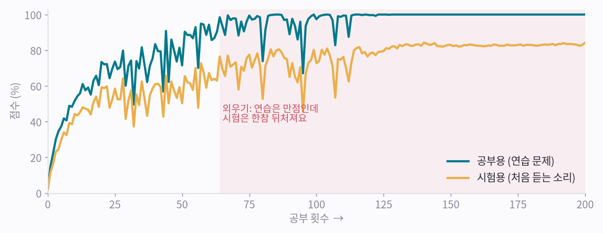

**그림 보는 법**

- 청록 선은 공부용(연습 문제) 점수예요. 금방 거의 100%가 돼요.
- 노란 선은 시험용(처음 듣는 소리) 점수예요. 훨씬 천천히 오르고, 84%에서 끝나요.
- 빨간 구간에서는 연습 문제를 다 맞히는데, 시험은 16점쯤 뒤처져 있어요. 배운 것 중 일부는 무늬가 아니라 외운 답이에요.

!!! abstract "한 줄 정리"
    연습 점수와 시험 점수의 차이가 크면 ‘외우기’예요. 엔지니어들은 과적합(overfitting)이라고 불러요.

*외우기를 막는 쉬운 방법이 있어요.*

## 그림 7 · 문제를 바꿔 가며 공부시켜 봤어요

외우기를 막는 흔한 방법이 있어요. 공부할 때마다 소리를 살짝 바꿔서 보여 주는 거예요. 소리가 조금 늦게 시작하거나, 일부가 가려지거나, 비 소리가 섞여도 개는 개예요.

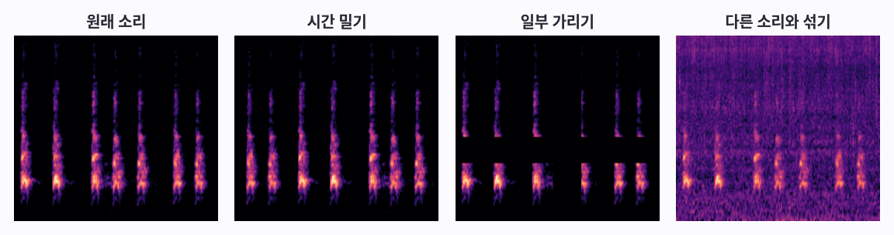

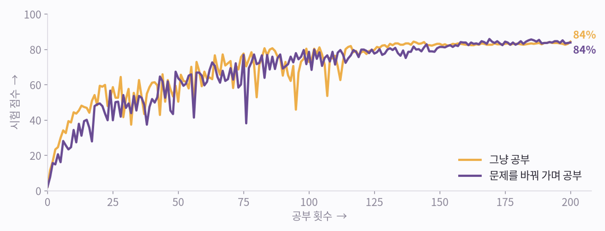

**그림 보는 법**

- 위: 원래 개 소리 그림과 바꾼 문제 세 가지예요. 시간 밀기, 일부 가리기(띠 모양으로 지움), 비 소리와 섞기.
- 아래: 그냥 공부한 AI(노랑)는 84%, 문제를 바꿔 가며 공부한 AI(보라)는 84%로 끝났어요. 사실상 같아요.
- 시험이 400개뿐이라 한 문제가 0.25점이에요. 이 정도 차이는 실력이 아니라 운이에요. 이번엔 이 방법이 도움이 안 됐어요.

!!! abstract "한 줄 정리"
    문제 바꾸기(데이터 증강)는 외우기를 막는 흔한 방법이지만 만능은 아니에요. 도움이 되는지는 시험을 봐야 알아요.

*다른 방법을 써 보기 전에, 이 AI가 뭘 틀리는지부터 볼게요.*

## 그림 8 · 시험 결과: 잘 맞히는 소리, 헷갈리는 소리

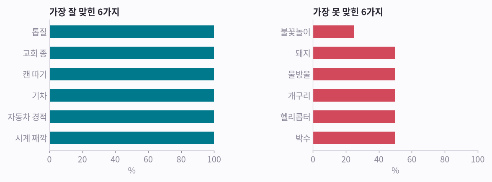

**그림 보는 법**

- 왼쪽: 가장 잘 맞힌 소리들이에요. 예: 톱질, 교회 종, 캔 따기.
- 오른쪽: 가장 못 맞힌 소리들이에요. 예: 불꽃놀이, 돼지, 물방울. 종류마다 시험 문제가 8개뿐이라 50%는 8개 중 4개예요.
- 가장 많이 헷갈린 건 ‘불꽃놀이’를 ‘장작 타는 소리’라고 답한 경우예요(5번). 아래 카드에서 실제 시험 소리를 들어 보세요.
- 카드마다 시험 소리의 그림 옆에, AI가 답한 종류의 공부용 소리 그림을 놓았어요. 틀린 카드에서는 두 그림 모두 가는 세로줄이 잔뜩 서 있어요. 불꽃놀이와 장작 타는 소리를 헷갈릴 만하죠. 움직임에도 이런 짝이 있어요. [4편 「움직임을 알아보는 AI」](aip-teaching-motion.md)에서는 앉기와 서기가 그래요.

**시험 문제를 직접 들어 보세요**

**확신하고 맞힘** · 정답: **개**

<b>듣기</b> <audio controls preload="none" src="/assets/aip/aip-teaching-sound-3f2baf8d44.wav"></audio>

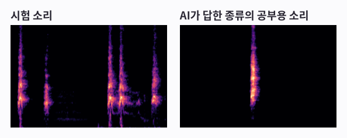

AI의 답 1~3위: 개 100%, 재채기 0%, 박수 0%

**망설였지만 맞힘** · 정답: **비행기**

<b>듣기</b> <audio controls preload="none" src="/assets/aip/aip-teaching-sound-2f1a921149.wav"></audio>

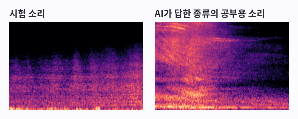

AI의 답 1~3위: 비행기 30%, 천둥번개 27%, 바람 22%

**틀림** · 정답: **불꽃놀이**

<b>듣기</b> <audio controls preload="none" src="/assets/aip/aip-teaching-sound-4142412477.wav"></audio>

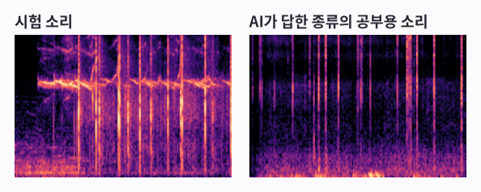

AI의 답 1~3위: 장작 타는 소리 54%, 발소리 13%, 불꽃놀이 10%

!!! abstract "한 줄 정리"
    점수 하나보다 ‘무엇을 틀리는지’를 봐야 AI를 어떻게 고칠지 알 수 있어요.

*더 잘하려면 예제가 훨씬 많아야 해요. 그런데 2,000개밖에 없다면?*

## 그림 9 · 이미 많이 배운 AI를 빌려 써요

다른 연구팀이 소리 약 200만 개로 미리 학습시켜 공개한 큰 AI를 빌렸어요. 이 AI의 ‘눈’(숫자 약 8,600만 개)은 그대로 두고, 맨 끝의 ‘50종류 중 고르기’ 부분만 우리 1,600개로 새로 가르쳤어요. 몇 초면 끝나요.

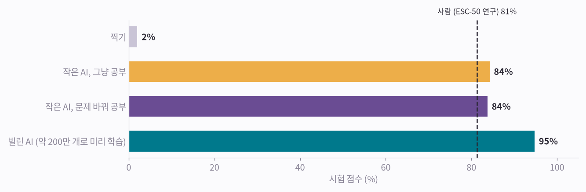

**그림 보는 법**

- 찍기는 2%예요. 우리가 처음부터 가르친 작은 AI는 84%(문제 바꿔 공부: 84%)였어요.
- 빌린 AI는 같은 시험에서 95%를 맞혔어요.
- 점선은 ESC-50을 처음 발표할 때 사람이 맞힌 점수예요. 81%예요. 빌린 AI는 이보다 높아요(재는 조건이 완전히 같지는 않아요).
- 빌린 ‘눈’만 있으면 학습을 아예 안 하고 레퍼런스 몇 개로 알아볼 수도 있어요. [5편 「레퍼런스만 주면 알아보는 AI」](aip-learning-from-reference.md)에서 해 봐요.

!!! abstract "한 줄 정리"
    처음부터 가르치기보다, 이미 많이 배운 AI를 빌려 끝부분만 가르치는 게 훨씬 잘돼요. 이걸 ‘전이 학습’이라고 해요.

*소리 AI는 대략 이렇게 배워요. 아래에 다섯 줄로 정리했어요.*

## 다섯 줄 정리

1. 이름표 붙은 예제를 많이 모으고, 소리마다 그림으로 바꿔요.
2. 나눠요. 대부분으로 공부하고, 일부는 숨겨 뒀다가 시험에만 써요.
3. AI가 맞혀 보면 채점해서 조금 고쳐요. 이걸 아주 많이 반복해요.
4. 연습 점수만 앞서가면 외우는 중이에요. 고치는 방법을 시험해 보고, 시험 점수를 올리는 것만 남겨요.
5. 예제가 적으면, 이미 많이 배운 AI를 빌려서 끝부분만 가르쳐요.

----

**시리즈** · [← 1편, 소리를 보다](aip-seeing-sound.md) · [3편, 움직임을 보다 →](aip-seeing-motion.md)

### 출처와 표기

녹음: ESC-50 (K. J. Piczak, CC BY-NC). 사람 점수 81.3%는 Piczak(2015). 빌린 모델: AST (Gong, Chung, Glass; MIT/ast-finetuned-audioset-10-10-0.4593, BSD-3-Clause). 학습은 RTX 3090 한 대에서 실행했어요. NVIDIA·GeForce RTX는 NVIDIA Corporation의 상표이며, 지칭 목적으로만 사용했습니다.

### 용어 설명

- *이름표 붙은 소리*: 레이블된 데이터셋
- *공부용 / 시험용*: 학습 세트 / 테스트 세트 (여기선 ESC-50 5번 폴드)
- *공부 1회*: 에폭(epoch)
- *틀린 정도*: 손실(loss, 교차 엔트로피)
- *조금 고치기*: 경사 하강법 (AdamW 같은 옵티마이저)
- *돋보기*: CNN의 합성곱 필터
- *외우기*: 과적합(overfitting)
- *문제 바꾸기*: 데이터 증강 (시간 이동, SpecAugment, mixup)
- *AI 빌려 쓰기*: 사전 학습 모델로 전이 학습 (AudioSet으로 학습한 AST)
