# 로컬 AI에게 읽기를 맡겨 보니: NVIDIA GPU와 Claude Code

Claude는 요금제마다 쓸 수 있는 양(사용량 한도)이 정해져 있어요. Claude Code로 일하다 보면 그 사용량이 어디서 새는지 보여요. 코드를 고치는 데보다 **읽는 데** 훨씬 많이 들어요. 문서 수십 편, 긴 PDF, 웹 페이지 여러 장을 읽히면 한도가 금방 차요.

그래서 집에 있는 그래픽카드(RTX 3090)에 AI 모델을 하나 설치하고, 읽기만 그쪽에 맡겨 봤어요. 하루 동안 설치하고 재 본 기록이에요.

---

## 30초 요약

- 3090에 **Qwen3.6 35B**를 설치하면 초당 약 164토큰으로 답하고, 그림도 봐요(토큰은 AI가 글을 세는 단위로, 한글은 대략 한두 글자에 하나). Claude보다 약하지만 "읽고 요약하기"에는 충분했어요.
- **같은 Claude Code 화면을 그대로 쓰면서 두뇌만 로컬 모델로 바꿀 수 있어요.** `claude-local` 한 줄이면 파일 수정, 터미널 실행, 웹 검색까지 Claude 사용량 없이 돼요.
- 평소에는 역할을 나눠요. **Claude는 찾고, 판단하고, 고치고**, **로컬 AI는 읽고 짧게 돌려줘요**.
- 블로그 글 **131편** 요약: 로컬에서 4분 38초, Claude 사용량은 **약 98% 적었어요**(Claude가 직접 읽었을 때의 추정치와 비교).
- 처음에는 27B 모델로 시작했어요. 35B로 바꾸니 같은 일이 1.6~2.8배 빨라졌어요.
- 글 **7편**은 차이가 작았어요. 효과는 읽을 양이 수십 편을 넘어야 커요.
- 리뷰처럼 판단이 필요한 일, 코드 수정은 그대로 Claude가 해요. 로컬 AI는 틀린 지적도 해요.

---

## 무엇을 설치했나

| 항목 | 내용 |
|---|---|
| 그래픽카드 | RTX 3090 (메모리 24 GB) |
| 실행 프로그램 | Ollama (모델을 내려받고 실행해 주는 무료 프로그램) |
| 모델 | Qwen3.6 35B (알리바바의 공개 모델. 35B는 모델 안의 숫자가 350억 개라는 뜻. 한 번에 그중 30억 개만 쓰는 구조라 빠르다. 아래 「모델을 바꿨다」에서 설명) |
| 모델 파일 크기 | 22 GB (숫자 하나를 4비트, 즉 아주 짧게 줄여 저장한 판) |
| 그래픽카드 메모리 사용 | 23.2 GB (24 GB 중) |
| 한 번에 읽는 양 | 6만 5천 토큰 (한글로 책 100쪽이 넘는 양) |
| 속도 | 초당 약 164토큰 (처음 쓴 Qwen3.6 27B는 약 63토큰) |

메모리를 아끼는 설정 하나가 효과가 컸어요. 모델이 앞에서 읽은 내용을 기억하는 공간(KV 캐시)을 더 짧은 숫자로 저장하게 하면 메모리가 절반만 들어요. 아낀 만큼 한 번에 읽는 양을 두 배로 늘렸어요.

NVIDIA 그래픽카드만 되는 건 아니에요. 실행 프로그램(Ollama)은 AMD 그래픽카드와 Apple 실리콘 Mac도 지원하고, Mac용 Qwen3.6 판도 따로 있어요. 중요한 건 상표보다 메모리 크기예요.

35B(4비트 판)가 한 번에 6만 5천 토큰을 읽게 하면 메모리가 약 23 GB 들어서, 그래픽카드 메모리 24 GB나 메모리 32 GB 이상인 Mac이 필요해요. 메모리가 그보다 작으면 더 작은 모델을 쓰거나(27B는 20.6 GB, 더 작은 판도 있어요) 한 번에 읽는 양을 줄이면 돼요. 속도는 메모리가 데이터를 얼마나 빨리 옮기느냐(메모리 대역폭)에 달려 있어요. 길이 넓을수록 차가 한꺼번에 많이 지나가는 것과 같아요. 그래서 같은 모델이라도 컴퓨터에 따라 이 글의 숫자보다 빠를 수도, 느릴 수도 있어요. 저는 NVIDIA에서만 직접 재 봤어요.

---

## 같은 화면, 다른 두뇌: Claude Code를 로컬 모델로

오늘 해 본 것 중 가장 쓸모 있었던 건 이거예요. **평소 쓰던 Claude Code 화면을 그대로 두고, 답하는 두뇌만 집 컴퓨터(그래픽카드)에 설치한 AI 모델로 바꿀 수 있어요.**

- 명령 `claude`로 열면 평소처럼 Anthropic 서버의 Claude가 답해요.
- 명령 `claude-local`로 열면 같은 화면, 같은 도구가 그대로인데 답은 집의 Qwen3.6 35B가 해요. Claude 사용량은 0이에요.
- 파일 고치기, 터미널 명령 실행, 웹 페이지 읽기가 그대로 돼요. 원래는 안 되던 웹 검색도 집에 띄운 검색 프로그램으로 연결했어요(아래 「검색은 왜 안 됐나」).

그래서 Claude 사용량이 바닥나도 일이 멈추지 않아요. 한도가 오기 전에 Claude에게 진행 상황을 몇 줄로 정리하게 하고, `claude-local`로 다시 열어 그 메모를 건네면 같은 화면에서 이어서 일할 수 있어요.

두 세션은 서로 메시지도 주고받아요. Claude Code에는 같은 컴퓨터에 열린 다른 세션에 메시지를 보내는 기능이 있는데, 로컬 모델로 연 세션도 똑같이 참여해요. 시험해 보니 로컬 세션을 열어 Claude 세션에 메시지를 보내기까지 13초가 걸렸고, 메시지는 제대로 도착했어요. 그래서 진행 메모를 복사해 붙이는 대신 메시지로 넘길 수 있어요. 반대 방향도 같은 방식이라, Claude 세션이 긴 작업을 로컬 세션에 맡겨 두고 결과를 메시지로 받는 것도 될 거예요. 이쪽 방향은 아직 시험하지 않았어요. 다만 로컬 세션에서는 다른 컴퓨터나 원격으로 연결한 세션이 보이지 않았어요.

재 본 숫자예요.

- 파일 하나를 만들고 실행해 결과를 보고하는 일: 35B로 39초 (처음 쓴 27B는 1분 42초)
- 여러 페이지에서 날짜와 숫자를 찾아야 하는 어려운 조사 질문 4개: 사실 13개 모두 맞힘, 질문당 평균 68초

한계도 있어요. 로컬 프로그램에는 앞에서 읽은 지시문을 기억해 두는 기능(프롬프트 캐싱)이 없어서, 한 번 주고받을 때마다 Claude Code의 2만 토큰짜리 기본 지시문을 처음부터 다시 읽어요. 그래서 짧은 일도 수십 초가 걸리고, 수십 단계가 이어지는 큰 작업은 Claude보다 확실히 약해요. 설정할 때 걸리는 함정 두 가지는 아래 「함정」에 적어 뒀어요.

---

## 역할 나누기: 찾기는 Claude, 읽기는 로컬

평소에는 이렇게 써요. Claude로 일하다가 **읽을 게 많은 일만** 로컬에 넘겨요.

1. Claude가 무엇을 읽을지 정해요. 파일 경로나 웹 주소만 고르고, 내용은 읽지 않아요.
2. 로컬 AI가 파일과 페이지를 직접 열어서 읽어요.
3. 로컬 AI는 몇 줄짜리 요약만 돌려줘요.
4. Claude는 그 몇 줄을 보고 판단해요.

비싼 건 원문이에요. 원문이 Claude를 거치지 않으니 그만큼 사용량이 줄어요.

이 연결은 MCP로 만들었어요. MCP는 Claude에 도구를 꽂는 표준 플러그예요. 작은 프로그램을 하나 등록하면, Claude는 그것을 "파일 고치기", "명령 실행" 같은 도구 중 하나로 봐요. 저는 "로컬 AI에게 읽히기" 도구를 만들어 꽂았어요. 이 도구가 집 컴퓨터에서 파일을 직접 열기 때문에 원문이 Claude를 거치지 않아요. 도구 설명에 "읽을 게 많으면 이 도구를 써라"라고 적어 두니, 제가 말하지 않아도 Claude가 알아서 넘겨요.

| 방식 | 누가 답하나 | 언제 쓰나 |
|---|---|---|
| `claude-local` | 세션 전체를 로컬 모델이 | Claude 사용량이 바닥났을 때 |
| MCP 도구 | Claude가 일하고, 읽기만 로컬 모델이 | 평소에 |

---

## 실측: 블로그 글 7편과 131편 요약

제 블로그 글로 두 번 시험했어요.

시리즈 글 7편(5만 2천 자)은 로컬에서 41초가 걸렸어요(27B로는 1분 56초). 7편일 때는 줄어든 비율이 커 보이지만, 실제로 아낀 양은 2만~3만 토큰 정도예요. 게다가 처음이라 요약 스크립트를 짜는 데 쓴 토큰이 섞여 있어요. 27B로 할 때는 시간도 Claude가 직접 읽는 것과 비슷했어요.

투자 글 131편(65만 자)은 달랐어요. 로컬에서 4분 38초가 걸렸고(27B로는 12분 16초), Claude 쪽은 요약 결과를 읽는 약 5천 토큰으로 끝났어요. Claude가 직접 읽었다면 수십만 토큰이 들고, 대화창도 거의 꽉 찼을 거예요.

두 경우 모두 "Claude가 직접 읽었다면" 값은 글자 수로 계산한 추정치예요. 실제 Claude로 같은 일을 해서 잰 값은 아니에요.

요약 품질은 쓸 만했어요. 시리즈 요약에 나온 정확도 숫자(95%, 97%)는 원문과 맞았어요. 다만 131편 요약에 중국어 낱말이 서너 군데 섞여 나왔어요. 27B와 35B 모두 그랬어요. 이 모델 계열에서 가끔 생기는 버릇이에요. 그래서 중요한 숫자와 이름은 원문과 대조해요.

---

## 무엇을 맡기고, 무엇은 안 맡기나

기준은 단순해요. **읽을 건 많은데 결과는 짧은 일**이면 로컬에 맡겨요.

- 맡겨요: 문서 여러 편 요약, 긴 로그 정리, 웹 페이지 여러 장 읽기, 긴 PDF에서 필요한 내용 찾기
- 안 맡겨요: 코드 수정과 디버깅(어차피 Claude가 코드를 읽어야 해요), 사실 확인, 글 리뷰, 최종 편집, 작은 일

블로그 글 리뷰도 따져 봤어요. 저는 글마다 여섯 단계로 검토해요(저작권, 사실 확인, AI 말투 지우기, 수학 싫어하는 독자로 읽기, 최종 편집, 한국어 교정). 이 중 넷은 판단이 필요해서 Claude가 해요. 독자로 읽기와 한국어 교정 두 단계만 로컬 AI가 "후보"를 먼저 뽑아 볼 만해요. 이 글로 그 시험을 해 봤어요. 결과는 아래 「이 글로 해 본 시험」에 있어요.

---

## PDF, 한글 파일, 웹 페이지도

로컬 AI가 읽을 수 있게 파일을 글자로 바꿔 주는 단계를 붙였어요.

| 형식 | 바꾸는 방법 |
|---|---|
| PDF | 쪽마다 글자를 뽑아요. 글자가 없는 쪽(스캔본)은 모델이 그림으로 보고 읽어요 |
| Word, Excel, PowerPoint | 문단, 표, 시트를 글자로 뽑아요. 옛 형식(.doc, .xls, .ppt)도 돼요 |
| 한글(.hwp, .hwpx) | 공개 도구로 글자를 뽑아요 |
| 웹 페이지 | 주소를 주면 본문만 받아 와요 |

효과가 가장 큰 건 **긴 PDF**예요. Claude는 PDF를 읽을 때 쪽마다 글자와 함께 그 쪽의 이미지까지 받아요. 글자만으로도 쪽당 1천5백~3천 토큰이고, 이미지는 따로 더 들어요. 36쪽짜리 영문 기술 매뉴얼이면 5만~11만 토큰이 넘어요. 로컬에 맡기니 16초 만에 제목, 대상 제품, 주요 내용을 정리해 줬어요.

Excel처럼 숫자가 많은 파일은 맡기지 않아요. 이 모델은 합계나 추세를 틀리기 쉬워요. 숫자는 Claude가 코드로 계산하는 쪽이 정확하고, 원래도 사용량이 적게 들어요.

옛 Word·PowerPoint 형식은 관리가 끊긴 변환 도구를 써야 해요. 오래된 프로그램은 보안 구멍이 생겨도 고쳐지지 않아요. 출처를 모르는 파일을 다루는 일이라, 인터넷과 쓰기 권한을 막은 격리 컨테이너(Docker) 안에서만 실행해요.

**휴대폰 사진과 스크린샷도** 같은 방식이 통해요. 저는 휴대폰으로 기사 화면을 찍어 Claude에게 자주 보내요. 그런데 메시지에 사진을 바로 붙이면, 보내는 순간 사진이 Claude에게 그대로 들어가서 사용량이 이미 들어요. 그래서 사진을 클라우드 동기화 폴더에 정해 둔 받은편지함(인박스)에 올리고 "인박스 읽어줘"라고만 말하도록 바꿨어요. 그러면 로컬 AI가 집 컴퓨터에서 사진을 읽고, Claude는 요약만 받아요. 기사 스크린샷 6장으로 재 보니 Claude 쪽 사용량이 약 1만 2천 토큰(사진 크기로 계산한 추정)에서 약 1천 토큰으로 줄었고, 읽는 데 13초 걸렸어요. 제목, 본문, 숫자도 정확히 옮겨 적었어요. 사진이 몇 장뿐이면 그냥 바로 붙이는 게 편해요. Claude가 직접 보고 판단할 수 있으니까요.

---

## 검색은 왜 안 됐나

웹 페이지를 **읽는** 건 로컬에서도 돼요. 그런데 **검색**은 안 됐어요.

Claude Code의 검색은 내 컴퓨터가 아니라 Anthropic 서버에서 실행돼요. 로컬 모델로 바꾸면 요청이 그 서버로 가지 않으니 검색도 함께 사라져요. 그래서 검색 엔진 여러 곳을 대신 조회해 주는 공개 프로그램(SearXNG)을 집 컴퓨터에 띄웠어요. 이것도 위와 같은 MCP 도구로 로컬 세션에 꽂았어요. 메모리는 약 125 MB만 써요.

시험 삼아 "최신 Ollama 버전을 찾아 줘"라고 했더니, 로컬 AI가 검색하고 GitHub 페이지를 열어서 52초 만에 맞는 버전과 출처를 답했어요. Claude 사용량이 바닥난 날에도 혼자 찾아볼 수 있게 된 거예요.

---

## 이 모델은 눈도 있다

Qwen3.6은 그림도 봐요. 제가 AI로 만든 사진들을 검사하게 해 봤어요.

- 35B는 사진 7장을 19초에 검사했어요. 한 장에 약 2.7초예요.
- 단풍잎 모양이 일그러진 캐나다 국기, 길도 없는 바위 위에 선 자동차, 들쑥날쑥한 부두 기둥을 한 번에 잡았어요.
- 처음 쓴 27B는 한 장에 약 7초였고, 틀린 지적도 했어요. "10월 말이면 나무가 거의 앙상해야 한다"고 했는데, 그 지역은 10월 말에도 단풍이 남아 있는 때가 많아요. 같은 사진에 한 번은 10점 만점에 3점, 다음엔 4점을 주는 등 점수도 흔들렸어요.

그래서 쓰는 법을 정했어요. 사진을 여러 장 만들면 **로컬 AI가 확실한 불량을 먼저 걸러 내고**, Claude는 남은 몇 장만 봐요. 괜찮은 사진 둘 중 하나를 고르는 일은 맡기지 않아요. Claude가 사진을 직접 보면 한 장에 약 1천5백 토큰이 들어요.

---

## 모델을 바꿨다: 27B에서 35B로

처음에는 Qwen3.6 27B를 썼어요. 그러다 같은 계열의 35B 모델이 더 빠르고 그림도 본다는 걸 알고 바꿨어요. 35B는 숫자가 더 많은데도 오히려 빨라요. MoE(전문가 혼합)라는 구조 덕분이에요. 회사에 전문가가 100명 있는데, 질문마다 접수 담당이 가장 잘 맞는 두세 명에게만 일을 넘기는 것과 비슷해요. 27B는 토큰 하나를 만들 때마다 270억 개 숫자를 전부 쓰지만, 35B는 350억 개 중 30억 개만 써요. 대신 전문가 전원이 메모리에 대기해야 해서 메모리는 더 많이 들어요. 검색에 맞게 다듬은 BigBang-v1이라는 모델도 시험했어요.

| | Qwen3.6 27B | BigBang-v1 | **Qwen3.6 35B** |
|---|---|---|---|
| 속도 | 초당 63토큰 | 초당 144토큰 | **초당 164토큰** |
| 그림 보기 | 됨 | 안 됨 | **됨** |
| 검색 시험 (질문 3개, 사실 7개) | 7개 중 6개, 323초 | 7개 모두, 168초 | **7개 모두, 128초** |
| 사진 7장 검사 | 약 47초 | - | **19초** |
| 글 7편 요약 | 1분 56초 | - | **41초** |

결국 35B 하나로 요약, 검색, 그림 검사를 모두 맡겼어요. BigBang-v1은 검색은 잘했지만 그림을 못 봤어요. 제가 받은 건 개인이 올린 비공식 판이었는데, Claude Code와 연결하자마자 오류가 났어요. 모델에 딸린 대화 형식 설정이 Claude Code가 보내는 요청 모양과 맞지 않았거든요. 그래서 지웠어요.

35B에도 단점은 있어요. 그래픽카드 메모리를 23.2 GB나 써서, 다른 프로그램이 조금만 메모리를 잡아도 느려져요.

35B로 바꾼 뒤 로컬로 할 수 있는 일이 늘었는지 숫자로 확인했어요. 조사와 Claude Code 통째 실행 결과는 위 「같은 화면, 다른 두뇌」에 적었고, 나머지는 이래요.

| 쓸 곳 | 시험 | 결과 |
|---|---|---|
| 사진 대량 정리 | 사진 61장에 설명과 태그 달기 | 97초 (한 장에 1.6초). 5장을 직접 확인해 보니 장면 설명은 5장 모두 맞았어요 |
| 짧은 요약 | 글 3편 요약 | 13초 |

사진 정리는 "강과 눈 덮인 숲", "돔 지붕 건물"처럼 찾아보는 용도로는 충분했어요. 하지만 세부는 약했어요. 사진 속 글자를 지어내기도 했고, 돌담을 다리라고 했고, 사람 수도 대충 셌어요. AI로 만든 사진인지도 5장 중 1장만 알아봤어요.

---

## 함정: 그래픽카드는 하나

오늘 가장 오래 헤맨 문제예요. 같은 그래픽카드로 이미지도 만들어요(ComfyUI). 이미지 작업을 끝내고 그 프로그램을 끄지 않았더니, 15.8 GB를 계속 잡고 있었어요. 그 상태로 로컬 AI를 실행하니 모델의 4분의 3이 그래픽카드에 못 들어가고 CPU로 밀렸어요. CPU는 이런 계산을 그래픽카드보다 훨씬 느리게 해요. 오류는 없었어요. 그때 쓰던 27B가 초당 63토큰에서 7토큰으로 느려졌을 뿐이에요. 속도가 이상해서 그래픽카드 메모리를 누가 쓰는지 확인(`nvidia-smi`)하고 나서야 원인을 찾았어요. 지금 쓰는 35B는 23.2 GB를 써서 여유가 더 없어요.

그 뒤로 규칙을 정했어요.

1. 이미지 작업이 끝나면 이미지 프로그램을 꼭 꺼요.
2. 로컬 AI를 쓰기 전에 모델이 그래픽카드에 100% 올라갔는지 확인해요(`ollama ps`).
3. 이미지를 다시 만들기 전에는 로컬 모델을 내려요(`ollama stop`).

직접 해 볼 분을 위해, 기술적인 함정 두 가지도 적어 둘게요.

- Claude Code를 로컬 모델로 실행하면 세션 중간에 "모델을 찾을 수 없음" 오류가 날 수 있어요. 배경 작업에 쓰는 작은 모델 이름(haiku)까지 로컬 모델로 연결해 줘야 해요.
- Claude Code는 모르는 모델이면 한 번에 20만 토큰을 읽는다고 가정해요. 실제 크기(6만 5천)를 알려 주지 않으면 대화가 길어졌을 때 로컬 프로그램이 요청을 거절해요.

---

## 이 글로 해 본 시험

이 글의 초안으로 리뷰 두 단계를 시험했어요. 먼저 로컬 AI에게 초안을 읽혀 지적 목록을 파일로 받아 두고, 저는 그 목록을 열지 않은 채 Claude로 같은 두 단계 리뷰를 따로 했어요. 그다음 둘을 비교했어요. 모델을 바꾼 뒤 같은 초안으로 35B도 다시 시험했어요.

| | 수학 싫어하는 독자로 읽기 | 한국어 교정 |
|---|---|---|
| 처리 시간 (27B → 35B) | 26초 → 8초 | 34초 → 12초 |
| Claude가 잡은 것 중 같이 잡은 것 | 9개 중 4개 → 6개 | 핵심 7개 중 1개 → 2개 |
| 로컬 AI만 잡은 쓸 만한 지적 | 3개 → 3개 | 2개 → 0개 |
| 틀린 지적 | 거의 없음 | 3개 → 3개 (맞는 표현을 틀렸다고 함) |

독자로 읽기에서는 쓸 만했어요. "CPU로 밀리면 왜 느려지나", "4비트가 뭔가", "메모리를 누가 잡고 있는지 어떻게 알았나"는 제가 놓친 것이라 이 글에 반영했어요. 35B는 제가 잡은 틀린 비유("책 한 권의 몇 장")까지 잡았어요.

한국어 교정은 두 모델 모두 반대였어요. "돌려줘요", "받아 와요" 같은 쉬운 말을 "제공해요", "추출해요", "반환해요"처럼 딱딱한 말로 바꾸자는 제안이 대부분이었어요. 그대로 따르면 오히려 번역투가 늘어요. 그래서 한국어 교정은 Claude만 하고, 독자로 읽기에만 로컬 AI의 목록을 참고로 쓰기로 했어요.

---

## 정리

- 로컬 AI가 Claude를 대신하지는 못해도, **읽는 일꾼**으로는 충분해요.
- 효과는 읽을 양에 비례해요. 문서 몇 편이면 그냥 Claude가 낫고, 수십 편부터 확실히 이득이에요.
- 결과는 초안이에요. 숫자와 이름은 원문과 대조하고, 판단과 수정은 Claude가 해요.
- 그래픽카드를 다른 작업과 같이 쓴다면, 누가 메모리를 잡고 있는지부터 확인해요.
- 모델은 Qwen3.6 35B 하나로 요약, 검색, 그림 검사를 다 맡길 수 있었어요. 대신 세부와 판단은 여전히 약해요.

---

### 출처와 표기

설정 값(KV 캐시 양자화, 컨텍스트 길이, keep-alive)은 Ollama 공식 FAQ를, Claude Code를 로컬 모델로 실행하는 환경 변수는 Ollama와 Claude Code 문서 및 커뮤니티 안내 글을, PDF 쪽당 토큰은 Anthropic의 PDF 지원 문서를 참고했어요. 검사한 사진은 실제 장소가 아니라 제가 FLUX.2 [klein]으로 만든 이미지예요. AMD 그래픽카드와 Mac 지원은 Ollama 배포 파일과 모델 라이브러리 기준이에요(직접 시험하지 않음). 속도, 시간, 메모리 숫자는 2026년 10월 25일 제 컴퓨터에서 한 번씩 잰 값이고, "Claude가 직접 읽었다면"은 글자 수로 계산한 추정치예요. Claude·Claude Code는 Anthropic PBC의, Qwen은 Alibaba Cloud의, Ollama는 Ollama, Inc.의, NVIDIA·GeForce·RTX는 NVIDIA Corporation의, Docker는 Docker, Inc.의, Microsoft Word·Excel·PowerPoint는 Microsoft Corporation의, 한글(HWP)은 한글과컴퓨터의, GitHub는 GitHub, Inc.의, FLUX는 Black Forest Labs의, ComfyUI는 Comfy Org의 상표이며, 지칭 목적으로만 사용했어요.

### 용어 설명

- *로컬 AI*: 인터넷의 서비스가 아니라 내 컴퓨터에서 실행하는 AI 모델
- *세션*: Claude Code 창 하나를 열어 이어 가는 대화 한 묶음
- *토큰*: AI가 글을 읽고 쓰는 단위. 한글은 대략 한두 글자에 토큰 하나 (모델마다 다르다)
- *Claude 사용량*: Claude가 읽고 쓴 토큰의 양. 요금제마다 한도가 있다
- *Ollama*: AI 모델을 내려받고 내 컴퓨터에서 실행해 주는 무료 프로그램
- *4비트로 줄인 판(양자화)*: 모델 숫자를 짧게 줄여 메모리를 아낀 판. 품질이 조금 떨어진다
- *KV 캐시*: 모델이 앞에서 읽은 내용을 기억해 두는 메모리 공간
- *프롬프트 캐싱*: 같은 지시문을 다시 읽지 않도록 기억해 두는 기능. 로컬 프로그램에는 없었다
- *컨테이너(Docker)*: 프로그램을 나머지 시스템과 떼어 놓고 실행하는 상자
- *SearXNG*: 여러 검색 엔진에 대신 물어보고 결과를 모아 주는 공개 프로그램
- *MCP*: Claude 같은 AI에 외부 도구를 연결하는 표준 방식. 등록한 프로그램이 AI가 쓰는 도구 목록에 나타난다
- *MoE(전문가 혼합)*: 모델 안을 여러 "전문가"로 나눠, 일마다 그중 일부만 쓰는 구조. 크기에 비해 빠르다
