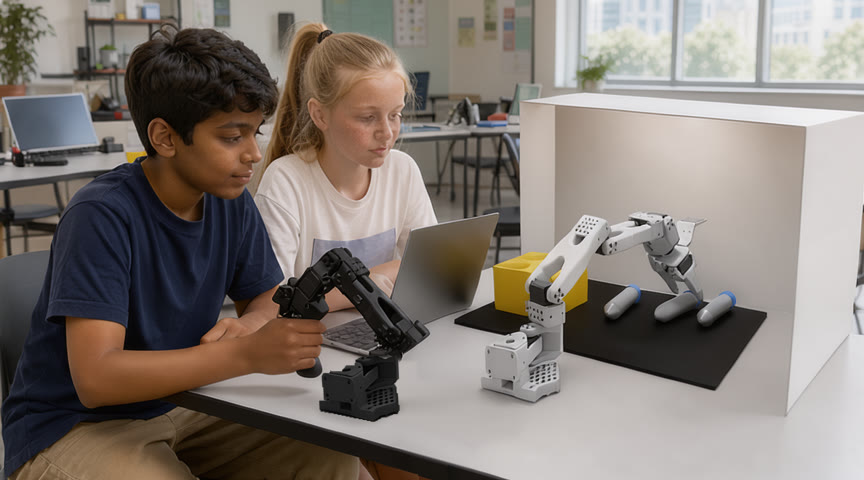
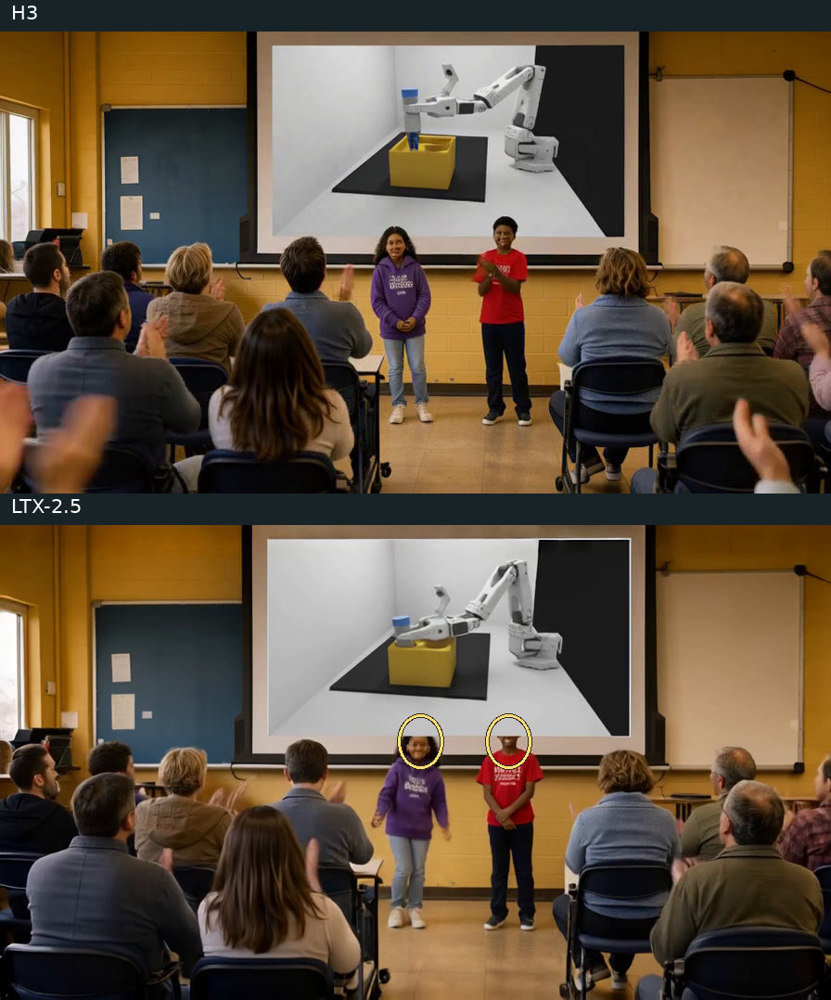

# 로봇 팔은 LTX로, 교실은 H3로 만든 이유

로봇 팔이 움직일 때 책상 끝을 한번 보세요. 검은 팔을 붙잡아 줘야 할 클램프는 책상에 잘 물려 있어요. 그런데 팔 아래 받침이 클램프에서 스르르 멀어져요. 로봇 강의 홍보 영상을 만들다가 MiniMax H3로 뽑은 장면에서 발견한 문제예요.

## 30초 요약

- 로봇 팔 장면(S06)은 첫 그림에서 불필요한 클램프를 지우고 받침 모양을 바로잡았어요. LTX-2.5로 움직이니 받침이 제자리를 지켰어요.
- 교실 장면(S11)은 같은 성질이 걸림돌이었어요. LTX는 아이들 머리가 스크린 가장자리에 걸친 구도까지 살렸어요. 이 장면은 H3를 남겼어요.
- RTX 3090에서 약 6초짜리 한 컷을 만드는 데 LTX는 대략 30~55초, H3는 2~10분이 걸렸어요. 홍보 영상에 실제로 쓴 두 작업 방식의 실행 시간이에요.

## 받침 모양은 첫 그림에서 이미 틀려 있었어요

S06에는 팔이 두 개 나와요. 사람이 검은 리더암을 움직이면 흰 팔로어암이 따라 해요. 관절은 움직여도 두 받침은 책상 위 같은 자리를 지켜야 해요. H3에는 동작 참고 영상까지 줬는데, 세 번 뽑아도 받침이 클램프에서 떨어져 나갔어요. 책상 끝을 기준으로 보면 금방 눈에 들어와요.

<video muted loop playsinline controls preload="metadata" poster="../../assets/ltx-vs-h3/s06-original-comparison-poster.jpg" src="../../assets/ltx-vs-h3/s06-original-comparison.mp4" style="width:100%" aria-label="S06 원본 비교"></video>

*왼쪽 H3, 오른쪽 LTX-2.5. 책상 끝을 기준으로 받침을 보세요. 인물은 AI 일러스트예요.*

LTX는 첫 그림을 충실히 따라갔어요. 그래서 영상에 움직임을 더 주문하기 전에 그림부터 손봤어요. FLUX로 엉뚱하게 달린 C자 클램프만 지우고 LTX로 돌리니 검은 받침이 제자리에 남았어요. 그런데 가만히 있는 받침을 보니 모양이 틀렸어요. 실제 두 받침은 색만 다른 같은 부품인데, 그림 속 검은 받침에는 가느다란 기둥과 긴 발판이 붙어 있었어요.

첫 수정에서는 검은 받침 부위만 골라 FLUX에 다시 그려 달라고 했어요. 기둥과 발판은 그대로였고 책상 앞쪽에는 밝은 네모 자국까지 남았어요. 두 번째에는 같은 그림에 답이 있었어요. 흰 받침을 오려 검게 바꾸고, 검은 팔 아래에 각도를 맞춰 붙였어요. 책상 자국을 메운 뒤 FLUX로 받침 주변을 자연스럽게 다듬었어요. 생성은 제 PC에서 돌렸고, 새 첫 그림은 Codex도 함께 검수했어요. 수정 범위 밖은 픽셀까지 원본과 같았어요.

*흰 받침의 모양을 검은 리더암 아래에 맞췄어요. 인물은 AI 일러스트예요.*

<video muted loop playsinline controls preload="metadata" poster="../../assets/ltx-vs-h3/s06-final-ltx-poster.jpg" src="../../assets/ltx-vs-h3/s06-final-ltx.mp4" style="width:100%" aria-label="S06 최종 LTX-2.5 컷"></video>

*팔이 움직이는 동안 검은 받침은 책상에 붙어 있어요. 인물은 AI 일러스트예요.*

그 그림으로 LTX를 다시 돌렸어요. 팔이 움직이는 동안 검은 받침은 책상에 붙어 있었어요. 홍보 영상 최종본(v7)에 넣은 건 이 컷이에요.

## 교실에서는 왜 H3를 남겼을까요?

교실 장면은 팔 대신 아이들 머리 위를 보면 돼요. 첫 그림부터 아이들 머리와 뒤쪽 스크린 가장자리가 겹쳤어요. 같은 그림으로 시작한 LTX는 그 겹침까지 고스란히 가져갔고, 제 눈에는 H3 쪽 구도가 더 자연스러웠어요.

*같은 시점의 두 프레임이에요. 위는 H3, 아래는 LTX-2.5(시드 19)예요. 아래쪽 원은 아이들 머리와 스크린 가장자리가 겹치는 곳을 표시해요. 인물은 AI 일러스트예요.*

여기도 첫 그림을 고쳐 봤어요. 아이들 머리가 잘 보이게 부분 수정을 하니 이번엔 낯선 노란 패널이 생겼어요. 참고 이미지를 준 버전에서는 머리 위에 왕관이 얹혔고요. v7의 교실 장면은 기존 H3 컷을 그대로 썼어요.

## 한 장의 3090으로 고른 두 컷

처음 비교할 때는 장면마다 같은 첫 그림을 두 모델에 주고 LTX는 시드(무작위 출발값)를 세 가지로 바꿔 가며 뽑았어요. 약 6초 분량에 LTX의 GPU 메모리 사용량은 최대 약 23GB였어요. H3는 동작 참고 영상을 쓴 로봇 팔에 약 10분, 교실에 약 2분이 걸렸어요. 해상도와 생성 설정도 조금씩 달라서, 이 숫자는 제 작업에서 한 컷을 다시 뽑을 때 얼마나 기다렸는지로 읽으면 돼요.

다음에 로봇 팔을 만들면 첫 그림에서 두 받침부터 나란히 볼 거예요. 교실이라면 아이들 머리 뒤로 어떤 선이 지나가는지 볼 거고요. 그림을 고친 뒤에는 장면마다 지켜야 할 곳을 한 군데 정해 놓고 두 영상을 보면 고르기 쉬워요.

**관련 글** [Claude는 감독, Codex는 일꾼: 사용량 아끼려고 만든 작업 브리지](ai-workbench-routing.md) · [1,069쪽 책을 로컬 AI에 맡기기](local-llm-reading.md)
