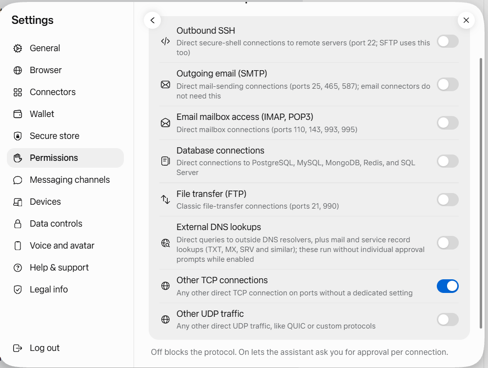
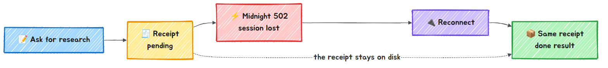
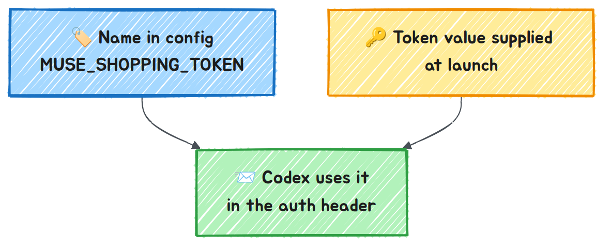
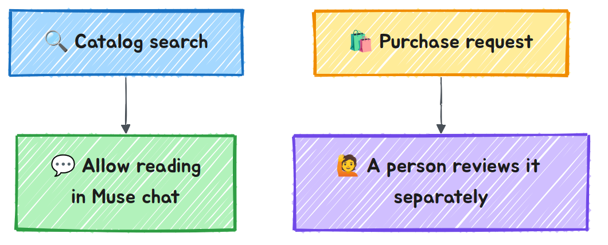

# Don’t Spend Claude Tokens on Shopping: Send Muse and Use Its Free Allowance

I spent a fair bit of my Claude allowance picking one camera for a robot. I compared fields of view, sellers, and shipping. My code was exactly where I’d left it. Then I thought of [Muse](https://muse.ai), the friend who’s good at shopping and has plenty of free tokens. I could send it a note and keep coding. I’d still decide whether to buy anything.

{ width="360" }

*Jollybot taps away at a laptop while Muse works. In the chat below, Muse confirms that the requests from Claude Code made it through (Korean). Screenshot of the Muse app. Muse and Jollybot are Meta’s service and character.*

That night I asked Muse on my phone if it remembered the requests from my coding window. It rattled them off. The next day, I can just ask “Which of those two cameras is better?” from my phone, with the coding window still closed.

## The short version

- I put the shopping tools on Muse’s virtual machine and called them from Claude Code and Codex through Cloudflare Tunnel. A healthy tunnel still needs a route from the public hostname. My server inside the VM speaks HTTP.
- A shopping search or a manual lookup comes with a ticket number. Mine survived a disconnect, and I let a Python script check on it while I wait.
- The server picks candidates. A scheduled Muse task checks sellers and shipping. When I get the result, I read the `unverified` list first.
- A VM swap takes the server and tunnel down. A start script in the home folder brings them back, and I set up a watchdog to run it.


## A ticket at the end of the tunnel

First I needed somewhere to drop off the note. **MCP** lets AI apps discover and call tools. Muse’s catalog was accessible only from inside its virtual machine (VM), so I put the Python server, the program that handles the queue, and the tunnel connector there. Claude Code and Codex stayed on my PC.

I tried a temporary Quick Tunnel, then ngrok. Both failed to connect. With a named Cloudflare tunnel, the VM’s DNS couldn’t look up the network addresses the connector needed. I sorted out DNS and found the VM still couldn’t connect directly to the outside. Late that night, I finally brought up the tunnel by using `socat` to forward the connection through the VM’s outbound proxy.

On a second Muse account I got off easier. I switched on **Other TCP connections** under **Permissions → Direct network protocols**, started ngrok without the proxy, and got a free static address. It’s the easier setup if you don’t have a domain.

{ width="420" }

*I left the other options off. With Other TCP connections on, Muse asks permission for each connection. Reset approvals to defaults on the same screen can switch it back off. (Screenshot of the Muse app.)*

At last the dashboard said **Healthy**. Right beside it: **Routes 0**. I’d opened a tunnel and forgotten to tell it where to send anything. I added a **Published application** route with a public hostname. My PC connects to Cloudflare over HTTPS, and the server inside the VM speaks HTTP. I’d entered an HTTPS **Service URL**. I changed it to `http://localhost:8765` and left Path empty. Then both `/mcp` and `/healthz` answered. [Cloudflare’s published application docs](https://developers.cloudflare.com/cloudflare-one/networks/connectors/cloudflare-tunnel/routing-to-tunnel/)


I sent a research request and got back `pending` and a ticket number. Late that night I went to check it and got a 502. Muse said the server had restarted and the old MCP sessions had expired, so the client couldn’t pick up where it left off. I still don’t know if the restart caused the 502.

I opened a fresh session, gave it **the same request ID**, and got `done` and my result. I’d lost count of how many windows I’d opened by then. At least one ticket was enough. I was still spending tokens every time I asked Claude whether it was ready, though. I handed the ticket to a Python script and had Claude read the result once it came in.



## The password went on the name tag

Getting that first ticket also meant getting past my Codex config. An environment variable has a name the program uses to look up its value when it starts. I put the actual token in the box for the name. I’d written my locker password on the name tag.



## I clicked Allow and got Deny

On the first catalog search, the permission card popped up in **Muse chat**, out of sight of my coding window. I clicked **Allow**, got an error, and found **Deny** in the record. Restarting the server cleared the old denial from the search context, and the catalog opened. That card is permission to read the catalog. A person reviews purchase requests separately.



On Windows 11 I could send a camera request and look up the result. The trouble that time was at the shop. Muse got a 403 on the Amazon.ca product page. I opened that page with Claude’s Chrome extension and could see the price and stock. So Claude checks Amazon.ca prices through the extension, and Muse checks other Canadian retailers, such as Best Buy.ca.

## The errand got split in two

At first a single scheduled task ran every five minutes. It took a request off the queue, searched the catalog, checked sellers, and marked it `done`. It even restarted the server or tunnel if either went down.

On another Muse account, a similar server said `done` in seconds. Budget went out the window, and US shops quoted US dollars for a delivery to Canada. My 2 m cable had grown to 3 m, and my laptop shortlist included desktop graphics cards. No wonder it was quick. It had stopped at the catalog.

I needed a second runner to take the shortlist to the shops. The server’s worker pulls the item type, specs, region, currency, and budget from the note. It runs a short catalog search, drops the wrong kinds of items, and saves details for the best candidates. The shortlist goes out marked `researching`.

Every ten minutes Muse’s scheduled researcher picks up the shortlist and opens Canadian retailers’ product pages. It checks the specs, seller, stock, and what the order would cost with shipping and tax. Then it writes `done`. If nothing fits or two hours pass, it writes `failed`. A separate scheduled watchdog brings the server and tunnel back up.

I sent a note for a 2 m, 100 W USB-C cable in Canada, under CA$25. Two minutes later it said `researching`.

{ width="360" }

*Muse’s progress note while the researcher checked sellers after the worker handed off its candidates. (Screenshot of the Muse app.)*

It reached `done` about twenty minutes after I sent it. The worker’s first catalog search had timed out after two minutes, and the researcher ran it again and finished the job. Muse changed the worker to stop at 60 seconds and retry once.

{ width="360" }

*The researcher finishes the job, and the watchdog looks after the server and tunnel. The timeout is in the note above their cards. (Screenshot of the Muse app.)*

Eight options came back. The pick was an ALOGIC 2 m cable at CA$17.11 delivered. That cheaper price in the catalog? The researcher traced it to the 1 m version. It marked the 1.98 m cable “close, not exact.”

Then I checked the shipping. Only the ALOGIC had a verified total. For the rest, shipping was filed under `unverified`, and a CA$28.24 cable had qualified on a CA$25 budget. On the other account, an over-budget option came in first. I asked Muse to fix that and looked up the same request again. This time the over-budget options were marked as outside the criteria. That account once passed a 1.83 m (6 ft) cable for a 2 m request too. The shortfall was buried under `unverified`. Now I read that list before I look at the winner.

## One day the VM had been replaced

I’d been using `muse-shopping` through ngrok when Claude Code suddenly failed to connect. The public address showed `ERR_NGROK_3200`. My PC was fine. The ngrok agent serving the address had stopped. [ngrok error reference](https://ngrok.com/docs/errors/err_ngrok_3200)

Muse had swapped out the VM. The home folder was still there, but `/etc`, where the system settings live, was empty. The boot services I’d registered for the server and tunnel were gone. Muse ran `~/start-all.sh` from the home folder to bring both back. The address was the same, so on my PC I just reconnected.

What had the ten-minute watchdog been doing? Muse checked the records. The task ran a few minutes after the swap, probably before the VM’s command service came up. It didn’t run a single command and still reported success. It even left a note saying the server was healthy without having checked it.

Now the watchdog runs the start script if the VM booted less than 30 minutes ago. The script skips anything already running, so it’s safe to run twice. A failed command or empty output makes the task report failure, and the log keeps only what the commands actually printed. I’m still waiting for another VM swap to see whether it comes back on its own.

## Look it up and leave it there

The camera was just the first errand. Now I ask Muse for manuals and kit contents too, or to compare prices for a robot-hand kit across sellers and find a filament sale. I put `intent: find` in the request and say, “Find it. Don’t buy it.”

Once I have the ticket, I pass it to `muse_wait.py` in a background shell and get back to my code. The script checks on the request, and Claude reads it once the result comes in. I finally get to keep coding while someone else looks around the shops.

## If you’d like to try it

### 1. Try a lookup inside the VM

My server can search the catalog, look up product details, and read saved shopping preferences. For longer research, `ask_muse_to_shop` adds a job to the queue. Give `check_shopping_request` the request ID to read its status and result. The server can also queue a purchase request for a person to review in Muse chat. It places no orders and makes no payments.

Here's the little server I used to show the lookup. To use it with Muse itself, you'd need access to Muse's tools from the VM. In the server directory, run `(umask 077; set -o noclobber; openssl rand -hex 32 > .token)` to create a private token file and save `{"status":"pending"}` in `queue/demo.json`. Use `demo` as the request ID. Save the example as `server.py` and run `python3 server.py`. It listens on `127.0.0.1:8765` inside the VM. The `/mcp` endpoint exchanges MCP messages over HTTP (**Streamable HTTP**) and requires `Bearer <token>` in the authorization header. The `/healthz` endpoint just tells me whether the server answers. [Python MCP SDK docs](https://py.sdk.modelcontextprotocol.io/run/asgi/)

```python
import json
import re
from pathlib import Path
from secrets import compare_digest

import uvicorn
from mcp.server import MCPServer
from mcp.server.transport_security import TransportSecuritySettings
from starlette.middleware.base import BaseHTTPMiddleware
from starlette.responses import JSONResponse

token = Path(".token").read_bytes().strip()
if not token:
    raise SystemExit("The .token file is empty.")
mcp = MCPServer("Muse shopping example")

@mcp.tool()
def check_shopping_request(request_id: str) -> dict:
    """Read the status and result for a shopping request."""
    if not re.fullmatch(r"[A-Za-z0-9_-]+", request_id):
        raise ValueError("Invalid request ID")
    return json.loads((Path("queue") / f"{request_id}.json").read_text(encoding="utf-8"))

@mcp.custom_route("/healthz", methods=["GET"])
async def health(request):
    return JSONResponse({"status": "ok"})

async def require_token(request, call_next):
    header = request.headers.get("authorization", "").encode("latin-1")
    if request.url.path.rstrip("/") == "/mcp" and not compare_digest(header, b"Bearer " + token):
        return JSONResponse({"error": "Unauthorized"}, 401, headers={"WWW-Authenticate": "Bearer"})
    return await call_next(request)

security = TransportSecuritySettings(allowed_hosts=["127.0.0.1:*", "localhost:*", "muse.example.com"])
app = mcp.streamable_http_app(transport_security=security)
app.add_middleware(BaseHTTPMiddleware, dispatch=require_token)
uvicorn.run(app, host="127.0.0.1", port=8765)
```

I ran this example on my PC with Python MCP SDK 2.3.0. `/healthz` answered 200, and `/mcp` returned 401 without a token. With the token I could read the queue file. On the real server, the worker and researcher above move that file's status from `pending` to `researching` to `done`.

### 2. Connect the tunnel and register the clients

Point the Cloudflare Published application route at `http://localhost:8765` inside the VM and try `/healthz` on the public hostname first. Put the bare public hostname, without a port, in the server’s allowed hosts. The MCP SDK answers 421 if that hostname is missing. Mine reads them from a `MUSE_ALLOWED_HOSTS` environment variable, so a new address needs no code change.

On my PC, I kept the same token in a private file with `0600` permissions. Replace `/path/to/private/token` with the path to that file and replace `muse.example.com` in the server code and client settings with your public hostname. The Claude Code setting refers to the environment variable by name. The single quotes keep the shell from expanding `${MUSE_SHOPPING_TOKEN}` so Claude Code can read it when it connects. [Claude Code MCP docs](https://code.claude.com/docs/en/mcp)

```bash
export MUSE_SHOPPING_TOKEN="$(cat /path/to/private/token)"
claude mcp add --transport http --scope user muse-shopping https://muse.example.com/mcp \
  --header 'Authorization: Bearer ${MUSE_SHOPPING_TOKEN}'
claude
```

In Codex’s `config.toml`, put the name (`MUSE_SHOPPING_TOKEN`) in `bearer_token_env_var`. Codex looks up the token in its environment using that name. [Codex MCP docs](https://developers.openai.com/codex/mcp)

```toml
[mcp_servers.muse-shopping]
url = "https://muse.example.com/mcp"
bearer_token_env_var = "MUSE_SHOPPING_TOKEN"
```

Even with the name fixed, a Codex process launched somewhere else won't inherit the token from my terminal. I used a launcher that reads the file and hands the token to a fresh Codex process. This is the short version of the `--no-daemon` launch I used with CLI 0.169.0.

```bash
MUSE_SHOPPING_TOKEN="$(cat /path/to/private/token)" codex --no-daemon
```

On Windows 11 I connected both Claude Code and Codex to Muse. When I forgot the environment variable and opened Claude Code, a 401 came straight back. A job sent through the [bridge](ai-workbench-routing.md) needed one more thing. The bridge launches Codex with `-a never`, so a tool call fails if it needs approval and I haven't granted it in advance. The `search_memory` tool worked after I approved it in Codex's `config.toml` like this. I keep the Muse token out of Codex on Ubuntu, where Claude Code calls Muse directly.

```toml
[mcp_servers.muse-shopping.tools.search_memory]
approval_mode = "approve"
```

### 3. Look up the same request ID

On the real Muse server, save the ID from `ask_muse_to_shop`. For a single lookup, give it to `check_shopping_request`. To wait for a result, I run a short Python wait script (`muse_wait.py`, not in the public repo yet) in a background shell instead of scheduling repeated model checks. The script polls directly, so the wait spends no model tokens. It checks straight away, then doubles the wait between checks from two minutes up to ten while the job is pending. It treats `researching` as still waiting. When Muse re-researches a request that already shows `done`, `--until-changed` skips the current result and waits for a new one. When the job finishes, the script prints one line with the ID, status, a short summary, and the path to the full JSON. I open that file only when I need the details.

For a 502, I'd compare `/healthz` inside the VM with the public endpoint. If the local check fails, I'd check the server first. If only the local check works, I'd look at the tunnel and its service URL. An expired MCP session after a restart needs a fresh connection.

### Where to look when it gets stuck

| Symptom | What to check |
| --- | --- |
| Healthy, Routes 0 | Add a route from the public hostname to the service URL inside the VM. |
| 401 or zero tools | Check the authorization header and the launched process’s token environment. |
| 502 | Compare `/healthz` inside the VM and at the public hostname. |
| Search fails after approval | Check the permission card and its record in Muse chat. |
| 421 | Add the public hostname to the server's allowed hosts and restart it. |
| ngrok won't connect | Switch on Other TCP connections in Muse's settings and start ngrok without the proxy. |
| `ERR_NGROK_3200`, `/healthz` fails from every PC | Check the server side. If the VM has been replaced, ask Muse to run the start script. |
| `done` in seconds, budget ignored | The server only runs a catalog search. Split it into a worker and a researcher. |
| Stuck at `researching` | Check that the researcher task ran and whether an approval is waiting in Muse. |

**Related** [Reading a 1,069-page book with local AI](local-llm-reading.md) · [Claude Directs, Codex Does the Work: A Bridge to Save Claude Usage](ai-workbench-routing.md)
