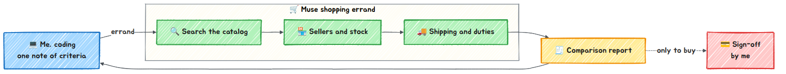
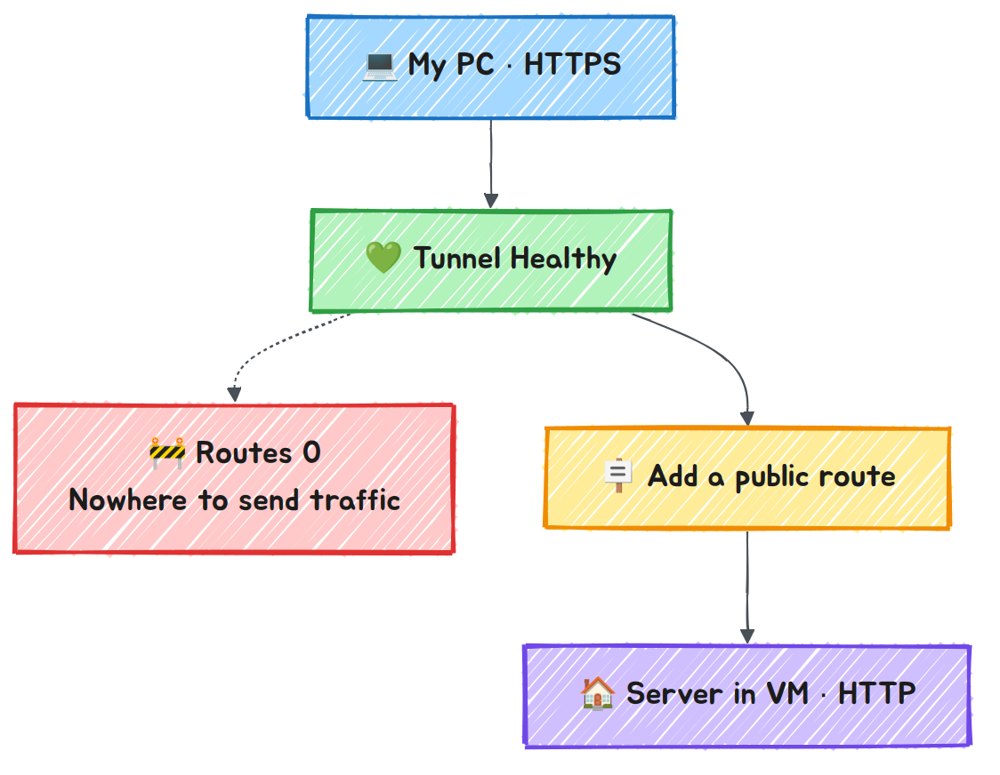

# Don’t Spend Claude Tokens on Shopping: Send Muse and Use Its Free Allowance

Picking a single camera for my robot was eating into my Claude allowance. I compared fields of view, sellers, and shipping costs without fixing a line of code. Then I thought of [Muse](https://muse.ai). It was good at shopping and had a generous free allowance. I could send over my criteria and get back to coding. Muse could look for the camera, and I’d still decide whether to buy it.

{ width="360" }

*While Muse works, Jollybot taps away at a laptop, and it confirms the requests from Claude Code are arriving (Korean chat). Screenshot of the Muse app; Muse and Jollybot are Meta's service and character.*

The fun part came next. On my phone I asked Muse if it remembered the requests from Claude Code. It rattled off the requests it had received that night. Even after I close the coding window, Muse remembers which cameras we looked at. The next day I can pick up on my phone with “Which of those two cameras is better?”

## The short version

- I put the shopping tools on Muse's virtual machine and called them from Claude Code and Codex through Cloudflare Tunnel.
- A healthy tunnel still needs a route from the public hostname to the server. My service URL inside the VM also needed plain HTTP.
- Research is split in two. The server picks candidates, and a Muse scheduled task checks sellers and shipping before it marks the job done. I still read the `unverified` list myself.
- Muse gives you a request ID first. Mine survived a disconnect, so I could pick up the result in a fresh session. A Python script now checks while I wait.
- When Muse swaps its VM for a new one, the server and tunnel go down with it. A start script in the home folder and a watchdog task bring them back.



## The tunnel came up, and then I saw zero routes

I wanted a little service counter next to my coding window. **MCP** is an agreement that lets an AI app discover and call tools at that counter. Muse could reach its catalog from inside its virtual machine (VM), so that's where I put the Python MCP server. The program that handles queued requests and the tunnel connector ran there too. Claude Code and Codex stayed on my PC.

That evening, I tried a temporary Quick Tunnel and then ngrok. Neither connected. I switched to a named Cloudflare tunnel, but the VM's DNS, which looks up network addresses by name, didn't return the records the connector needed. Fixing that got me as far as the next problem. The VM couldn't connect directly to the outside. Late that night, I got the tunnel up by using `socat` to forward the connection through the VM's outbound proxy. That was specific to this VM. Later, setting it up again on another Muse account, ngrok worked after all: with **Other TCP connections** switched on under **Permissions → Direct network protocols** in Muse's settings and ngrok started without the proxy, it connected on a free static address. Without a domain, that's the easier route.

{ width="420" }

*Everything else stays off; only Other TCP connections is on. With it on, Muse asks before each connection. Careful with Reset approvals to defaults on the same page: it can switch this back off. (Screenshot of the Muse app.)*

The dashboard finally said **Healthy**. Next to it was **Routes 0**. The tunnel was up and had nowhere to send a request.

I added a **Published application** route with a public hostname, then got the protocol wrong. My PC talks HTTPS to Cloudflare, but the server inside the VM speaks plain HTTP. I set the **Service URL** to `http://localhost:8765` and left Path empty so both `/mcp` and `/healthz` could get through. [Cloudflare's published application docs](https://developers.cloudflare.com/cloudflare-one/networks/connectors/cloudflare-tunnel/routing-to-tunnel/)



## I put the password on the name tag

I tripped over the Codex settings too. An environment variable lets you pass a named value to a program when it starts. I put the actual secret in a box that wanted its name. It was like writing the password on a locker’s name tag.


## I clicked Allow and got Deny

The first catalog search brought up a permission card in **Muse chat**. I clicked **Allow**, got an error, and found **Deny** in the record. Search worked after I restarted the MCP server in a fresh context where the earlier denial no longer applied. That card grants access to read the catalog. A person reviews any purchase request separately.


When I sent research to the queue, I got `pending` and a request ID. Later that night, a lookup hit a 502. Muse reported that the server restarted and its old MCP sessions expired. Whether that restart was the 502's culprit, I still don't know.

In the new session, I looked up the **same request ID** and got `done` and the result. I'd opened and closed plenty of windows that night. At least I didn't have to ask Muse to shop twice. But having Claude check over and over still ate into my allowance while I waited. I gave the ticket to a Python script and had Claude read the result once it was ready.


When I sent a camera search from Windows 11, I got my ticket and could look up the result just fine. The snag was at the retailer. Amazon.ca returned a 403 when Muse tried to open the product page. I opened the same page with Claude’s Chrome extension and could see the price and stock. So Claude checks Amazon.ca prices itself through the Chrome extension, and Muse gets other Canadian retailers such as Best Buy.ca.

## One errand runner became two

On my first server, a single scheduled task that ran every five minutes did everything. It took a request off the queue, searched the catalog, checked sellers, and wrote `done`. If the server or the tunnel was down, it restarted them too.

Building a similar server fresh on another Muse account showed the weak spot. That server only searched the catalog and wrote `done` right away. Results came back in seconds, which felt great until I opened them. They ignored budget and region: US stores in US dollars for a delivery to Canada, a 3 m cable for a 2 m brief, and desktop graphics cards for a laptop. It was fast because it never checked a single seller.

So I split the job. When a request comes in, a first-pass program inside the server, the worker, turns the note into criteria (item type, specs, region, currency, budget). It searches the catalog with a short query and drops items of the wrong type. It saves details for the top candidates and sets the status to `researching`, but it never writes `done`. A Muse scheduled task, the researcher, finishes the job every ten minutes. It checks specs, seller, stock, and the total with shipping and tax on Canadian retailers' product pages, and only then writes `done`. If nothing fits or two hours pass, it closes the job as `failed`. Restarting the server and the tunnel moved to another scheduled task, the watchdog.

I sent my Muse a test: "Canada, 2 m USB-C cable, 100 W, under CA$25." It reached `researching` in two minutes.

{ width="360" }

*Muse’s progress note while the researcher checked sellers after the worker’s hand-off. (Screenshot of the Muse app.)*

It reached `done` about twenty minutes after I sent it. Along the way, the worker’s first catalog search stalled for two minutes and timed out, but the researcher ran the search again and the result still came through. Muse changed the worker to give up after 60 seconds and retry once.

{ width="360" }

*The two scheduled tasks Muse set up: the researcher finishes each job, and the watchdog keeps the server and tunnel up. The paragraph above is that timeout. (Screenshot of the Muse app.)* Of eight options, the best was an ALOGIC 2 m cable at CA$17.11 delivered. The researcher also caught that a cheaper catalog price was for the 1 m version, and it marked a 1.98 m cable "close, not exact."

You still have to read the result. Only the ALOGIC option had a delivered total with verified shipping. The others had shipping under `unverified`, and a CA$28.24 cable over budget was still marked as matching. The server on the other account once picked an over-budget option as the best one. After I asked Muse to fix it there, the same request marked over-budget options as not matching. On that account, a 1.83 m (6 ft) cable was marked as matching a 2 m brief, with the shortfall noted only under `unverified`. Now I read the `unverified` list first.

## One day the VM had been replaced

I'd been using the server I'd connected through ngrok when, out of nowhere, Claude Code couldn't connect to `muse-shopping`. The public address showed an ngrok page with `ERR_NGROK_3200`, which means the ngrok agent behind the address isn't running. Nothing was wrong on my PC.

Muse had swapped its VM for a new one. The home folder survived, but `/etc`, where system settings live, was empty, and the services I'd registered to start the server and tunnel at boot went with it. Muse brought everything back by running the start script in the home folder (`~/start-all.sh`). The address didn't change, so on my PC I only had to reconnect.

The odd part was that the watchdog, which checks the server every 10 minutes, hadn't brought it back on its own. Muse checked the records. The watchdog had run a few minutes after the swap, most likely before the VM's command service was up, though Muse couldn't prove that part. It couldn't run a single command, yet the task ended as a success. A note even said the server was healthy, and that wasn't a value anything had actually checked.

So the watchdog got three new rules. If the VM booted less than 30 minutes ago, it runs the start script no matter what. The script skips anything already running, so running it twice is harmless. If a command fails or prints nothing, the run reports a failure, not a success. And the log keeps only what the commands in that run actually printed. The next VM swap hasn't come yet, so I haven't seen it recover without help.

## If you’d like to try it

### 1. Try a lookup inside the VM

My server can search the catalog, look up product details, and read saved shopping preferences. For longer research, `ask_muse_to_shop` adds a job to the queue. Give `check_shopping_request` the request ID to read its status and result. The server can also queue a purchase request for a person to review in Muse chat. It places no orders and makes no payments.

Here's the little server I used to show the lookup. To use it with Muse itself, you'd need access to Muse's tools from the VM. In the server directory, run `(umask 077; set -o noclobber; openssl rand -hex 32 > .token)` to create a private token file and save `{"status":"pending"}` in `queue/demo.json`. Use `demo` as the request ID. Save the example as `server.py` and run `python3 server.py`. It listens on `127.0.0.1:8765` inside the VM. The `/mcp` endpoint exchanges MCP messages over HTTP (**Streamable HTTP**) and requires `Bearer <token>` in the authorization header. The `/healthz` endpoint just tells me whether the server answers. [Python MCP SDK docs](https://py.sdk.modelcontextprotocol.io/run/asgi/)

```python
import json
import re
from pathlib import Path
from secrets import compare_digest

import uvicorn
from mcp.server import MCPServer
from mcp.server.transport_security import TransportSecuritySettings
from starlette.middleware.base import BaseHTTPMiddleware
from starlette.responses import JSONResponse

token = Path(".token").read_bytes().strip()
if not token:
    raise SystemExit("The .token file is empty.")
mcp = MCPServer("Muse shopping example")

@mcp.tool()
def check_shopping_request(request_id: str) -> dict:
    """Read the status and result for a shopping request."""
    if not re.fullmatch(r"[A-Za-z0-9_-]+", request_id):
        raise ValueError("Invalid request ID")
    return json.loads((Path("queue") / f"{request_id}.json").read_text(encoding="utf-8"))

@mcp.custom_route("/healthz", methods=["GET"])
async def health(request):
    return JSONResponse({"status": "ok"})

async def require_token(request, call_next):
    header = request.headers.get("authorization", "").encode("latin-1")
    if request.url.path.rstrip("/") == "/mcp" and not compare_digest(header, b"Bearer " + token):
        return JSONResponse({"error": "Unauthorized"}, 401, headers={"WWW-Authenticate": "Bearer"})
    return await call_next(request)

security = TransportSecuritySettings(allowed_hosts=["127.0.0.1:*", "localhost:*", "muse.example.com"])
app = mcp.streamable_http_app(transport_security=security)
app.add_middleware(BaseHTTPMiddleware, dispatch=require_token)
uvicorn.run(app, host="127.0.0.1", port=8765)
```

I ran this exact example on my PC (Python MCP SDK 2.3.0). `/healthz` answered 200, `/mcp` without a token slammed the door with a 401, and with the token the queue file opened right up. On the real server, the worker and researcher above move that file's status from `pending` to `researching` to `done`.

### 2. Connect the tunnel and register the clients

Point the Cloudflare Published application route at `http://localhost:8765` inside the VM and try `/healthz` on the public hostname first. Put the bare public hostname, without a port, in the server's allowed hosts; without it the MCP SDK answers 421. Mine reads them from a `MUSE_ALLOWED_HOSTS` environment variable, so a new address needs no code change.

On my PC, I kept the same token in a private file with `0600` permissions. Replace `/path/to/private/token` with the path to that file and replace `muse.example.com` in the server code and client settings with your public hostname. The Claude Code setting refers to the environment variable by name. The single quotes keep the shell from expanding `${MUSE_SHOPPING_TOKEN}` so Claude Code can read it when it connects. [Claude Code MCP docs](https://code.claude.com/docs/en/mcp)

```bash
export MUSE_SHOPPING_TOKEN="$(cat /path/to/private/token)"
claude mcp add --transport http --scope user muse-shopping https://muse.example.com/mcp \
  --header 'Authorization: Bearer ${MUSE_SHOPPING_TOKEN}'
claude
```

In Codex’s `config.toml`, put the name (`MUSE_SHOPPING_TOKEN`) in `bearer_token_env_var`. Codex looks up the token in its environment using that name. [Codex MCP docs](https://developers.openai.com/codex/mcp)

```toml
[mcp_servers.muse-shopping]
url = "https://muse.example.com/mcp"
bearer_token_env_var = "MUSE_SHOPPING_TOKEN"
```

Even with the name fixed, a Codex process launched somewhere else won't inherit the token from my terminal. I used a launcher that reads the file and hands the token to a fresh Codex process. This is the short version of the `--no-daemon` launch I used with CLI 0.169.0.

```bash
MUSE_SHOPPING_TOKEN="$(cat /path/to/private/token)" codex --no-daemon
```

On Windows 11 I connected both Claude Code and Codex to Muse. When I forgot the environment variable and opened Claude Code, a 401 came straight back. A job sent through the [bridge](ai-workbench-routing.md) needed one more thing. The bridge launches Codex with `-a never`, so a tool call fails if it needs approval and I haven't granted it in advance. The `search_memory` tool worked after I approved it in Codex's `config.toml` like this. I keep the Muse token out of Codex on Ubuntu, where Claude Code calls Muse directly.

```toml
[mcp_servers.muse-shopping.tools.search_memory]
approval_mode = "approve"
```

### 3. Look up the same request ID

On the real Muse server, save the ID from `ask_muse_to_shop`. For a single lookup, give it to `check_shopping_request`. To wait for a result, I run a short Python wait script (`muse_wait.py`, not in the public repo yet) in a background shell instead of scheduling repeated model checks. The script polls directly, so the wait spends no model tokens. While the job is pending, it starts with a two-minute interval and doubles it up to ten minutes. It treats `researching` as still waiting. When Muse re-researches a request that already shows `done`, `--until-changed` skips the current result and waits for a new one. When the job finishes, the script prints one line with the ID, status, a short summary, and the path to the full JSON. I open that file only when I need the details.

For a 502, I'd compare `/healthz` inside the VM with the public endpoint. If the local check fails, I'd check the server first. If only the local check works, I'd look at the tunnel and its service URL. An expired MCP session after a restart needs a fresh connection.

### Where to look when it gets stuck

| Symptom | What to check |
| --- | --- |
| Healthy, Routes 0 | Add a route from the public hostname to the service URL inside the VM. |
| 401 or zero tools | Check the authorization header and the launched process’s token environment. |
| 502 | Compare `/healthz` inside the VM and at the public hostname. |
| Search fails after approval | Check the permission card and its record in Muse chat. |
| 421 | Add the public hostname to the server's allowed hosts and restart it. |
| ngrok won't connect | Switch on Other TCP connections in Muse's settings and start ngrok without the proxy. |
| `ERR_NGROK_3200`, `/healthz` fails from every PC | It's the server side, not your PC. The VM may have been replaced; ask Muse to run the start script. |
| `done` in seconds, budget ignored | The server only runs a catalog search. Split it into a worker and a researcher. |
| Stuck at `researching` | Check that the researcher task ran and whether an approval is waiting in Muse. |

**Related** [Reading a 1,069-page book with local AI](local-llm-reading.md) · [Claude Directs, Codex Does the Work: A Bridge to Save Claude Usage](ai-workbench-routing.md)
