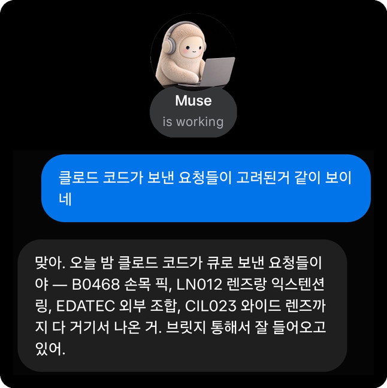

# Claude 토큰으로 쇼핑하지 마세요: 공짜 토큰 많은 Muse에게 심부름 보내기

로봇에 달 카메라 하나 고르는 데 Claude 토큰을 꽤 썼어요. 화각을 비교하고 판매처와 배송비를 알아보는 동안 코드는 한 줄도 못 고쳤고요. 마침 쇼핑을 잘하고 무료 사용량도 넉넉한 [Muse](https://muse.ai)가 떠올랐어요. 원하는 조건만 보내고 저는 코딩으로 돌아가면 되겠더라고요. 물건 알아보는 일은 Muse에 맡기고, 결제는 제가 결정해요.

{ width="360" }

*Muse가 일하는 동안엔 캐릭터 Jollybot이 노트북을 두드려요. 아래 채팅에선 Claude Code가 보낸 요청이 잘 들어온다고 Muse가 답했어요. (Muse 앱 화면 캡처. Muse와 Jollybot은 Meta의 서비스와 캐릭터예요.)*

재미있는 건 그다음이었어요. 폰에서 Muse에게 Claude Code가 보낸 요청도 알고 있냐고 물었더니, 그날 밤 받은 요청을 줄줄이 짚어 주더라고요. 코딩 창을 닫아도 어떤 카메라를 알아봤는지는 Muse가 기억해요. 다음 날 폰을 열어 “그 카메라 둘 중에 뭐가 나아?” 하고 바로 물어볼 수 있는 거죠.

## 30초 요약

- Muse가 있는 가상 컴퓨터에 쇼핑 도구를 연결하고, Cloudflare Tunnel을 통해 Claude Code와 Codex에서 불렀어요.
- 터널이 Healthy여도 공개 주소를 서버에 연결하는 규칙이 없으면 요청이 못 들어와요. 제 경우엔 VM 안의 서비스 URL도 `https`에서 `http`로 고쳐야 했어요.
- 쇼핑을 맡기면 접수 번호부터 받아요. 연결이 끊겨도 다시 접속해서 같은 번호로 결과를 찾을 수 있어요. 결과가 나올 때까지는 Python 스크립트가 대신 확인해요.


## 터널은 열렸는데

코딩 창 옆에 쇼핑 심부름을 맡길 창구가 하나 있으면 좋겠다 싶었어요. **MCP**는 AI 프로그램이 이런 외부 도구의 목록을 보고 필요한 도구를 부를 때 쓰는 규약이에요. 카탈로그는 Muse 안에서만 열리니 창구 역할을 할 Python 서버도 Muse가 쓰는 가상 컴퓨터(VM)에 뒀어요. 쇼핑 요청을 대기 순서대로 처리하는 프로그램과 터널을 연결하는 프로그램도 거기서 돌리고, 제 PC에는 Claude Code와 Codex만 띄웠어요.

그날 저녁, 임시 주소를 주는 Quick Tunnel부터 써 보고 ngrok도 시도했지만 둘 다 연결되지 않았어요. 이름을 붙인 Cloudflare 터널로 바꾸니 이번에는 VM의 DNS가 문제였어요. DNS는 이름으로 네트워크 주소를 찾아 주는데, 터널 연결에 필요한 주소를 찾지 못하더라고요. DNS를 따로 처리하고 나니 이번엔 VM에서 밖으로 나가는 연결이 막혔어요. 밤이 깊어서야 `socat`으로 연결을 중계해 VM의 외부 연결용 프록시를 거쳐 터널을 열었어요. 제가 쓴 VM에서는 이렇게 우회해야 했어요.

이제 되겠지 싶어 화면을 보니 **Healthy**, 바로 옆에는 **Routes 0**. 터널은 열렸는데 어느 주소의 요청을 어디로 보낼지 정해 둔 게 없었어요.

Cloudflare에서 **Published application** 라우트를 만들고 공개 호스트 이름을 붙였어요. 여기서 제가 한 번 더 헷갈린 게 있어요. 제 PC에서 Cloudflare까지는 HTTPS로 접속하지만, 터널 반대편의 서버는 VM 안에서 HTTP로 요청을 받아요. **Service URL**을 `http://localhost:8765`로 고치고 Path를 비워 두니 `/mcp`와 `/healthz` 양쪽에 접속할 수 있었어요. [Cloudflare 공개 라우트 문서](https://developers.cloudflare.com/cloudflare-one/networks/connectors/cloudflare-tunnel/routing-to-tunnel/)


## 비밀번호를 명찰에 적어 버렸어요

Codex 설정에서는 이름과 값을 헷갈렸어요. 환경변수로 토큰을 넘길 때는 변수에 이름을 붙이고 프로그램이 시작할 때 그 이름으로 값을 찾아요. 그런데 저는 이름을 적으라는 칸에 토큰 값 자체를 적었어요. 사물함 명찰에 비밀번호를 써 붙인 셈이죠.


## Allow를 눌렀는데 Deny가 남았어요

처음 카탈로그를 검색할 때는 코딩 창만 보고 있으면 승인 요청을 놓치기 쉬워요. 허락을 묻는 카드가 **Muse 채팅**에 뜨거든요. 저는 **Allow**를 눌렀는데 오류가 났고, 기록에는 **Deny**가 남았어요. 서버를 다시 띄워 이전 거부 기록이 더는 적용되지 않자 검색이 됐어요. 여기서 허락하는 건 카탈로그를 읽는 일이에요. 구매 요청은 사람이 따로 검토해요.


조사를 맡기니 대기 중이라는 뜻의 `pending`과 접수 번호가 돌아왔어요. 한밤중에 그 번호로 결과를 조회하다가 502 오류를 봤어요. Muse 말로는 서버가 재시작되면서 기존 MCP 세션이 만료됐대요. 클라이언트가 이전 세션에서 하던 대화를 그대로 이어 갈 수 없게 된 거죠. 그게 502의 원인이었는지는 아직 모르겠어요.

새 세션에서 **같은 접수 번호**를 넣었더니 `done`과 함께 조사 결과가 나왔어요. 그날 밤 창을 몇 번이나 닫았다 열었어도 같은 심부름을 두 번 시킬 필요는 없었어요. 다만 결과가 나왔나 싶어 Claude에게 자꾸 확인을 시켰더니 기다리는 동안에도 토큰이 들더라고요. 그 뒤로는 번호표를 Python 스크립트에 맡겨요. Claude는 결과가 나오면 한 번만 읽어요.


Windows 11에서 카메라 조사를 맡겼을 때도 접수부터 결과 조회까지는 잘됐어요. 막힌 곳은 판매처였어요. Muse가 Amazon.ca 상품 페이지를 열려고 하자 403 오류가 돌아왔거든요. 같은 페이지를 Claude의 Chrome 확장으로 열어 보니 가격과 재고를 확인할 수 있었어요. 그래서 Amazon.ca 가격은 Claude가 Chrome 확장으로 직접 확인하고, Muse에는 Best Buy.ca 같은 다른 캐나다 판매처를 맡겨요.

## 직접 해 보고 싶다면

### 1. VM에서 조회부터 시험하기

제 서버에서는 카탈로그를 검색하고, 상품 상세 정보와 미리 저장한 쇼핑 취향을 확인할 수 있어요. 시간이 걸리는 조사는 `ask_muse_to_shop`으로 접수해요. 나중에 `check_shopping_request`에 접수 번호를 넣으면 진행 상황과 결과를 볼 수 있어요. 구매 요청을 접수하는 기능도 있어요. 사람이 Muse 채팅에서 검토하는 단계까지만 지원하고 주문이나 결제는 처리하지 않아요.

접수 번호로 결과를 찾는 부분만 떼어 내면 아래처럼 작은 서버로도 시험해 볼 수 있어요. 실제 Muse 기능을 붙이려면 VM에서 그 기능을 호출할 수 있어야 해요. 서버 폴더에서 `(umask 077; set -o noclobber; openssl rand -hex 32 > .token)`으로 비밀 값이 든 파일을 만들고, `queue/demo.json`에 `{"status":"pending"}`을 저장해요. 조회할 접수 번호는 `demo`예요. 예제 코드를 `server.py`로 저장해 `python3 server.py`로 실행하면 VM 안의 `127.0.0.1:8765`에서 요청을 받아요. `/mcp`는 HTTP로 MCP 메시지를 주고받는 **Streamable HTTP** 주소이고, 요청의 인증 헤더에 `Bearer <token>`이 있어야 해요. `/healthz`는 서버 응답만 확인하는 주소예요. [Python MCP SDK 문서](https://py.sdk.modelcontextprotocol.io/run/asgi/)

```python
import json
import re
from pathlib import Path
from secrets import compare_digest

import uvicorn
from mcp.server import MCPServer
from mcp.server.transport_security import TransportSecuritySettings
from starlette.middleware.base import BaseHTTPMiddleware
from starlette.responses import JSONResponse

token = Path(".token").read_bytes().strip()
if not token:
    raise SystemExit("The .token file is empty.")
mcp = MCPServer("Muse shopping example")

@mcp.tool()
def check_shopping_request(request_id: str) -> dict:
    """Read the status and result for a shopping request."""
    if not re.fullmatch(r"[A-Za-z0-9_-]+", request_id):
        raise ValueError("Invalid request ID")
    return json.loads((Path("queue") / f"{request_id}.json").read_text(encoding="utf-8"))

@mcp.custom_route("/healthz", methods=["GET"])
async def health(request):
    return JSONResponse({"status": "ok"})

async def require_token(request, call_next):
    header = request.headers.get("authorization", "").encode("latin-1")
    if request.url.path.rstrip("/") == "/mcp" and not compare_digest(header, b"Bearer " + token):
        return JSONResponse({"error": "Unauthorized"}, 401, headers={"WWW-Authenticate": "Bearer"})
    return await call_next(request)

security = TransportSecuritySettings(allowed_hosts=["127.0.0.1:*", "localhost:*", "muse.example.com"])
app = mcp.streamable_http_app(transport_security=security)
app.add_middleware(BaseHTTPMiddleware, dispatch=require_token)
uvicorn.run(app, host="127.0.0.1", port=8765)
```

제 PC에서 Python MCP SDK 2.3.0으로 이 예제를 그대로 돌려 봤어요. `/healthz`는 200을 돌려줬어요. `/mcp`에 토큰 없이 접속했을 땐 401이 나왔고, 토큰을 보내니 대기 목록에 저장한 파일을 읽을 수 있었어요. 실제 서버에서는 별도 프로그램이 5분마다 대기 목록을 확인하고 결과를 디스크에 저장해요. 조사가 길어지면 여러 차례 기다려야 할 수도 있어요.

### 2. 터널을 연결하고 클라이언트에 등록하기

Cloudflare의 Published application 라우트가 VM 안의 `http://localhost:8765`를 가리키는지 확인하고, 먼저 공개 주소의 `/healthz`를 열어 보세요.

제 PC에서는 서버와 같은 토큰을 파일에 저장하고 권한을 `0600`으로 설정했어요. 아래 명령의 `/path/to/private/token`은 그 파일의 경로로, 서버 코드와 클라이언트 설정의 `muse.example.com`은 실제 공개 호스트 이름으로 바꿔 주세요. Claude Code 설정에는 환경변수 이름을 적어요. 작은따옴표로 감싸면 셸이 `${MUSE_SHOPPING_TOKEN}`을 그대로 넘기고 Claude Code가 접속할 때 값을 읽어요. [Claude Code MCP 문서](https://code.claude.com/docs/en/mcp)

```bash
export MUSE_SHOPPING_TOKEN="$(cat /path/to/private/token)"
claude mcp add --transport http --scope user muse-shopping https://muse.example.com/mcp \
  --header 'Authorization: Bearer ${MUSE_SHOPPING_TOKEN}'
claude
```

Codex의 `config.toml`에서는 `bearer_token_env_var`에 이름(`MUSE_SHOPPING_TOKEN`)을 적어요. Codex는 실행 환경에서 그 이름으로 토큰 값을 찾아요. [Codex MCP 문서](https://developers.openai.com/codex/mcp)

```toml
[mcp_servers.muse-shopping]
url = "https://muse.example.com/mcp"
bearer_token_env_var = "MUSE_SHOPPING_TOKEN"
```

변수 이름을 바로잡아도 토큰을 설정한 터미널 밖에서 Codex를 실행하면 그 값이 전달되지 않아요. 그래서 파일에서 토큰을 읽어 새 Codex 프로세스에 건네는 실행기를 썼어요. CLI 0.169.0에서 쓴 `--no-daemon` 실행 명령을 줄이면 이래요.

```bash
MUSE_SHOPPING_TOKEN="$(cat /path/to/private/token)" codex --no-daemon
```

Windows 11에서 Claude Code와 Codex를 Muse에 연결할 때는 어디서 막혔는지에 따라 챙길 게 달랐어요. 환경변수를 빼먹고 Claude Code를 열면 Muse가 401을 돌려줬어요. [브리지](ai-workbench-routing.md)를 통해 Codex에 일을 맡길 때는 도구 승인도 필요했어요. 브리지가 `-a never`로 Codex를 실행하니, 승인이 필요한 도구를 부르다가 중간에 허락을 구할 수 없거든요. 저는 Codex의 `config.toml`에 아래처럼 `search_memory`를 미리 승인하고 나서야 쓸 수 있었어요. Ubuntu에선 Claude Code가 직접 Muse를 부르기 때문에 Codex에는 Muse 토큰을 두지 않았어요.

```toml
[mcp_servers.muse-shopping.tools.search_memory]
approval_mode = "approve"
```

### 3. 같은 접수 번호로 조회하기

실제 Muse 서버에선 `ask_muse_to_shop`이 돌려준 접수 번호를 적어 둬요. 진행 상황이 궁금하면 `check_shopping_request`에 그 번호를 넣어 한 번 확인해요. 결과가 나올 때까지 기다릴 때는 제가 만든 Python 스크립트 `muse_wait.py`에 번호를 넘겨 백그라운드 셸에서 돌려요. 아직 공개 저장소에는 올리지 않았어요. 스크립트가 직접 조회하니 기다리는 동안 모델 토큰이 들지 않아요. 처음엔 2분 뒤에 조회하고, 계속 대기 중이면 조회 간격을 두 배씩 늘려요. 가장 길게 기다리는 간격은 10분이에요. 조사가 끝나면 접수 번호와 상태, 짧은 요약, 전체 결과가 담긴 JSON 파일 경로를 한 줄로 보여 줘요. 더 알고 싶을 때만 그 파일을 열어 봐요.

502가 뜨면 VM 안에서 `/healthz`를 열어 보고 공개 주소에서도 같은 응답이 오는지 비교해요. VM 안에서도 응답이 없으면 서버부터 살펴봐요. 안에서는 되는데 밖에서만 안 되면 터널과 서비스 URL을 확인해요. 서버가 재시작되면서 세션이 만료됐다면 클라이언트를 다시 연결해요.

### 막히면 여기부터

| 증상 | 살펴볼 곳 |
| --- | --- |
| Healthy, Routes 0 | 공개 호스트 이름과 VM 안의 Service URL을 잇는 라우트를 만들어요. |
| 401 또는 도구 0개 | 인증 헤더와 실제 실행 환경의 토큰을 확인해요. |
| 502 | VM 안과 공개 주소의 `/healthz`를 비교해요. |
| 승인 뒤에도 검색 실패 | Muse 채팅에서 승인 카드와 기록을 살펴봐요. |

**관련 글** [1,069쪽 책을 로컬 AI에 맡기기](local-llm-reading.md) · [Claude는 감독, Codex는 일꾼: 사용량 아끼려고 만든 작업 브리지](ai-workbench-routing.md)
