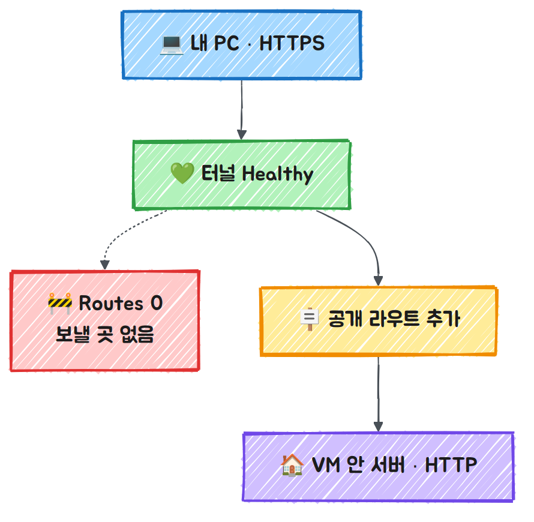
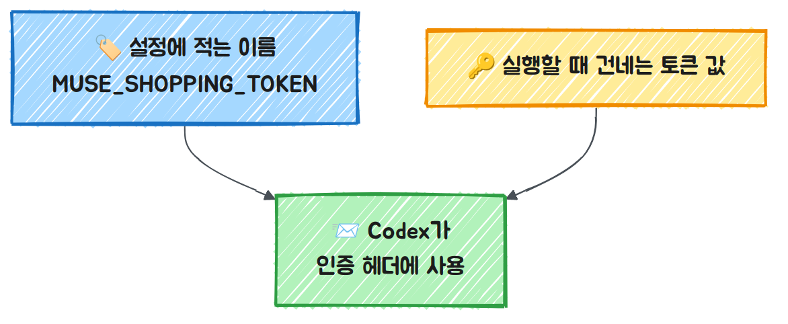
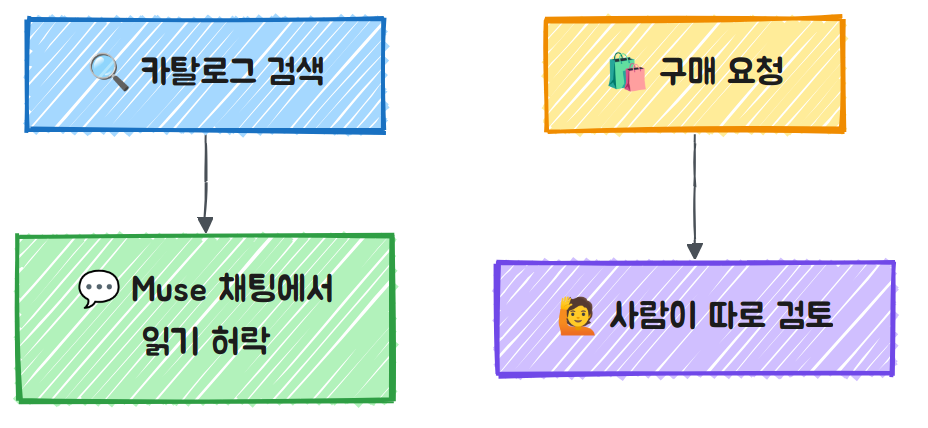
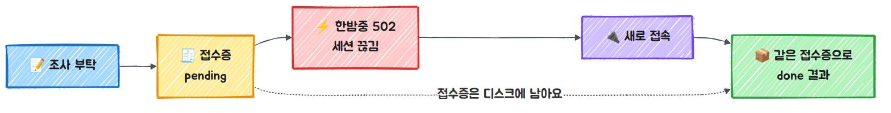

# Claude 토큰으로 쇼핑하지 마세요: 공짜 토큰 많은 Muse에게 심부름 보내기

로봇 카메라 하나 고르는데 Claude 사용량이 쭉쭉 빠졌어요. 화각을 비교하고 판매처와 배송비를 살피는 동안 코드는 한 줄도 못 고쳤죠. 마침 쇼핑을 잘하고 무료 사용량도 넉넉한 Muse가 있었어요. 조건만 적어 보내고 저는 코딩으로 돌아가면 되겠다고 생각했어요. 쇼핑만 구매 대행 하청에 맡기는 셈이죠. 물론 결제 도장은 제가 찍어요.

## 30초 요약

- Muse가 있는 가상 컴퓨터에 쇼핑 도구를 연결하고, Cloudflare Tunnel을 통해 Claude Code와 Codex에서 불렀어요.
- 터널이 Healthy여도 공개 주소를 서버에 연결하는 규칙이 없으면 요청이 못 들어와요. 제 경우엔 VM 안의 서비스 URL도 `https`에서 `http`로 고쳐야 했어요.
- 쇼핑을 맡기면 접수 번호부터 와요. 연결이 끊겨도 이 번호가 남아 있어서, 다시 접속한 뒤 같은 요청의 결과를 읽을 수 있었어요.


## 터널은 열렸는데

제가 원한 건 코딩 화면 옆에 접수 창구 하나를 두는 거였어요. **MCP**는 AI 프로그램이 그런 외부 도구의 목록을 받아 보고 호출할 수 있게 해 주는 약속이에요. 카탈로그는 Muse 안에서만 열 수 있어서, 접수 창구 역할을 하는 Python 서버도 Muse가 쓰는 가상 컴퓨터(VM)에 뒀어요. 쇼핑 큐(대기 목록)를 처리하는 프로그램과 터널 연결 프로그램도 그쪽에 두고, 제 PC에는 Claude Code와 Codex만 띄웠어요.

그날 저녁엔 먼저 임시 주소를 주는 Quick Tunnel과 ngrok을 써 봤는데 둘 다 연결에 실패했어요. 이름을 붙인 Cloudflare 터널로 바꿔도 VM의 DNS(이름으로 접속 주소를 찾는 기능)가 터널에 필요한 답을 주지 않았어요. DNS를 따로 처리하고 나니 이번엔 바깥으로 나가는 연결이 막혔고요. 밤이 깊어서야 `socat`을 중계기로 써서 VM의 외부 연결용 프록시를 통해 터널을 연결했어요. 이건 그 VM에서 필요했던 조치예요.

이제 되겠지 싶어 화면을 보니 **Healthy**, 바로 옆에는 **Routes 0**. 터널은 열렸는데 어느 주소의 요청을 어디로 보낼지 정해 둔 게 없었어요.

Cloudflare에서 **Published application** 라우트를 만들고 공개 호스트 이름을 붙였어요. 거기서도 한 번 더 틀렸어요. PC는 Cloudflare에 HTTPS로 접속하지만, 터널이 VM 안에서 찾아갈 서버는 일반 HTTP로 듣고 있었어요. **Service URL**을 `http://localhost:8765`로 고치고 Path는 비워 둬서 `/mcp`와 `/healthz`가 모두 닿게 했어요. [Cloudflare 공개 라우트 문서](https://developers.cloudflare.com/cloudflare-one/networks/connectors/cloudflare-tunnel/routing-to-tunnel/)



## 비밀번호를 명찰에 적어 버렸어요

Codex 설정에서도 한 번 발이 걸렸어요. 환경변수는 프로그램을 시작할 때 이름을 붙여 건네는 값이에요. 저는 이름을 넣으라는 칸에 실제 비밀 값을 넣었어요. 사물함 명찰에 비밀번호를 적어 둔 셈이죠.



## Allow를 눌렀는데 Deny가 남았어요

첫 카탈로그 검색 때는 코딩 화면만 보고 기다리면 놓치기 쉬운 게 있었어요. 허락을 묻는 카드가 **Muse 채팅**에 뜨거든요. 저는 **Allow**를 눌렀는데 오류가 났고, 기록에는 **Deny**가 남았어요. 서버를 새로 띄워 이전 승인 기록이 적용되지 않는 상태에서 다시 검색하니 됐어요. 이 카드로 허락하는 건 카탈로그를 읽는 일이에요. 구매 요청은 사람이 따로 봐요.



조사를 맡긴 뒤엔 대기 중이라는 뜻의 `pending`과 접수 번호가 먼저 와요. 한밤중에 그 번호로 조회하다 502를 만났어요. Muse 쪽 설명으로는 서버가 다시 시작되면서 클라이언트가 쓰던 MCP 세션(서버와 메시지를 주고받던 상태)이 만료됐어요. 그게 502의 범인이었는지는 아직 모르겠어요.

실제로 새 세션에서 **같은 접수 번호**를 넣자 `done`과 결과가 왔어요. 밤새 열었다 닫은 창은 많았지만, 쇼핑을 다시 부탁할 필요는 없었어요.



## 직접 해 보고 싶다면

### 1. VM에서 조회부터 시험하기

제 서버에는 카탈로그 검색과 상품 상세 조회, 저장한 쇼핑 선호 읽기가 있어요. 오래 걸리는 조사는 `ask_muse_to_shop`으로 대기 목록에 넣고, `check_shopping_request`에 접수 번호를 주면 상태와 결과를 읽어요. 구매 요청도 접수할 수 있지만 사람이 Muse 채팅에서 따로 검토하고, 이 서버에서 주문이나 결제를 실행하진 않아요.

아래는 접수 번호로 파일 하나를 읽는 뼈대예요. 실제 Muse 기능을 붙이려면 VM에서 그 기능을 호출할 수 있어야 해요. 서버 폴더에서 `(umask 077; set -o noclobber; openssl rand -hex 32 > .token)`으로 비밀 값이 든 파일을 만들고, `queue/demo.json`에 `{"status":"pending"}`을 저장해요. 조회할 접수 번호는 `demo`예요. 아래를 `server.py`로 저장해 `python3 server.py`로 실행하면 VM 안의 `127.0.0.1:8765`에서 요청을 받아요. `/mcp`는 HTTP로 MCP 메시지를 주고받는 **Streamable HTTP** 주소이고, 요청의 인증 헤더에 `Bearer <token>`이 있어야 해요. `/healthz`는 서버 응답만 확인하는 주소예요. [Python MCP SDK 문서](https://py.sdk.modelcontextprotocol.io/run/asgi/)

```python
import json
import re
from pathlib import Path
from secrets import compare_digest

import uvicorn
from mcp.server import MCPServer
from mcp.server.transport_security import TransportSecuritySettings
from starlette.middleware.base import BaseHTTPMiddleware
from starlette.responses import JSONResponse

token = Path(".token").read_bytes().strip()
if not token:
    raise SystemExit("The .token file is empty.")
mcp = MCPServer("Muse shopping example")

@mcp.tool()
def check_shopping_request(request_id: str) -> dict:
    """Read the status and result for a shopping request."""
    if not re.fullmatch(r"[A-Za-z0-9_-]+", request_id):
        raise ValueError("Invalid request ID")
    return json.loads((Path("queue") / f"{request_id}.json").read_text(encoding="utf-8"))

@mcp.custom_route("/healthz", methods=["GET"])
async def health(request):
    return JSONResponse({"status": "ok"})

async def require_token(request, call_next):
    header = request.headers.get("authorization", "").encode("latin-1")
    if request.url.path.rstrip("/") == "/mcp" and not compare_digest(header, b"Bearer " + token):
        return JSONResponse({"error": "Unauthorized"}, 401, headers={"WWW-Authenticate": "Bearer"})
    return await call_next(request)

security = TransportSecuritySettings(allowed_hosts=["127.0.0.1:*", "localhost:*", "muse.example.com"])
app = mcp.streamable_http_app(transport_security=security)
app.add_middleware(BaseHTTPMiddleware, dispatch=require_token)
uvicorn.run(app, host="127.0.0.1", port=8765)
```

이 예제를 제 PC에서 그대로 돌려 봤어요(Python MCP SDK 2.3.0). `/healthz`는 200으로 답했고, 토큰 없이 `/mcp`에 가니 401로 문전박대, 토큰을 넣으니 큐 파일이 열렸어요. 실제 서버에선 별도 프로그램이 5분마다 대기 목록을 살피고 결과를 디스크에 남겨요. 조사에 5분보다 더 걸릴 수도 있어요.

### 2. 터널을 연결하고 클라이언트에 등록하기

Cloudflare의 Published application 라우트가 VM 안의 `http://localhost:8765`를 가리키는지 확인하고, 먼저 공개 주소의 `/healthz`를 열어 보세요.

PC에는 서버와 같은 토큰을 권한 `0600`인 비공개 파일에 옮겨 뒀어요. 아래에서는 `/path/to/private/token`을 그 파일 경로로 바꿔요. 서버 코드와 아래 설정의 `muse.example.com`은 실제 공개 호스트 이름으로 바꿔요. Claude Code 설정에는 실행할 때 읽을 환경변수 이름을 남겨요. 작은따옴표 덕분에 셸은 `${MUSE_SHOPPING_TOKEN}`을 그 자리에서 풀지 않고 Claude Code에 넘겨요. [Claude Code MCP 문서](https://code.claude.com/docs/en/mcp)

```bash
export MUSE_SHOPPING_TOKEN="$(cat /path/to/private/token)"
claude mcp add --transport http --scope user muse-shopping https://muse.example.com/mcp \
  --header 'Authorization: Bearer ${MUSE_SHOPPING_TOKEN}'
claude
```

Codex의 `config.toml`에서는 `bearer_token_env_var`에 이름(`MUSE_SHOPPING_TOKEN`)을 적어요. Codex는 실행 환경에서 그 이름으로 토큰 값을 찾아요. [Codex MCP 문서](https://developers.openai.com/codex/mcp)

```toml
[mcp_servers.muse-shopping]
url = "https://muse.example.com/mcp"
bearer_token_env_var = "MUSE_SHOPPING_TOKEN"
```

명찰을 고친 뒤에도 토큰을 읽어 들인 터미널과 실제 Codex를 시작한 곳이 다르면 값이 전달되지 않아요. 제 경우엔 파일에서 값을 읽어 새 Codex에 직접 건네는 실행기를 썼어요. 다음은 당시 CLI 0.169.0에서 쓴 `--no-daemon` 방식이에요.

```bash
MUSE_SHOPPING_TOKEN="$(cat /path/to/private/token)" codex --no-daemon
```

Claude Code도 Codex도 결국 이 설정으로 붙었어요. 환경변수를 빼먹고 Claude Code를 열었더니 바로 401이 돌아왔고요.

### 3. 같은 접수 번호로 조회하기

실제 Muse 서버에서 `ask_muse_to_shop`이 준 번호를 적어 두고 `check_shopping_request`에 넣어 보세요. `pending`이면 조금 뒤에 같은 번호로 다시 확인해요.

502가 나면 VM 안의 `/healthz`와 공개 주소의 응답부터 비교할 수 있어요. VM 안에서 상태 확인에 실패하면 서버부터 봐요. VM 안에서만 성공하면 터널과 서비스 URL을 살펴봐요. 서버를 다시 띄운 뒤 세션이 만료됐다면 클라이언트를 다시 연결해요.

### 막히면 여기부터

| 증상 | 살펴볼 곳 |
| --- | --- |
| Healthy, Routes 0 | 공개 호스트 이름과 VM 안의 Service URL을 잇는 라우트를 만들어요. |
| 401 또는 도구 0개 | 인증 헤더와 실제 실행 환경의 토큰을 확인해요. |
| 502 | VM 안과 공개 주소의 `/healthz`를 비교해요. |
| 승인 뒤에도 검색 실패 | Muse 채팅에서 승인 카드와 기록을 살펴봐요. |

**관련 글** [로컬 AI에게 읽기 맡기기](local-llm-reading.md) · [Max 5x는 비싸고, 딱 2배만 필요했다: Claude Code에 Codex를 일꾼으로 붙인 밤](ai-workbench-routing.md)
