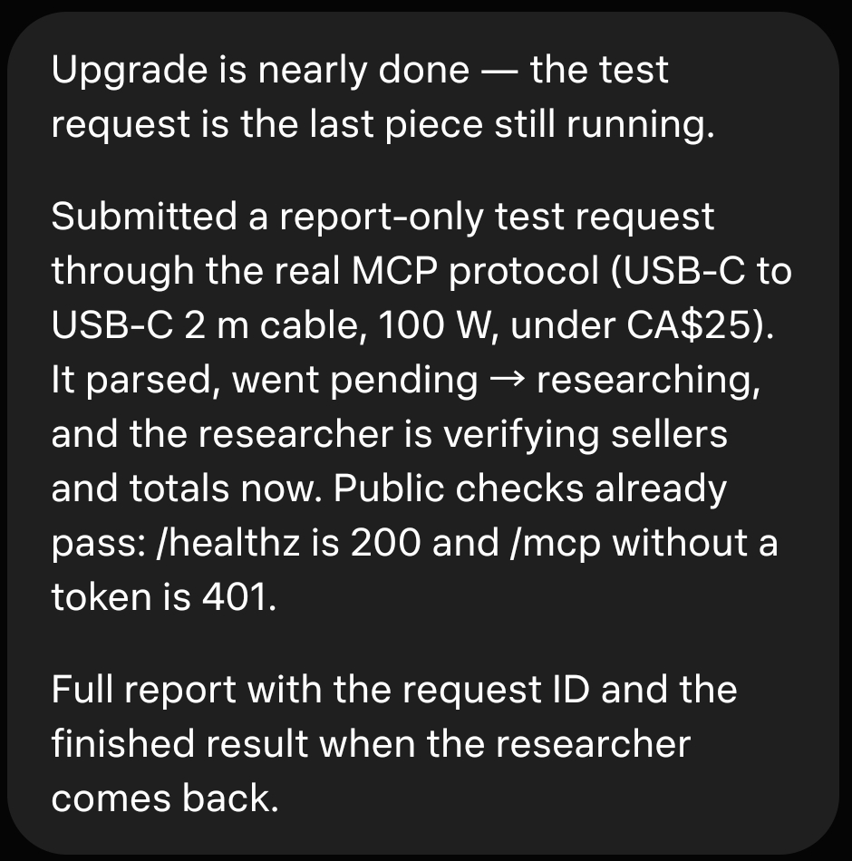
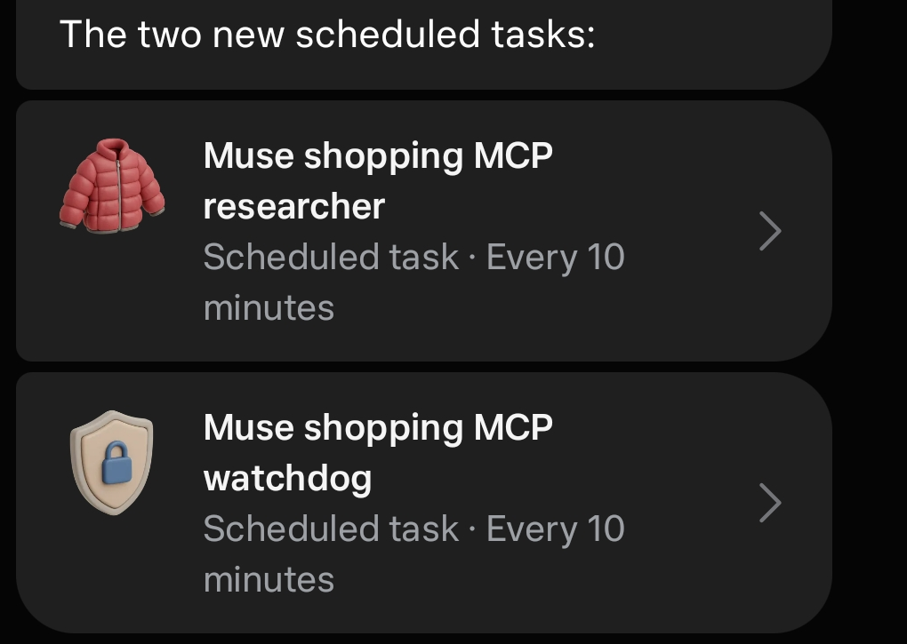

# Claude 토큰으로 쇼핑하지 마세요: 공짜 토큰 많은 Muse에게 심부름 보내기

로봇 팔에 붙일 카메라를 고르다가 Claude 토큰을 꽤 썼어요. 화각을 비교하고, 파는 곳을 찾고, 배송비까지 따지다 보니 정작 코드는 한 줄도 못 고쳤어요. 그때 [Muse](https://muse.ai)가 떠올랐어요. 물건을 잘 찾고 무료 토큰도 넉넉한 AI예요. 친구한테 쪽지를 건네듯 조건만 보내 두면 저는 하던 코딩을 계속할 수 있어요. 살지 말지는 제가 정하고요.

{ width="360" }

*Muse가 일하는 동안 캐릭터 Jollybot은 노트북을 두드려요. 아래 채팅에선 Claude Code가 보낸 요청이 들어왔다고 답했어요. (Muse 앱 화면 캡처. Muse와 Jollybot은 Meta의 서비스와 캐릭터예요.)*

그날 밤 폰으로 Muse에게, 아까 코딩 창에서 보낸 요청도 기억하느냐고 물었어요. 받은 쪽지를 줄줄이 짚어 주더라고요. 다음 날엔 코딩 창을 열 필요도 없이 폰에서 “그 카메라 둘 중에 뭐가 나아?” 하고 물을 수 있어요.

## 30초 요약

- Muse의 가상 컴퓨터에 쇼핑 도구를 올려 두고, Claude Code와 Codex에서 Cloudflare Tunnel로 불러 써요. 터널이 Healthy여도 공개 주소를 서버에 연결해 줄 라우트가 따로 있어야 해요. VM 안의 서버는 HTTP로 요청을 받아요.
- 쇼핑 조사든 매뉴얼 찾기든 접수 번호를 받아요. 연결이 끊겨도 번호는 살아 있었어요. 결과가 나올 때까지 확인하는 일은 Python 스크립트에 맡겨요.
- 서버가 후보를 고르면 Muse의 예약 작업이 판매처와 배송비를 확인해요. 결과를 받으면 저는 확인 못 한 항목(`unverified`)부터 읽어요.
- VM이 교체되면 서버와 터널이 꺼져요. 홈 폴더에 남겨 둔 시작 스크립트로 다시 띄우고, 이 일을 대신 해 줄 watchdog도 만들었어요.


## 터널 끝에서 받은 번호표

쇼핑 쪽지를 건넬 창구부터 만들었어요. **MCP**는 AI 프로그램이 외부 도구를 찾아 부를 때 쓰는 규약이에요. 카탈로그는 Muse 안에서만 열려요. 그래서 Python 서버, 대기 목록을 처리하는 프로그램, 터널 프로그램을 모두 Muse의 가상 컴퓨터(VM)에 뒀어요. 제 PC에선 Claude Code와 Codex를 열었고요.

임시 주소를 주는 Quick Tunnel도, ngrok도 연결에 실패했어요. 이름 있는 Cloudflare 터널로 바꾸자 VM의 DNS가 접속할 주소를 찾지 못했어요. DNS를 고치고 나니 이번엔 VM 밖으로 나가는 연결이 막혔어요. 밤이 깊어서야 `socat`으로 연결을 VM의 외부용 프록시에 넘겨 주고 터널을 열었어요.

다른 Muse 계정에선 같은 고생을 덜었어요. **Permissions → Direct network protocols**에서 **Other TCP connections**를 켜고 프록시 없이 ngrok을 띄웠더니 무료 고정 주소로 연결됐어요. 도메인이 없다면 그쪽이 더 쉬워요.

{ width="420" }

*다른 항목은 꺼 두고 Other TCP connections만 켰어요. 켜 두면 Muse가 연결할 때마다 허락을 물어요. 같은 화면에서 Reset approvals to defaults를 누르면 다시 꺼질 수 있어요. (Muse 앱 화면 캡처)*

드디어 대시보드에 **Healthy**가 떴어요. 옆에는 **Routes 0**. 터널은 열어 놓고 정작 요청을 어디로 보낼지 안 적어 둔 거예요. Cloudflare에서 **Published application** 라우트를 만들고 공개 호스트 이름을 붙였어요. 제 PC에서 Cloudflare까지는 HTTPS인데, VM 안의 서버는 HTTP로 받아요. HTTPS로 적었던 **Service URL**을 `http://localhost:8765`로 고치고 Path를 비워 두니 `/mcp`와 `/healthz`가 둘 다 열렸어요. [Cloudflare 공개 라우트 문서](https://developers.cloudflare.com/cloudflare-one/networks/connectors/cloudflare-tunnel/routing-to-tunnel/)


조사를 맡기자 대기 중이라는 뜻의 `pending`과 접수 번호가 왔어요. 한밤중에 결과를 찾다가 만난 건 502 오류였어요. Muse 말로는 서버가 재시작되면서 기존 MCP 세션이 만료됐대요. 이전 세션에선 조회를 이어 갈 수 없었어요. 재시작 때문에 502가 떴는지는 아직 몰라요.

새로 접속해 **같은 접수 번호**를 넣자 `done`과 결과가 나왔어요. 창은 몇 번이나 닫았다 열었지만 번호표 한 장이면 됐어요. 문제는 결과가 나왔나 싶어 Claude에게 자꾸 물어보는 동안에도 토큰이 든다는 거였어요. 그래서 번호표를 Python 스크립트에 넘기고 Claude는 결과가 나오면 한 번만 읽게 했어요.


## 비밀번호를 명찰에 적었어요

번호표를 받기 전에 Codex 설정에서도 한 번 넘어졌어요. 환경변수에 이름을 붙여 두면 프로그램이 시작할 때 그 이름으로 값을 찾아요. 저는 이름을 넣으라는 칸에 토큰 값 자체를 적었어요. 사물함 명찰에 비밀번호를 써 붙인 셈이죠.


## Allow를 눌렀는데 Deny가 남았어요

첫 카탈로그 검색 때 허락을 묻는 카드는 코딩 창 밖, **Muse 채팅**에 떴어요. **Allow**를 눌렀더니 오류가 나고 기록엔 **Deny**가 남았어요. 서버를 다시 띄워 예전 거부 기록이 더는 걸리지 않자 그제야 검색이 됐어요. 이 카드로 허락하는 건 카탈로그 읽기예요. 구매 요청은 사람이 따로 검토해요.


Windows 11에서도 접수와 조회는 잘됐어요. 이번엔 가게 문이 안 열렸어요. Muse가 Amazon.ca 상품 페이지를 열자 403이 떴는데, 같은 페이지를 Claude의 Chrome 확장으로 열면 가격과 재고가 보였어요. 그래서 Amazon.ca 가격은 Claude가 Chrome 확장으로 확인하고, Best Buy.ca 같은 다른 캐나다 판매처는 Muse에 맡겨요.

## 심부름을 둘로 나눴어요

처음엔 5분마다 실행되는 예약 작업 하나가 대기 목록에서 요청을 꺼내고, 카탈로그와 판매처를 확인하고, `done`을 적었어요. 서버나 터널까지 멈춰 있으면 그 작업이 다시 띄웠고요.

다른 Muse 계정에 비슷한 서버를 만들었더니 몇 초 만에 `done`이 떴어요. 반가워서 열어 보니 예산은 무시했고, 캐나다로 받을 물건인데 미국 가게의 미국 달러 가격이 나왔어요. 2 m 케이블을 부탁했더니 3 m짜리가, 노트북을 부탁했더니 데스크톱 그래픽 카드가 섞여 있었어요. 카탈로그만 보고 완료를 찍었으니 빠를 만했어요.

후보 목록을 들고 가게까지 가 줄 사람이 필요했어요. 그래서 일을 둘로 나눴어요. 먼저 서버의 worker가 쪽지에서 물건 종류, 사양, 지역, 통화, 예산을 추려요. 짧은 검색어로 카탈로그를 뒤져 종류가 다른 물건을 빼고, 상위 후보의 상세 정보를 저장한 뒤 `researching`으로 넘겨요.

Muse의 예약 작업(researcher)은 10분마다 목록을 받아 캐나다 판매처의 상품 페이지를 열어요. 사양, 판매자, 재고를 보고 배송비와 세금을 더한 총액까지 확인하면 그제야 `done`이에요. 맞는 게 없거나 두 시간이 지나면 `failed`로 마쳐요. 서버와 터널을 살리는 건 별도 예약 작업(watchdog)이 맡아요.

“캐나다, 2 m USB-C 케이블, 100 W, CA$25 미만.” 쪽지를 보낸 지 2분 만에 `researching`이 떴어요.

{ width="360" }

*worker가 넘긴 후보를 researcher가 살펴보는 동안 Muse가 보낸 중간 보고예요. (Muse 앱 화면 캡처)*

`done`은 접수하고 20분쯤 지나 떴어요. worker의 첫 카탈로그 검색이 2분 만에 시간 초과로 끝났는데, researcher가 검색을 다시 해서 마무리했어요. Muse는 worker가 60초 뒤에 중단하고 한 번만 다시 시도하도록 고쳤어요.

{ width="360" }

*researcher는 조사를 마무리하고, watchdog은 서버와 터널을 살펴요. 예약 작업 카드 위에 시간 초과 기록이 보여요. (Muse 앱 화면 캡처)*

후보 8개 중 Muse가 고른 건 ALOGIC 2 m 케이블이었어요. 배송비까지 CA$17.11. 더 싸 보이던 카탈로그 가격은 researcher가 확인해 보니 1 m짜리였어요. 1.98 m짜리엔 “close, not exact”(거의 맞음) 표시를 붙였고요.

배송비까지 확인된 건 ALOGIC 하나였어요. 나머지 배송비는 `unverified`에 있었고, 예산을 넘는 CA$28.24짜리까지 조건에 맞는다고 나왔어요. 다른 계정에선 예산 초과 후보가 아예 1등이었어요. Muse에 고쳐 달라고 한 뒤 같은 요청을 보니 예산을 넘긴 후보는 탈락으로 표시됐어요. 거기선 1.83 m(6 ft) 케이블도 2 m 조건에 맞다고 나온 적이 있어요. 길이가 모자란다는 얘기는 `unverified`에만 있었죠. 이제는 1등보다 그 목록부터 봐요.

## 어느 날 VM이 바뀌어 있었어요

ngrok으로 잘 쓰던 `muse-shopping`에 갑자기 Claude Code가 연결하지 못했어요. 공개 주소를 열자 `ERR_NGROK_3200`이 떴어요. 문제는 제 PC가 아니었어요. 그 주소로 응답해야 할 ngrok이 꺼져 있었어요. [ngrok 오류 문서](https://ngrok.com/docs/errors/err_ngrok_3200)

Muse의 VM이 교체된 거였어요. 홈 폴더는 남았지만 시스템 설정이 들어 있는 `/etc`는 비어 있었어요. 부팅할 때 서버와 터널을 띄울 서비스 등록도 사라졌죠. Muse가 홈 폴더의 `~/start-all.sh`를 다시 실행해 둘 다 살렸어요. 주소는 그대로라 제 PC에선 다시 연결만 했어요.

10분마다 확인하는 watchdog은 그동안 뭘 했을까요? 기록을 본 Muse 말로는 VM 교체 몇 분 뒤 작업이 실행됐는데, 명령을 받아 줄 VM 안의 서비스가 아직 뜨기 전이었던 것 같대요. 실행한 명령은 하나도 없는데 작업은 성공으로 끝났어요. 서버가 정상이라는 메모까지 있었지만 실제로 확인한 값은 없었고요.

그래서 부팅한 지 30분이 안 됐으면 watchdog이 시작 스크립트부터 실행하게 했어요. 이미 실행 중인 프로그램은 스크립트가 건너뛰니 두 번 실행해도 괜찮아요. 명령이 실패하거나 출력이 없으면 실패로 보고하고, 기록엔 그때 명령이 실제로 출력한 값만 남겨요. 다음 VM 교체 때 혼자 살아날지는 아직 못 봤어요.

## 찾기만 하는 심부름

카메라로 시작했지만 이제는 매뉴얼이나 키트 구성품도 Muse에게 물어봐요. 로봇 손 키트를 어느 판매처에서 얼마에 파는지 비교하거나 필라멘트를 할인하는 곳을 찾는 식이에요. 쪽지에 `intent: find`를 넣고 “찾기만 해 줘. 사지는 마”라고 적어요.

요즘은 쪽지를 보내고 받은 번호를 `muse_wait.py`에 넘겨 백그라운드에서 기다리게 해요. 스크립트가 결과를 확인하는 동안 저는 코드를 봐요. Claude도 심부름이 끝나면 그때 한 번 읽고요. 카메라를 고르느라 멈췄던 코딩을 이제는 계속할 수 있어요.

## 직접 해 보고 싶다면

### 1. VM에서 조회부터 시험하기

제 서버에서는 카탈로그를 검색하고, 상품 상세 정보와 미리 저장한 쇼핑 취향을 확인할 수 있어요. 시간이 걸리는 조사는 `ask_muse_to_shop`으로 접수해요. 나중에 `check_shopping_request`에 접수 번호를 넣으면 진행 상황과 결과를 볼 수 있어요. 구매 요청을 접수하는 기능도 있어요. 사람이 Muse 채팅에서 검토하는 단계까지만 지원하고 주문이나 결제는 처리하지 않아요.

접수 번호로 결과를 찾는 부분만 떼어 내면 아래처럼 작은 서버로도 시험해 볼 수 있어요. 실제 Muse 기능을 붙이려면 VM에서 그 기능을 호출할 수 있어야 해요. 서버 폴더에서 `(umask 077; set -o noclobber; openssl rand -hex 32 > .token)`으로 비밀 값이 든 파일을 만들고, `queue/demo.json`에 `{"status":"pending"}`을 저장해요. 조회할 접수 번호는 `demo`예요. 예제 코드를 `server.py`로 저장해 `python3 server.py`로 실행하면 VM 안의 `127.0.0.1:8765`에서 요청을 받아요. `/mcp`는 HTTP로 MCP 메시지를 주고받는 **Streamable HTTP** 주소이고, 요청의 인증 헤더에 `Bearer <token>`이 있어야 해요. `/healthz`는 서버 응답만 확인하는 주소예요. [Python MCP SDK 문서](https://py.sdk.modelcontextprotocol.io/run/asgi/)

```python
import json
import re
from pathlib import Path
from secrets import compare_digest

import uvicorn
from mcp.server import MCPServer
from mcp.server.transport_security import TransportSecuritySettings
from starlette.middleware.base import BaseHTTPMiddleware
from starlette.responses import JSONResponse

token = Path(".token").read_bytes().strip()
if not token:
    raise SystemExit("The .token file is empty.")
mcp = MCPServer("Muse shopping example")

@mcp.tool()
def check_shopping_request(request_id: str) -> dict:
    """Read the status and result for a shopping request."""
    if not re.fullmatch(r"[A-Za-z0-9_-]+", request_id):
        raise ValueError("Invalid request ID")
    return json.loads((Path("queue") / f"{request_id}.json").read_text(encoding="utf-8"))

@mcp.custom_route("/healthz", methods=["GET"])
async def health(request):
    return JSONResponse({"status": "ok"})

async def require_token(request, call_next):
    header = request.headers.get("authorization", "").encode("latin-1")
    if request.url.path.rstrip("/") == "/mcp" and not compare_digest(header, b"Bearer " + token):
        return JSONResponse({"error": "Unauthorized"}, 401, headers={"WWW-Authenticate": "Bearer"})
    return await call_next(request)

security = TransportSecuritySettings(allowed_hosts=["127.0.0.1:*", "localhost:*", "muse.example.com"])
app = mcp.streamable_http_app(transport_security=security)
app.add_middleware(BaseHTTPMiddleware, dispatch=require_token)
uvicorn.run(app, host="127.0.0.1", port=8765)
```

제 PC에서 Python MCP SDK 2.3.0으로 이 예제를 그대로 실행해 봤어요. `/healthz`에선 200이 나왔어요. `/mcp`에 토큰 없이 접속했을 땐 401이 나왔고, 토큰을 보내니 대기 목록에 저장한 파일을 읽을 수 있었어요. 실제 서버에서는 앞에서 말한 worker와 researcher가 이 파일의 상태를 `pending`에서 `researching`, `done`으로 바꿔 가요.

### 2. 터널을 연결하고 클라이언트에 등록하기

Cloudflare의 Published application 라우트가 VM 안의 `http://localhost:8765`를 가리키는지 확인하고, 먼저 공개 주소의 `/healthz`를 열어 보세요. 서버의 허용 호스트에는 공개 호스트 이름을 포트 없이 그대로 넣어요. 빠지면 MCP SDK가 421로 응답해요. 저는 환경변수 `MUSE_ALLOWED_HOSTS`에서 읽게 해서 주소가 바뀌어도 코드를 고칠 필요가 없어요.

제 PC에서는 서버와 같은 토큰을 파일에 저장하고 권한을 `0600`으로 설정했어요. 아래 명령의 `/path/to/private/token`은 그 파일의 경로로, 서버 코드와 클라이언트 설정의 `muse.example.com`은 실제 공개 호스트 이름으로 바꿔 주세요. Claude Code 설정에는 환경변수 이름을 적어요. 작은따옴표로 감싸면 셸이 `${MUSE_SHOPPING_TOKEN}`을 그대로 넘기고 Claude Code가 접속할 때 값을 읽어요. [Claude Code MCP 문서](https://code.claude.com/docs/en/mcp)

```bash
export MUSE_SHOPPING_TOKEN="$(cat /path/to/private/token)"
claude mcp add --transport http --scope user muse-shopping https://muse.example.com/mcp \
  --header 'Authorization: Bearer ${MUSE_SHOPPING_TOKEN}'
claude
```

Codex의 `config.toml`에서는 `bearer_token_env_var`에 이름(`MUSE_SHOPPING_TOKEN`)을 적어요. Codex는 실행 환경에서 그 이름으로 토큰 값을 찾아요. [Codex MCP 문서](https://developers.openai.com/codex/mcp)

```toml
[mcp_servers.muse-shopping]
url = "https://muse.example.com/mcp"
bearer_token_env_var = "MUSE_SHOPPING_TOKEN"
```

변수 이름을 바로잡아도 토큰을 설정한 터미널 밖에서 Codex를 실행하면 그 값이 전달되지 않아요. 그래서 파일에서 토큰을 읽어 새 Codex 프로세스에 건네는 실행기를 썼어요. CLI 0.169.0에서 쓴 `--no-daemon` 실행 명령을 줄이면 이래요.

```bash
MUSE_SHOPPING_TOKEN="$(cat /path/to/private/token)" codex --no-daemon
```

Windows 11에서 Claude Code와 Codex를 Muse에 연결할 때는 어디서 막혔는지에 따라 챙길 게 달랐어요. 환경변수를 빼먹고 Claude Code를 열면 401이 나왔어요. [브리지](ai-workbench-routing.md)를 통해 Codex에 일을 맡길 때는 도구 승인도 필요했어요. 브리지가 `-a never`로 Codex를 실행하니, 승인이 필요한 도구를 부르다가 중간에 허락을 구할 수 없거든요. 저는 Codex의 `config.toml`에 아래처럼 `search_memory`를 미리 승인하고 나서야 쓸 수 있었어요. Ubuntu에선 Claude Code가 직접 Muse를 부르기 때문에 Codex에는 Muse 토큰을 두지 않았어요.

```toml
[mcp_servers.muse-shopping.tools.search_memory]
approval_mode = "approve"
```

### 3. 같은 접수 번호로 조회하기

실제 Muse 서버에선 `ask_muse_to_shop`으로 받은 접수 번호를 적어 둬요. 진행 상황이 궁금하면 `check_shopping_request`에 그 번호를 넣어 한 번 확인해요. 결과가 나올 때까지 기다릴 때는 제가 만든 Python 스크립트 `muse_wait.py`에 번호를 넘겨 백그라운드 셸에서 실행해요. 아직 공개 저장소에는 올리지 않았어요. 스크립트가 직접 조회하니 기다리는 동안 모델 토큰이 들지 않아요. 바로 한 번 조회하고, 대기 중이면 2분부터 조회 간격을 두 배씩 늘려요. 가장 길게 기다리는 간격은 10분이에요. `researching`도 아직 기다리는 상태로 봐요. 이미 `done`인 요청을 Muse가 다시 조사할 때는 `--until-changed`를 붙여 지금 결과를 건너뛰고 새 결과를 기다려요. 조사가 끝나면 접수 번호와 상태, 짧은 요약, 전체 결과가 담긴 JSON 파일 경로를 한 줄로 보여 줘요. 더 알고 싶을 때만 그 파일을 열어 봐요.

502가 뜨면 VM 안에서 `/healthz`를 열어 보고 공개 주소에서도 같은 응답이 오는지 비교해요. VM 안에서도 응답이 없으면 서버부터 살펴봐요. 안에서는 되는데 밖에서만 안 되면 터널과 서비스 URL을 확인해요. 서버가 재시작되면서 세션이 만료됐다면 클라이언트를 다시 연결해요.

### 막히면 여기부터

| 증상 | 살펴볼 곳 |
| --- | --- |
| Healthy, Routes 0 | 공개 호스트 이름과 VM 안의 Service URL을 연결하는 라우트를 만들어요. |
| 401 또는 도구 0개 | 인증 헤더와 실제 실행 환경의 토큰을 확인해요. |
| 502 | VM 안과 공개 주소의 `/healthz`를 비교해요. |
| 승인 뒤에도 검색 실패 | Muse 채팅에서 승인 카드와 기록을 살펴봐요. |
| 421 | 서버의 허용 호스트에 공개 호스트 이름을 넣고 다시 띄워요. |
| ngrok이 연결되지 않음 | Muse 설정에서 Other TCP connections를 켜고 ngrok을 프록시 없이 띄워요. |
| `ERR_NGROK_3200`, 어느 PC에서도 `/healthz` 실패 | 서버 쪽을 살펴봐요. VM이 바뀌었다면 Muse에게 시작 스크립트를 실행해 달라고 해요. |
| 몇 초 만에 `done`, 예산 무시 | 카탈로그 검색만 하는 구조예요. worker와 researcher로 나눠요. |
| 계속 `researching` | researcher 예약 작업이 실행됐는지, Muse에 승인 대기가 있는지 봐요. |

**관련 글** [1,069쪽 책을 로컬 AI에 맡기기](local-llm-reading.md) · [Claude는 감독, Codex는 일꾼: 사용량 아끼려고 만든 작업 브리지](ai-workbench-routing.md)
