# Claude Code와 Codex를 MCP로 Muse에 연결하는 법

저는 Muse에게 상품 조사를 맡겨요. 이 구성을 쓰면 Claude Code나 Codex에서 검색을 맡기고 나중에 결과를 확인할 수 있어요. MCP는 코딩 도구가 Muse의 도구 목록을 받아 보고 필요한 도구를 호출하는 데 쓰는 프로토콜이에요.

## 1. 어느 컴퓨터에서 무엇을 실행할지 정해요

- **Muse VM**에서는 MCP 서버, 쇼핑 큐 워커, Cloudflare 터널 커넥터를 실행해요. 중간에서 요청을 전달하는 서버가 Muse 내부 쇼핑 도구에 접근할 수 있어야 해요. 제가 만든 서버는 제 Muse 환경에 맞춘 것이고 공개 설치 패키지는 없어요. 직접 만들려면 VM에서 같은 종류의 기능을 호출할 수 있어야 해요.
- **내 PC**에서는 Claude Code나 Codex를 실행해요. 두 클라이언트는 같은 공개 HTTPS MCP 주소와 bearer 토큰을 써요.

요청은 **Claude Code 또는 Codex → HTTPS MCP → Cloudflare Tunnel → Muse VM 안 MCP 서버 → Muse 쇼핑 도구** 순서로 전달돼요. 아래 예제의 `muse.example.com`은 내 호스트 이름으로 바꿔요.

**확인해요.** VM에서 프로그램을 실행해 Muse 쇼핑 기능을 호출할 수 있고, PC에서 쓸 클라이언트에 로그인할 수 있어야 해요.

## 2. 토큰을 만들고 보관해요

VM의 서버 디렉터리에서 무작위 토큰을 한 번 만들어요. 아래 Bash 명령은 소유자만 접근할 수 있는 `.token` 파일을 만들어요. 파일이 이미 있으면 덮어쓰지 않아요.

```bash
(umask 077; set -o noclobber; openssl rand -hex 32 > .token)
```

서버가 시작할 때 이 파일을 읽게 해요. PC로는 신뢰할 수 있는 비밀 저장소나 안전한 파일 전송으로 옮겨요. 아래 예제에선 비공개 디렉터리의 `~/.config/muse-shopping/token`에 파일 권한 `0600`으로 저장해요. 파일에는 토큰 값만 넣어요. 채팅, 명령 인자, 로그, 스크린샷, Git에 토큰을 남기지 않아요.

**확인해요.** 두 컴퓨터에서 `ls -l`로 토큰 파일을 확인해요. 권한은 `-rw-------`로 표시돼야 해요. 인증은 서버를 띄운 다음 단계에서 확인해요.

## 3. Muse VM에 MCP 서버를 만들어요

Python MCP SDK로 아래 여섯 도구를 등록해요. 각 도구의 처리 함수는 VM 안에서 쓸 수 있는 Muse 기능을 호출하도록 연결해요.

| 도구 | 하는 일 |
| --- | --- |
| `search_products` | 호출한 자리에서 카탈로그 검색 결과를 받아요. 판매처 재고와 배송은 따로 확인해야 해요. |
| `product_details` | 상품 ID로 카탈로그 항목 하나와 세부 옵션을 확인해요. |
| `search_memory` | 저장된 쇼핑 선호를 읽어요. 수정 기능은 두지 않아요. |
| `ask_muse_to_shop` | 판매처, 재고, 배송까지 포함한 총액을 조사하도록 큐에 넣고 요청 ID를 바로 돌려줘요. |
| `check_shopping_request` | 요청 ID로 상태와 결과를 읽어요. |
| `file_purchase_request` | 사람이 Muse 채팅에서 검토할 구매 요청을 큐에 넣어요. 서버는 주문하거나 결제하지 않아요. |

VM의 루프백 인터페이스에서 포트 `8765`로만 요청을 받아요. `/mcp`는 **Streamable HTTP**로 열고, 이 경로의 모든 요청에서 `Authorization: Bearer <token>`을 검사해요. 토큰이 없거나 틀리면 HTTP 401을 돌려줘요. 별도의 `GET /healthz`는 인증 없이 서버가 살아 있는지만 알려줘요.

아래는 **최소 예제**예요. 실제 Muse 서버와 별개로, Python MCP SDK 2.x의 `MCPServer`로 조회 도구 하나만 등록해요. `server.py`로 저장하고 서버 디렉터리에서 `python3 server.py`로 실행하면 `.token`을 읽고, 요청 ID에 해당하는 `queue/<ID>.json` 파일을 조회해요. [공식 Python SDK 문서](https://py.sdk.modelcontextprotocol.io/run/asgi/)

Claude가 예제 코드를 그대로 실행해 Python MCP SDK 2.3.0(pip 패키지 `mcp`)에서 확인했어요. `GET /healthz`는 200, 토큰 없는 `/mcp` 요청은 401을 반환했어요. 인증된 세션에서 `initialize`가 성공했고, `tools/call`로 `check_shopping_request`를 호출하니 큐 파일 내용이 돌아왔어요.

```python
import json
import re
from pathlib import Path
from secrets import compare_digest

import uvicorn
from mcp.server import MCPServer
from mcp.server.transport_security import TransportSecuritySettings
from starlette.middleware.base import BaseHTTPMiddleware
from starlette.responses import JSONResponse

token = Path(".token").read_bytes().strip()
if not token:
    raise SystemExit("The .token file is empty.")
mcp = MCPServer("Muse shopping example")

@mcp.tool()
def check_shopping_request(request_id: str) -> dict:
    """Read the status and result for a shopping request."""
    if not re.fullmatch(r"[A-Za-z0-9_-]+", request_id):
        raise ValueError("Invalid request ID")
    return json.loads((Path("queue") / f"{request_id}.json").read_text(encoding="utf-8"))

@mcp.custom_route("/healthz", methods=["GET"])
async def health(request):
    return JSONResponse({"status": "ok"})

async def require_token(request, call_next):
    header = request.headers.get("authorization", "").encode("latin-1")
    if request.url.path.rstrip("/") == "/mcp" and not compare_digest(header, b"Bearer " + token):
        return JSONResponse({"error": "Unauthorized"}, 401, headers={"WWW-Authenticate": "Bearer"})
    return await call_next(request)

security = TransportSecuritySettings(allowed_hosts=["127.0.0.1:*", "localhost:*", "muse.example.com"])
app = mcp.streamable_http_app(transport_security=security)
app.add_middleware(BaseHTTPMiddleware, dispatch=require_token)
uvicorn.run(app, host="127.0.0.1", port=8765)
```

큐에 넣은 요청은 ID별로 디스크에 저장해요. 워커를 주기적으로 실행해 대기 중인 요청을 처리하고 같은 ID에 결과를 저장해요. 제 워커는 5분마다 실행돼요. 조사가 한 주기보다 오래 걸릴 수 있고, MCP 서버만 재시작해도 요청 ID는 그대로예요.

**확인해요.** VM에서 `curl -fsS http://localhost:8765/healthz`가 성공해야 해요. 토큰 없이 `/mcp`로 요청하면 401이 나와요. 인증된 MCP 테스트 클라이언트로 `initialize`를 호출하고 `notifications/initialized`를 보낸 뒤, 같은 세션에서 `tools/list`를 호출해요. 전체 서버에서는 도구 여섯 개, 위 예제에서는 하나가 보여요.

## 4. Cloudflare Tunnel로 접속 주소를 만들어요

1. 내 Cloudflare 계정에서 관리하는 도메인을 준비해요. Cloudflare One 대시보드에서 이름이 있는 터널을 만들고, 커넥터 자격 증명으로 Muse VM에서 `cloudflared`를 실행해요. 커넥터 자격 증명은 비공개로 보관하고 MCP bearer 토큰과 구분해요.
2. 터널의 **Routes** 탭에서 **Published application** 라우트(공개 호스트 이름)를 추가해요. 쓸 서브도메인을 지정하고 서비스 URL은 `http://localhost:8765`로 적어요. `/mcp`와 `/healthz`가 모두 전달되도록 라우트의 Path는 비워요. VM 안 서버는 일반 HTTP로 받고, PC는 Cloudflare에 HTTPS로 접속해요.
3. 터널에 라우트가 표시되는지 봐요. **Healthy인데 Routes가 0**이면 커넥터는 연결됐지만 공개 호스트 이름 라우트가 비어 있어요. DNS 레코드만 추가하면 라우트는 여전히 비어 있어요. [Cloudflare 공개 라우트 가이드](https://developers.cloudflare.com/cloudflare-one/networks/connectors/cloudflare-tunnel/routing-to-tunnel/)


제 VM처럼 외부 연결이 제한된 경우에만 DNS 조회와 터널 접속을 따로 확인해요. 제 환경에서는 커넥터 전용 마운트 네임스페이스 안에서 로컬 DNS 스텁을 썼고, HTTP/2 연결은 `socat` 포워더를 거쳐 VM의 외부 연결용 프록시로 보냈어요. 프록시 자격 증명은 실행 세션에 묶여 있어서 포워더와 커넥터를 함께 시작했어요. 워치독은 살아 있는 터널 연결이 0일 때만 둘을 다시 시작했어요.

**확인해요.** PC에서 `curl -fsS https://muse.example.com/healthz`가 성공해야 해요. 이어서 `https://muse.example.com/mcp`로 인증된 `initialize`와 `tools/list` 검사를 반복해요. 서버 상태 응답과 도구 여섯 개가 보이는지는 별도로 확인해요.

## 5. PC의 Claude Code에 Muse를 등록해요

Bash에서 실행 환경에 토큰을 읽어 들이고 사용자 범위로 서버를 등록해요. 헤더를 작은따옴표로 감싸면 셸이 변수 참조를 그대로 전달해요. Claude Code가 접속할 때 실제 값을 읽어요. [Claude Code MCP 공식 문서](https://code.claude.com/docs/en/mcp)

```bash
export MUSE_SHOPPING_TOKEN="$(cat "$HOME/.config/muse-shopping/token")"
claude mcp add --transport http --scope user muse-shopping https://muse.example.com/mcp \
  --header 'Authorization: Bearer ${MUSE_SHOPPING_TOKEN}'
claude
```

사용자 설정 파일 `~/.claude.json`의 `mcpServers.muse-shopping`에 아래 항목이 생겨요. 연결할 때 실제로 보내는 헤더는 `Authorization: Bearer <token>`이에요.

```json
{
  "type": "http",
  "url": "https://muse.example.com/mcp",
  "headers": {
    "Authorization": "Bearer ${MUSE_SHOPPING_TOKEN}"
  }
}
```

**확인해요.** 새 Claude Code 세션에서 `/mcp`를 열어 `muse-shopping`이 연결됐고 도구 목록이 보이는지 확인해요. 다음에 실행할 때도 Claude Code를 열기 전에 같은 환경변수를 읽어 들여요.

## 6. PC의 Codex에 Muse를 등록해요

`~/.codex/config.toml`에 아래를 추가해요. Muse 항목이 이미 있으면 그 항목을 수정해요. 제 설정에서 `approval_mode = "approve"`는 Codex가 이 세 도구 호출을 사전 승인하도록 해요. Muse 카탈로그 접근 권한과 사람의 구매 승인은 별개예요. [Codex MCP 설정 문서](https://developers.openai.com/codex/mcp)

```toml
[mcp_servers.muse-shopping]
url = "https://muse.example.com/mcp"
bearer_token_env_var = "MUSE_SHOPPING_TOKEN"

[mcp_servers.muse-shopping.tools.search_products]
approval_mode = "approve"

[mcp_servers.muse-shopping.tools.ask_muse_to_shop]
approval_mode = "approve"

[mcp_servers.muse-shopping.tools.check_shopping_request]
approval_mode = "approve"
```

`bearer_token_env_var`에는 Codex가 찾을 환경변수 **이름**을 적어요. 실제로 실행되는 Codex 프로세스는 환경변수에서 토큰 값을 읽고 인증 헤더를 만들어요. 한 터미널에서 `export`하면 그 환경에서 시작한 프로그램에만 전달돼요. GUI 실행기나 이미 떠 있는 백그라운드 프로세스에 값이 없다면, 토큰을 명시적으로 전달해 새 CLI를 실행해요.



아래 리눅스 예제를 `start-codex-muse.py`로 저장하고 프로젝트 폴더에서 `python3 start-codex-muse.py`로 실행해요. 비공개 파일을 읽어 프로세스 환경으로 토큰을 넘겨요. 제가 쓴 Codex CLI 0.169.0에서는 `--no-daemon`으로 CLI를 직접 실행할 수 있어요.

```python
import os
from pathlib import Path
import sys

token = (Path.home() / ".config/muse-shopping/token").read_text().strip()
if not token:
    sys.exit("The Muse token file is empty.")

env = os.environ.copy()
env["MUSE_SHOPPING_TOKEN"] = token
os.execvpe("codex", ["codex", "--no-daemon", *sys.argv[1:]], env)
```

**확인해요.** 새 Codex 세션에서 `/mcp`를 열어 `muse-shopping: connected (6 tools)`가 보이는지 확인해요. `unknown (0 tools)`는 그 세션에서 도구 목록을 사용할 수 없다는 뜻이에요. 큐 작업의 상태를 판단하기 전에 실행 환경과 연결부터 확인해요.

## 7. 첫 조사 요청을 큐에 넣어요

> Muse로 캐나다 배송을 포함해 50캐나다달러 이하인 책상 조명 후보를 비교해 줘. 결과만 알려주고 구매는 하지 마.

`ask_muse_to_shop`을 `intent: "find"`로 호출해요. 결정에 필요한 조건을 요청 본문에 적고, 확인하지 못한 항목은 미확인으로 표시해 달라고 해요. 응답에서 `request_id`를 저장해요. `pending`은 큐에 접수됐다는 뜻이에요. 결과가 필요할 때 `check_shopping_request`에 그 ID를 넘겨요. 대기 중에는 같은 ID만 조회하고 검색을 추가로 보내지 않아요. 조건이 바뀌면 새 요청에 “이전 요청 `<ID>`를 대체”라고 적으면 Muse가 이전 요청을 대체된 상태로 표시할 수 있어요.

카탈로그 접근 승인이 필요하면 **Muse 채팅**에 카드가 뜰 수 있어요. 첫 검색 전에 Muse 채팅을 열어 두고 카드가 나타나면 바로 확인해요. 제 환경에서는 응답 시간이 약 1분이었어요. 이 카드는 카탈로그 검색에 대한 권한을 줘요. 구매 요청은 사람이 Muse 채팅에서 별도로 승인해야 하고, 서버는 구매하지 않아요.


**확인해요.** 먼저 요청 ID를 받았는지 확인해요. 나중에 같은 ID를 조회했을 때 `done`과 조사 결과가 오면 완료예요.

## 8. VM부터 클라이언트까지 점검해요

| 증상 | 해결 방법 |
| --- | --- |
| `unknown (0 tools)` | 공개 `/healthz`를 확인하고, 인증된 MCP 초기화와 도구 목록 조회를 해 봐요. 둘 다 성공하면 새 클라이언트 세션을 열어 `/mcp`를 확인해요. |
| `MUSE_SHOPPING_TOKEN` 누락 또는 401 | 설정의 변수 이름, 토큰 파일, 클라이언트를 실제로 시작한 프로세스를 확인해요. 서버와 같은 토큰을 쓰는지 확인하고 진단 출력에는 값을 남기지 않아요. |
| Claude Code에서 `Failed to connect ... HTTP 401` | 시작 환경에 `MUSE_SHOPPING_TOKEN`이 빠져 있어요. 5단계처럼 환경변수를 읽어 들인 뒤 Claude Code를 다시 시작해요. |
| HTTP 502 | VM 안의 `/healthz`와 공개 주소의 응답을 비교해요. VM에서도 실패하면 MCP 프로세스를 확인해요. VM에선 되면 터널 연결과 서비스 URL을 확인해요. 복구 후 같은 ID로 결과를 다시 조회해요. |
| 재시작 후 MCP 세션 만료 | 재연결하거나 클라이언트를 새로 열어 MCP 세션을 다시 초기화해요. 디스크에 저장된 쇼핑 요청은 기존 ID로 조회해요. |
| 카탈로그 승인 시간 초과 또는 Allow 오류 | Muse 채팅을 미리 열고 카드가 뜨면 바로 확인해요. 제 환경에서는 실패한 Allow가 Deny로 기록됐고, 새 컨텍스트에서 MCP 서버를 재시작하니 해결됐어요. |
| 터널은 Healthy인데 Routes가 0 | `http://localhost:8765`로 Published application 라우트를 만들고 공개 `/healthz`를 다시 확인해요. |

**확인해요.** 조치한 뒤 공개 서버 상태와 도구 여섯 개를 확인해요. 이미 검색을 접수했다면 같은 ID를 조회해 연결이 복구됐는지 확인해요.

2026년 11월 17일에 이 구성으로 두 클라이언트를 실제 Muse 서버에서 확인했어요. Claude Code는 `${MUSE_SHOPPING_TOKEN}` 헤더로 연결됐고 환경변수 없이 시작하면 HTTP 401이 나왔으며, Codex는 토큰 실행기로 시작한 뒤 도구 호출에서 완료된 결과를 받았어요.

---

**관련 글** [로컬 AI에게 읽기 맡기기](local-llm-reading.md) · [Claude Code에서 Codex와 로컬 Qwen에 일을 맡기는 MCP 브리지 만들기](ai-workbench-routing.md)
